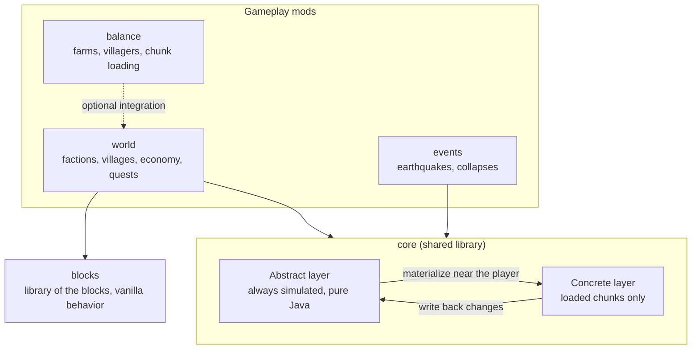
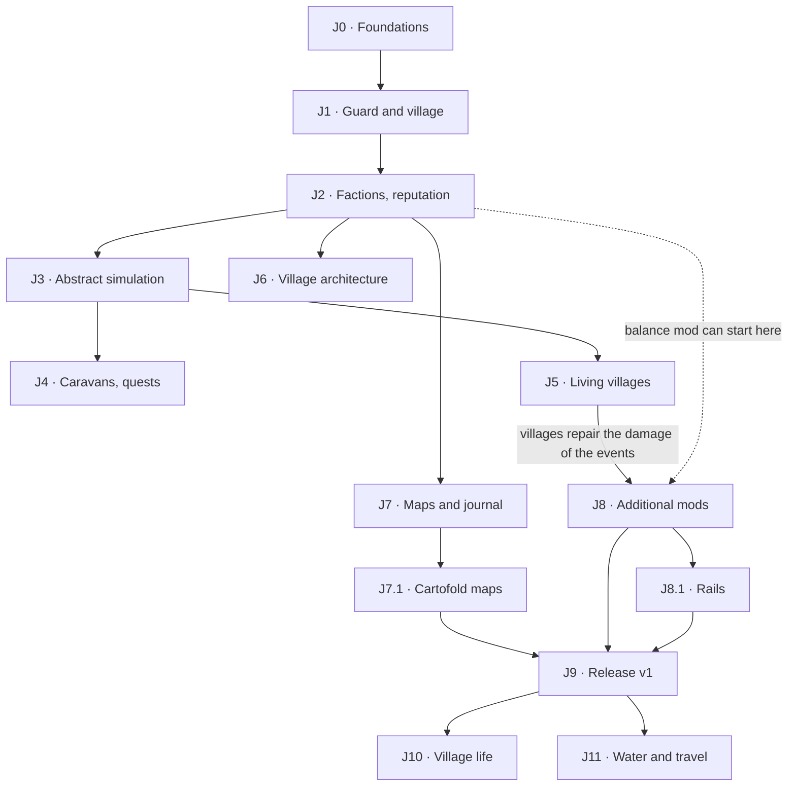

# Folkhold — Design document


## Vision and principles

Goal: a single-player Minecraft (NeoForge 1.21.1) where the world changes without the player. NPC factions trade, fight and take territory. Nature grows and ages. Natural events occur. There is less grind and fewer abusive automatic farms.

The project has a base modpack (existing mods) and three mods to develop:

- **World**: factions, villages, economy, quests.
- **Balance**: farms, villagers, chunk loading, trains.
- **Events**: earthquakes, collapses.

Design principles:

- **The world lives without the player.** The mod simulates all important state in an abstract form: the factions, the stocks and the territories. It also does this when the chunks are not loaded.
- **The player is one actor among others.** The player can influence the factions but cannot control them. No system needs the player to work.
- **Stable states, not infinite curves.** Prices, populations and budgets move toward an equilibrium. A disturbance creates a story. Then the system returns to equilibrium.
- **Less grind, not more farms.** Comfort comes from trade and NPCs, not from unlimited automation.
- **Everything is configurable.** Each rule has a setting (config or datapack). Balance changes do not need a new build.
- **Data-driven when stable.** Content (cultures, NPC recipes, structures, quests) starts in Java code. When a type of content is stable, it moves to JSON files in the mod jar, which a datapack can replace. Code and content stay separate.
- **Two languages.** All text that the player sees exists in English and French. Code uses translation keys only.

## Base modpack

The pack targets **NeoForge 1.21.1**. **packwiz** manages it: a versioned list in Git, updated with one command (`packwiz update --all`), exported as a `.mrpack` file. Prism Launcher and the Modrinth app import a `.mrpack` file in one click.

The pinned versions are in `modpack/mods/*.pw.toml`.

| Category | Mod | Modrinth slug | Pinned version | Note |
| --- | --- | --- | --- | --- |
| Performance | Sodium | `sodium` | 0.8.13 | Client only |
| Performance | Lithium | `lithium` | 0.15.4 | |
| Performance | ModernFix | `modernfix` | 5.27.26 | |
| Performance | FerriteCore | `ferrite-core` | 7.0.3 | |
| Performance | ImmediatelyFast | `immediatelyfast` | 1.6.14 | Client only |
| Performance | Entity Culling | `entityculling` | 1.11.3 | Client only |
| Performance | C2ME (NeoForge) | `c2me-neoforge` | 0.4.0-alpha.0.123 | Alpha. Chunk generation, I/O and loading on more CPU cores |
| Performance | ScalableLux | `scalablelux` | 0.3.0-alpha.0.8 | Alpha. Faster light engine |
| Performance | NoisiumForked | `noisiumforked` | 2.7.0 | Faster noise generation |
| Performance | Chunky | `chunky` | 1.4.23 | Pre-generation of the world before the play |
| Profiling | spark | `spark` | 1.10.124 | Measures the cost of each system for each tick |
| Nature | Dynamic Trees | `dynamictrees` | 1.7.2 | |
| Nature | Serene Seasons | `serene-seasons` | 10.1.0.9 | Requires GlitchCore |
| Nature | Smart Feeding Troughs | `smart-feeding-troughs` | 1.2.0 | Requires Dirigo |
| Terrain | The Roads More Travelled | `the-roads-more-travelled` | 0.5.1 | Beta |
| Aging | Immersive Weathering: Renewed | `immersive-weather-renewed` | 1.0.4 | Beta, unofficial port. Requires Moonlight Lib |
| Navigation | Small Ships | `small-ships` | 2.0.0-b2.1 | Beta |
| Navigation | Cartofold | `cartofold` | 0.43.6 | Required by `folkhold_world`. Minimap (the key Y shows or hides it), map of the explored world (key M), survey maps. The jar of its GitHub Release |
| Terrain | Tectonic | `tectonic` | 3.0.28 | Large continents, deep oceans, mountain ranges. Requires Lithostitched |
| Light | LambDynamicLights | `lambdynamiclights` | 4.8.11 | Client only |
| Time | Slumber | `slumbermod` | 1.0.0 | Pinned. MIT license. While all the players sleep, the server runs extra ticks of the levels in place of the night skip. Server side: the pack installs it on both sides, so that a single player world (integrated server) also has it. See "Sleep" below |
| Gameplay | Markethold | `markethold` | 0.2.1 | Balance of the trades of the villagers. The jar of its GitHub Release |
| Gameplay | Runehold | `runehold` | 0.2.1 | Balance of the enchantments and of the anvil. The jar of its GitHub Release |
| Gameplay | Railhold | `railhold` | 0.2.1 | Trains of linked minecarts, locomotives and storage minecarts. The jar of its GitHub Release |
| Library | GeckoLib | `geckolib` | 4.9.3 | Required by `folkhold_world` |
| Library | Confee | `confee` | 0.2.0 | Beta, pinned. Client only. Required by `folkhold_world` and `folkhold_events` on the client: the config screens of the client options. The jar of its GitHub Release |
| Comfort | JEI, Jade | `jei`, `jade` | 19.57.0.451, 15.10.6 | For development |
| Comfort | Inventory Tweaks: ReFoxed | `inventory-tweaks-refoxed` | 1.2.0 | Client only. The key R sorts the inventory under the cursor (default key of the pack). Refills a stack that runs out, and replaces a tool that breaks |
| Comfort | Default Options | `default-options` | 21.1.8 | Client only. Sets the default keys of the pack (`config/defaultoptions/keybindings.txt`), and keeps the keys that the player set. Requires Balm |

packwiz resolves most dependencies automatically (for example GlitchCore for Serene Seasons). Some mods do not declare a required library in their Modrinth metadata. Add these libraries explicitly:

- Immersive Weathering: Renewed requires Moonlight Lib.
- Smart Feeding Troughs requires Dirigo (1.3.0 or later, before 2.0.0).

**Sleep** (Slumber 1.0.0): the night does not jump to the morning. The game runs the ticks of the night: the furnaces smelt, the crops grow, the monsters move, and the villagers follow their daily schedule.

- When all the players that are not spectators sleep, Slumber sets the game rule `playersSleepingPercentage` to 101 (no vanilla night skip). Then, at the end of each server tick, it runs extra ticks of all the levels (`ServerLevel.tick`), until the morning. It sets the game rule back at the morning.
- The number of extra ticks in one server tick is `max(slumberTickMultiplier - 1, ceil(ticks to the morning / 40))`. Slumber has the 40 in its code: the night ends in about 40 server ticks. The game rule `slumberTickMultiplier` (default 20) is only a minimum. It applies only at the end of the night (the last `40 × (multiplier - 1)` ticks). It does not change the highest number of extra ticks.
- Measure: a GameTest server with Folkhold and Slumber, and a mock player in a bed at the time 13000. The night of 11,004 game ticks takes 142 server ticks, with 276 game ticks at most in one server tick. A furnace smelts 55 raw iron, as in 11,004 normal ticks.
- Cost: the total work of the night is the same as with no sleep: about 11,000 level ticks. A spark profile of the owner gives about 29 ms for a level tick. Thus the night takes about 11,000 × 29 ms = 5.3 minutes of real time (9.2 minutes with no sleep). With no limit, one server tick at the start of the night takes about 276 × 29 ms = 8 s. The server answers the players only between two server ticks. The watchdog of the server (`max-tick-time`, 60 s) stops the server when the server tick is too long. Folkhold limits the extra ticks (see below).
- Value of `slumberTickMultiplier`: keep the default (20). A lower value does not lower the number of extra ticks at the start of the night. This number comes from the 40 of the code. A lower value also makes the end of the night longer. A higher value makes the end of the night shorter. The Folkhold limit applies after the game rule.
- Limit (`folkhold_balance`, mixin `SlumberSimulatorMixin` into `Simulator.simulateWorld`): the balance mod gives fewer extra ticks in one server tick than Slumber asks for. The night ends in more server ticks, and each server tick stays short. The number of extra ticks is the smallest of these 3 values, and 1 at least:
  - the number of Slumber,
  - `maxExtraTicks` (default 20),
  - the budget `extraTickBudget` (default 50 ms), divided by the estimated time of one extra tick. The server options are in the section `sleep` of `folkhold_balance-server.toml`.
- `SleepTickLimiter` measures the time of the extra ticks of each server tick. The new estimate is the mean of the last estimate and the last measure. The first server tick of a sleep has no estimate and runs 1 extra tick. With 29 ms for a level tick, each server tick runs 1 extra tick. Then a server tick takes about 60 ms, and the night takes about 5.3 minutes. With fast level ticks (2.5 ms or less), the night goes 21 times faster at most.
- Clock of the night (`NightClock`, option `nightSeconds`, default 40 s, 0 = off). The CPU work of the simulated night does not change with the limit. With 29 ms for a level tick, the 11,000 ticks of a night need about 5.3 minutes of real time. More extra ticks in each server tick do not change this time. The extra ticks can fail to end the night in `nightSeconds`. In this case, the day time jumps by the missing ticks in each server tick, in small steps, as the vanilla night skip. The jumped ticks are not simulated: the furnaces and the crops get only the simulated ticks.
  - The clock measures the real time of each server tick of the sleep (the mean of the last estimate and the last measure). It calculates the server ticks that are left before the target, and the game ticks to advance in each of them. The jump is this number less the simulated ticks of the server tick (the normal tick and the extra ticks), 0 at least.
  - The jump stops before the morning. The extra ticks of the server tick end at the morning or before it, so Slumber sees the morning. The first server tick of a sleep has no jump. The jump needs the game rule `doDaylightCycle`.
  - A fast world simulates the whole night with no jump when the extra ticks end the night before the target.
- Measure of the clock: a GameTest server with Folkhold and Slumber 1.0.0, and a mock player in a bed at the time 13000. Each tick of the overworld has a load of 29 ms. The load is a busy wait in the tick of an entity, so that the extra ticks of Slumber also have it. Temporary local GameTest, not in the repository.
  - No clock: 5,500 server ticks, 2 game ticks at most in one server tick, 329 s for the night.
  - `nightSeconds = 40` (default): 651 server ticks, 2 game ticks at most in one server tick, 40.1 s for the night. 1,302 of the 11,000 ticks are simulated (12 %), the rest is the jump. The longest server tick takes 304 ms (1 server tick over 100 ms).
  - `nightSeconds = 30`: 485 server ticks, 30.2 s for the night, 970 simulated ticks.
  - One budget also uses the time left in the server tick (50 ms less the normal tick). This budget gives 3 game ticks in one server tick. A server tick takes about 89 ms. But the night still takes 328 s: the work of the night is the same. The limit keeps the fixed budget.
- Slumber is optional. With no Slumber in the mod list, the mixin plugin `BalanceMixinPlugin` skips the mixin. Thus the log has no warning about a missing class. The mixin is also `@Pseudo`. Its injectors have `require = 0`: a different version of Slumber does not stop the game. But then Slumber runs with no limit. In this case, the balance mod writes a warning to the log at the first server tick with extra ticks (`SleepTicks.onServerTick`).
- Measure of the limit: GameTest server with Folkhold and Slumber 1.0.0, flat world with level ticks of less than 1 ms. A mock player sleeps in a bed at the time 13000. With no limit (`maxExtraTicks` and `extraTickBudget` at 1000), the night takes 146 server ticks. One server tick has 263 game ticks at most. With the defaults, the night takes 532 server ticks. One server tick has 21 game ticks at most: 20 extra ticks and the normal tick. In this world, the real time of a server tick is not a valid measure. The level ticks are too fast, and other processes run on the machine. The time of a server tick in a real world needs a measure on a real server.
- The handlers of the server tick and the level tick of Folkhold run one time for each server tick. They do not run for each extra tick (see "General architecture", "Fast ticks").

Maintenance rules:

- Each update goes through a Git branch, a test start of the game and a test world before the merge.
- Pin the beta and unofficial mods (`packwiz pin`). This prevents a silent update that breaks the pack.
- During development, add our own mods to the pack as local files. If we publish them, add them through Modrinth.

## General architecture

The three mods use a shared library, `core`. The library separates two layers:

- The **abstract layer** always runs. It decides what happens (wars, stocks, travel).
- The **concrete layer** runs only in loaded chunks. It shows the result near the player. Then it writes the changes back to the abstract layer (deaths, raids, sales).



The balance mod has no dependency on `core` and stays usable alone. When the world mod is present, the balance mod uses it through an optional interface (for example to read village stocks).

**Configuration.** Each mod has two kinds of options:

- **Server options** (`ModConfigSpec` of NeoForge, type SERVER): the rules of the game. The file is `serverconfig/<mod id>-server.toml` of the world, and the server sends the values to the clients. The NeoForge config screen edits them only in a single player world that is not open to LAN. On a dedicated server, the operator edits the file.
- **Client options** (Confee API, scope CLIENT): the display options of each player. `folkhold_world` has `showTerritoryHud` and `showQuestHud` (both on by default). `folkhold_events` has `cameraShake` (0 to 1, default 1). The file is `config/<mod id>-client.toml`. Each option has a label and a tooltip in English and in French (keys `config.<mod id>.client.<option>` and `<key>.tooltip`).

The button "Config" of `folkhold_world` and `folkhold_events` in the mod list opens the Confee screen of the client options. The button "Server options" of this screen opens the NeoForge screen of the server options (`ServerConfigScreen` of `core`). Confee 0.2.0 has no server options and no sync from the server to the clients: thus the server options stay on `ModConfigSpec`. `folkhold_balance` has only server options and keeps the NeoForge screen. The button "Config" of `folkhold_core` opens the "What's new" screen.

The concrete layer reads the blocks only in chunks that are ready: loaded and complete (`ReadyChunks`). On the server, `Level.isLoaded` is also true for a chunk that has a ticket and a generation that is not complete. A read in such a chunk stops the server thread until the generation is complete. For example, the village heart does its work only when all the chunks of its scan area (the area of the village structure) are ready.

**Fast ticks.** The game time can advance by more than one tick in one server tick. Slumber runs extra ticks of the levels while the players sleep (see "Base modpack", "Sleep"). These extra ticks run the entities, the block entities, the random ticks and the vanilla raids. They do not fire the events `ServerTickEvent` and `LevelTickEvent`. Rules for the code of the mods:

- A periodic check of a handler of the server tick uses `IntervalCheck` (`core`). The check is due when the game time is one interval or more after its last run. A test `gameTime % interval == 0` skips most of the checks during a fast night. These checks use `IntervalCheck`: the escorts, the materialization of the groups, the discovery of the settlements and the detachments of the vanilla villages.
- The code of an entity or of a block entity (for example the village heart) runs at each tick, also at each extra tick.
- The abstract simulation (`SimulationTicker`) starts one abstract tick at most in one server tick. It starts it when the game time reaches the time of the next abstract tick. The next abstract tick comes one interval (2,400 game ticks) after the start of the abstract tick. In a fast night, each abstract tick can start up to `maxExtraTicks` game ticks (default 20) after its time. With no Folkhold limit, this delay is up to 275 game ticks, and a night can have one abstract tick less than with no sleep.

The blocks of all the mods are in the library `blocks` (mod `folkhold_blocks`). It has no dependency, except Minecraft and NeoForge. A block of the library has its definition: shape, block states, placement of the parts, light, model, item, loot table, tags and names. It also has the behavior that a player expects from a similar vanilla block, with no other Folkhold mod. For example, a player lights and puts out a brazier as a campfire. The library has no game logic. The other mods add the features of a block: block entity, click, scheduled tick, and actions when the block goes into the level or away. A mod registers one `BlockFeature` for a block (`BlockFeatures.register`). For example, the world mod gives the village heart its block entity, its screen and the destruction of the village. The ids `folkhold_world:<block>` of the blocks of the library resolve to the blocks of the library (registry aliases).

## World mod: factions, diplomacy, territories

When a new world starts, the mod creates 5 to 7 factions (`FactionGenerator.Settings.DEFAULT`):

- 1 or 2 factions that are allies of the player.
- 1 neutral faction.
- The other factions are hostile.

The villages come from the vanilla structure placement (random spread, spacing 40 chunks, separation 16). A village does not start when a possible vanilla village start is 12 chunks or nearer on the two axes (exclusion zone). The spacing in numbers:
- Reach of a village from its middle:
  - A city is the largest natural village: the start level is 16 at most. A city goes about 116 blocks. The parts are radius 106, wall margin 4, palisade and gate row 2, and flat terrain of 6 blocks in front of a gate.
  - A maritime city goes about 126 blocks: a port of 15 rows in front of a water gate.
  - A vanilla village goes about 80 blocks.
- The rules give distances between start chunks, not between the middles. The plaza of a village starts at the corner of its start chunk with a random rotation. Thus 2 middles can be about 15 blocks nearer than their start chunks.
- Two faction villages of 2 adjacent placement regions (spacing 40, separation 16): 17 chunks (272 blocks) at least on one axis. Thus about 257 blocks are between the middles. Two maritime cities need about 248 blocks: the margin is about 9 blocks.
- A faction village and a vanilla village: the exclusion zone keeps 13 chunks (208 blocks) at least on one axis. Thus about 193 blocks are between the middles. A city and a vanilla village need about 196 to 204 blocks: the margin is about zero. An overlap needs a city at the minimum distance with the 2 villages turned to each other: this is rare, but possible.

A village belongs to the faction with the nearest territory center, so the number of villages of a faction depends on the world.

### Glossary

| Term | Meaning |
| --- | --- |
| Territory | Disc of chunks around a village. The chunk is the unit of territory ownership (world mod). |
| Spawn cell | Square of 4×4 chunks. Unit of the spawn budget (balance mod). |
| Abstract tick | One step of the abstract simulation: every 2,400 game ticks (2 minutes). |
| Cycle | One game day (24,000 ticks = 10 abstract ticks). The jobs consume their inputs and produce their outputs once each cycle. |
| Level | Integer value (1 to 20) that measures the growth of a settlement. It sets the traits of the settlement. |
| Tier | Name for a range of levels: Hamlet, Village, Town, City, Capital. |
| Job | Economic activity of a settlement. A job has one recipe for each cycle. |
| Bank | Building of a village. Its chests contain the stocks of the village and a part of the treasury. |
| Mobile group | Group of NPCs that travels between villages: a caravan or a traveling merchant. |
| Route | List of points between two villages. A mobile group follows it. |
| Materialization | Creation of the entities of an abstract state near a player. The opposite operation removes the entities and writes their state back. |
| Quest board | Block in each faction village. It shows the quests of the village. |
| Ambush | Group of pillagers that attacks an escorted caravan at a point of its route. |
| Pillager camp | Pillager site of the world (a vanilla pillager outpost by default) with a disc of territory around it. |
| Pillager patrol | Mobile group of a pillager camp that walks a loop in the territory of the camp. Near a player, it becomes vanilla pillagers that walk to the player. |

### Data model

| Entity | Main fields |
| --- | --- |
| `Faction` | id, name, culture (village style, units), color and banner, treasury, military power, base attitude to the player, traits (expansionist, merchant, isolationist) |
| `Relation` | pair of factions, value from -100 to +100, state (alliance, peace, tension, war), date of the last change |
| `Territory` | claimed chunks (a disc around the village), owner village and faction, current contest |
| `Settlement` | id, faction, position, state (active or ruins), level, experience, tier (from the level), population, jobs, stocks, garrison |
| `MobileGroup` | id, kind (caravan, traveling merchant), faction, origin, destination, route, progress, cargo, members (stable UUID, role, health), state |
| `Quest` | id, kind (delivery, escort), giver, player, success condition, deadline, reward, state |

The mod stores all of this in `SavedData` of the Overworld level: settlements, mobile groups, quests, factions, reputations. The code writes the NBT by hand, with a version number.

### Simulation rules (abstract tick every 2,400 ticks = 2 minutes)

**Phase 1: living territories, no wars between NPCs.** Territories change mostly because of the player and because of the growth of the villages. The only military content is the defense of the villages and the pillager patrols (see "Pillager faction"). The factions have no patrols, and there are no bandits and no armies.

**Implemented**:

- **Claim**: each village claims a disc of chunks around its position (its heart when the village exists). A chunk is in the disc when the distance from the position to the center of the chunk is not more than the claim radius. The claim radius comes from the level of the village (`claim_radius` in `levels.json`). It is 9 chunks (144 blocks) for a hamlet, 27 chunks for a city, 33 chunks for a capital. The radius has two lower limits:
  - The minimum territory radius of the tier of the level (`min_territory_radius` in the village sizes). This radius contains the village structure of the tier.
  - The radius that contains all the blocks at 1.5 times the village radius (server configuration).

  Thus the territory contains all of the village and a margin. A chunk that two villages claim belongs to the nearest village. At equal distance, the village with the higher level gets the chunk.
- **Unclaimed land**: a chunk that no village claims. A chunk of unclaimed land near a pillager camp can be a pillager territory (see "Pillager faction").
- **Destruction of a village**: kill the captain and destroy the village heart (the central banner). The village becomes ruins. Its territory becomes unclaimed. The ruins stay in the world.

The faction of a new village comes from the regions of the cultures (`CultureRegions`, `CultureMap`). The world has a grid of square regions of 2048 blocks. The seed and the biome at the middle of a region select the culture of the region. A culture has a weight of 8 in its biomes of affinity (the tag `#folkhold_world:culture/<id>`). It has a weight of 1 in the other biomes. Valeholm is frequent in the cold and frozen biomes, Ashmark in the temperate biomes, and Sunreach in the hot biomes. A village belongs to the nearest faction of the culture of its region: the faction with the nearest territory center.

- **Trade**: each trade between two villages creates a caravan. The goods arrive with the caravan (see "Trade between villages").
- **Relations**: each caravan that arrives raises the relation between the two factions a little.
- **Abstract caravans**: a caravan with no player near has no risk. It always arrives.

**Planned**:

- **Help a faction grow**: colonization quests (escort settlers, deliver materials) found a hamlet of this faction in unclaimed land.
- **Rally a village**: with sufficient reputation and a quest, a village can change its banner and join a different faction.
- **Natural growth**: a prosperous faction slowly founds a hamlet in unclaimed land near its territory (maximum one each game week).
- **Diplomacy**: relations change with trade and incidents. Relations decide which factions trade together.
- **Decline**: a faction with no village disappears. Its ruins stay in the world.

**Phase 2 (later)**: wars between factions, sieges, patrols, bandits, armies and NPC-against-NPC conquests, on the same simulation.

### Cultures

A culture is a template for factions. It has a name, colors, a banner and name syllables (for faction and village names). It also has the pitch of the voices of its units and biomes of affinity. A village name is one prefix and one suffix of the syllables of its culture (`VillageNames`). Each culture has about 48 prefixes and 48 suffixes (about 2,350 names), with its own sounds: northern for Valeholm, harsh for Ashmark, bright for Sunreach. No syllable is in 2 cultures. Two settlements can have the same name. In a sample of 500 settlements, about 7 % of them share their name with another one (`CultureNamesTest`). A settlement saves its name: a change of the syllables does not change the names of the existing settlements. The style of the villages is the visual aspect of the culture. A culture has several factions, and the factions of a culture can be allies or enemies. **Implemented**: the cultures are Java definitions (`Cultures`). **Planned**: each culture moves to a JSON file in the mod (`data/folkhold_world/folkhold/cultures/<id>.json`), and a new culture then needs no code.

The factions of a world are not static content. The mod creates them when the world starts, from the cultures, and saves them in the world.

All cultures are human. **Planned**: non-human cultures (illagers, piglins).

### Pillager faction

**Implemented** (`PillagerFaction`, `PillagerTerritories`, `PillagerPatrols`, `PillagerPatrolGroups`, `PillagerData`): the pillagers are a faction with a territory, patrols and a negative reputation. They have no villages.

- **Faction**: one fixed faction with the id `pillagers`. The faction generator does not make it, and it is not in the generated factions. Thus no settlement belongs to it: the faction has no quest board, no quests, no traders and no caravans. Its name is in the language files ("Pillagers", "Pillards"), and its color is a fixed grey.
- **Camps**: a pillager camp is a structure start of the structure tag `#folkhold_world:pillager_sites`. The tag contains the vanilla pillager outpost, and a data pack can add other pillager sites. When a chunk of the Overworld loads with such a start, the mod records the camp. It records the center of the box of the structure and the radius of its territory (`territoryRadius`, default 6 chunks). The world data keeps the camps (`folkhold_pillagers.dat`). This camp takes the place of a camp of the discovery with the same start chunk.
- **Discovery of the camps** (`PillagerDiscovery`): the mod finds the camps before the game generates their chunks, as the settlement discovery finds the faction villages. The camps come from the structure sets of the chunk generator with a random spread placement and a structure of the tag. For the vanilla outposts: spacing 32, separation 8, frequency 0.2, and an exclusion zone near the villages. Every 5 seconds, the placement regions in `discoveryRadius` around each player go into a queue. For the candidate chunk of a region, the discovery applies the rules of the placement. Then a worker thread calculates if the structure can start there (`StartCheck`), as for the settlement discovery. The server thread puts the result in the structure check of the level and asks the structure manager. The discovery does not generate chunks. A discovered camp has its center at the middle of its start chunk, at the sea level, until its start chunk loads. The world data keeps the checked regions.
- **Territory**: a chunk is in the territory of a camp with two conditions. The center of the chunk is in the disc of the camp, and no settlement claims the chunk. The claims of the settlements always win. When two discs contain a chunk, the nearest camp gets it.
- **Reputation**: each player has one reputation with the pillagers, in the range of the other factions. The start value is -400 (Hostile). The value never goes up: a positive change has no effect, so the tier is always Hostile or Sworn enemy. The value does not spread to other factions, and the actions with other factions do not change it. A player who kills an illager in a pillager territory loses 10 reputation (`killReputation`).
- **Patrols**: each second, the server checks the players of the Overworld (not the spectators). A player who stays in a pillager territory for 30 seconds (`patrolDelaySeconds`) gets a patrol from the camp. The next patrol for this player comes after 5 minutes (`patrolCooldownSeconds`). The player gets 3 pillagers when Hostile (`patrolSize`, 0 turns off the patrols), and 2 more when Sworn enemy (`swornEnemyExtra`).
  - The patrol is the abstract patrol of the camp that is the nearest to the player. This patrol must travel and have no entities (see "Abstract patrols"). When the camp has no such patrol, the patrol leaves at the next check. No other pillagers spawn for the player. Thus a camp sends at most `patrolsPerCamp` patrols at the same time.
  - The patrol gets its entities 32 blocks from the player in the direction of the camp (`spawnDistance`). When the player is nearer to the camp, the patrol gets its entities at the camp. The position is on the surface, in a loaded chunk, and not in a fluid. When no position is good, the patrol leaves at the next check.
  - The members are vanilla pillagers, with the UUID and the health of their member. The first member is a patrol leader with the ominous banner. The members walk to the player with the vanilla patrol goal. While the player is in the territory, the members get the new position of the player at each check. The vanilla AI attacks the player at a short distance. The clocks of the patrols are in memory: a server restart starts them again.
- **Abstract patrols** (`PillagerPatrolGroups`, `PatrolRoutes`): each camp has 2 abstract patrols (`patrolsPerCamp`, 0 to 4). They are mobile groups of the kind `pillager_patrol`, and they move also with no player near.
  - A patrol has `patrolSize` plus `swornEnemyExtra` members. With `patrolSize` at 0, the camps have no patrols. The loss of one member does not stop the patrol.
  - The route is a loop around the camp. Its points are on a circle at 60 % of the radius of the territory, 12 blocks or less apart. A point must be in a chunk of the territory of the camp that no settlement claims. When all points are good, the loop is the full circle. Else the patrol walks the longest run of good points, there and back. A camp with fewer than 2 good points in a run has no patrols.
  - The patrols of a camp start at equal distances on the loop. On each abstract tick, a patrol moves `blocksPerTick` blocks (section `groups`). At the end of the loop, the patrol gets the loop again from the claims of this time and starts it again. A patrol never arrives.
  - When its camp goes away, or when the loop of its camp has no good chunk, the patrol goes away.
  - The world data keeps the patrols with the camps (`folkhold_pillagers.dat`). The patrols are not in the registry of the caravans. They do not count in `maxGroups`, and the simulation of the caravans does not move them.
  - Entities (`PatrolEntities`): a patrol gets entities when its camp sends it to a player (see "Patrols"). The living members that the player does not get stay abstract. While a patrol has entities, the abstract simulation does not move it. Each second, the health of the entities sets the health of the members. The position of the first living entity sets the progress on the loop. A member with no target and no player to follow walks on the loop, 16 blocks ahead of the progress.
  - The entities can be farther than `materializeDistance` plus `dematerializeMargin` blocks from all the players (section `groups`, 112 + 32 blocks). In this case, the entities go away and the patrol is abstract again, with the health of its members. This also occurs when the chunk of an entity unloads, and when the server stops. An entity of a patrol that loads from a chunk while its patrol has no entities does not join the level.
  - A dead entity records the death of its member. When all members are dead, the patrol waits at the start of its loop for 20 minutes of game time (`patrolRespawnMinutes`). Then it gets new members at full health.
- **Encounters with the caravans** (`PatrolEncounters`, `PatrolFight`): a caravan that travels in a territory meets a patrol of the camp. The patrol of the camp that is the nearest to the caravan comes, if it travels, has no entities and has a living member. A caravan meets the patrols of a camp one time in 10 minutes of game time (`encounterCooldownMinutes`). The option `caravanEncounters` (default true) turns on the encounters.
  - A caravan with no entities: the server checks it on each abstract tick, after the patrols move. It checks the route that the caravan travelled since the last check. It checks one point each 16 blocks. An encounter is an abstract fight with the health of the fighters.
  - The strength of a fighter is its health multiplied by its attack damage. A guard of the caravan uses `unit.guard.attackDamage`. A pillager uses 2.5 (`encounterDamage`). The side with the higher strength wins. The caravan wins when the strengths are equal.
  - All fighters of the side that loses die. The side that wins loses a share of its fighters, rounded down. This share is the square of the ratio of the strength of the loser to the strength of the winner. The fighters that die are the weakest. The other fighters keep their health.
  - A caravan that loses keeps half of each item of its cargo and half of its payment, and continues. The lost share is `encounterCargoLoss` (0.5). A caravan with no living guard is lost: its merchant dies. A beaten patrol waits at the start of its loop with new members, as after a real fight.
  - Examples with the start values: a guard has 30 health and 3 damage, a pillager has 24 health and 2.5 damage. 4 guards (360) beat a patrol of 5 pillagers (300), and 2 guards die. A patrol of 5 beats 3 guards (270), and 4 pillagers die. A patrol of 5 beats 2 guards (180), and 1 pillager dies.
  - A caravan with entities: each second, the server checks the position of its merchant. The patrol gets all its living members as entities near the point 24 blocks ahead of the merchant on the route. The position is a position that the merchant can reach (see "Spawn position of an attack" in the escorts). They attack the merchant. The result is the result of the real fight (see "Entities"). With no good position, the patrol does not come, and the server tries again after 5 seconds.
  - An escort ambush at a point in a territory: the patrol of the camp attacks in place of the ambush. When the caravan met the patrols of this camp in the cooldown, the point has no ambush, so the escorted caravan gets no double attack. When the camp has no free patrol, the ambush of the escort occurs. Then the caravan counts as met by the camp.
  - The progress of the last check and the encounters of each caravan are in memory. After a restart, the check of a caravan starts at its position of this time, and the cooldowns start again. The world data does not change.
- **Raids**: the leader of a patrol carries the ominous banner. A player who kills it gets the vanilla Bad Omen. The omen starts a raid at the next village that the player enters, also at a faction village (see "Raids against the faction villages").
- **Information for the player**: when a player enters a pillager territory, the banner of the HUD shows two items. These are "Lands of the Pillagers" and the tier of the player. The territory HUD shows the faction and the tier, with no village of the faction. A pillager territory that the player entered shows on the maps (see "Maps and journal"). Then the legend of the map of the journal also has the pillager faction, in its color. The admin map shows the territories of all the camps of the world.
- **Entry points**: `PillagerPatrols.send` spawns a patrol at a position and sends it to a target. `PillagerTerritories.campAt` and `PillagerTerritories.nearestCamp` find the camp of a position. Another system can use them, for example an ambush on the route of an escort.
- The numbers are in the section `pillagers` of the server config (`folkhold_world-server.toml`).

## World mod: villages, NPCs, defense

Each faction village has fortifications and guards. A player in iron armor with no enchantments must lose a frontal attack. The player needs enchanted diamond gear, allies or a trick.

### Villages

- Generated as structures of the type `folkhold_world:fortified_village` (`FortifiedVillageStructure`), one set of pools for each culture:
  - The plaza is the start piece: the village heart, the braziers, the alarm bell, the quest board and the sign of the hall. It goes on the terrain with a random rotation, as the start piece of a vanilla village. The start level of the village gives its tier and its size (see "Village sizes" and "Village plan" in "Village growth"). The structure places the street pieces and the buildings of the plan of this tier (`VillagePlanPieces`). The plan turns with the plaza: its north is the side of the street of the bank in the plaza template. A street goes out of each side of the plaza and continues with segments, crossroads and side streets. Each segment and each crossroad has plots for houses on its sides, and each open end of a street has a short end. The streets go on the terrain, and the arms of the wall (below) give them their levels. On water, the blocks of a path change to planks (processor list `village/street`): spruce planks, or the planks of the biome variant. The street to the north of the plan has the plot of the bank. The builders build homes on the free plots (see "Village growth").
  - The buildings and the job posts of the start level (`PlotUses`, `VillagePlanPieces`). The generation gives the village the buildings and the job posts of its start level. Thus a new village needs no growth step for them. The scan of the heart finds their building signs and their job signs (see "Village growth").
    - The bank: the plot of the bank on the street to the north of the plan (pool `bank`).
    - The buildings of the level (data file `folkhold/village_buildings.json`, see "Buildings of the level" and "Market" in "Village growth"). A storehouse comes from the level 3, and the market from the level 5. A barracks and a second storehouse come from the level 9, and a second barracks from the level 17. The market is the piece of the pool `market` of the variant. The other buildings are a piece of the pool `houses` with the building sign of the kind and no job sign. A piece that fits the home of the style comes first, then a piece with another name than `house_<kind>`. Thus the maritime storehouse is the smokehouse. A building that fits the home of the style takes the first free home plot of the plan that is not wide. The plan gives the plots nearest to the middle first. A larger building takes a wide plot of its wide home. The market of the base, Sunreach and maritime styles takes the wide plot of the market. The Sunreach storehouses and barracks (13 × 13 blocks) take the plots of the courtyard houses. The plan of the level has one wide plot for each building that needs it, and at least the count of the style. For example, a Sunreach village of the level 17 or more has 4 courtyard plots. Under the level 5, the wide plot of the market stays free.
    - The job posts: one house-workshop for each job slot of the start level (`job_slots`). Only the jobs that the level and the biome at the middle of the plaza allow get a post (`Economies.eligibleJobs`: minimum level and biome). Each job gets one post at most. The biome of the posts is the biome at the middle of the plaza. The biome of the settlement is the biome at the heart. Near the edge of a biome, a post can get a job that is not valid in the biome of the settlement. Then the heart gives it a new job (see "Job posts"). The job of each post comes from `JobAssignment.next` with the jobs of the earlier posts, as the growth chooses the job of a new post. The first post has a job that trades (each job of the job files trades). The next posts follow the weights of the jobs, with the multiplier of the culture of the region. The weights use the culture of the region of the culture map, not the culture of the faction of the settlement. The generation reads no saved data, and only the weights change. The seed is the seed of the village (the world seed and the start chunk): the same village gets the same jobs. The piece is a home of the pool `houses` with the job sign of the job. For the fisher, this home is the fishing hut of the maritime villages. Else the piece is `job_<id>` of the pool `jobs` of the variant. A job with no piece that fits the plot gives its place to the next job, 3 jobs at most. A village with 2 posts or more does not get one job only. When the earlier posts have one job, the last post takes another job. A fishing hut on a home plot does not take the last post. This other job comes from the other eligible jobs, with the same rules. Thus a maritime hamlet has a post that is not a fisher.
    - The plots of the posts: the street to the south of the plan (piece `street`, pool `streets_first`) has the plots of the first posts. Its west plot near the plaza has the first post, and its east plot has the second post. A Valeholm street also has a plot for the third post, on its west side far from the plaza. The next posts take the free home plots that are not wide, nearest to the middle first.
    - The homes: each other plot gets a piece of the pool `houses` that fits the plot, with the weights of the pool. Some pieces have a building sign of a kind of the buildings of the levels (storehouse, barracks, market). Such a piece comes only from the buildings of the level, not as a home. The sign of the fish market has no market post. Thus the scan does not count it as a market, and the fish market can be a home plot. A piece with a job sign (the fishing hut) is a job post. It comes only while the village has fewer posts than its posts of the level, with a job that the level and the biome allow. A piece with no bed (the forge, the fish market) gives no places. Each home plot has a least number of beds (`PlotUses.leastBeds`). The calculation starts with the home beds of the maximum population of the level (the maximum population minus the places of the hall). It subtracts the beds of the placed pieces. It also subtracts the beds of the other free home plots with the largest home of the pool. A piece with fewer beds (the forge, a fishing hut of 2 beds) comes only when the home plots that stay give the beds. When no piece with these beds fits the plot, a piece with fewer beds and 1 bed or more comes, the most beds first. Then the plot has a building, but the village does not get the home beds that it needs. The layout gives a problem (`home beds <beds> of <need>`) when the placed pieces have fewer home beds than the village needs. When no home of the pool has beds, each home of the pool can come. The job posts get their plots first, in the order of the posts, then the bank and the buildings of the level, then the homes. The spare plots stay free.
    - Each plot gets the first piece of a shuffled list that fits the area of the plot in the plan.
    - Plot terrain (`PlotTerrain`, `PlotTerrains`): the plan tests the terrain of each plot before the generation of the chunks. The terrain cache of the layout gives the column of the terrain from the noise (see "Terrain heights at generation"). It gives a column at each point of a grid of 4 blocks in the area of the plot. A plot is bad when a point has lava at the surface. This is rare. The lava of the noise is in the aquifers under Y -54. The lava pools are features that the noise does not show. A plot is also bad when the water of a point is deeper than 5 blocks (the deepest shallow water of the site check). A plot is also bad when the surfaces of 2 points have a difference of more than 8 blocks. A bad plot becomes a spare plot: the plan takes the next good plots, in the maximum radius. The good plots in the radius can give fewer homes than the village needs (a maritime capital on a coast). Then the missing homes take the nearest bad plots over deep water with no lava and no steep slope, on their foundation (`PlotTerrain.onFoundation`). A plot with lava or a steep slope never gets a home. The plots of the bank and of the first jobs keep their building on bad terrain. The noise does not show the ravines, the lava lakes and the lava pools: the carvers and the features make them after the structures. A building over them, or on bad terrain, stands on its foundation: the foundation of the template fills the space under it.
    - Each street piece is the element of its pool with the length of the piece in the plan. The pools are `streets_bank` for the first piece of the street to the north, and `streets_first` for the first piece of the other axis streets. A segment (`street_next`) or a crossroad (`street_cross`) comes from `streets_next`. The start of a side street comes from `streets_side`, and a street end from `street_ends`. A plot that is not wide gets a piece that fits the home of the style. A wide plot gets a piece that fits its wide home and not the home of the style. The plot connectors of a street piece that are not plots of the plan stay free, and the wall does not keep their space. The style of the plan comes from the folder of the pool of the homes of the variant (`FortifiedVillageStructure.styleOf`). The style is `maritime`, `sunreach` or `valeholm`, else the style of all the cultures.
    - A house-workshop has 2 beds and a cottage 3 beds. The barracks, the storehouses and the market give no places.
    - The houses of the pool `houses` have no job sign, except the fishing hut of the maritime villages. The fishing hut is a home with the job sign of the fisher.
    - In each home of the pools `homes` and `houses`, a villager can walk from the front to each work block and to each bed. Each work block has a free floor block next to it. The head of each bed has a free floor block next to it at the level of the bed. This block is on one of the 3 sides that are not the side of the foot. The vanilla behavior `SleepInBed` starts at 2 blocks or less from the head. The structure script checks this rule for each bed of each piece of each variant (`check_bed_heads`), and stops when a bed does not obey it. Each bed stands against a wall: a wall block touches its head, or wall blocks touch its 2 parts on the same long side. The script moves a bed that does not stand against a wall to the nearest free position against a wall on its floor (`wall_beds`). After the move, a walk from the front still reaches each bed and each work block. The new storey of a home puts its beds against a wall first (`place_beds`). The script stops when a bed does not stand against a wall (`check_bed_walls`).
  - Then the structure adds a closed wall (`WallLayout`, `VillageWall`). The wall goes around all the pieces of the core and around the space of each free plot of the core. The core is the plaza and the plan inside the first wall. The plan inside the first wall is all the plan of a hamlet and of a village. For a town, a city or a capital, it is the core plots (see "Bands of the rings" below). The outline is a free outline around them, with a margin of 4 blocks (`wall.margin`). The palisade has no gap (see "Free outline of the first wall" below). On flat ground, the outline is the rectangle around them. The towers come from the garrison (see "Towers of the wall" below). A gate is on each of the 4 axes of the plaza, except on a cliff (see "The cliff side" below). The gate is on the first edge of its side that the axis meets. An arm of the village goes from a gate to the plaza through the streets on its axis. A gate off the axis of its street gives an arm off this axis. Such a gate is near a corner of its edge, or moves away from a cliff. The arm stops at the first row with a piece that is not a street in its path or its edges. The middle of the row is not the only block that counts. Thus the arm does not go on the plots along its street (`VillageOverlapGameTests`). This rule applies from the plan version 4 (`PlanVersion.ARM_WIDTH`). A world of an earlier version keeps the stop on the middle only. Each arm is a ramp from the level of the gate to the level of the plaza (`PathRamp`). The level of the ramp changes by 1 block at most from a row to the next one. The rows on the flat terrain behind the gate stay at the level of the gate. Between the gate and the plaza, the ramp stays near the terrain. A gate higher or lower than the range of its arm moves to the nearest level in this range. Its flat terrain clears the terrain above it. The ramp has the width of a street: 3 blocks of path in the middle, and an edge of terrain on each side. The edge has the surface block of the terrain (grass, sand). The ramp cuts through the high terrain up to the surface (the ores and the lights of the old street included). Dirt fills the holes under the ramp and shallow water (less than 3 blocks deep). A house on a plot of an arm moves to the level of the ramp at its plot. Thus its door stays at the level of the street. Street stairs (`StreetSteps`, `VillagePathPiece`, `StreetStepsPiece`): 2 rows of a street side by side can have a difference of 1 block. Then the 3 blocks of path of the lower row get a stair one block above them, facing the higher row. Thus a villager, a unit, a horse or a player walks up and down the street with no jump. A row gets one stair at most. A row lower than the rows on its 2 sides gets the stair that faces the row before it. A step of 2 blocks or more gets no stair. The ramps of the arms have steps of 1 block, and the plan avoids the steeper slopes (see "Ground of the plan" in "Village growth"). An arm and a path across a band put their stairs from their levels. Each street piece of the plan gets a piece with no template (`StreetStepsPiece`, after the paths of the gates). At the generation, this piece reads the ground of each row of the street, and puts the stairs on the blocks of path. The ground is the first block with a collision shape, with no leaves, no logs, no stairs and no street lights. A row on a path from a gate gets no stair from this piece. The box of this piece goes 16 blocks under the lowest row of the street. The piece has no terrain adaptation: it does not change the shape of the terrain. The stair is the stone of the style (`wall.street_stairs`, written by the structure script). The stairs are cobblestone stairs for the style of all the cultures, mossy cobblestone stairs for Valeholm and sandstone stairs for Sunreach. The maritime villages have stone brick stairs. The desert variants have sandstone stairs and the swamp variants mud brick stairs. The road tag (`folkhold_world:road`) has these stairs: the road network of the caravans counts them. The repairs record a stair of a street as its surface block (`StreetBlocks.isStreetBlock`), and fill a broken stair with the same stair. The paths of an earlier save have no stair block in their data and get no stairs. A village that exists keeps its saved pieces: only a new village gets the stairs.
  - Free outline of the first wall (`WallOutline`, `WallLayout.free`): the outline is a closed orthogonal polygon, clockwise. Its edges go along X or along Z. The first edge faces north and starts at the north-west corner of the top row. A rectangle has 4 edges: the north, east, south and west sides.
    - The outline starts from the rectangle around the pieces of the core and the spaces of the free plots, with the margin. The rectangle goes into cells of 4 blocks. The last column and the last row of cells take the blocks that stay: 4 to 7 blocks.
    - A cell that touches a piece or a free plot with the margin stays in the outline. The outline also keeps a passage of 17 blocks on each side of each axis of the plaza (`WallLayout.GATE_PASSAGE`). The passage goes from the plaza to the last piece on the axis. A gate on its axis, with its 2 corner towers and their stairs, fits there.
    - Another cell is high when a grid point of the terrain cache in it is more than the rise above the plaza (`PlanGround.high`). The rise is the rise of the rules of the plan with the outline rule (10 or 16 blocks), else 16 blocks (`FortifiedVillageStructure.outlineRise`). Water is not high ground.
    - The high cells that a chain of high cells joins to the edge of the rectangle go out of the outline. A high cell inside the village (a hill between the streets) stays.
    - A cut of one cell in width goes back into the outline, thus the wall gets no slot. A cut part needs a square of 2 x 2 cells. A part of the outline goes out when no square of 3 x 3 cells of the outline covers it. The cells that the pieces need stay. Then the outline keeps its part with the plaza, and fills its holes. 2 cells of the outline that touch only at a corner get the 2 other cells of their square.
    - The line goes through the outer blocks of the cells. An outer corner turns to the right, an inner corner to the left. Only an outer corner can have a corner tower. The block of an inner corner is the first block of the next edge. A tower and its stair stop 1 block before an inner corner, and stay inside the outline. A gate stays 5 blocks away from an inner corner (`WallLayout.INNER_CLEARANCE`), and the clearance of the gate comes after these blocks.
    - The outline can have no edge of its side on the axis of a gate, or no space for the gate there. Then the wall is the rectangle.
    - The plan keeps the boxes of the core near good ground (see "Ground of the plan" in "Village growth"). Thus the free outline goes around the plan on the ground of the site, and the line does not climb a cliff.
    - A village that exists keeps its saved pieces: only a new village start gets the free outline.
  - The palisade follows the terrain (`PalisadeHeights`). The structure reads the height of the terrain on the line of the palisade, and at 2 blocks inside and outside the line. It reads the heights at the corners of a grid of 4 blocks from the terrain cache of the layout (see "Terrain heights at generation"). It interpolates between these corners. A column is not lower than the terrain of its block. It is at most 1 block lower than the near terrain, thus a mob on this terrain cannot jump onto the palisade. 2 columns side by side have a difference of 1 block at most: a column goes up for this rule, never down. A foundation fills the space under a column. When the ground at the generation is higher than the base of a column, the column gets more logs.
  - A tower or a gate is a template on the highest base under it.
  - Towers of the wall (`WallLayout.towers`, `WallLayout.withTowers`): the number of towers of a village comes from its garrison. The first wall has 4 towers at least (`FortifiedVillageStructure.towers`). It has 2 towers for each archer of a full garrison of the top level of the tier. An archer changes its post between the towers. The village keeps its wall while its level goes up in its tier, thus each archer of the tier has a post. The rule uses the outline and the gates of a wall and a number of towers, not the size of the wall. The towers go in this order:
    - A tower next to each gate: after the gate, with 2 free blocks between the gate and the tower. The stair of the tower is away from the gate. When the edge has no space there, the tower goes before the gate. When the gate is near the start of its edge, this tower is at the corner. Each gate gets its tower, also when the number of towers is smaller.
    - Then the outer corners, the corner with the largest view first. The view of a corner uses a grid of 4 × 4 points, 8 blocks apart. The grid is in the quarter outside the 2 edges of the corner. The view is the number of grid points that are lower than the eyes of an archer on a tower there. The eyes are 9 blocks above the base of the corner. With the same view (on flat terrain), the corner farthest from the towers comes first. Thus the second corner is across the wall from the first one.
    - Then the towers along the edges: each new tower goes at the position farthest from the other towers, along the line of the wall. Thus the longest free parts of the wall get the towers.
    - A tower and its stair never cover another tower, a gate or the 2 free blocks of a gate. They stay inside the outline. The last 5 blocks of an edge stay for the corner tower of the next edge. An inner corner has no tower.
    - A corner with no tower is a plain corner of palisade. The corner block belongs to the edge that starts there, and the palisade of the 2 edges meets on it with no gap. The terrain around a plain corner is flat at the base of the corner, 2 blocks in each direction, except on water.
    - The towers of the garrison that have no place on the first wall go to the first ring, then to the next ring (`VillageWall.Wall.spareTowers`). A ring has a tower next to each of its gates, and no other tower when the village has no archer for it. On the water side of a maritime village, no tower stands on a column with no palisade.
    - The posts of the archers (`VillageLayout.posts`) are the watch posts of the towers: one on each tower. Thus a land village of a tier has 2 posts for each archer of the tier, or more.
    - The towers of each tier, at the top level of the tier, on the flat terrain of the GameTest world (`WallTowerGameTests.towersFollowTheArchersOfTheTier`, log lines `Tower measure`). The "full layout" column is the number of towers of the same walls at the tower spacing of the settings (`WallLayout.plan`). On other terrain, the numbers stay the same while the first wall has a free position for each of its towers.

      | Tier | Level | Archers | First wall | Ring 1 | Ring 2 | Ring 3 | All the walls | Full layout |
      |---|---|---|---|---|---|---|---|---|
      | hamlet | 4 | 2 | 4 | - | - | - | 4 | 11 |
      | village | 8 | 3 | 6 | - | - | - | 6 | 12 |
      | town | 12 | 4 | 8 | 4 | - | - | 12 | 29 |
      | city | 16 | 5 | 10 | 4 | 4 | - | 18 | 53 |
      | capital | 20 | 5 | 10 | 4 | 4 | 4 | 22 | 83 |
  - The cliff side (`CliffSide`): a village on a cliff uses the cliff as a wall. The drop of a block of the line is the base of its column minus the lowest terrain outside the line. This terrain is at 1 to 10 blocks from the line, on the axis out of its side. A block with a drop of 8 blocks or more is a cliff block. The flat terrain of a gate goes 6 blocks out, and the stairs of an exit have 6 steps at most. Thus no walk goes from the gate down the cliff.
    - No gate opens on a cliff. A gate is on a cliff when its level is 8 blocks or more above the lowest terrain in front of it. This terrain is at 1 to 10 blocks in front of the 5 blocks of the gate. The level of a gate is the highest base under it, in the range of its arm. For a ring, the range is the range of its path across the band. A gate of the first wall on a cliff moves to the nearest position with no cliff block. It moves along its edge by 2 blocks at most. At this distance, it stays near the axis of its street. Its arm stops before a building in its width (see the arms above). Else the gate goes away when the wall keeps another gate. The towers of the edge follow the new position of the gate, or the palisade takes the place of the gate.
    - The wall keeps at least one gate. When each gate is on a cliff, the gate with the nearest free position on its edge moves there: this gate can have no arm. When no side has a free position, the gate with the smallest drop stays. A gate on the water side of a maritime village (no palisade, see `SeaWall`) does not count as another gate.
    - A cliff block has a low palisade: 2 logs above the base (`PalisadeHeights.LOW_LOGS`), with the points of the columns. The flat terrain along the palisade is at the level of the base, thus a mob inside cannot jump over the low palisade. The terrain below the cliff is too far down for a mob outside. A segment of palisade goes into pieces of full and low palisade (`PalisadePiece` keeps its number of logs).
    - The rings follow the rule of the cliff side, with one difference. A gate of a ring does not move, because the path across the band goes straight from the inner gate to the ring gate. A gate of a ring on a cliff goes away when the ring keeps another gate. A side of the first wall with no gate gives no gate on this side of the rings.
    - The repairs keep the low palisade. The reference of the village has the number of logs of each segment. The data of a segment with no number of logs is a full palisade. The raids use the gates that stay: the approach of the raiders and the forced gates read the fence gates of the village (`VillageExits`, `MarchOnVillageGoal`).
    - On flat terrain, no block is a cliff block, and the wall does not change.
  - Terrain heights at generation (`TerrainCache`): the layout of a village reads the terrain from the noise of the terrain. It reads it before the generation of the chunks. The site check, the ground of the plaza, the plot terrain, the street heights and the wall heights read the columns of one cache. The cache is in the layout of one village, on the thread of the generation: it is not shared and it is not static. A column gives the surface, the floor and the lava at the top (`TerrainColumns`). The surface is the first free block, water included. The floor is above the top block that blocks the motion.
    - A grid column has an X and a Z that are multiples of 4: the corners of the noise cells of the vanilla terrain. The first read of a grid column reads the 16 grid columns of its chunk from one noise object (`NoiseChunk`). The noise object calculates the noise of the chunk one time, and it covers one chunk only: its aquifer covers one chunk. For each column, this is about 3 times faster than one `getBaseHeight` call, with the same columns.
    - The other columns (the street heights, the middle of a small box) read one column from a noise object of one cell, as `getBaseColumn`. The 9 points of the site check do the same. The site check runs for each structure check: it reads few columns, far apart, and does not read full chunks.
    - A chunk generator that is not the vanilla noise generator gives each column from `getBaseColumn`. The columns are the same in all modes when the lowest Y of the noise is a multiple of the cell height. All the vanilla noise settings obey this condition. The GameTests compare the layouts with one read of the generator for each column.
  - Outer rings (`WallLayout.ring`, `WallLayout.rings`, `WallOutline.ring`): the outline of a ring is the outline of the inner wall, larger by the band on each side. The band is 24 to 48 blocks. The outline of the ring does not include the high ground of the band. On flat ground around a rectangle, the ring is the rectangle larger by the band.
    - The rectangle of the ring is the box of the inner outline, larger by the band. It is in cells of 4 blocks (see "Free outline of the first wall" above). A cell is out of the ring when, on each axis, no block of the inner wall is at the band or less. Thus the ring is an offset of the inner outline. A cut corner of the first wall that is less deep than 2 bands is not in the outline of the ring.
    - The ring keeps a gap of 16 blocks or more around the inner wall (`WallLayout.RING_GAP`). The gap holds the flat terrain in front of the inner gates, and the towers and the flat terrain of the ring. In this gap, it also keeps a passage of 17 blocks on each side of the axis of each inner gate.
    - Out of this gap, the ring cuts out the high ground with the rules of the first wall. A cell is high when a grid point in it is more than the rise above the plaza. The rise is the rise of the free outline of the first wall. The high cells that a chain of high cells joins to the edge of the rectangle go out. Thus on a mountain side, the ring goes along the foot of the mountain, and the band is narrower there.
    - The gates of a ring are on the same axes as the gates of the inner wall. Each gate is on the first edge of its side that the axis meets from the plaza. Thus the paths go straight through the band.
    - The ring takes the outline with the fewest blocks of its line on high ground (`WallLayout.highBlocks`). It takes it from this list: the cut outline, the offset with no cut, and the rectangle around the inner outline, larger by the band. With the same number of blocks, the first outline of the list comes first. An outline with no edge with the space for a gate is not in the list. Thus near a hill next to the inner wall, the ring can go around the hill on its outer side. On flat ground, the ring is the offset.
    - `WallLayout.ring` gives the full layout of a ring, with the towers at the tower spacing of the inner wall (`wall.tower_spacing`, also the towers of `WallLayout.plan`). The generation keeps the towers of the rule of the towers (see "Towers of the wall" above). This rule gives a tower next to each gate of the ring. The towers stay in the band. The number of rings of a tier comes from the village size (`rings`). `WallLayout.sides` gives the edges of a wall in order, each with its towers and its gate: the ring districts cut these lines into segments.
    - Ring walls (`VillageWall.rings`): each ring follows the rules of the first wall. It has the palisade on the terrain of its line, the towers of its gates and the gates on the highest base under them. It has the flat terrain along the palisade and at the gates, and the water side (`SeaWall` for a maritime village). A gate that opens on water gets an exit: a pier, a bridge from the inner wall, or a port on the outer ring. The heights come from the terrain cache of the village (see "Terrain heights at generation"). The band of a ring is the band of the style of the village (see "Bands of the rings" below). The band is 32 blocks in the base and maritime styles. It is 40 blocks in the Sunreach style and 48 blocks in the Valeholm style. A tier with no band plots has a band of 24 blocks.
    - Band paths: each gate of a ring gets a path (`VillagePathPiece`) across the band. The path goes from 2 blocks inside the ring gate to the flat terrain in front of the gate of the inner wall. The distance between the 2 gates is not always the band. The gate of a free outline can be deeper, and a ring that goes around high ground is nearer. The path goes to the inner gate. The path is a ramp that ends at the level of the inner gate (the rule of the arms of the first wall). The level of the ring gate stays in the reach of this ramp. An inner gate that opens on water gives no path.
    - Bands of the rings (`VillagePlan.band`, `VillagePlan.bandWidth`, `FortifiedVillageStructure.layout`): a town, a city or a capital has a small first wall. Its other plots are in the bands between the walls. The first wall goes around the core: the plaza and the plan of the core plots in the core radius (`core_radius`, 64 blocks). The core plots (`core_plots`) are the plots of the tier minus the band plots: 14 plots. The band of each ring gets the plan of its band plots (`band_plots` in `village_sizes.json`).
      - The band holds a row of homes, a ring street and a row of homes. The band is 4 blocks, 2 home depths, the street (5 blocks) and 6 blocks (`VillagePlan.BAND_INNER`, `BAND_OUTER`). The 4 free blocks along the inner wall hold its flat terrain. The 6 free blocks along the ring hold its flat terrain, its towers and their stairs.
      - The ring street goes along each edge of the inner wall. An edge can cross the axis of its side. On such an edge, the street starts at the 2 sides of the path across the band and goes to the ends of the edge. Another edge is a cut corner of a free outline. On this edge, the street starts at the 2 sides of the middle of the edge, when a segment fits there. Thus a band around a rectangle has 8 street starts. As in the plan of the core, the plan adds segments (`street_next`) at the open end nearest to the middle. It adds a street end (`street_end`) at each open end. The paths across the band keep the 5 blocks of the axis: no piece and no plot is on an axis. From the plan version 6 (`PlanVersion.BAND_PATHS`), the plan reads the real paths across the band. A path off the axis keeps its own 5 rows free, from the middle of the plan to the outside on its side. The ring street then starts at the 2 sides of this path. A gate of the inner wall off its axis gives such a path. A side with no path keeps its axis free (`VillageBandPlanTest.pathOffTheAxisKeepsItsRowsFree`). The band of a new ring at runtime uses the same rule (`RingBands`).
      - The plots of a band have no role and no wide home. They get the random shift of the plan (see "Village plan"), and a setback only where the band has the space. The homes are the good plots nearest to the middle, then the bad plots that hold a home on their foundation. The spare plots are the bad plots first, then the farthest plots of the band.
      - The buildings of the level and the job posts take the plots of the core first. Then they take the plots of the first band, then the next bands. A building that needs a wide plot (the market, the Sunreach courtyard houses) is always in the core. The home beds of each plot count the homes of all the bands (`PlotUses.leastBeds`).
      - The streets and the buildings of a band are pieces of its ring: the ring districts place them (see "Ring districts" below). Thus the reference of the village, its area and the scan of the heart cover the homes of the bands (see "Village area"). The repairs and the growth on the free plots also cover them.
      - The band is the space between the outline of the inner wall and the outline of the ring. Each piece and each plot is 4 blocks or more outside the inner line. It is also 6 blocks or more inside the ring line. Where a ring goes around high ground, the band is narrower and can have no plot. The plan of a band obeys the region of the band and the level of the plots of the ground. See "Ground of the plan" in "Village growth".
      - Planned (#1146, #1149): a ring street on all the ring, homes of 2 or 3 sizes, and lanes in the bands. The design note gives the measures of the bands, the options and their cost: [Dense bands and varied homes](research/dense-bands-and-varied-homes.md).
    - Ring districts (`RingDistricts`): the game places the pieces of a structure only in the range of 8 chunks of its start chunk. The pieces of the rings go into districts. A district is a square of 8 x 8 chunks around the start chunk of the village, in a grid of 5 x 5 cells. Each district has its anchor chunk in its middle. A piece goes to the district of the middle of its box, and a palisade segment is cut at the borders of the cells. Thus each piece stays in the range of its anchor. Each district gets the ground fill of its towers and gates. The streets and the buildings of the bands go to the districts with the same rule, after the pieces of the walls. They get no ground fill. A ring of a village goes away, with the rings outside it, when its box touches the core of a near village. It also goes away when its box touches the rings of a near village with priority. The priority goes to a higher start level, then to the lower start chunk. A ring that goes away takes its band with it. The village keeps its level, and it does not get the homes, the job posts and the buildings of this band.
    - Rings at generation (`VillageRingStructure`, `VillageRingPlacement`, `VillageRings`): each district is a structure with its own start in its anchor chunk (structure set `folkhold_world:village_rings`). A chunk is an anchor when the village set has a start chunk at the offset of a district from it. The district finds its villages from the world seed only. It uses the placement of the village set, the site check and the biome check of the start, and the start level. It also uses the layout of the village and its rings. It does not read the chunks of the village, thus the order of the chunk generation has no effect. The districts of a village share the plan of its rings through a bounded cache (`PlanCache`, 64 villages). This cache is safe for the threads of the generation, and the server clears it when it stops. The village structure and the districts of a village with rings also share the layout of the village. They use a cache of the same type. Thus a town, a city or a capital calculates its layout one time.
    - Rings at runtime (`RingPlans`): the next ring of a village comes from its saved pieces and the terrain of the world. It uses the layout of the rings of the generation (`VillageWall.rings` with a height function).
      - The walls of a village (`RingPlans.walls`, `WallLine`): the reference of the village gives the blocks of the lines. These blocks come from the columns of the palisade, the towers and the gates. A tower covers 5 blocks of the line after its origin. A corner tower (no line before it on its edge) also covers the end of the edge before it. A gate covers its 5 blocks. Each group of blocks that touch on a side is a wall. Its line goes clockwise from the north-west block of its top row. At each block, the line goes straight on, turns to the right (an outer corner) or turns to the left (an inner corner). A line that is not closed gives no wall: for example the line of a maritime village, with no palisade on the water side. The traced wall (`WallLayout.traced`) has the corners and the gates of the line, and the gate levels of the gate pieces.
      - The next ring (`RingPlans.next`): the village can have fewer walls than the first wall and the rings of its tier. Then a new ring goes around its outer wall (the wall with the largest box), with the band of its style and its tier. The ring has a tower next to each gate. It also has the towers of the garrison of the tier that the walls of the village do not have. The high ground of the ring is the terrain more than 16 blocks above the plaza (`PlanGround.HIGH_RISE`).
      - The terrain of the world (`RingPlans.worldHeight`): the top block with no logs, no leaves and no blocks with no collision (the plants), water included.
      - The GameTests `RingPlanGameTests` check 2 rules on the flat world. First, the saved pieces of a hamlet and of a town give the walls of their layouts (outlines, gates, gate levels). Second, the next ring of a hamlet at the town tier is the ring of the generation around the same first wall. This ring has the same outline, gates, towers and pieces, and a closed line.
    - Near villages: the rule of the ring districts reads the faction villages that start at 31 chunks or less. For each village, it reads the largest box of its first wall. It also reads all the possible rings of its tier, with the band of its style. The largest box includes the core radius of the tier, the margin, the flat terrain and the exits of the water gates. The rule also reads the possible starts of the vanilla villages in a biome of the vanilla villages, with 110 blocks around their start chunk. A possible start is at a corner or the middle of the chunk, at the sea level or 40 blocks above it. The village set keeps 12 chunks from the vanilla villages (exclusion zone).
    - The ring districts have the terrain adaptation `beard_thin`, as the village. The flat terrain of the palisade and of the gates shapes the terrain of the noise. The boxes of the towers and the gates also shape it.
    - Old worlds: the overworld keeps a flag from its creation (`folkhold_village_rings.dat`). A world of an earlier version has no flag: no district starts there. Its new towns, cities and capitals have their first wall only, with all their plots inside it, in the maximum radius of the tier. A village that exists keeps its saved pieces in all the worlds. A town, a city or a capital of a world with no flag gets the missing rings of its tier at runtime. Its builders build them (see "New rings at the town and city tiers" in "Construction"). The GameTest `OldWorldRingGameTests.townOfAnOldWorldBuildsItsRing` sets the flag off for one tick. Then a town of the level 9 with its first wall only gets the construction sites of its ring, with no change of its tier.
    - Held villages (`RingDistrictHolds`, file `folkhold_ring_holds.dat`): in a world with the flag, a district calculates the layout of its village from the seed. It uses the code of the current version. A later version can give a village another first wall. Then a district that the world does not have yet would place a ring out of line with the saved first wall. Thus the reference of a village with rings checks its first wall one time in each server run, before it reads its districts. It compares the palisade columns of its saved start with the palisade columns of the first wall of its layout. A village with another first wall is held: from then on, no district of the village starts. A held village keeps the district pieces in its reference only when each of their palisade columns is on a closed wall of the village. Else the reference has no district piece, and the builders build the missing rings around the saved first wall at runtime. The blocks of the districts that the world placed stay. The command `/folkhold village generate` can place a village at another level than its start level. This village is held too: the command puts the starts of its districts in place, and the hold stops the districts of the start level. The GameTest `OldWorldRingGameTests.heldVillageGetsNoNewRingDistrict` checks the rules. The check calculates the layout of the village one time in each server run (the cache of the districts keeps it).
  - Before the start, the structure checks the terrain around the middle of the plaza (`VillageSite`). It uses a grid of 3 x 3 points, 32 blocks apart. These conditions stop the village: water at the middle of the plaza, a mean slope of more than 40 % between the neighbor points. Deep water on more than 45 % of the points gives a maritime village (see below). Deep water is the sea or a deep lake. Its surface is at the sea level or lower, and the water is deeper than 5 blocks. Thus the steepest slopes stop a village, and the streets follow the other slopes. Shallow water does not stop a village. An island or a lake shore with shallow water gets a village. Its buildings stand on stilts, and its streets are planks over the water. The discovery of the settlements uses the same check.
  - Heart of a steep start (`HeartSite`, `HeartSearch`): when the site check accepts a village, the plaza can move to flatter ground near the start. The search runs before the plan. The site check at the start decides if a village starts. The biome check reads the biome at the middle of the plaza of the start. Thus the structure check and `/locate` do not calculate the search: they read only the start.
    - The positions are the points of a grid of 16 blocks around the middle of the plaza, at `heartShift` blocks or nearer. `heartShift` is a server option: 48 blocks, and 0 turns off the search. On each axis, the shift and the radius of the plan of the tier stay in `max_distance_from_center` (110 blocks). Thus the pieces stay in the range of 8 chunks from the start chunk. For a radius of 64, the largest offset on one axis is 46 blocks. This radius applies to a hamlet and to the core of a town, a city or a capital. The largest offset is 30 blocks for a village (radius 80). On the grid of 16 blocks, the offsets on one axis are 32 blocks and 16 blocks at most.
    - The cheap score of a position reads the surface on a square of 5 x 5 points, 16 blocks apart. The position is in the middle of the square. The positions share these points: the search reads 81 columns at most. The score is the number of points at 10 blocks or less from the level of the position (`PlanGround.MAX_RISE`). Between 2 positions with the same number, the lower sum of the differences between neighbor points wins. When all the points of the start are near its level, the plaza does not move.
    - The search takes the 3 best positions with a better cheap score than the start. Each of these positions has a site that the site check accepts (not maritime), a biome of the structure and the variant of the start. These positions and the start get the flood of the core with the strict rules (see "Ground of the plan" in "Village growth"). The plaza moves to the position with the largest region, when this region is 20 % larger than the region at the start or more.
    - A cave village and a maritime village do not move. The offset of each village is in a bounded cache of 256 villages, safe for the threads of the generation. Thus the discovery, the village structure and the ring districts calculate the search one time. The search of the near villages of the rings goes 6 chunks farther (37 chunks): 2 villages can move 48 blocks to each other.
    - Old worlds: only a world that a version with the search creates moves its villages. The overworld data keeps the flag (`folkhold_village_heart.dat`). In a world of an earlier version, the discovery knows settlements that the game did not generate. Their villages stay at their start.
    - Measure (`PlotTerrainGameTests.measureHeartShift`, optional, with `FOLKHOLD_VILLAGE_MEASURE`): the 20 mountain sites of the measure of the plans (seed 783), with the start level of each chunk. The plaza moves at 11 sites. The mean flood region is 626 grid points with no search and 767 grid points with the search. The check of the start (the structure check, `/locate`) takes the same time with and without the search: 32 to 45 ms. The start with the search takes 1169 ms on average and 1739 ms at most. A worker thread of the generation or of the discovery calculates it. On a flat start, the search takes about 80 ms.
    - The GameTest `PlotTerrainGameTests.heartMovesToFlatterGroundAtASteepStart` checks a steep start. The plaza moves and the region is larger. The pieces stay in the range of 8 chunks from the start chunk. In a world with no search, the plaza stays at the start.
  - Plan version (`PlanVersion`, `VillagePlanVersion`): the overworld data keeps one version of the rules of the village plan from the creation of the world (`folkhold_village_plan.dat`). All the villages of the world use the rules of this version. Thus the ring districts of a village use the rules of its core, also when they generate later. A new world gets the last version. A world with no saved version gets the version 1 and keeps it. A new rule of the plan applies only from its version, so the villages of an old world do not change. The flags of the heart search and of the rings stay separate. The cache of the layouts of the ring districts has the version in its key. The GameTest `VillageRingGameTests.layoutCacheKeepsThePlanVersion` checks that a new world has the last version and that the cache keeps one layout for each version.
    - Version 1: the rules of a world with no saved version.
    - Version 2: the ramp profile of the streets of the core (see "Street ramps" below).
    - Version 3: the houses of the core at the level of their street (see "Street ramps" below).
    - Version 4: the arms of the gates stop at a building in their width (see "Street ramps" below).
    - Version 5: the ramp profile of the band streets, and the fill of the open holes next to the paths (see "Street ramps" below).
    - Version 6: the plan of a band keeps the rows of its real paths across the band free (see "Bands of the rings" in "Structure").
  - Street ramps (`StreetRamp`, `StreetRamps`, plan version 2): each street piece of the core gets a ramp profile. A piece with no template (`VillagePathPiece` with the width of a street) puts the rows of the street on this profile.
    - The level of a row is the Y of its top block. 2 rows side by side have a difference of 1 block or less. Each row is as near to the terrain at its middle as this rule allows. The first row of a piece is near the level of the street before it. The first row of an axis street is near the level of the plaza.
    - An axis street follows the path of its gate on the rows that they share. A ramp before such a row ends at the level of the path, when its length allows it.
    - On each row, the terrain above the level goes away and a hole under it gets dirt. The middle 3 blocks become a dirt path, and the 2 edges get the surface block of the terrain. Stairs go on each step of 1 block. A piece can continue the piece before it on the same street. Then its path also covers the last row of the piece before it, with the stair between them.
    - Cut and fill: the server option `streetCutFill` (1 block, 0 to 3) gives the number of blocks on each side of the street. These blocks also go to the level of the row. The option applies to the villages that the game did not generate.
    - Houses at the level of their street (plan version 3). Each house of the core stands at the level of the street at its plot. Its connector goes 1 block above the top block of the street, as on a path from a gate. Thus its door is at the level of the street, and its foundation can grow on a slope. The junctions between the house and its street move with it. A cliff house stays against its rock face.
    - Arms with the width of a street (plan version 4). The arm of a gate stops at the first row with a building in its path or its edges. A gate off the axis of its street gives an arm along the plots of this street. The arm does not go on them (see the arms in "Structure").
    - The junctions between 2 street pieces go to the level of the profile. Thus the terrain adaptation of the junctions follows the profile. A world of the plan version 1 keeps the stairs of the streets of the core (`StreetStepsPiece`).
    - Streets of the bands (plan version 5). Each street of a ring band gets a ramp profile, as a street of the core. A band has no plaza. A first piece starts at the level of the path across the band next to it, or at the terrain. The junctions and the houses of the band go to the level of the profile. Thus a natural hole under a band street gets dirt under its rows, 16 blocks deep at most. A world of an earlier version keeps the stairs of the band streets (`StreetStepsPiece`), with no fill.
    - Open holes next to the paths (plan version 5). Each street path, each arm and each path across a band has sides. The sides are 2 blocks on each side, out of its edges and its margin. The flat terrain in front of and behind a gate has the same sides around its area. On the sides, an open hole is a column with air 1 block under the row. It has nothing at the level of the row or above it. It gets dirt from its floor to 1 block under the row. Its floor must be terrain, 10 blocks under the row or less. The top block of the fill is the grass, dirt or sand of the edge. A floor of water, of a street or of another piece, and a hole under a roof, do not change. Thus the side of a path goes down by 1 block at most in its 2 first blocks. A hole farther than 2 blocks stays. The sides are not a part of the area of the flat terrain. Thus the terrain adaptation and the cleared space of a gate do not change (`StreetHoleGameTests`).
    - Measure of the holes (`VillageGroundGameTests.measureHolesNearTheStreets`, with Tectonic 3.0.28 and Lithostitched 1.8.0). The village is the capital of style base of the seed 2313585753942443114, at the start chunk [956, -11]. The shaft under a band street at X 15386 to 15389, Z -176 to -173 has its bottom at Y 47 in version 4. In version 5, the rows of the street are at Y 64, with no hole. The small holes next to the east gate of the outer ring (X 15428 to 15432, Z -186) are at Y 59 to 62. In version 5, they are at Y 63. The crevasse next to the flat terrain of this gate (X 15437 to 15443) has its bottom at Y 55 to 57. In version 5, its 2 first blocks on each side are at Y 63. Its part 3 to 5 blocks from the flat terrain stays.
    - Measure (`VillageGroundGameTests.measureGroundAroundThePaths`, seed -6649279558474420555, 7 villages): 3857 path columns. The steps of 2 blocks or more next to a path are 9, all higher than the path. Most of them are at the far end of a street end. The steps past the edge are 53. 46 of 169 buildings stand on a foundation of 4 blocks or more. The houses at the level of their street give the same counts.
    - Measure of the plan version 5 (`measureGroundAroundThePaths`, with Tectonic 3.0.28 and Lithostitched 1.8.0). The 7 villages have 3327 path columns in the 2 versions. The steps past the edge go from 62 in version 4 to 33 in version 5. The 8 high steps next to a path stay, and no step next to a path is lower than the path.
  - The terrain near the village changes before the generation of the blocks. The terrain adaptation of the structure (`beard_thin`, as in a vanilla village) puts the terrain under the templates and removes it from them. Pieces with no blocks (`TerrainPiece`) make the terrain flat along the palisade and in front of each gate. Along the palisade, the flat terrain goes 2 blocks inside and outside the line. On a slope, the terrain adaptation does not remove all the terrain above this level. The flat terrain of a gate also removes the terrain and the plants in the 3 blocks above its level. Thus the gate is open to the walk. The adaptation adds the boxes of the pieces together. Near a tower or a gate, these boxes are at different levels. Thus the terrain can get a gap of air under its top block. A piece with no blocks (`GroundFillPiece`) on each tower and each gate fills these gaps. It fills them in the box of the template, in a band of 4 blocks around it and down to 16 blocks below it. Air under the surface gets the ground block of the surface when a solid block or water under the terrain closes it within 8 blocks. The ground block is dirt under grass and snow, else the surface block. It is dirt for sand and gravel over water. A deeper space is a cave and stays. The fill does not close the space that the flat terrain of a gate clears, and it has no terrain adaptation. Only the villages in new chunks get the fill: the chunks of the world that exist do not change.
  - A foundation of stone fills the space under the lowest layer of the templates, down to the ground (processor `folkhold_world:foundation`, list `village/foundation`). The stone is cobblestone, or the stone of the biome variant. A building on a hole, on water or on a slope does not float. Over water, the building stands on stilts (`stilt`): at the corners of its lowest layer and every 3 blocks along its edges. The stilts are spruce logs, or the blocks that replace them in the biome variant (cut sandstone in the desert).
  - Maritime villages: the check of the site gives a maritime village when the middle of the plaza is on land. The deep water must also cover more than 45 % of the points (an island, a peninsula, a coast). The water is the wall (`SeaWall`). The palisade stands on the land side of the ring only. At each end of the land side, it goes 4 columns into the water, on its foundation from the floor of the water. The gates on the other columns go away, and no tower stands there (see "Towers of the wall"). A village that fills its island has no palisade, no towers and no gates.
  - The pieces of a maritime village: a fishing port, in all the cultures (`MARITIME` in the structure script, variants with `maritime` in the structure). The pieces are fishing huts, a fish market and a smokehouse, with cottages, barracks, forges and storehouses. A fishing hut has 2 beds, the barrels of the catch, a smoker, the nets, and the job sign of the fisher. The fish market has a `market` sign and the stalls of the catch. The smokehouse has a `storehouse` sign, and the smokers and their racks. The buildings have a lower wall of mossy cobblestone and stone, iron bars in the windows and a stone quay at the porch. A maritime site selects the maritime variant of the biome, else the maritime base variant (spruce). The piers of the water gates go from the village to the sea.
  - With Immersive Weathering, the processor `folkhold_world:optional_replace` changes the stone of the maritime pieces to mossy stone and the iron bars to rusted iron bars. A replacement names its output block by its id. With no block of this id (the mod is not present), the block of the template stays.
  - The water side: the top block of the terrain is water at the sea level or lower. On water, the palisade stands on its foundation of stone from the floor of the water, with no flat terrain along it. A gate opens on water when 2 of the 3 points in front of it (at 2, 4 and 6 blocks) are on water. Such a gate gets an exit over the water (`WaterExit`, `VillageWall.exit`) and no flat terrain in front of it. The exit is a simple pier, a bridge to the next ring, or a port. The blocks come from `wall.pier`: the deck, the posts, the rails and the stairs of the steps (the wood of the variant).
    - Simple pier (`PierPiece`): 3 blocks wide and at the level of the gate. It goes over the water to the first position on land: 4 blocks at least and 12 blocks at most. The pier stops at the range of 8 chunks from the start chunk, also under 4 blocks. When the first row of the pier is out of the range, the gate has no pier and is a land gate. It gets the flat terrain in front of it. On a shore, the deck goes through the ground. It has posts down to the floor of the water every 3 rows, and rails on its two sides, except on its first row.
    - Steps: each pier, bridge and jetty has a flight of stairs along a side of its deck. This side is the side of the higher X or Z. The flight has 8 steps at most. It goes from the level of the deck down to one block under the top block of the water (`VillageWall.lowestStep`: the sea level minus 2). Each step is one block lower than the step before it, and the rail is open next to the top step. Thus a player, a villager or a unit in the water swims to the lowest step and walks up onto the deck. The flight ends at the last row of a pier, and it is in the middle of a bridge.
    - Moored boats (`MooredBoats`): a simple pier with steps has a vanilla boat on the water. The boat is next to the row before the top step, on the side of the steps. When this row is on a shore, the boat goes to the row before it. A bridge has no boat. The boat has the wood of the deck, and its bow points out of the wall. A deck that is not planks of a boat wood gives an oak boat. The piece places the boat once, at the generation of the chunk of the boat. A player can take it, and the repairs do not put it back. A pier or a port of an existing village gets its boats only in the chunks that generate after the update.
    - Bridge (`VillageWall.bridge`): the gate of the ring gets a bridge from the inner gate when 2 conditions are true. First, the next ring has a gate on the same axis. Second, the water goes from the first row of the deck to 6 blocks or less before the line of the ring (`WaterExit.BRIDGE_SHORE`). The first row of the deck is 2 blocks from the line. The bridge is a pier that starts at the row after the outer row of the inner gate. It ends at the row before the inner row of the ring gate. It is at the level of the inner gate, with no rails on its 2 end rows. The gate of the ring takes the level of the bridge. The pier of the inner gate stays under the bridge.
    - Port (`PortPiece`): a water gate of the outer wall can get a port. The outer wall is the first wall of a village with no rings, or the last ring. The water must be open from the first row of the deck to 48 blocks from the line (`WaterExit.PORT_REACH`). The water across the axis of the gate, 8 blocks from the line, must be 32 blocks wide or more (`PORT_WIDTH`). The port has a quay of 4 rows along the wall, 10 blocks on each side of the axis of the gate. It has 3 jetties of 10 rows out over the water: one on the axis and one 7 blocks to each side. The quay has rails on its edges, except in front of the gate and at the start of each jetty. It has posts under its edges, lanterns on its corners and 2 barrels at each end. Each jetty has rails and posts as a pier, a lantern and a mooring post at its end, and its steps. A moored boat floats on the water next to the last row of each jetty, on the side of the lantern. A port out of the range of 8 chunks from the start chunk gives its place to a simple pier. A wall with rings has no port on its first wall: the first wall has a simple pier, or a bridge to the ring.
    - The exits reach 15 blocks from the line at most (the jetties of a port). The core of a village and the box of each ring have a margin of 16 blocks for the flat terrain and the exits (`VillageWall.EXIT_REACH`).
    - The reference of a village keeps the box of each pier, bridge and port (see "Village area"). A village that exists keeps its saved piers: they have no steps.
  - Cliff houses (pool `cliff_houses`, `cliff_house` in the structure script): tall houses that stand against a rock face. Each variant of each style has a cliff house of 2 storeys (`cliff_house_2`, 4 beds) and of 3 storeys (`cliff_house_3`, 6 beds). The cliff houses have the style of their culture (`CliffStyle`). The maritime villages have the cliff houses of all the cultures. The pool of the cave variant is empty.
    - A cliff house has the plot of a home of the base style (9 x 9 blocks). A storey is 4 blocks high. The body is 7 blocks wide, with a porch and the house sign.
    - The back wall is a full wall of stone on all the storeys, with no window and no door: it stands against the rock.
    - The style of all the cultures: a timber frame of stripped spruce logs, a lower row of stones and walls of calcite. The back wall is stone bricks. The gable roof is dark oak, with the ridge toward the rock. The porch roof is slabs on a post. The stair is cobblestone, with a rail of fences.
    - The Valeholm style: the walls of a Norse long house (horizontal spruce logs between posts, a base of stones). The back wall is cobblestone. The steep roof is dark oak, 2 blocks up for each block to the ridge. The ridge is planks, with carved horns at its 2 ends. The stair is mossy cobblestone.
    - The Sunreach style: walls of smooth sandstone with pillars of cut sandstone at the front corners. A band of terracotta is at the top of each storey. The windows have iron bars, and the back wall is sandstone. The flat roof has a parapet of walls and slabs. A striped awning of wool is over the door. The awning has no posts: the porch row stays free for the walk to the stair. The stair is smooth sandstone, with a rail of sandstone walls.
    - The biome variants replace the wood and, in the desert and the swamp, the stones (see "Village styles and terrain").
    - Each storey has its own door. The ground floor has the front door, at the level of the street. An outside stair of stone goes up along the east wall from the porch row, with a parapet and a rail. It rises 1 block for each block. Each upper storey has a door in the east wall, next to the step of the stair at the level of its floor. Thus a villager walks from the street to each door, and the house has no inside stair.
    - Each storey has 2 beds and a lantern. The structure script and the GameTests (`CliffHouseTemplateGameTests`) check the beds, the house sign and the back wall. They also check a walk from the front to each door, each bed and each work block.
    - The cliff houses do not grow in place: they have no step pieces.
    - No connector targets the pool. The generation places the cliff houses on the cliff plots of the plan (see "Cliff plots" in "Village growth"). The growth does not use the pool: a free cliff plot gets a home of the pool `houses` from the growth.
  - Cave villages: a village in the rock of a mountain, behind a rock face. The main hall is the plaza with the heart, the tunnels are the streets, and the carved rooms are the buildings on the plots. The rock is the wall: a cave village has no palisade. Only the hamlet and the village tiers have a cave village.
    - Site (`CaveSite`): the search reads the terrain before the generation of the chunks, from a start position. It tries the feet on the 2 axes through the start position, at 32 blocks or less, in the 4 directions. The nearest foot with a site wins. The rules of the generation (`CaveSite.Rules.DEFAULT`):
      - The foot is the position of the entrance gate, on dry land with no lava, above the sea level. Its height is the floor level of the village. The terrain at 1 to 3 blocks in front of the foot does not go up or down by more than 3 blocks. This terrain is a landing in front of the gate.
      - The rock face: the terrain 8 blocks into the rock is 8 blocks or more above the floor level. The top of the face is a cliff in the sense of the cliff side (`CliffSide.drop`). Its drop to the foot is the rise, and no terrain between them is lower than the foot. The face is 7 blocks wide. The line has a point every 2 blocks. At each point, the foot is 3 blocks or less from the floor level. At each point, the terrain 8 blocks into the rock is also 8 blocks or more above the floor level.
      - The mass of rock: a square of 32 x 32 blocks starts 8 blocks behind the foot. In this square, the terrain is 10 blocks or more above the floor level, at each point of a grid of 8 blocks. A hall is 6 blocks high: 4 blocks of rock or more stay above it.
      - The site gives the foot, the direction into the rock, the floor level, the roof and the rock depth. The roof is the lowest terrain above the floor level in the square. The rock depth is the distance into the rock on the axis where the terrain stays 10 blocks or more above the floor level. The rock depth is 96 blocks at most. `CaveSite.roof` gives the roof of any box, for the box of the pieces of a village.
      - The height of a position comes from the grid columns of the terrain cache (`TerrainCache`, `HeightGrid`). Each search reads about 11 chunks of the terrain, in about 175 ms.
    - Measure (`CaveSiteGameTests`, optional, seed 20261026): 200 mountain sites (a mountain or a hill at the middle of the start chunk). 14 sites have a cave site (7 %). The check of a village (`VillageSite`) rejects 58 of the 200 sites as too steep. 8 of these 58 sites have a cave site (14 %). The rule that stops most feet is the mass of rock: the mountains have few squares of rock behind a face. With the values of the design note, only 1 site of 200 passes (0.5 %). These values are a face of 12 blocks in 6 blocks, 9 blocks wide. They also give a roof of 12 blocks in a square of 48 x 48 blocks.
    - Pieces (folder `village/cave`, `CAVE_PIECES` in the structure script): one style for all the cultures and all the biomes. All the pieces are rigid, with the processor list `village/cave/rock`.
      - The main hall (`plaza`): the plaza of the cave village, 15 x 15 blocks and 6 blocks high. It has the village heart, the braziers, the alarm bell, the hall sign, the quest board, 3 lamp posts and 4 hanging lanterns. An opening of a tunnel is in the middle of each side. The tunnel of the entrance is to the west (pool `tunnels`). The streets of the plan are to the north (`streets_bank`), the south and the east (`streets_first`).
      - The tunnels of the streets (`street`, `street_bank`, `street_next`, `street_cross`, `street_side`, `street_end`): the pieces of the plan. They have the lengths and the plots of the streets of all the cultures. A tunnel is 5 blocks wide, as a street, and 4 blocks high. It has a floor of stone bricks, and 3 blocks of air between 2 walls of shell. The wall on each side has an opening of 7 x 3 blocks at each plot: the porch of the room of the plot. A crossroad has an opening of 3 blocks in each wall for the side tunnels. The end of a street is a wall of shell.
      - The entrance: the gate (`gate`, pool `gates`) in the rock face. Then the segments of the tunnel go to the main hall (`tunnel`, 6 blocks, pool `tunnels`). The gate is 9 blocks wide. It has a porch of 7 x 4 blocks with a lamp post on each side. It also has a facade of stone bricks with a gate of 3 fence gates and a banner, and the start of the tunnel.
      - The carved rooms (`carve`): a room for each building of the pieces of all the cultures. These buildings are the 4 houses, the bank, the market and a house-workshop for each job. A room has the blocks of the building, with its beds, its signs and its work blocks. The carved air is the air under the highest block of each column. In the open parts (a yard, the square of the market), it is 3 blocks of air above the floor. The front row (the porch) has 3 blocks of air: the height of the opening of the plot. The sides, the back and the top layer of the room have no carved air: the shell closes the room there. Above the roof, the rock of the world stays.
      - The seal of a free plot (`CaveSealPiece`): a piece with no template, in front of the opening of a plot with no building. Each block of the opening (7 x 3 blocks) gets the block of the shell: it closes a hole of the world behind the opening. The seal is not a part of the reference of the village. The builders remove it as rock when they build a room on the plot. It does not take the space of a new building.
      - The pools of the land (`fields`, `mills`) are empty: a cave village has no land outside a palisade.
    - The shell of rock (processor `folkhold_world:rock_shell`, `RockShellProcessor`): a structure void of a cave piece marks each position of the shell. This is each position where the piece has no block, next to the carved air or next to a block with no collision (a torch). The processor gives it the rock of the place, from the block of the world. Stone gives cobblestone, and deepslate gives cobbled deepslate. Granite, diorite, andesite and tuff give their polished block, and dirt gives coarse dirt. Another solid block stays (an ore). Some blocks become cobblestone, or cobbled deepslate under the Y 0. These blocks are a hole (air, water, lava, a plant), a falling block, a block with a block entity (a spawner) and an infested block. Thus the shell closes each cave, aquifer and lava pool that crosses a piece. The springs of the game open only in a rock of the world (stone, granite, deepslate). Thus no spring of water or lava opens in a wall of a hall. The builders and the repairs skip the structure voids: the shell is not a part of the reference of a village.
    - Light: the lights of a cave piece give a block light of 1 or more to each position where a monster can spawn. Such a position is a free position on a block with a full top face. The structure script checks each piece with a flood fill of the light, and adds a hanging lantern above a dark position (`cave_lit`). A hanging lantern hangs from a block of the piece: under the shell, the piece has a block of chiseled stone bricks for it. The builders need this block to place the lantern.
    - Generation (`CaveVillage`, the variant with `cave` of the structure `village.json`): a start chunk gets a cave village when 3 conditions are true. The check of the site of a village (`VillageSite`) rejects the terrain as too steep. The tier of the start level is the hamlet or the village. The search of a cave site from the middle of the plaza finds a foot. Thus a start chunk never has a normal village and a cave village, and the normal villages do not change. With no cave variant in the structure, no cave village starts.
      - Frame: the entrance gate is at the foot, and its tunnel goes into the rock. The entrance is the gate (4 blocks), then 2 segments of 6 blocks. The main hall is after the tunnel, at the floor level. The plan turns with the main hall. The west of the plan goes out of the rock, and the tunnel of the entrance takes the place of the street to the west.
      - Plan: the plan of the tier (`VillagePlan`), on a flat floor. Its streets go to the north, the south and the east of the main hall. A plot is good when the terrain above it is 10 blocks or more above the floor level (`CaveSite.roof`). A carved room is 10 blocks high. The buildings, the job posts and the homes come from the pools of the cave variant, as in a normal village (`VillagePlanPieces`).
      - The village needs all its plots and homes. No street and no plot can be on the tunnel of the entrance. The village needs 8 blocks of terrain above the floor level over the main hall. It needs 6 blocks over each street and over the tunnel of the entrance behind the face. When one of these conditions is false, the start chunk has no village.
      - The check of the biome reads the biome at the foot, outside the rock: the main hall can be in a cave biome.
      - The pieces of a cave village (`CavePiece`) have no terrain adaptation. The structure keeps `beard_thin` for the other villages. The game does not shape the rock around a cave piece. The cave pieces place no waterlogged block.
      - A cave village has no palisade, no tower and no ring: its wall is the rock. Its gate is the entrance gate. The scan of the heart finds its fence gates, and the exits and the raids use them as the gate of a palisade.
      - The area of a cave village (`VillageReference.caveArea`) is the box of all its pieces. Thus the spawn protection, the scan, the repairs and the clearing of a cave village cover its halls, its tunnels and its rooms. The clearing finds no tree in the rock: it removes only the trees on the mountain in the margin of the boxes of the pieces.
      - The pools of the land are empty: the growth of a cave village builds no field and no mill.
      - The command `/folkhold village generate` places no cave village.
      - Cost of the check: on the server thread, the check of a start chunk that is too steep takes about 340 ms. The search of the cave site and the check of the rock use this time. The check of another start chunk takes about 30 ms. The chunk generation does the check on a worker thread. The settlement discovery also does it on a worker thread (see the settlement positions in "Villages"). The `/locate` command does it on the server thread.
  - The game places the trees of the biome after the structures. Before the first garrison of a village, its heart removes the trees that are in the way (`VillageClearing`). The blocks of a tree are the logs, the leaves, the vines, the cocoa pods and the bee nests. The roots and the propagules of the mangroves are also blocks of a tree. The cacti count as trees. A tree is in the way when one of its blocks is in a zone of the clearing:
    - the box of a template piece (a house, a tower, a gate, the plaza), with a margin of 2 blocks in all the directions.
    - a street or a path of a gate, and 1 block on each side of it. The zone goes from the ground up to 5 blocks above it (the space of a rider on a horse).
    - the palisade of the first wall and of the rings, and 2 blocks on each side of it, at all the heights. A tree against the wall helps the raiders.
    - the flat terrain in front of and behind each gate, and the box of each pier. The zone has a margin of 2 blocks on the horizontal plane, at all the heights. The zone reaches the approach of the gate, 8 blocks out of the line.
  - The other trees stay: between the houses, on the free plots and in the bands between the rings. The box of the clearing is the area of the village, larger by 14 blocks on the horizontal plane. These blocks hold the approaches of the outer gates, and 6 blocks for the crowns of their trees. The box goes from 8 blocks below the area to 40 blocks above it.
  - The clearing removes a full tree, not a part of it. The trunk of a tree is a group of logs and roots of mangroves that touch, also by an edge or a corner. A trunk is a tree only when natural leaves (not the leaves that a player places) touch it. A log with no leaves stays, and the builders remove it as an obstacle. When one block of a trunk is in a zone, the full trunk goes. A cactus is a group of cactus blocks, and it goes in the same way. Each other block of a tree belongs to the nearest trunk. The distance is the number of steps from face to face through the blocks of the trees. A block at the same distance from a trunk that goes and from a trunk that stays belongs to the trunk that stays. The blocks of a trunk that goes go with it. A block of a tree that is not a trunk block goes when it is in a zone, also when its trunk stays. For example, the leaves over a street or a roof go. Thus no leaves stay with no trunk, and no trunk stays cut.
  - Limits of the clearing: the trunks of two trees that touch are one trunk, and the two trees go. This occurs in a dark forest or a mangrove swamp. A tree larger than 6 blocks past a zone keeps its blocks out of the box of the clearing. Leaves with no trunk in the box stay out of the zones.
  - The clearing keeps the blocks of the structure pieces. In a piece, it removes a block of a tree only where the piece has air. It keeps the columns of the palisade, but the leaves and the vines on a column go. It also keeps the blocks under the buildings (the foundations and the stilts) and the posts of the piers. It keeps the blocks of the players and of the construction sites. A trunk does not continue through these blocks. A waterlogged block leaves its water. The layer of snow on a removed block of a tree goes away with it.
  - A construction site removes the trees of its work zone before its fences (`VillageClearing.clearSite`). The work zone is the box of the building, the band of the builders and the ring of fences. It goes from 3 blocks below the box to 3 blocks above it. The site uses the same rule of the full tree. Thus a free plot keeps its trees until a site uses it. A repair site removes no tree.
  - Cost: the clearing reads the box once, section by section. It reads only the sections of 16 × 16 × 16 blocks whose palette has a block of a tree. Then it works on the blocks of the trees only, in memory. For a city, the box has some million positions, but most sections have no tree block.
  - Timing: the heart does the clearing at its first check after the chunks of the box of the clearing are ready (complete). It does not wait for a player near the heart. The heart ticks only when its chunk ticks. Thus a player near the village sees the trees in the way until the last chunk of the box is ready. The generation of the chunks cannot do the clearing. The trees of a chunk come after its structure pieces, and a tree of the next chunk can grow into it later.
  - In the grove and the snowy slopes, the surface of the terrain has powder snow. Under the buildings and the palisade, the foundations replace it. Once, after the clearing of the trees and in a different tick, the heart replaces the other powder snow with snow blocks (`VillageClearing.replacePowderSnow`). It does this in the area of the village and in a band of 8 blocks around it. This covers the streets, the terrain between the buildings, the flat terrain, the stairs and the approaches of the gates. The layers of snow stay. The heart keeps the blocks of the structure pieces, but a position where a piece has air changes. It also keeps the blocks of the players and of the construction sites. Thus the villagers and the units do not sink in the village. A heart of an earlier save does this replacement once.
  - The first garrison of a village waits for the clearing of the trees and of the powder snow. The heart waits while a chunk of the clearing or of the band of the powder snow is not ready.
  - Limit: the heart knows only the blocks that a player places in the area of the village (see "Village area"). The powder snow that a dispenser places changes to snow blocks. The powder snow that a player places outside the area of the village (the band around the wall) also changes.
  - The structure files (`structure/village.json`) give the pools, the settings of the wall and the blocks of the palisade.
  - Stone wall pieces (`WallSettings.StoneWall`, field `wall.stone` of each variant, `STONE` in the structure script). The pieces are a stone tower (`stone/tower`), a stone gate (`stone/gate`) and the blocks of a stone column. All the cultures have these pieces, and the cultures with a stone of their own have their stone pieces in their style (`STONE_STYLES`, `STONE_COLUMNS`). The cave variant has no stone wall: a cave village has no palisade. A stone piece has the shape of its wooden piece: the same positions, and at each position a block with the same collision shape. The GameTest `VillageTemplateGameTests.stoneWallHasTheShapeOfThePalisade` and the check of the script check this rule. Thus the watch post, the stair of the tower, the passage of the gate and the reach of the builders do not change. The logs, the stripped logs and the planks change to stone bricks, the slabs and the stairs to stone brick slabs and stairs. The cobblestone base, the fence gates of the gate, the dark oak roof, the lights and the barrel stay.
    - A stone column has stone bricks in place of the logs, and the base and the foundation of cobblestone. Every second column has a stone brick wall on top, in place of the fence of the point.
    - Valeholm: walls of rubble in place of the planks. The rubble is cobblestone with some mossy cobblestone, with the same blocks in each run of the script. Posts and corners of mossy stone bricks replace the vertical logs. The slabs and the stairs are mossy cobblestone. The beams of stripped spruce logs under the parapet of the tower stay timber. A stone column has mossy stone bricks, and a mossy cobblestone wall on its point. The pieces keep the dark oak roof of the tower. The shape rule does not let a stone piece add the carved horns of a long house.
    - Sunreach: walls of smooth sandstone on a base of sandstone replace the planks and the cobblestone. Pillars of cut sandstone replace the vertical logs. A band of terracotta replaces the beams under the parapet. The slabs and the stairs are smooth sandstone. The pyramid roof of the tower is smooth sandstone stairs with a smooth sandstone slab. The shape rule keeps the pyramid, and the tower has no flat roof. A stone column has smooth sandstone on a base of sandstone, and a sandstone wall on its point. The builders change the cobblestone base of the column to sandstone.
    - The biome variants change the stone. The base, plains, birch and savanna variants use stone bricks. The desert variants use cut sandstone, sandstone stairs, cut sandstone slabs and sandstone walls. The swamp variants use mud bricks, and mud brick stairs, slabs and walls. The cobblestone is sandstone in the desert and mud bricks in the swamp. The mossy stone bricks are cut sandstone in the desert and mud bricks in the swamp. The mossy cobblestone slabs and walls are sandstone slabs and walls in the desert. They are mud brick slabs and walls in the swamp.
    - The plan test of the village pieces (`VillageTemplateGameTests.eachVillagePlanHasNoWarning`) covers the stone pieces: the builders can place each block. The generation does not place the stone pieces. The builders change the palisade into the stone wall at the village tier (see "Stone wall at the village tier" in "Construction").
- The size follows the abstract state: a hamlet has a palisade, a city has a stone wall and archer towers.
- Settlement positions come from the seed. The village is a structure with a vanilla placement (structure set, random spread). The game can calculate where a structure starts from the seed and the biomes, without the generation of chunks: the `/locate` command uses this method. The check of a start reads only the plaza and the site: the plan comes with the generation of the pieces. The abstract simulation uses the same method to know the villages of a region before the player goes there. As the chunk generation, it also applies the exclusion zone around the vanilla villages. A new settlement is at the middle of the plaza of its village, after the search of the heart. See "Heart of a steep start" in "Villages". The worker thread of the check calculates this middle. Some checks run on the server thread: the discover action and the fixed start chunk of the test world. Such a check adds the settlement at the middle of its start chunk. Then a worker thread moves it to the middle of the plaza. The discovery reads the placement from the structure sets of the chunk generator. Some generators do not generate the faction villages, for example the generator of a vanilla Superflat world. In such a world, the discovery finds no village. The `/locate` command does not apply the exclusion zone: in chunks that the game did not generate, it can show a village that does not start. The discovery covers 1024 blocks around each player and the world spawn (`discoveryRadius`). The simulation runs on all the discovered villages. Thus the world around the player changes with no visit. The admin screen lists these villages, with the name in italics while the game did not generate them. Its discover action checks at once the regions up to 3000 blocks in each direction around the operator (`adminDiscoveryRadius`).
- The discovery calculates the start of each candidate chunk of its queue on a worker thread (`StartCheck`). The calculation uses the context of the structure check of the level (`StructureCheck`). The server thread then puts the result in the structure check, and the check of the region uses it. A chunk in the storage of the level keeps its saved starts. The check of a cave site can take some hundred milliseconds (see "Cave villages"). A region stays in the checks in progress until its result comes. The discovery has `discoveryChecksPerTick` checks in progress at most. The discover action of the admin screen and the check at the server start stay on the server thread.
  - Measure (`DiscoveryCheckGameTests`, optional, seed 20261026): the time of a check on the server thread, at 300 mountain sites. The check of a village rejects 85 of these sites as too steep. With the calculation on the server thread: mean 154 ms, 95 % of the checks under 709 ms, maximum 2,468 ms. The sites that are too steep: mean 449 ms, maximum 2,468 ms. With the worker thread: mean 3.2 ms, maximum 21.5 ms. The 2 ways give the same result at the 300 sites. Other processes run on the machine: the times change from one run to the next.
- Materialization: when the player comes near, the mod creates the garrison and the inhabitants from the `Settlement` state. When the player goes away, the mod removes them and writes their state back (health, deaths, equipment).
- Villagers: the villagers of a village are its population: the inhabitants. The setting `inhabitantLimit` can set a maximum (0: no maximum), and the server and the other mods can limit the entities.
  - Places (`VillagePlaces`, `VillageBeds`): the places of a village are the maximum of its inhabitants, as the buildings in a real-time strategy game. Each bed of the homes of the village gives one place: the beds of the structure and the beds that a player places. The beds of a garrison building (a template with a name that ends with `barracks`) are for the garrison: they give no place. The hall gives one place to each builder and each handyman, thus a village with no bed keeps its workers. A village with fewer places than inhabitants keeps its inhabitants, and gets no new inhabitant. Each cottage of the village structure has 3 beds, and each job building 2 beds.
  - The heart counts the beds with each scan of the village. It scans the village again after a finished construction site, and when a player places or breaks a bed in the village. The settlement keeps the number of beds (`Beds`). The heart screen and the journal show the inhabitants and the places ("Housing").
  - The order of the places: first one worker of an active job that trades (see "Trade with the player"). Thus each village with an active job has a trader, also a small village. Then 2 builders and 1 handyman (settings `builders` and `handymen`), also in a small village. The builders build the construction sites of the village (see "Construction"). The handymen light the braziers in the evening and put them out in the morning (see "Shelter at night"). Then the workers show the active jobs of the settlement (see "Job posts"). In a village with a list of posts, the workers are the household of the home of each active post. In a village with no list of posts, 2 inhabitants (`workersPerJob`) for each active job. The rest have no job: they give life to the village.
  - The builders and the handymen stay vanilla villagers (bed, bell, raids, zombies), with no trades. Only their model changes: a GeckoLib model with arms that move (place a block, use a brazier). It uses the vanilla textures of the villagers: the skin, the type and the profession. The other villagers keep the vanilla model.
  - The heart creates the villagers in groups of 4, one group every 2 seconds while a player is near.
  - Blocked villagers (`BlockedVillagers`): the rule applies to the villagers of the village. It also applies to the units of its garrison with a width of less than 1 block (not a golem). Such a villager or unit is blocked when it cannot walk back to the heart. For example, it is in a hole or on the top of the palisade. A unit uses the path finder of the units for the search. A villager is still when it stays 30 seconds in a cube of 3 blocks in each direction around a position. A still villager gets a search of a way to the heart with its path finder (`FolkNavigation.hasWay`). The range of the search is the distance to the heart and 16 blocks, from 48 to 160 blocks. With no way, the villager is blocked. With a way, it waits 30 seconds for the next search. A blocked villager gets a new search every 10 seconds, and a villager that leaves its cube is not blocked. A villager in its bed and a builder at work are not blocked. The heart updates the list at each check of the villagers (only with a player near it), with 2 searches at most for each check. The list is not saved. The heart screen shows the number of blocked villagers and units ("Blocked villagers", in the economy section, in red when it is more than 0).
  - Drops and pits (`Pits`, `FolkNavigation`): the path finder of the villagers of a faction village keeps away from some places. The villagers cannot climb back from these places. A pit is a closed space. A walk from a position in it can use steps of 1 block up and 3 blocks down at most. It can go through the doors, the fence gates and the trapdoors. This walk does not go 5 blocks away and does not go 2 blocks higher. The navigation gives no path to a target in a pit or at the edge of a pit, except for a villager in a pit. The edge of a pit is next to a drop of 2 blocks or more into the pit. The wander and work targets do not go there. The path finder gives no fall of 2 blocks or more into a pit. A position at the edge of a drop of 2 blocks or more costs 4 blocks of walk more. A vanilla villager keeps the vanilla path finder.
  - Rescue of the blocked villagers (`VillageRescues`, `RescuePlan`): the builders of the village rescue the blocked villagers and units, one at a time. The rescue comes before the repairs. The heart starts no repair while a rescue goes on, and a builder with a rescue leaves its construction site.
    - The plan: a column of ladders from the floor of the villager up to an exit. The exit is the lowest position 2 to 6 blocks above the floor where the villager can stand. Such a position has 2 free blocks on a block with a sturdy top face. The bottom of the column is the position of the villager, or a free position next to it on the same floor. Each ladder needs a wall with a sturdy face. Where no wall holds a ladder, all the column is scaffolding. The blocks of the column replace only air and plants. A blocked villager with no plan waits 1 minute for the next plan.
    - The nearest available builder (awake, calm) walks to the exit. After 20 seconds, the builder works from its position when it is 8 blocks or less from the exit. This position can be the edge of a deep hole. Else it goes to the exit directly.
    - The builder places the column from the bottom, one block every half second. A ladder comes from the stock of the village, as a block of a construction site (see "Materials" in "Construction"). With no ladder in the stock, the rescue waits, and the heart screen shows the row "Rescue: Waits for ladders". The scaffolding uses no materials.
    - The villager walks to the bottom of the column (5 seconds at most, then it goes there), and climbs to the exit. Then it walks to the heart. When it is 4 blocks from the exit, or after 20 seconds, the builder removes the column from the top. A removed ladder goes back to the stock.
    - A deep hole needs more than one rescue. The villager can still have no way to the heart after the climb (a ledge). Then the next check of the heart starts a new rescue for it at once.
    - A rescue removes its blocks 2 minutes after the end of the column, also with no builder. The heart saves the blocks of its rescue. After a load, the first check of the heart puts back the blocks that were there before the rescue. A block that a player changed stays.


### Vanilla villages in a territory

The Folkhold villages are the main settlements of a territory. A vanilla village inside the territory of a faction gets a small detachment of guards of this faction. It gets nothing more: no village heart, no garrison of a faction village, no quest board, no economy and no claim.

- A vanilla village is a bell with 2 beds or more in 32 blocks around it. A bell of a faction village does not count.
- Every 10 seconds, the mod checks the bells in 64 blocks around each player, in the loaded chunks.
- A vanilla village in a chunk that an active settlement claims gets 2 guards of the faction of this settlement. The setting `detachmentGuards` sets this number, and 0 turns off the detachments. The guards have the equipment of a hamlet. They spawn near the bell and patrol around it. They use the colors and the reputation of the faction: they defend the villagers against the monsters and against a hostile player.
- A dead guard comes back after the refill delay of the garrisons, when no guard of the detachment fights.
- When the territory changes owner, the guards change their faction. When no settlement claims the chunk, the guards go away. A vanilla village with no territory has no guards.
- When the bell is not there any more (a player broke or moved it), the detachment of this bell leaves. A bell at a new position is a new village for the scan.

### Village styles and terrain

- Each faction has an **architecture style**. There are 3 or 4 styles, and two factions can have the same style. Examples: Norse (long houses, steep roofs, axes), Medieval (cobblestone and timber frame, stone walls, swords and crossbows).
- A style sets the architecture of the buildings and some traits of the units and the village.
- Each style has **biome variants**: the buildings use the local materials (spruce in the taiga, sandstone in the desert).
  - **Implemented**: the variants of the village pieces for the biomes of the villages:
    - oak in the plains, the sunflower plains, the meadow, the cherry grove and the forest.
    - birch in the birch forest.
    - acacia in the savanna.
    - sandstone in the desert, with doors and fence gates of jungle wood.
    - mangrove and mud bricks in the swamp and the mangrove swamp.
    - spruce in the taiga, the snowy taiga, the snowy plains, the grove, the snowy slopes and the windswept hills: the base variant. The windswept hills include the biomes windswept hills, windswept forest and windswept gravelly hills. In the snowy biomes, the generation of the world adds the snow on the village.
  - **Implemented**: the styles of the cultures. A style changes some pieces of the village. The other pieces are the pieces of all the cultures. Each style has the biome variants of the materials.
    - Ashmark: the pieces of all the cultures (timber frame houses with a gable roof).
    - Valeholm (Norse): long houses in 2 orientations. A deep long house has the gable end and the door on the street, and the body goes 17 blocks deep into the plot. A side long house (cottage, storehouse) has the long side and the door on the street, and goes 17 blocks along the street. Walls of horizontal spruce logs between posts, a base of stones, and a long hearth in the middle. The steep roof is dark oak, 2 blocks up for each block to the ridge, with carved horns at the ends of the ridge. The ridge is a row of planks with no slab on it, and the middle horn stands on these planks. A builder stands on a scaffolding in the house to place the ridge. The cottage has 3 beds, the barracks 4 beds. A Norse street has a segment of 21 blocks with 2 plots on each side. The jigsaw tries the houses of the pool in a random order. A house that touches another piece goes to the next house. A plot with no house that fits stays free. The wall goes around all the pieces: the long houses make the palisade larger.
    - Sunreach (desert and Mediterranean): flat houses with a parapet on the roof. Walls of smooth sandstone with pillars of cut sandstone at the corners, and a band of terracotta. Small windows with iron bars, and a striped awning of wool over the door. Courtyard houses (13 x 13: a cottage, the barracks, the storehouse) have the rooms around a courtyard open to the sky. The courtyard has a basin in the middle. The cottage has 3 beds, the barracks 4 beds. The streets are the streets of all the cultures.
  - A variant replaces the wood of the walls, the floors, the frames, the doors and the fences. The desert and the swamp also replace the stones. The roofs stay of dark oak in all the variants.
  - The structure script (`tools/structures/village.py`) writes the pieces, the template pools and the processor lists of each variant. Each variant has a folder with the name of the variant. The jigsaw connectors of a piece use the pools of its variant. The script also writes the biomes of the village (the tag `#folkhold_world:has_village`): the biomes of all the variants.
  - The generation places the pieces with a known shape: it does not change the shape of a block from its neighbors. Thus the structure script gives each fence, wall and pane of each piece its state from its neighbors in the piece (`connect`). This is the state that the game gives it, after the block replacement of the variant. A block connects to a full face of its neighbor (`collision` gives the shape of each block that is not a full block). A wall side is tall under a block with a bottom face that covers it. Thus the fences and the walls of a pen have no gaps, also in the desert, where a fence becomes a sandstone wall. A GameTest compares the state of each fence, wall and pane of each piece with the state from the game.
  - 2 values select the variant of a village (`variants` in the structure). These values are the culture of the region and the biome at the middle of the start piece. See "World mod: factions, diplomacy, territories". A variant can have a culture (`culture`): its pieces are the style of the culture. The search goes in this order. First, a variant of the culture with the biome. Second, the base variant of the culture (a variant of the culture with no biome). Third, a variant of all the cultures with the biome. Last, the base variant of the structure. At a given place, a village has the same layout in the variants of the same pieces. The village gets the palisade, the piers and the stilts of its variant. The repairs use the pieces of the village, and the growth uses the homes of its variant.
- The village adapts to the terrain:
  - coast and river: docks, boats, fishing huts, bridges.
  - mountain and cliff: large houses against the cliff, terraces, walls that follow the terrain, or a village dug into the rock. **Implemented**: the villages of the meadow, the cherry grove, the windswept hills, the grove and the snowy slopes. The arms of these villages are ramps (see "Villages"). The cliff houses on the plots under a rock face (see "Cliff plots" in "Village growth"). The cave villages in the rock (see "Cave villages" in "Villages"). In the grove and the snowy slopes, the heart replaces the powder snow of the village with snow blocks.
  - island: the wall follows the coast, piers are the access, stilt houses.
  - gates: the terrain outside a gate can be higher or lower than the gate. Then the heart builds cobblestone stairs once (at most 6 steps). Stairs that go down have a support under each step. For stairs that go up, the heart removes the terrain above each step. A player can stack fence gates in the opening of a gate. A fence gate and the stacked fence gates above it, on its axis, are one gate. The lowest fence gate gives the floor of the gate, and the stacked fence gates get no stairs. The heart, the units and the raiders open, close and force all the fence gates of a gate together. A generated gate has one row of fence gates.
- A village is a group of pieces on the terrain (streets, houses, towers, walls), as the vanilla villages, not one large piece.

### Village growth

Growth is gradual. Each settlement has a **level** from 1 to 20. The tiers are names for ranges of levels. The level sets the traits of the settlement: claim radius, maximum population, job slots and stock capacity. It also sets the number of trade offers, the number of village cats, and the units of the garrison and their equipment. A data file holds the level table, the tier table and the traits. More levels and tiers can exist later.

| Levels | Tier | Trades |
| --- | --- | --- |
| 1–4 | Hamlet | Basic offers |
| 5–8 | Village | More offers, better prices |
| 9–12 | Town | Specialized craftsmen |
| 13–16 | City | Rare offers, inn, advanced quests |
| 17–20 | Capital | All offers |

- **Start level**: when the mod creates a settlement, the settlement gets a start level from 1 to 16. The level comes from the chances `start_levels` of the data file `folkhold/levels.json`. Only growth makes a Capital: the level table rejects a start chance in the last tier. A settlement with a higher start level also starts with more stocks.
  - The start level of a village structure comes from the world seed and the start chunk of the structure (`Settlements.startLevel(worldSeed, chunk)`, `LevelTable.startSeed`). The same world and the same chunk give the same level, thus the structure can use the level before its settlement exists. The discovery and the heart of the village use this level. The discovered settlement and the settlement of the heart of one village get the same level.
  - A heart outside a village structure (for example a heart that a player places) has no start chunk. Its start level comes from the id of the heart. A save with no level uses the same rule.
- **Village sizes** (`VillageSizeTable`, `VillageSizes`, data file `folkhold/village_sizes.json`): the size of the village of each tier. Each tier has a plot target with the spare plots, or the beds rule. The beds rule gives the homes for the maximum population of the top level of the tier, minus the places of the hall. Then it adds the spare plots. The rule counts the homes only, not the buildings of the level. The minimum territory radius is the claim radius of the first level of the tier. Each tier also has the spare share: 10 to 20 % of the plots that the village needs. The spare plots stay empty. Each tier also has the maximum radius in blocks and the number of rings outside the first wall. It also has the wall type (`none` or `palisade`) and the minimum territory radius in chunks. A tier with rings can have the plots of the band of each ring (`band_plots`) and the core radius (`core_radius`). The core inside the first wall gets the other plots (see "Bands of the rings" in "Villages"). The file must have a size for each tier of the level table. A file that is not valid gives an error in the log with the tier and the bad value. Then the mod uses the default table.
- **Village area** (`VillageHearts`): the area of a village has two parts. The first part is the village radius around the heart (`villageRadius`, 48 blocks, server configuration). The second part is the area of the village structure (the box of the wall on the horizontal plane). For a town, a city or a capital with rings, the wall is the outer ring. The reference of the village (`VillageReference`) has the pieces of the ring districts. Thus the area, the scan of the heart and the repairs cover all the rings. The first search of a reference reads the anchor chunk of each district at the status `STRUCTURE_STARTS`. The territory also contains the outer ring: the minimum territory radius of each tier (`min_territory_radius`) is larger than the outer ring of the tier. The area goes 32 blocks up and down from the heart. A heart with no village structure, or a village structure with no wall, has the village radius only. After a load, the registry of the hearts does not know the structure area of a heart. The first search that needs the area asks the loaded heart for its structure, and the registry keeps the area. Thus the area is correct at once after a load, also for a heart that does not tick. The server tick of the heart registers the area again once each second, with no extra cost. The scan of the heart uses the same structure search. Thus the area of a large village follows its structure, and the area of a small village is the village radius.
  - The units, the cats and the inhabitants of a village are in its area. The heart looks for them in the smallest box that contains the two parts. An alert reaches all the units of the village in this box.
  - A position is in a village when it is in one of the two parts. When a position is in more than one village, the position belongs to the nearest heart. This rule gives the village of a new unit, of a villager, and of a bed or a job sign. It also gives the village of a block of a player for the repairs and of a bank chest. It also gives the village of a quest board and of a construction site. It also gives the village rules for the players, and the check of a vanilla village near a faction village. A player can use the quest screen of a village in its area, or in the village radius plus the reach of a click. When a village becomes ruins, its stock goes into the bank chests of its area. When the heart of the village is not loaded at this time, the structure area is not known. Then only the bank chests in the village radius get the stock.
  - The systems with their own radius also cover the structure area (`VillageHearts.findNear`): the radius is the minimum for a small village. No hostile monster spawns naturally in the spawn protection radius (`spawnProtectionRadius`) or in the structure area. A monster looks for a faction unit in two cases. The first case: it is at the village radius plus the chase radius from the heart or nearer. The second case: it is at the chase radius from the structure area or nearer. A raid is at the village when its center is in the raid radius (`heartRadius`) or in the structure area.
  - Cost: the search of the units records its time in the simulation profiler (`village units (area search)` in `/folkhold sim profile`).
- **Animals in the pens** (`VillagePens`): the pen of the rancher gets cows, and the pen of the shepherd gets sheep. The templates have no animals, because a template with entities adds them again at each placement.
  - The pen of a job sign is the closed yard with the nearest hay block (16 blocks or less from the sign). The yard is the positions under the open sky that an animal can stand on, around the hay block, with no way out on foot. A yard with an opening is not a pen, so a building in construction gets no animals.
  - Each 10 seconds, the heart checks the pens of its job signs. When it first finds a pen, the pen gets 3 animals (`penAnimals`, 0 to 8), minus the animals of this type already in it. The heart keeps the hay block and the ids of its animals, so a second construction of the building adds no animals.
  - When the pen has fewer animals than its number for 20 minutes (`penReplaceSeconds`), the missing animals come back. The animals that a player brings count.
  - The animals of the village keep the pen as their walk area: they do not go out through a door that a worker opens.
  - Each pen has a fence gate in the middle of its back edge. A player brings animals into the pen through it. The animals and the villagers do not open a fence gate.
- **Village plan** (`VillagePlan`, `StreetStyle`): a core calculation gives the streets and the plots of a village of a tier, with no world access. The inputs are the village size of the tier: the plot target, the spare share and the maximum radius. The street pieces and the homes of the style are also inputs. The other inputs are the 4 axis streets of the plaza, a test of the terrain of a plot and a seed. The first piece of each axis street is a segment with the dimensions of the first street piece of the structure. The structure places `street_bank` for the street to the north and `street` for the other axis streets (the Norse pieces in the Valeholm style). Its plots keep their roles (`PlotRole`). The bank is on the north street, at the plot at x = 0 of the first plot row. The first job post (`JOBS_FIRST`) is on the south street, at the plot at x = 0 of the first plot row. The next job posts of the start (`JOBS_START`) are on the south street, at the plot at x = 4 of the first plot row. In the Valeholm style, they also take the plot at x = 0 of the second row. These plots are never wide plots and never spare plots. Then the plan adds street pieces at the open end with the highest priority, until it has the plot target. The street pieces are `street_next`, `street_cross`, and `street_side` then `street_next` on a side exit.  Each piece, each street end and each home stays inside the maximum radius, on the ground of the site (see "Ground of the plan" below). It touches no other piece and no other home. For this rule, the home is the largest home of the style, centered on its plot. The homes take the plots with a role, the wide plots and the good plots nearest to the middle. For this choice, a plot of a side street counts at 50 % of its squared distance (about 71 % of its distance). The spare plots are the bad plots first, then the farthest plots of the plan. Of 8 layouts, the plan keeps the layout with the smallest shortfall. Then it keeps the layout with the fewest homes on bad plots, then the fewest missing wide plots. Then it keeps the layout with the fewest missing plots of side streets under 40 % of the plots (`VillagePlan.sideShortfall`), then the smallest radius. Some plots hold a wide home. The wide homes are the market (15 x 9), the Sunreach courtyard houses (13 x 13) and the Valeholm side long houses (17 x 10). Only these homes take a wide plot. A home that is larger than the home of its style goes only on a plot that the plan marks for it. Examples are the Sunreach courtyard barracks and storehouse, and `house_storehouse_side`. A Valeholm side long house takes the place of the other plot on its side of the segment. It goes past the end of its segment only before a street end. When the radius is too small, the plan gives the missing plots and homes. The structure uses the plan of the tier of its start level (see "Villages"). The radius of this plan is the radius of the tier or the `max_distance_from_center` of the structure (110 blocks), the smaller of the two. A town, a city or a capital in a world with the rings uses the plan of its core plots in the core radius. It also uses the plan of each band (see "Bands of the rings" in "Villages"). The wall includes a margin of 4 blocks, the palisade and the outer row of the gates. The pieces of the plan, the wall and the terrain adaptation (12 blocks) then stay in the range of 8 chunks from the start chunk. The game places the pieces of a structure in this range. The plan of the structure tests the terrain of the plots (see "Plot terrain" in "Villages"). `FortifiedVillageStructure.layout` gives all the pieces of a village of a chosen variant and size, with no placement of blocks: the GameTests use it.
  - Side streets: a side street starts at a side exit of a crossroad and goes into a quarter of the village. Each street has a level (`Piece.level`). The level is 0 for an axis street and 1 for a side street of an axis street. It is 2 for a side street of a side street. A street of the level 2 gets no crossroad. The second piece of 2 opposite axis streets (north and south, or east and west, from the seed) is a crossroad. Its 2 side streets go into the 4 quarters. The other axis pieces are a crossroad 1 time in 3, and the pieces of a side street 1 time in 3.
  - Priority of the open ends: the second piece of the axis streets with the first crossroads comes first. Then an open end of a side street counts at 40 % of its distance to the middle. It counts at 25 % in a quarter with no plot of a side street. An open end of an axis street counts at its distance. The smallest value comes first: the plan fills the quarters, and not only the axes.
  - Less aligned homes: each plot gets a random setback from the street (0 to 2 blocks, `VillagePlan.MAX_SETBACK`). It also gets a random shift along the street (0 or 1 block, `MAX_SHIFT`). The shift goes in opposite directions on the 2 sides of the street. The area of the plot holds the setback and the shift. When this area is not free, the home stays at the edge of the street, in the middle of its plot. A wide home has no setback and no shift. The generation moves the building of the plot by its setback and its shift (`VillagePlanPieces`). The blocks between the street and the building keep the terrain. A cave village has no setback and no shift: its rooms open on the walls of the tunnels.
  - Measure of the side streets, for the village tier and above. 40 % or more of the plots are on side streets or on the ring streets of the bands. Each quarter of a village has plots of side streets (`SideStreetPlanTest`, 12 seeds, good and bad terrain). On the flat terrain of the GameTest world, a village of the level 8 has 12 to 16 of its 28 plots on side streets. A town has 28 to 30 of its 42 plots on side streets and on its ring street (`VillagePlanGameTests`, log lines `Village plan`).
  - The streets have no bends: the street pieces are straight.
  - Ground of the plan (`PlanGround`, `VillagePlan.Ground`): the plan follows the terrain of its site. The ground reads the surface of the terrain at the grid columns of the terrain cache. These columns are 4 blocks apart (see "Terrain heights at generation" in "Villages"). The rise of the rules (see "Rule sets" below) is 10 blocks (`PlanGround.MAX_RISE`) or 16 blocks (`HIGH_RISE`).
    - Region of the core: a flood from the grid point of the plaza. The flood goes from a point to a neighbor point when two conditions are true. First, their surfaces have a difference of 4 blocks or less (`PlanGround.MAX_STEP`: a ramp climbs 1 block for each block). Second, the neighbor is the rise or less above or below the plaza. A larger step is a cliff: the flood stops there. Water does not stop the flood: the plot terrain keeps its rules for deep water, thus a maritime village keeps its homes on foundations. Each grid point of a street piece, of a street end and of a plot of the core is a point of the flood.
    - Region of a band: no 2 grid points side by side in a box have a step of more than 4 blocks. Thus a street piece or a plot of a band has no cliff.
    - Level of the plots: each grid point of a plot is 6 blocks or less above or below the surface at its connector (`MAX_PLOT_RISE`). The connector is at the edge of its street. Else the plot is a bad plot: it can be a spare plot, never a home. The building of a plot stands at the level of its street at its connector: thus no building stands far above or below its street.
    - Cliff plots (`PlanGround.cliff`, `VillagePlan.Plot.cliff`): a plot of a piece that obeys the rules of the ground. Its front is at the level of its street, and a rock face is behind it. The front of the plot is its grid points in front of its last 4 blocks, at least the first 4 blocks. The front is 6 blocks or less above or below the street at the connector, and in the region of the core. No grid point of the plot is more than 6 blocks below the street. The face is the highest grid point of the last 4 blocks of the plot or of the 4 blocks behind it. The face is 7 blocks or more above the street (`CLIFF_FACE`). No point has lava or deep water. A face of 10 blocks or more (`HIGH_CLIFF_FACE`) gives a cliff house of 3 storeys, a lower face a cliff house of 2 storeys.
      - A cliff plot takes the area of the home of the style, with no setback and no shift. It obeys the outline rule of the first wall: the free line does not climb the rock behind it. Thus a cliff plot is on a terrace under a rock step that stays in the rise of the rules. The plan tests a cliff plot before the other rules of the plots. Such a plot fails the level rule, and often the region of the core (a step of more than 4 blocks).
      - A cliff plot is a good plot. It holds only a home (`PlotUses`): no wide home, no building of the level and no job post.
      - The generation places the cliff house of the pool `cliff_houses` with the storeys of the plot (`cliff_house_<n>`). Else it places the cliff house with the most storeys under them (`VillagePlanPieces`). The house stands at the back of the plot, against the face, with its floor at the level of the street at the connector. It has no terrain adaptation (`CavePiece`). The rock behind the box and beside it stays. The air of the template removes the rock in the box, and the foundation fills the space under its floor. When no cliff house fits, the plot gets a home of the pool `houses`.
      - Measure: at the 6 mountain sites of the GameTest `PlotTerrainGameTests.mountainPlansFollowTheGround` (a town of the level 12 at each site), the plans have 22 cliff plots. The cores of these towns have no cliff plot with a home: the cliff houses stand in the bands of the rings.
      - The outside stair of the cliff house goes to each upper door (see "Cliff houses" in "Villages"). The villagers walk from the street into each storey. The GameTest `CliffHouseTemplateGameTests.villagersWalkToEachDoorOfACliffHouse` puts the house of 3 storeys against a block of stone. The path finder of the villagers (with the rules of the pits) finds a way from the street into each storey.
    - Cost: the priority of an open end and the order of the plots add a cost to the distance to the middle. The cost is 2 blocks for each block of difference with the plaza (`RISE_COST`), and 16 blocks on water deeper than 5 blocks (`WATER_COST`). On flat dry ground, the cost is 0: the plan does not change, and the village stays compact. On a slope, the plan grows first on the flat side and along the contour lines: a greedy growth from the heart. A band has no cost.
    - Outline of the first wall: the first wall has a free outline (see "Free outline of the first wall" in "Villages"). It goes around the boxes of the plan at the margin of the wall, and at most one cell of the outline (4 blocks) farther. The planner keeps the grid points near the plaza, its pieces, its street ends and its plots. These are the points at the margin + 6 blocks or less from each box (`PlanGround.OUTLINE_SLACK`). The 6 blocks are a cell of the outline and the 2 blocks of the line. A new piece or a new plot goes into the plan only when its near points are the rise or less above the plaza (`PlanGround.lineFits`). This rule applies to each near point that no box before it covers. The line can go down: the cliff side uses a drop as a wall (see "The cliff side" in "Villages"). Thus the free outline goes around the plan on good ground, also when the plan of the core is not a rectangle. The first pieces of the axis streets can put a part of the line on high ground.
    - Rule sets (`VillagePlan.Rules`): the plan of the core tries the rule sets `ALL`, `HIGH` and `NO_LEVEL` in this order. It keeps the first plan with all its plots, all its homes and all its wide plots. When no plan has them, it keeps the best plan of these 3 rule sets (the order of the 8 layouts above). The core never takes `REGION` or `NONE`: the outline rule of the first wall always applies. Thus a village on small ground is narrower: the greedy growth leaves the plots that the ground does not hold. A narrow village has its plaza with the heart, and fewer homes and job posts than its level needs.

      | Rule set | Rise | Region and cost | Outline of the first wall | Level of the plots |
      |---|---|---|---|---|
      | `ALL` | 10 | yes | yes | yes |
      | `HIGH` | 16 | yes | yes | yes |
      | `NO_LEVEL` | 16 | yes | yes | no |
      | `REGION` | 16 | yes | no | no |
      | `NONE` | - | no | no | no |

      A band tries `ALL` (the region of a band and the level of the plots), then `REGION`, then `NONE`. The first piece of each axis street and its plots do not obey the rules of the ground. They keep the bank and the first jobs next to the plaza. A cave village has no ground: its plots follow the rock (see "Cave villages" in "Villages").

      Small ground (`VillagePlan`, `shallowSlot`): when the home of the style does not fit a plot, the greedy growth tries a less deep wide home. For Valeholm, it is the side long house (17 x 10) at the edge of the street. This house takes the place of the long house (9 x 17). The plot is then a wide plot of this home only. The JUnit test `PlanGroundTest.smallGroundTakesALessDeepHome` checks it in a narrow valley. At the measured mountain sites, the street pieces of Valeholm (21 blocks) are the limit, and no plan takes this home.
    - Measure at the mountain sites (`PlotTerrainGameTests.measureMountainPlans`, with `FOLKHOLD_VILLAGE_MEASURE`): seed 783 and the first 20 mountain sites that the site check accepts. The measure uses the top level of the hamlet, the village and the town. It uses the layout of the generation (the plaza at the heart of the search). Of the 60 core plans, 43 plans take `ALL`, 16 plans `HIGH` and 1 plan `NO_LEVEL`. 28 first walls have a free outline. 15 free lines climb, and 16 rectangles around the same pieces climb. 6 plans are narrow (all villages of the level 8 in the Valeholm style): they miss 3 to 15 plots. For example, a village of the level 8 keeps 13 of its 28 plots, with 6 home beds and 3 job posts of 9. The plans have 2729 home beds and 534 job posts. With no search, the same plans have 2661 home beds, 527 job posts and 12 narrow plans. These plans have 74 missing plots and 85 missing homes (51 and 51 with the search). With no search, 11 free lines and 12 rectangles climb. The cores of the towns keep the beds of their level with the plots of their bands. The first pieces of the axis streets do not obey the rules of the ground. The GameTest `PlotTerrainGameTests.mountainPlansFollowTheGround` uses the first 6 mountain sites, with a town of the level 12. It checks that each town has its plaza with the heart, one home and one job post at least. Each plot with a building of a plan with the level rule is at the level of its street. The rectangle line goes around the plaza and the first pieces. In a plan with the outline rule, the line of the first wall climbs no more than the rectangle line. The log has a line `Ground of the plan` for each town.
    - Measure of the rings at the same sites (`PlotTerrainGameTests.measureMountainPlans`, the ring of each town, 20 rings). 11 rings are not the rectangle around the first wall, larger by the band. 9 rings have blocks of their line on high ground (more than the rise of the free outline above the plaza, `WallLayout.highBlocks`). 13 rectangles around the same first walls have such blocks. For example 0 blocks in place of 24, 81 in place of 109, 152 in place of 203. Each band has all its plots and homes. 2 of the 9 rings are around a core plan with no rule of the ground. The 7 other rings are on the slopes near the first wall. The high ground of the rule set `ALL` starts 10 blocks above the plaza. The gap of 16 blocks around the first wall, or the cut line, stands on this ground. The GameTest `PlotTerrainGameTests.mountainPlansFollowTheGround` checks that each ring of the 6 towns has no more blocks on high ground than the rectangle. It also checks that one ring at least has fewer (2 rings of the 6 sites). The log has a line `Ground of the ring` for each ring.
    - Limits: the first pieces of the axis streets do not obey the rules of the ground. The first wall goes around them: a wall can climb near them. A band can still take `REGION` or `NONE`. A ring keeps its gap of 16 blocks around the inner wall, also on high ground. A gate is only on the 4 axes of the plaza.
    - Shift of the heart: a steep start can move its plaza to flatter ground before the plan. See "Heart of a steep start" in "Villages".
    - Study of the generation methods (state of the art, fit with the constraints of the plan, ranked proposals): [Village generation study](research/village-generation.md).
    - A village that exists keeps its saved pieces and its plan: only a new village start uses the ground. The rings are not in a release yet. In a world of a `develop` build with the rings, a ring district that is not generated yet reads the new layout of its village. Its ring can be out of line with the saved first wall.

  | Tier | Plots | Core plots | Band plots | Spare share | Maximum radius | Core radius | Rings | Minimum territory radius |
  | --- | --- | --- | --- | --- | --- | --- | --- | --- |
  | Hamlet | 14 | - | - | 15 % | 64 | - | 0 | 9 |
  | Village | 28 | - | - | 15 % | 80 | - | 0 | 13 |
  | Town | 42 | 14 | 28 | 15 % | 96 | 64 | 1 | 20 |
  | City | 53 | 14 | 19, 20 | 15 % | 106 | 64 | 2 | 27 |
  | Capital | 66 | 14 | 15, 18, 19 | 15 % | 106 | 64 | 3 | 30 |

  The spare share applies to the core and to each band. The core of 14 plots has 2 spare plots, and a band of 19 or 20 plots has 3. Thus a city has 8 spare plots and a capital 10.

  The maximum radius is the radius of a village with all its plots inside the first wall. Such a village is a hamlet, a village, or a town, a city or a capital in a world with no rings. The maximum radius of the city and of the capital is 106 blocks. With a larger radius, a plan on bad terrain can put pieces out of the range of the structure. In a world with the rings, the core radius limits the plan of the core. The bands of the rings give the space for the other plots.
- **Village measure** (GameTests `PlotTerrainGameTests`): the villages on the vanilla Overworld noise of a fixed seed, with no block placement and no chunk generation. The required tests check 2 villages of each style at natural sites (start level of the chunk). The tests `measure<Style>Tiers` measure the top level of each tier of a style at the first site of the style. For the maritime style, this site is a beach site. The tests measure the hamlet and the town, or all the tiers with the environment variable `FOLKHOLD_VILLAGE_MEASURE`. The tests of the land styles are optional. The maritime test is required and also measures the capital. Each village must have all its plots and homes, and no layout problem. It must have no home on bad terrain, except a home on its foundation over deep water. It must have the buildings, the job posts and the home beds of its level, and 10 to 20 % spare plots. The free market plot below level 5 is not a spare plot. The log has a line `Village measure |` for each village. The line gives the tier, the style, the level, the plots, and the plots of the core and of each band. It also gives the free plots, the spare plots, the homes, the home beds and the beds that the level needs. It also gives the buildings, the storehouses, the barracks and the market, the job posts and the failed placements. It also gives the spare plots with bad terrain: the plots that the terrain rejects in the plan. The plan makes the bad plots spare first. The line also gives the time of the layout in milliseconds, and the rule set of the ground of the core and of each band. The optional test `measureRings` (with `FOLKHOLD_VILLAGE_MEASURE`) counts the rings of the first 40 natural towns, cities and capitals of the seed. It uses the start level of their chunk. The log has a line `Village ring measure |` for each tier. The line gives the villages and the villages with all the rings of their tier. It also gives the villages that lose a ring to a faction village, and the villages that lose a ring to a possible vanilla village. With the current sizes, 38 of the 40 villages keep all their rings: 30 of 31 towns and 8 of 9 cities. The sample has no capital. The 2 other villages lose a ring and its band to a possible vanilla village, and no village loses a ring to a faction village.
- **Measure of the ground around the paths** (`VillageGroundGameTests.measureGroundAroundThePaths`, optional, with `FOLKHOLD_VILLAGE_MEASURE`, issue #799): the GameTest world is flat and has no other dimensions. Thus the test makes a level of the vanilla Overworld noise (`NoiseLevels`, with reflection on the server). The level uses the seed of the playtest world of the owner. The test turns on the generation of the structures during the measure. It generates the chunks of the faction villages near 7 positions up to the features (the terrain, the terrain adaptation and the pieces). Then it scans the top blocks. The modpack uses the terrain of Tectonic. The terrain of this level is the vanilla terrain, and the villages are not the villages of the playtest.
  - Place of each step. The test gives the distance from the path column to the nearest end of a street piece, in 3 bands. The bands are: at the end (0 to 2 blocks), near the end (3 to 5) and in the middle (6 or more). The test also gives the pieces near the path column. A rigid building counts at 6 blocks or less. A path from a gate counts at 1 block or less. A junction between 2 street pieces counts at 3 blocks or less. The last count is the distance of the path column and of the side column from the noise surface with no structure.
  - Step past the edge: a column at 2 blocks from a path. It is 2 blocks or more lower or higher than the column between it and the path.
  - Measure on the vanilla terrain: 7 villages and 3806 columns of dirt path in the pieces of the villages. 9 columns next to a path are 2 blocks or more lower than the path, and 4 columns are 2 blocks or more higher. All 13 steps are at the end of a street piece, and 49 % of the path columns (1877) are there. Each of the 13 steps is near a rigid building and near a junction between 2 street pieces. 7 steps are also at a path from a gate. 78 columns past the edge have a step: 36 at the end of a piece, 27 near the end and 15 in the middle. 132 columns are 1 block lower than the path. No stair, planks or slab is out of the boxes of the pieces. No stair of the streets is over air. No hole next to a path has a block of wood. 117 columns of coarse dirt are between 2 columns of dirt path. The street templates use 10 % of gravel and 10 % of coarse dirt in the path (`path_block` of `tools/structures/village.py`).
  - Measure with Tectonic 3.0.28 and Lithostitched 1.8.0 on the local runtime classpath: 7 villages and 3303 columns of dirt path. The villages have 16 low steps and 20 high steps. 18 of the 36 steps are at the end of a piece, and 50 % of the path columns are there. 31 steps are near a rigid building. 71 columns past the edge have a step: 37 at the end of a piece, 24 near the end and 10 in the middle.
- **Measure of the holes near the streets** (`VillageGroundGameTests.measureHolesNearTheStreets`, optional, with `FOLKHOLD_VILLAGE_MEASURE`, issue #799). The test makes a capital with all its rings in a level of the noise. It is the capital of style base of the playtest world 2313585753942443114. It sets the structure starts of the village and of its ring districts in their chunks, as the command `/folkhold village generate` does. Then it generates the chunks of 3 places up to the features. It logs the top of each column and the pieces there. The places are a shaft under a band street, a crevasse next to the flat terrain of a gate and small holes near it. The playtest world has Tectonic and Lithostitched: put their jars in `dev/run-gametest/mods` to get its terrain.
- **Measure of the terrain under the streets** (`StreetBeardGameTests.measureTerrainUnderTheStreets`, optional, with `FOLKHOLD_VILLAGE_MEASURE`): the test uses the level and the villages of the ground measure. The street pieces with no template are `StreetStepsPiece` and `VillagePathPiece`. For each chunk near these pieces, the test fills 2 new chunks with the noise of the terrain. The first chunk gets the terrain adaptation of all the boxes of the village. The second chunk gets the same adaptation with no box of these pieces. The test counts the blocks of rock that the first chunk removes or adds. It also gives the depth of these blocks and the columns with a different top. The 7 villages give no difference in 335 chunks.
- **Sizes of version 0.5**: the sizes of `village_sizes.json` are the result of the measure. A village does not get new plots in the world in this version.
  - Measure of the top level of each tier at the first site of each style (seed 783, all the tiers with `FOLKHOLD_VILLAGE_MEASURE`). Each village has all its plots and no failed placement. It has the buildings, the job posts and the home beds of its level, and 10 to 20 % spare plots. The core and each band of these villages obey all the rules of the ground (rule set `ALL`, see "Ground of the plan"):

    | Tier | Style | Level | Plots | Core + bands | Free plots | Spare plots | Homes | Home beds | Beds of the level | Buildings | Storehouses / barracks / market | Job posts | Failed placements | Spare plots with bad terrain |
    |---|---|---|---|---|---|---|---|---|---|---|---|---|---|---|
    | hamlet | base | 4 | 14 | 14 | 3 | 2 | 4 | 22 | 21 | 11 | 1 / 0 / 0 | 5 | 0 | 0 |
    | hamlet | sunreach | 4 | 14 | 14 | 3 | 2 | 4 | 22 | 21 | 11 | 1 / 0 / 0 | 5 | 0 | 0 |
    | hamlet | valeholm | 4 | 14 | 14 | 2 | 2 | 5 | 25 | 21 | 12 | 1 / 0 / 0 | 5 | 0 | 2 |
    | hamlet | maritime | 4 | 14 | 14 | 3 | 2 | 4 | 22 | 21 | 11 | 1 / 0 / 0 | 5 | 0 | 2 |
    | village | base | 8 | 28 | 28 | 4 | 4 | 8 | 42 | 41 | 24 | 1 / 0 / 1 | 9 | 0 | 0 |
    | village | sunreach | 8 | 28 | 28 | 4 | 4 | 8 | 42 | 41 | 24 | 1 / 0 / 1 | 9 | 0 | 0 |
    | village | valeholm | 8 | 28 | 28 | 4 | 4 | 8 | 42 | 41 | 24 | 1 / 0 / 1 | 9 | 0 | 4 |
    | village | maritime | 8 | 28 | 28 | 4 | 4 | 8 | 42 | 41 | 24 | 1 / 0 / 1 | 9 | 0 | 4 |
    | town | base | 12 | 42 | 14 + 28 | 6 | 6 | 16 | 74 | 61 | 36 | 2 / 1 / 1 | 13 | 0 | 0 |
    | town | sunreach | 12 | 42 | 14 + 28 | 6 | 6 | 12 | 62 | 61 | 36 | 2 / 1 / 1 | 13 | 0 | 3 |
    | town | valeholm | 12 | 42 | 14 + 28 | 6 | 6 | 12 | 62 | 61 | 36 | 2 / 1 / 1 | 13 | 0 | 6 |
    | town | maritime | 12 | 42 | 14 + 28 | 6 | 6 | 12 | 62 | 61 | 36 | 2 / 1 / 1 | 13 | 0 | 6 |
    | city | base | 16 | 53 | 14 + 19 + 20 | 8 | 8 | 16 | 82 | 81 | 45 | 2 / 1 / 1 | 17 | 0 | 0 |
    | city | sunreach | 16 | 53 | 14 + 19 + 20 | 8 | 8 | 16 | 82 | 81 | 45 | 2 / 1 / 1 | 17 | 0 | 3 |
    | city | valeholm | 16 | 53 | 14 + 19 + 20 | 8 | 8 | 16 | 82 | 81 | 45 | 2 / 1 / 1 | 17 | 0 | 8 |
    | city | maritime | 16 | 53 | 14 + 19 + 20 | 8 | 8 | 16 | 82 | 81 | 45 | 2 / 1 / 1 | 17 | 0 | 8 |
    | capital | base | 20 | 66 | 14 + 15 + 18 + 19 | 10 | 10 | 21 | 105 | 101 | 56 | 2 / 2 / 1 | 21 | 0 | 1 |
    | capital | sunreach | 20 | 66 | 14 + 15 + 18 + 19 | 10 | 10 | 21 | 105 | 101 | 56 | 2 / 2 / 1 | 21 | 0 | 3 |
    | capital | valeholm | 20 | 66 | 14 + 15 + 18 + 19 | 10 | 10 | 20 | 102 | 101 | 56 | 2 / 2 / 1 | 21 | 0 | 10 |
    | capital | maritime | 20 | 66 | 14 + 15 + 18 + 19 | 10 | 10 | 20 | 102 | 101 | 56 | 2 / 2 / 1 | 21 | 0 | 10 |

  - Reach of each tier, in blocks from the middle of the plaza to the outer wall, at most. The first wall is at the radius of the plan inside it, plus the wall margin (4 blocks) and the wall line (2 blocks). This radius is the maximum radius, or the core radius of a tier with bands. Each ring adds the band of the style: 32, 40 or 48 blocks. The column gives the band of 48 blocks. The outer ring adds 16 blocks for its flat terrain and the exits of its water gates. In the flat GameTest world, the core plan of a town, a city or a capital reaches 52 to 54 blocks. This value is for the base and maritime styles. The core plan reaches 61 blocks in the Sunreach style and 54 blocks in the Valeholm style (`VillagePlanGameTests`, log lines `Village plan`). Thus the first wall is nearer than the value of the table.

    | Tier | Radius in the first wall | First wall | Rings | Outer wall | Minimum territory radius |
    |---|---|---|---|---|---|
    | hamlet | 64 | 70 | 0 | 70 | 9 chunks (144 blocks) |
    | village | 80 | 86 | 0 | 86 | 13 chunks (208 blocks) |
    | town | 64 | 70 | 1 | 134 | 20 chunks (320 blocks) |
    | city | 64 | 70 | 2 | 182 | 27 chunks (432 blocks) |
    | capital | 64 | 70 | 3 | 230 | 30 chunks (480 blocks) |

  - Spacing of the faction villages: the placement keeps spacing 40 and separation 16. Two cities with all their rings need about 360 blocks between their middles (the band of 48 blocks of the Valeholm style). The placement gives 257 blocks at least. In this case the rule of the near villages removes rings and their bands (see "Rings at generation"). The measure of the rings shows that this case is rare. 38 of 40 natural towns and cities keep all their rings. No village of the sample loses a ring to a faction village. Thus the spacing does not go up.
  - The vanilla village exclusion zone is 12 chunks: a large city does not overlap a vanilla village. About half of the possible starts of the faction villages go away with this zone.
  - Limits of the measure: one site for each style, and no capital in the sample of the rings. The playtest of the villages of each tier is #558.
- **Experience**: at each cycle, the settlement gets experience from its prosperity (`Economies.prosperity`, 0 to 1). The share of its active jobs that have their inputs gives 60 %. A faction treasury at the minimum or above (`economy.treasuryMinimum`) gives 40 %. The gain of a cycle is the prosperity × `maxExperiencePerCycle` (10), rounded. The experience for each level increases with the level. The villages have no food need: a village with no food in its stock loses no experience.
- **Buildings of the next tier** (`TierGate`, `SettlementLevels.addExperience`, the list `next_tier` of the data file `folkhold/village_buildings.json`): a village needs buildings before it leaves its tier. A settlement with the experience of the next tier and a missing building keeps the top level of its tier. It keeps the experience of this level (the experience that gives the next level). The experience is not lost, and the next gain gives the next level when the building is there. A large gain stops at the first tier with a missing building. A settlement above a tier with a missing building does not go down.
  - The gate applies with the setting `construction.growth`: else the builders cannot build the buildings, and the village keeps the rule of the experience. It applies to a settlement with the buildings of a scan of its heart. The heart records the number of building signs of each kind in the settlement after each scan (`Settlement.buildings`, `Buildings` in the saved settlements). A settlement of the simulation that the heart did not scan keeps the rule of the experience.
  - The command `/folkhold settlement level` of the operators sets a level with no gate.
  - The growth builds the missing buildings of the next tier before the homes, at each level of the tier (see "Physical growth" below). A village with no free plot for them stays at its tier.
  - The buildings of each tier (start values, the playtest tunes them). A kind that comes 2 times needs 2 buildings:

    | Tier | Needed buildings for the next tier |
    | --- | --- |
    | Hamlet | a market, a storehouse |
    | Village | a barracks |
    | Town | 2 storehouses |
    | City | none |

  - The stone wall at the village tier and the second ring at the town tier are not buildings of the scan. They are not in the gates. For the stone wall, see "Stone wall at the village tier" in "Construction".
- **Loss**: a raid fall, a pillage of the bank or the death of the captain removes experience. A settlement can go down one level.
- **Level event**: the mod sends an event when the level changes. Other systems can use it, for example the physical growth.
- **Garrison**: the garrison follows the level of the village (see "Balancing"). When the level changes, the heart adds the missing units, and the units that are alive get the equipment of the new level.

**Physical growth**: the village grows in the world. The growth uses the construction system of J5 · Living villages. The setting `construction.growth` turns on the steps that take a new plot at runtime: the new homes, the buildings of the level and the first market. It is false by default: in version 0.5 of the village sizes, the villages take no new plot at runtime. With the setting false, the maintenance steps stay. These steps are the first posts, the check of the market signs (`VillageHeartBlockEntity.checkMarkets`) and a broken or stopped market on its plot. The repairs do not use this setting.

- **First posts** (`VillageGrowth`, `VillageBuildings.steps`, also with `construction.growth` false): a scanned village with no valid post that trades builds a house-workshop first. It builds it before the market and before the other buildings, also when it needs no new home. The first post takes the place of the new home of the check: the building of the level comes after it. Its job comes from `JobAssignment.next` with the eligible jobs (minimum level and biome), so it is a job that trades. The inhabitants of the homes fill the first valid post first (see "Job posts"). The post that trades is active with 1 inhabitant of the homes. The generation gives each new village a post that trades. Thus this step is for a legacy village and a village with no valid post that trades (for example a level loss). It is also for a village that lost its house-workshops.
- **New homes** (`VillageGrowth`, `VillagePlots`, setting `construction.growth`): the streets of the village structure have plots (the jigsaw connectors with the name `folkhold_world:plot`). The generation puts a building on each plot of the plan, except on the spare plots. Under the level 5, it also puts no building on the wide plot of the market. The wall keeps the space of each free plot of the plan. This space is the area of the plot in the plan and a box on the plot. The box goes around all the pieces of the pool `homes` and of the pool `jobs` of the variant (`VillagePlots.space`, `VillagePlots.homePools`). The sizes come from the templates of the pools, thus the space holds each house-workshop of the culture. The space is 9 × 9 blocks in the base and maritime styles. It is 9 × 13 blocks in the Sunreach style, and the Sunreach cottage is 9 × 11 blocks. It is 9 × 17 blocks in the Valeholm style. The palisade is 5 blocks (the margin of 4 blocks and 1 block) from the spaces. A tower or its stair goes 4 blocks inside the palisade. Thus no part of the wall is in the space of a free plot. The population follows the homes (`HomeNeed`, `VillageGrowth.homeNeed`): the level gives a maximum population, not a target. A village does not build a home only to reach the population of its level. A village needs a new home in one of these cases:
  - A free post: the level has more job slots (`job_slots`) than the village has job posts. Each new home is a house-workshop with a post, thus each new home takes one free post. A new village has one post for each job slot of its start level: it gets a free post when its level goes up.
  - A surplus: two conditions are true. A resource of the village has a surplus for 3 days or more (`construction.growthSurplusDays`). The last new home started 2 days ago or more (`construction.growthHomeDelayDays`). Thus a surplus gives one home at a time. The source of the surplus is a hook (`VillageGrowth.SurplusSource`): no resource of the village gives a surplus, and the source gives 0 days. The heart saves the game time of the start of its last new home (`LastHomeTick`).
  - A free post comes before a surplus, and does not wait for the delay. The growth starts one site at a time: a free post also gives one home at a time.
  - The days are game days of 24,000 ticks. The numbers are start values: the playtest of the villages tunes them.

  Then its builders build a home on the nearest free plot. The free plots are the spare plots of the plan, in the core first, then in the bands of the rings. Each new home is a house-workshop. The job of its post comes from `JobAssignment.next` with the valid posts of the village. The piece is `job_<id>` of the pool `jobs` of the variant of the village. When the variant has no piece for the job, or no free plot holds it, the growth tries the next eligible job. It uses the same rule, for 3 jobs at most. An eligible job obeys the minimum level and the biome. Then the growth builds no home in this check. The growth starts no site while the village has a site. The heart checks the growth only after a scan. Thus the post of the last house-workshop counts before the next choice, and 2 sites do not take the same need. When no house-workshop of the tried jobs has a piece and a free plot, the village has no place for a new home. The heart records this value (`VillageHeartBlockEntity.isHomeNoSpace`). The value is not saved: the next check sets it. The value is also true when the variant has no piece for the tried jobs. A check that starts the market site tries no home: the value stays the value of the last check that tried a home. The heart screen shows the row "No place for a new home" in its Jobs tab. The heart looks for a free plot after the check of the repairs, when the village is calm, has builders and has no site. A free plot has no building of the generation. The space of the home has no piece of the structure, no palisade, no earlier construction site and no block of a player. It also has no column of a street piece, a street end included (`VillageGrowth.hasRoom`). A building that is larger than a home reaches past its plot. Thus this rule keeps it off the streets (`VillageGrowthGameTests.growthBuildingDoesNotStandOnAStreetEnd`). The site uses the stock and the delivery quests of the village. At the end, the heart scans the village again: the new beds give places, and the job sign gives a new post. In a legacy village, each new active post takes one legacy job slot. A level that goes down does not remove a home.
- **Plots**: the plaza has no plot. The plan of the tier gives the plots (see "Village plan"), with about 15 % spare plots. It gives 14 plots in a hamlet, 28 in a village, 42 in a town, 53 in a city and 66 in a capital. The spare plots stay free, and the wide plot of the market under the level 5. A hamlet of the base, Sunreach or maritime style has 11 buildings and 3 free plots. A Valeholm hamlet has 12 buildings and 2 free plots. A capital has 56 buildings and 10 free plots. The core of a town, a city or a capital has 14 plots. The bands of its rings have the other plots (see "Bands of the rings" in "Villages").
- **Buildings of the level** (`VillageGrowth`, `VillageBuildings`, data file `folkhold/village_buildings.json`, setting `construction.growth`): these are the missing buildings of the level of a village. A village that needs no new home builds them on the free plots, with the same rules as the homes. A requirement gives a kind of building and a minimum level. The data file gives a storehouse from the level 3, and a barracks and a second storehouse from the level 9. It also gives a second barracks from the level 17. The forge is not a building of a level: the blacksmith works in its house-workshop (see "Job posts"). The scan of the heart counts the building signs of each kind: a building of the generation counts. The generation gives a new village the buildings of its start level (see "Villages"). With the setting false, a village has the buildings of its start level. The building is the piece `house_<kind>` of the pool `houses` of the variant of the village, in the style of its culture. The first requirement with a missing building comes first. A level that goes down does not remove a building.
- **Growth in the heart screen** (`VillageGrowthInfo`, `GrowthCause`, section "Growth"): the player sees what stops the growth of the village. The server makes the rows when the player opens the screen.
  - The next level and its tier, or "Last level".
  - With the setting `construction.growth`: one row for each building of the next tier, in the order of the gate, with its state. See "Buildings of the next tier". The row "Next tier: Waits for the buildings of the next tier" shows when a settlement is at the top level of its tier. This settlement has the experience of the next level and a missing building.
  - The free job posts (the job slots of the level with no post, see "New homes"). With a free post, the row "New home" with its state.
  - The state is the first of these states that applies:
    - built,
    - in construction: a site of the village builds the piece,
    - no growth: the setting is false,
    - no builder,
    - village in alert,
    - no free plot: the last check of the growth found no free plot or no piece for it (`VillageHeartBlockEntity.isBuildingNoSpace`, `isMarketNoSpace`, `isHomeNoSpace`, not saved),
    - else "Next check of the builders": a repair, a rescue or another site comes first.

    The states that the player can change (no growth, no builder, no free plot) are in red.
- **Buildings of the next tier in the growth** (`VillageBuildings.steps`, setting `construction.growth`): inside a tier, the missing buildings come after the first posts. They come before the new homes. The market of the next tier comes first, then the other buildings in their order. See "Buildings of the next tier" above. Thus a hamlet builds its market before the level 5, and a village builds its barracks before the level 9. The growth builds them with the rules of the buildings of the level. A building of the level of the same kind does not come a second time in the same check.
- **Market** (`VillageBuildings.steps`, `VillageMarket`): the data file gives one market from the level 5. The generation gives a new village of the level 5 or more its market (see "Villages"). The first market on a free plot needs the setting `construction.growth`. A market on its plot comes back also with the setting false (see "Broken or stopped market"). A village of the level 5 or more with no market builds its market after its first posts. It builds it before a new home and before the other buildings of the level. The market takes one plot, and the plots are few. If the homes come first, they can take all the plots, and the village never gets its market. A home that waits for the market waits for one construction only. The market is the piece of the pool `market` of the variant of the village. If no free plot can hold the market, the growth goes on with the home or the building of the level. Then the village has no market until a plot is free again (or until the town ring adds plots). The heart keeps the plot of its market (`VillageMarket.Plot`: the template, the origin and the turn of the piece, saved in the heart).
  - **Broken or stopped market**: the repairs keep the blocks of the box of a construction site and do not repair them. Thus the growth builds the market again in two cases. The first case: the market sign or the market post is broken (by a player, a raid or an explosion). The second case: the market site stops before its end. Then the next check of the growth starts a new site on the plot of the market, with the same piece. The builders build only the missing blocks. The village takes no other plot for its market. No block event tells the heart about all these changes. Thus, before its steps, the growth scans the village again when a market sign of the scan is not a market any more (`VillageHeartBlockEntity.checkMarkets`). A site that is not finished at a stop of the server stays in the saved sites and goes on after the load. The plot of a market of the village structure comes from its piece at the first scan of the heart. This piece is the market piece that holds the first market sign.
  - **Block of a player**: the builders never change a block of a player. The market sign and the market post of the plot each have a position. While a block of a player stands at one of these positions, the growth does not build the market again (state `BLOCKED`). It goes on with the next step. The market comes when the player removes the block.
  - See "Market square" for the trade place.
- **Homes that grow in place** (`HomeSteps`, `VillageGrowth.enlarge`, setting `construction.growth`): this step is for a village of the town tier or more. When this village needs a new home (see "New homes") and has no free plot for it, it makes one home larger in place. The town tier permits the step 2 (4 beds), and the city tier and above the step 3 (6 beds).
  - The home is a piece of the village structure with a piece of the next step. See "Pieces of the homes that grow in place" below. `job_<id>` gives `job_<id>_step2`, and `job_<id>_step2` gives `job_<id>_step3`. The home with the lowest step comes first, then the nearest home to the heart. The builders build the piece of the next step on the piece of the home, with the same origin and the same turn. They remove the roof, and build the new storey, the stair and the new roof.
  - The job post and the household of the home do not change, and the beds of the step before stay. The household stays in the home during the construction. At the end, the scan of the heart gives the home its new beds. The home of the post has more beds, and the village has more places.
  - The heart saves the piece of the step of each home that grows in place (`GrownHomes`). The reference of the repairs has this piece in the place of the piece of the structure (`VillageReference.withReplaced`). When the site of the home ends, the growth removes its box from the boxes that the repairs keep (`VillageRepairData.removeConstruction`). The repairs compare the home with the piece of its step. A site that stops before its end leaves the piece of the step in the reference. The repairs then build the missing blocks of the home.
  - The growth makes one home larger at a time, as it builds one new home at a time. A village keeps a free post when its homes grow: the homes grow up to the highest step of the tier.
  - Limits: only the homes of the village structure grow. The homes that the builders build on the free plots are not pieces of the structure. Only the house-workshops with a piece of a next step grow (#939 for the base house-workshops with a shed and a yard).
- **Pieces of the homes that grow in place** (pieces of the structure script, `add_storey`, `StoreyStyle`, `home_step`, pools `jobs_step2` and `jobs_step3` of each variant, `VillageGrowth.HOME_STEPS`). A house-workshop has a piece of step 2 (`job_<id>_step2`, a second storey and 4 beds). It also has a piece of step 3 (`job_<id>_step3`, a third storey and 6 beds). These pieces are in the style of its culture and in its biome variants. The maritime villages use the pieces of the base style.
  - Each step keeps the blocks of the step before at the same positions, except the roof and the blocks of the new stair. The job sign, the house sign, the work blocks, the beds and the door do not move. The piece has the width and the depth of the step 1 piece, thus it stays on its plot with its setback. The builders add blocks and remove few.
  - The new storey has the walls of the ground floor. A wall block takes the place of a door, an opening or a work block. The roof of the house goes up on the new storey. A chimney goes up through the new storeys. A stair in the storey below goes up through a hole in the new floor. Each new storey has 2 beds and a wall torch on each side wall. The style gives the storeys:

    | Style | Height of a storey | Floor of the new storey | Stair |
    | --- | --- | --- | --- |
    | Base | 4 | planks on the beam of the walls | 3 steps of spruce |
    | Valeholm | 3 | planks on the top logs of the walls | 2 steps of spruce, and a hole above the cell behind the stair |
    | Sunreach | 4 | the flat roof (a copy of the roof and its parapet goes on the new storey) | 3 steps of smooth sandstone |

    The base and the Valeholm styles add a row of slabs over the porch at step 2.
  - The script places the stair and the beds at the first positions that obey the rule of `TemplateReach`. With these positions, a walk from the porch reaches each work block and each bed. The walk reaches a bed when it reaches a position next to its head at the level of the bed. This position is on a side that is not the side of the foot. Thus 2 beds side by side do not take the only free position next to a head. The search tries 400 stairs and 8 positions of a bed at most. The script stops when a step changes a block of the step before (except the stair). It also stops when a step has the wrong number of beds, or a work block or a bed with no walk.
  - The homes with steps: in the base style, the 13 house-workshops with a house shell of the full depth (9 blocks). These are the baker, the pastry cook, the butcher, the 2 sawyers, the mason and the 2 smelters. They are also the blacksmith, the tinker, the carpenter, the weaver and the papermaker. The base house-workshops with a shed and a yard have no step pieces. The shed has 2 rows, and a stair does not fit without a change of the ground floor or of the yard (#939). In the Valeholm and the Sunreach styles, all the 34 house-workshops have step pieces: their sheds are deeper. The cave variant has empty step pools. The cottages have no step pieces.
  - The GameTest `HomeStepTemplateGameTests` checks each step piece against its step 1 piece, its beds and the walk to each bed and work block. The plan test of the village pieces (`eachVillagePlanHasNoWarning`) covers the step pieces.
- **Fields and mills** (pieces of the structure script, `LAND`, `FIELDS`, `field`, `windmill`): the pieces of the land outside the palisade. They are in the pool `fields` (`field_small`, `field_large`) and the pool `mills` (`mill`) of each variant. The front of a piece is its north side (z = 0): a row of ground with the building sign. The pieces have no jigsaw connector.
  - A field: farmland with crops near the end of their growth (mostly wheat, with rows of carrots, potatoes or beetroots). The field has a fence around it, with a fence gate in the middle of the front side. A lantern is on each corner post, and the farm sign (`building_sign_farm`) is next to the gate. The small field is 11 × 12 blocks with 1 block of water. The large field is 17 × 12 blocks with 2 blocks of water. The water is a waterlogged slab in the middle row. Each block of farmland is 4 blocks or less from the water, so it stays wet. The first row inside the fence is a path from the gate. Paths go from this row to the back fence: 2 paths in the small field, 3 in the large field. Each crop is 2 blocks or less from a path or from the outside of the fence: a builder reaches it from there.
  - The windmill (9 × 14 × 8 blocks): a tower of 7 × 7 blocks. It has a base course of stone, walls of planks, a log at each corner and a pyramid roof. The room has a grindstone, barrels of flour and hay bales. The middle of the room stays free: the scaffolding of the builders goes up there to the slab in the top ring of the roof. The 4 arms of the sails are fences around a hub on the front wall, each with a cloth of white wool. The mill sign (`building_sign_mill`) stands next to the door.
  - The materials come from a land style (`LandStyle`): the fence, the gate, the paths, the walls, the roof and the sails. The biome variants replace the blocks as in the other pieces (oak, birch, acacia, sandstone and mangrove). The cultures with a land style of their own have their fields and their mill in their style.
    - Valeholm (`NORSE_LAND`): corner posts of mossy cobblestone under the lanterns of the fields. The fence connects to their full faces. The fields have rows of beetroots in place of the carrots. The windmill has walls of horizontal spruce logs on a base of rubble, and posts of stripped spruce logs at the corners. It has a floor of spruce planks and the steep roof of a long house (`steep_mill_roof`). The ridge of this roof goes from the front to the back, with gable walls of spruce planks. Carved horns are at the 2 ends of the ridge. The Valeholm windmill is 9 × 18 × 8 blocks. The ridge has no slab: a builder on a scaffolding in the room places it, as in a long house.
    - Sunreach (`SUN_LAND`): fences of sandstone walls with corner pillars of cut sandstone under the lanterns. The water of the fields is in waterlogged slabs of smooth sandstone. The windmill has walls of smooth sandstone on a base of sandstone, and pillars of cut sandstone at the corners. It has a band of terracotta at the top of the walls, and windows with iron bars. It has a floor of smooth sandstone and the flat roof of a Sunreach house (`flat_mill_roof`). This roof is a layer of smooth sandstone with a parapet of sandstone walls and slabs. A striped awning of orange and white wool is over the door, and each cloth of the sails has a stripe of orange wool. The Sunreach windmill has the size of the base windmill.
  - **Land of the levels** (`VillageLand`, the list `land` of the data file `folkhold/village_buildings.json`, setting `construction.land`, true by default). The list gives a field from the level 5, and a mill and a second field from the level 9. It also gives a third field from the level 13. The setting `construction.growth` has no effect on the land. The builders build the first missing piece of the list after the repairs and the growth on the plots. They build it when the village is calm, has builders and has no site. The field is the small or the large field (random order: the other size comes when the first size has no site). The heart keeps the land pieces that its builders start (`VillageHeartBlockEntity.landPieces`, saved). The count of the pieces of each kind gives the missing land: the scan of the heart does not see them. A level that goes down does not remove a field or a mill. The production stays abstract: the fields and the mills do not change the recipes or the stock.
  - **Site of a land piece**: outside the area of the village structure (the box of its outer ring). The site has 4 to 48 free blocks between the area and the piece, on the 4 sides. The front of the piece faces the area. The scan of the heart covers the area and 1 block more. It does not see the fence gate of a field, so a field gate is not a gate of the village. The 4 corners of the box are in the territory that the settlement claims, and the middle of the box is in no other village. The ground under the box is the top block that blocks the motion, with no leaves. This ground has a slope of 2 blocks or less, and no fluid. It has no road block (block tag `folkhold_world:road`: paths, gravel, cobblestone, planks, slabs). It has no block of a player that the heart knows. The box has no piece and no palisade of the village structure, no other land piece and no work zone of a construction site. It is not in the lane in front of a gate of the scan. This lane is 4 blocks on each side of the gate. It goes from the side of the area of the gate out to the end of the search. The ground layer of the piece is the lowest top block of the ground: the builders remove the higher ground in the box. The nearest site comes first: the distance to the area, then the distance from the middle of the box to the heart. With no free site, the village builds nothing in this check.
  - Limit: the bands between the rings of a town or a city are in the area of the village structure. The land pieces go around the outer ring only. The bands hold homes and streets, and no field and no mill.
- **Planned**: larger walls and new streets when no plot is free. Each building, wall section and defense has a minimum level.

### Construction

The construction system changes the blocks of the level into the blocks of a **target**. A target is a set of block states at positions, for example a building of the village. The repair of the village (J5) and the physical growth (J6) use it.

**Implemented**: the plan, the kinds of the blocks, the capture of a target and a run with no villager. Also the construction tool of the operators, the construction sites of the builders and the repairs of the villages.

- **Plan** (`folkhold_core`): from a target and the blocks of the level, the planner makes an ordered list of steps. A step removes a block, places a block, places or removes scaffolding, or adds a fluid. Each step has the full state of the block (facing, axis, half, shape) and the position where the builder stands.
- **Order**: the plan removes the obstacles first: the attached blocks first, then from the top to the bottom. A block that needs an obstacle as its support also goes, and comes back if the target has it. Then the placements go from the bottom to the top. A block comes after the block that holds it: a falling block after the block below it, an attached block after its support. A connected block comes after the solid blocks next to it. One step places the two parts of a door, a bed or a tall plant.
- **Fluids**: the sources of water and lava come at the end. A waterlogged block goes in place with no water, and gets its water at the end. A flowing fluid is not part of a target: it comes back from its source.
- **Reach**: a builder places and removes the blocks of a zone around its feet. The zone goes 2 blocks on the X axis and on the Z axis. On the Y axis, it goes from the layer of the floor of the builder to one block above its head (config `construction.reachHorizontal`, `reachBelow` and `reachAbove`).
- **Position to stand**: a builder stands in a free space of two blocks, on a block with a full top face. It does not climb on the top of a new wall, which is 1 block wide. The block below the builder is one of these blocks:
  - a block of the level, or the scaffolding of the plan
  - a block that the plan puts directly on a block of the level, for example the floor of a house on the ground
  - a block of the plan in a square of 2 × 2 floor blocks. Examples: the floor of a house on its foundation, the floor of an upper storey.
  - The other floor blocks of the plan are the tops of new walls. The blocks of the plan are the blocks that the steps place. They are also the blocks that the site placed before the plan, for example before a load of the level. The plan and the site use one function for this rule (`ConstructionPlanner.isWallTop`).
- **Way to the position**: a villager can walk from the ground to the position to stand of the plan. Else the position is on a scaffolding column of the plan: the builder climbs the column from its bottom. The way follows the path finder of the villagers: the builder walks through a door, a carpet or water. It jumps 1 block up and goes down 3 blocks at most. A fence, a wall and lava stop it. The ground is around the box of the target and the reach, at most 1 block above the bottom of the box.
  - The search first looks for a clear way: a way with no step on the top of a new wall. It uses a way over a wall only when it finds no clear way. A position to stand with a clear way comes before a position with a way over a wall. This order stays when the position with a clear way is farther from the block. With no clear way, the plan keeps the nearest position with a way over a wall.
  - The plan uses one search for all its steps (`WalkSearch`). The search keeps the positions with no way (closed areas). A change of a block opens the closed areas near the block, and the closed areas that depend on them. This is necessary because a search does not go into a closed area. Thus after each change, the search gives the same way as a new search on the current blocks. The core test `WalkSearchTest.aSearchAfterChangesFindsTheWayOfANewSearch` compares the two searches after random changes.
- **Scaffolding**: with no position to stand with a way from the ground, the plan adds a column of vanilla scaffolding next to the block. A way goes from the ground to the bottom of the column. A column with a clear way to its bottom comes before a column with a way over a wall. With no such column, the builder goes directly to the nearest position to stand. With no position to stand, the plan adds a column with no way to it. The builder stands on the column, with the block at the height of its head. Under a roof, the block can be one block above the head. The plan selects a column on the ground before a column on a block of the plan, so the columns stand around a new house. Then it selects the column with the fewest new blocks: a column on top of an existing column makes it higher. The column stays out of the positions that the target fills, and it does not stand on a block that a later step removes. The plan removes each column after the last step that uses it, from the top. Thus a column does not close a way for the next steps, for example the way from a door to the rest of a room.
- **Warnings**: the plan reports these problems of a target: a falling block above air, an attached block with no support, a cycle of supports. It also reports a block with no position to stand.
- **Kinds of blocks** (`folkhold_world`): the class of a block gives its kind and the side of its support. The block state gives the side (`face`, `facing`, `hanging`, the half of a door). A trapdoor, a chain, a flower pot, a grindstone and a wall hanging sign stay in place alone. They come after the block on their side. A fence, a wall, a pane, stairs, a chest, a fence gate and a tripwire get their shape from their neighbors. Redstone wire is an attached block. The block tags `folkhold_world:construction/support_below` and `folkhold_world:construction/support_above` add the special cases, for example sugar cane and cave vines. The path finder of the villagers and the collision box give the walk of a block (see "Way to the position").
- **Block data**: the construction keeps the data of the blocks in the block tag `folkhold_world:construction/keep_data`. Examples: the text of a sign, the patterns of a banner, the profile of a head, the job and the icon of a job sign. The items of a container do not come with the block.
- **Capture**: a target comes from a box of the level, or from a structure template at a position, with its rotation and its mirror. A jigsaw block becomes its final state, as in a village.
- **Run**: a run applies the steps of a plan, with a number of steps for each tick. It puts the blocks directly, with no villager. It uses no items, and no block drops an item. The other part of a door or a bed goes first with no update, so that the primary part does not break.
- **Builders**: the builders of a village build a structure block by block, as players do. The village is the village of the center of the structure (see "Village area").
  - The work zone is the box of the structure and a band of the horizontal reach around it. First, the builders put spruce fences on the ground at the edge of the zone. The ring of fences has an opening on the side of the village. Then they apply the steps of the plan in their order. At the end, they remove the scaffolding that stays and the fences.
  - Each builder claims the next free step. It walks to a position where the block is in its reach zone. This position is the position to stand of the plan, or a free position near the block with a way from the ground. See "Way to the position". With no such position, the builder waits near the bottom of the column of the position of the plan, or near the block. At the position, it looks at the block and moves its arm. Then the block changes, with the sound of a placement or the particles of a break. One step takes 20 ticks (config `construction.builderTicksPerStep`), and a step of the scaffolding takes half this time. Thus a builder puts about 1 block each second, plus the time to walk. A builder that is in position for the next step takes it from a builder that walks to it.
  - A builder does not walk through the scaffolding. A scaffolding block stops the path finder of a builder, except the column that the builder climbs. Thus the builders take the ways of the plan. For a position on a scaffolding column, the builder walks to the bottom of the column and climbs it. To go to another position, it goes down the column first. A builder adds and removes the blocks of a column from its bottom, as a player does. The removal of a block waits while an entity is on the column above the floor of this block: else the entity falls. A builder there goes down the column first.
  - A builder does not stand on the top of a new wall, and walks on it only when no other way is near. The top of a wall is a block that a step of the plan places, with a sturdy top face. It is not a floor for a builder (see "Position to stand"). Thus it is not on a floor that the plan did not place. It is also not in a square of 2 × 2 floor blocks. The site and the plan use the same rule. The path finder of the villagers jumps 1 block up on the top of a wall and walks on it. Then it goes down on the other side. For the path finder of a builder, a position above the top of a new wall costs 64 blocks of walk more. Thus the builders leave a building through the door or the open side of the site. A way over a wall stays possible when there is no other way near. A free position near a block is not on the top of a new wall. Of the free positions near a block, a position with a clear way comes before a position with a way over a wall. See "Way to the position".
  - A builder goes directly to its position in two cases. The first case: it does not get nearer to its position on its path for 15 seconds. The second case: it has no path to it for 5 seconds. Thus a long walk around a building is not a cause. A builder that is not in position after 30 seconds, or that has no free position, works from where it is. A block does not go into an entity: after 2 seconds, the entity moves to a free position near it. An entity that goes to a position directly stops there: it keeps no speed, and a builder keeps no walk input and no jump. A builder that climbs a column, goes down a column, works or waits also has no walk input and no jump. Thus a builder does not walk on in the air above a column, and does not move off the top of a column.
  - The builders work during the day, when the village is calm. At night and during an alert, they go down from the scaffolding and stop. When a player is in the work zone, the builders stop and look at the player. Every 5 seconds, the player gets a message above the hotbar: go out of the zone.
  - The builders never change a block that a player placed in the village (see "Repairs"). The step of this position goes with no change.
  - The sites of one village come one after the other. Each level keeps its sites (`folkhold_builder_sites.dat`): the template, the position, the phase, the fences, the scaffolding and the positions of the blocks of its plans. After a load, a site makes a new plan from the blocks of the level. The blocks of the plans before the load stay blocks of the plan for the top of a new wall. This rule applies to the site and to the new plan.
  - Chunks not loaded: during the day, the builders of the oldest site of a village go on with the work in the abstract. Each builder of the village (`builders`) does 1 step each `construction.builderTicksPerStep` ticks. The site keeps the steps of this work. When the chunks load, the site applies these steps before the builders go on: 32 steps at most for each tick (`construction.catchUpStepsPerTick`). Thus a player who comes to the village sees the work of this time. No chunk stays loaded for a site.
  - A step that an entity blocks, or that waits for materials, stops this work: the builders go on from this step.
  - Materials: the builders take the materials of each block from the stock of the village. The cost of a block is in items of the economy. It comes from the recipes of the server: crafting, smelting, stonecutting, and the axe that strips a log. Example: 1 oak stairs costs 1.5 oak planks. The parts of items that the builders took and did not use stay in the site for the next blocks. They go back to the stock at the end.
  - Items of a state (`BuilderMaterials.itemsOf`): the placement of a block state costs the items of this state. These items come from the loot table of the state with no tool, when the drops are stable (the same items for 16 seeds). These drops are the same drops as for a removal. A block with an item costs its stable drops when they are only this item. Examples: a double slab costs 2 slabs, `candles=4` costs 4 candles, `pickles=3` costs 3 sea pickles. Else it costs 1 item of the block: 1 stone (its drop is cobblestone), 1 leaves block (its drops are random). A block with no item costs its stable drops: a pot with a poppy costs a flower pot and a poppy. A block with no item and no stable drops uses no materials. A cake with a candle costs a cake and a candle (its loot table drops only the candle).
  - On the same block with another state, a placement costs only the items that the new state has more than the block in place. Examples: a bottom slab that becomes a double slab costs 1 slab, and 1 candle that becomes 4 candles costs 3 candles. Stairs that turn cost nothing. When the new state has fewer items, the village keeps the items that the block loses, as for a removal. Example: a double slab that becomes a bottom slab gives 1 slab. When the plan removes the block before the placement, the placement costs all the items of the state.
  - A block waits when the stock does not have its materials. The steps after it wait too.
  - A rare block has no recipe from the items of the economy, for example calcite. A valuable block costs 1 emerald or more (`construction.valuableBlockPrice`), for example a gold block. The builders take a rare or a valuable block as it is from the stock. The village asks the players for it at once with a delivery quest, and the delivered blocks go into the stock.
  - The village also asks for a common material when the builders wait for it for 5 minutes (`construction.materialQuestMinutes`).
  - The fences of the work zone and the scaffolding use no materials.
  - Removed blocks (`BuilderMaterials.removedItems`): the drops of a removed block do not fall in the level. The village keeps them as items of the economy, with the contents of a removed container. This applies to all the removals of a site. These removals are the obstacles on the ground of a new building and the wrong blocks of a repair. They also include a block that goes for a short time and comes back.
    - The drops come from the loot table of the block, with no tool: no silk touch, no shears and no fortune. Examples: stone drops cobblestone, a grass block drops dirt, and a log drops its log. Leaves drop a sapling, sticks or an apple sometimes. A door drops one door for its two parts. A cake with a candle also gives a cake, as for its placement.
    - The stock counts items of the economy only. Each drop gives its cost in items of the economy, as for a placement. An item of the economy gives itself, and 1 oak stairs gives 1.5 oak planks. A block with stable drops of its item, or with no item, gives the items that its placement costs. Examples: a double slab gives 2 slabs, candles give their candles, and a pot with a plant gives a pot and a plant. Thus the builders can remove and place again such a block with no gain. A drop with no cost is lost, for example calcite or a block of another mod with no recipe. Such an item has no price in the economy, and the caravans would sell it at the default price.
    - Contents: the items of a removed container go out before the drops. Containers: the blocks with an inventory, the book of a lectern and the items on a campfire. The blocks with an inventory are a chest, a barrel, a furnace, a hopper and a shulker box. They are also a decorated pot, a jukebox and a chiseled bookshelf. An item with a cost and with no changed data gives its cost in items of the economy, as a drop. Changed data is damage, an enchantment, a name or contents. The stock takes these items only up to its stock capacity: the items above the capacity fall in the level. The other items fall in the level at the position of the container, and a player can take them. Examples are a music disc, a written book, a damaged tool or a shulker box with items. The village does not keep them as they are, because the caravans would sell them at the default price. A container with loot that is not made yet (a loot table in its data) has no contents. The removal removes the loot table, thus the loot never comes, and nothing falls. When the village keeps nothing (below), all the contents fall in the level.
    - The parts of items stay in the site for the next blocks. The whole items go into the stock at once, up to the stock capacity of the village. The items above the capacity stay in the site. At the end of the site, they go back to the stock up to the capacity, and the rest is lost.
    - The scaffolding, the fences of the work zone and the blocks of the tag `folkhold_world:construction/free_materials` give nothing: they use no materials. A block of a player stays in place (see "Repairs"), thus it gives nothing. A removal gives nothing when the block that the plan places at the same position uses no materials on air. Such a block is a block of the tag `free_materials`, or a block with no item and no stable drops. The test uses the cost on air, because the plan can remove a block that is equal to its target and place it again. Examples: a torch on a removed support, a sign with other text. Else a block that changes again and again at such a position gives items from nothing at each repair, because the placement costs nothing. The other placements cost what the removal of the same block gives. Example: an empty flower pot of the village (a player takes the plant) gives a pot. The repair takes a pot and a plant from the stock.
    - When the builders use no materials (`construction.freeMaterials`, a village with no economy, or a repair with `construction.freeRepairs`), the removed blocks give nothing. Thus a repair loop with free materials cannot make items from nothing. A repair loop with materials is a block that changes again and again into another block. In such a loop, each repair takes the cost of the template block and gives the cost of the drops of the other block. The positions of a repair wait 20 minutes before a new repair, and the equivalent blocks of the repairs are not damage (see "Repairs").
  - With the setting `construction.freeMaterials`, or in a village with no economy, the builders use no materials.
  - The blocks of the block tag `folkhold_world:construction/free_materials` use no materials: the blocks of the village library and the bell. The village makes them.
- **Repairs**: the builders of a village repair the damaged blocks of the village (config `construction.repairs`).
  - Reference: the structure pieces of the village at the generation: the plaza, the houses, the bank, the towers and the gates. The palisade is also a part of the reference: the base block and the 4 logs of each column. The streets and the paths are not template pieces: the repairs keep only the surface of the streets (below). The repairs change only the positions inside the palisade, the palisade included. Thus the stairs of the gates stay.
  - Streets (`StreetBlocks`): at its first check, the heart records the top block of each column of the streets in the area. It keeps this block (`folkhold_village_repairs.dat`). A street light, a plant or a fluid is not a surface block. A hole in a street (air, a fluid or a replaceable block) is a damaged block. A changed block that is not a hole is not damaged: a player can pave a street. A block that falls (gravel, sand) becomes a bridge block: the planks of the wood of the palisade, else the base block of the palisade. Thus the repair of a deep hole, for example after an explosion, gives a bridge over the hole.
  - Every 60 seconds (`construction.repairCheckSeconds`), a loaded village heart compares the blocks of the village with the reference. It does this when the village is calm, has builders and has no site.
  - A damaged block is a missing block or another block. A state that the normal use, the weather or the growth changes is not damage. Thus the comparison ignores the changes that come with the life of a village. Examples: open doors and gates, lit braziers, the color of the banners and the age of the plants. Other examples are the bites of a cake and the papers of the quest board (the offered quests of the village). It also ignores the connections of the fences and the walls, and the shape of the stairs and of the rails. It also ignores the water in a block. A banner of another color and a brazier in the place of a campfire are not damage.
  - Equivalent blocks (`RepairEquivalents`, data file `data/folkhold_world/folkhold/repair_equivalents.json`): the file gives groups of equivalent blocks. In a group, a block can take the place of another block, and the repairs do not change it. The properties that the two blocks share must have the same values, except the ignored properties above. Example: mossy cobblestone stairs are equivalent to cobblestone stairs with the same facing. A data pack (a modpack, a server) can replace the file. The format is `{"groups": [{"name": "<name>", "blocks": ["<block id>", "#<block tag>", ...]}, ...], "ignored_properties": ["<property name>", ...]}`. The comparison also ignores the properties with a name of `ignored_properties`, on all the blocks. These are the properties that another mod adds to the vanilla blocks and changes. The default list is `weathering`. Immersive Weathering adds this property (values `false`, `true`, `stable`) to the vanilla stones (classes `Mossable*` and `Crackable*`). It sets it to `true` near a source of moss or of cracks (`Weatherable.updateWeatheredStateOnNeighborChanged`). The groups use an index from each block and each tag to its groups, thus the comparison does not read all the groups. The file skips a block id that is not in the block registry, with a line in the debug log. An example is a block of a mod that is not loaded. A tag that no data pack gives is empty. Thus one file serves the game with or without the mods. If the file is missing or not valid, the mod logs the error and the repairs use no group. The file reloads with the data packs (`/reload`). The default groups:
    - Vanilla families:
      - an empty cauldron, a water cauldron and a powder snow cauldron. The rain or the snow fills an empty cauldron, and a player takes the water. No weather gives lava, thus a lava cauldron is not in the group.
      - a melon stem or a pumpkin stem with its fruit and with no fruit.
      - water, the ice blocks (`#minecraft:ice`) and the thin ice of Immersive Weathering.
    - Soil (one group):
      - the block tag `folkhold_world:construction/repair_soil` (grass, dirt, coarse dirt, podzol, mycelium, rooted dirt, farmland and paths),
      - the eroded grass, dirt and coarse dirt of The Roads More Travelled,
      - the soils of Immersive Weathering (rooted grass, permafrost and grassy permafrost, sandy dirt, silt, earthen clay, loam), with their grassy forms and their farmland,
      - the rooty soils of Dynamic Trees.

      These changes happen to the blocks of the tag. The grass spreads, a block above changes grass and paths into dirt, and a mob tramples farmland. Sand and the eroded sand of The Roads More Travelled are one group. Exception: a farmland of a template is damaged when the block of the level is not a farmland (a block with no `moisture`). A player or a mob tramples it into dirt, and the crop on it breaks. A farmland of Immersive Weathering has `moisture`: it stays a farmland.
    - Stones: each shape (block, slab, stairs, wall) of these stones is one group with its variants. The stones are cobblestone, stone, stone bricks, chiseled stone bricks, bricks, deepslate bricks and deepslate tiles. The variants are the mossy, cracked, snowy and sandy variants of Minecraft and of Immersive Weathering.
    - Iron: iron bars, iron doors and iron trapdoors with the exposed, weathered and rusted variants of Immersive Weathering, waxed or not.
    - Frost: short grass, fern, glass and glass panes with the frosty variants of Immersive Weathering.
  - The vanilla game alone does not change cobblestone, stone or bricks into their mossy or cracked variants: only a player does (crafting, smelting). The stone groups are for Immersive Weathering, and they also accept the mossy blocks of the templates of the other cultures. The other vanilla changes stay in their group (the soil, the cauldrons, water and ice), or are damage that the repairs must fix. This damage is a burned or broken block, a block that an enderman takes, or a sand or gravel block that falls.
  - Changes of other mods (modpack). The Roads More Travelled changes the grass, the dirt, the coarse dirt and the sand into eroded blocks (`MobEntityMixin`, `ServerPlayerEntityMixin`). It does this under the players and the leashed mobs. An eroded grass block at its first stages looks like grass. Immersive Weathering gives its random-tick behavior to the vanilla stones and iron blocks (`BlocksMixin`). The stones near water or moss become mossy, and the stones near fire, lava or cracked blocks crack. The iron rusts. The weather adds snow or sand to the stones (`block_growths/weather_snowstorm.json`, `weather_sandstorm.json`). The frost changes glass and grass in the icy biomes at night (`block_growths/frost_*.json`). Dynamic Trees puts a rooty soil under the trunk of its trees. Serene Seasons changes no block of a village, except that it melts snow and ice (`RandomUpdateHandler`): the snow and the ice are already not damage. The Roads More Travelled also breaks the short grass, the tall grass and the flowers under the players (`trmt$tryBreakVegetation` in `ServerPlayerEntityMixin` and `MobEntityMixin`, list `erodableVegetation` of `TRMTConfig`).
  - A player action that gives another block is damage. Examples: a candle cake that becomes a cake, a chipped anvil, a flower pot with a plant. The repair gives back the block of the template.
  - When the block of the level is the block of the reference with only other properties, the repair gives it the reference state. It does this with no removal and with no drops. Thus a block of more than one part (for example the quest board) keeps its other parts, and the block entity stays. The properties that show the contents of the block entity keep the value of the level. These properties are `has_book` (lectern), `has_record` (jukebox), the 6 `slot_N_occupied` properties (chiseled bookshelf), `has_bottle_0` to `has_bottle_2` (brewing stand). The connection of a chest (`type`) also keeps the value of the level. The other properties get the reference value. This rule applies to all the construction sites. Another block goes first, then the repair places the reference block.
  - On an empty position, the repairs keep the blocks of the weather and of the plants: snow, grass, flowers, trees (block tag `folkhold_world:construction/repair_natural`). A missing wild plant of a template is not damage: short grass, tall grass, ferns, dead bushes, flowers (block tag `folkhold_world:construction/repair_wild_plants`, a part of `repair_natural`). The weather, the animals, the players and other mods remove them, and the repairs keep the empty position or the natural block in their place. A missing log or crop stays damage. The tag also names, as optional entries, the blocks that Immersive Weathering adds on an empty position. These blocks are leaf piles under the leaves, weeds, frost, icicles, soot near fires and campfires, sand layers, ivy, moss and wall roots. The jigsaw blocks and the structure blocks also stay.
  - The repairs never change the blocks that a player placed in a village. When the player breaks such a block, the repairs can change the position again. The repairs also keep the boxes of the construction sites of the village: the new buildings. Each level keeps these positions (`folkhold_village_repairs.dat`).
  - Crops (`VillageRepairs.replanted`, `RepairRules`): the age of a crop is not damage (a crop grows, a player harvests it). A missing crop is damage. The repair puts back the farmland and a young crop (age 0) of the template, and the crop grows again. This rule applies to each crop of the reference: the fields outside the palisade and the gardens of the house-workshops. The seeds come from the stock of the village (the item of the crop: wheat seeds, carrot, potato, beetroot seeds). With no seeds in the stock, the setting `construction.freeReplant` (true by default) replants the crop for free. With the setting false, the repair waits for the seeds and asks for them with a quest, as for the other materials.
  - Land outside the palisade (`VillageRepairs.landPieces`): the reference of the repairs includes the fields and the mills that the builders of the village started. They come after the pieces of the structure. See "Land of the levels". A land piece counts when all its chunks are ready. Its positions are outside the area of the village, and the repairs check them with the same rules, except 2 rules. The box of the construction site of the piece does not keep its blocks: the repairs finish a piece that its site did not finish. A block in the place of the air of a land piece is not damage. The heart knows only the blocks that a player places in its area. Thus the repairs keep the blocks of the players on the land.
  - The damaged blocks make groups: two blocks at 3 blocks or less on each axis are in the same group. The builders repair the largest group first, with a repair site: fences, materials and quests, as for a construction site. A repair asks at once for the materials that the stock does not have, with delivery quests. The quests follow the stock: an offered quest changes to the new missing quantity, and goes away when the stock has the item. With the setting `construction.freeRepairs`, the repairs use no materials.
  - After a repair, its positions wait 20 minutes before a new repair. Thus a block that does not stay in place does not start a repair at each check. At the end of a repair, the heart gives the color of the faction to the banners again.
- **Stone wall at the village tier** (`StoneWall`): from the village tier (level 5), the builders change the first wall of the village. They change its palisade into the stone wall of its variant (see "Stone wall pieces" in "Villages").
  - The first wall is the wall of the village structure: its towers, its gates and its segments of palisade (`StoneWall.FirstWall`). The rings of a town, a city or a capital stay palisades. A variant with no stone wall (`wall.stone`) gets no site.
  - A village of the village tier or higher, with builders and no construction site, starts one site for one part of the first wall. This part is a tower, a gate or a segment of palisade. The nearest part to the heart comes first. The site is a repair site: fences, materials of the stock and delivery quests for the missing stone (see "Repairs").
  - A tower or a gate gets its stone piece, with the same origin and the same turn. The positions of the site are the positions where the stone piece has another block than the wooden piece. They also include the blocks of the piece next to these positions. Thus a torch or a lantern on a changed block falls with its support, and the site puts it back. A segment gets the stone column on each column. Stone takes the place of each log above the base, and the stone point takes the place of the wooden point. Stone also takes the place of the logs above the logs of the reference, where the ground is higher than the base.
  - The heart records each part at the start of its site, and saves it (`StoneWall.State`, tag `StoneWall` of the heart). From then on, the reference of the repairs has the stone part. It has the stone piece in place of the wooden piece, and the stone blocks in the segment. Thus the repairs keep the stone wall, and they finish the part of a site that stops before its end.
  - The heart checks the stone wall after the repairs and after the growth. A repair, a new home or a building of the level comes first. The rescues of the blocked villagers come before all of them, as before the repairs.
  - A level that goes down does not change the wall back: the stone parts stay. Under the village tier, the builders start no new part.
  - The stone wall is not a building of the scan: the next tier does not need it (see "Buildings of the next tier").
  - A village that exists gets the stone wall when its level is in the village tier or higher. This rule also applies to a town or a city of an earlier save. Its builders change its first wall part by part.
- **New rings at the town and city tiers** (`RingWall`): the town tier has 1 ring and the city tier has 2 rings. When a village gets to the town tier or the city tier, its builders build a palisade ring around its outer wall.
  - The plan: the next ring of the village from its saved pieces and the terrain of the world (see "Rings at runtime" in "Villages"). The heart makes the plan when the chunks around its area, to the largest band and 16 blocks more, are ready. The heart keeps the pieces of the plan (`RingWall.State`, tag `RingWall` of the heart).
  - A ring does not go where another village is. The chunks of its box, with 16 blocks more, have no reference of another faction village. They also have no reference of the ring districts of another village, or of a vanilla village. The village then keeps its walls, and the next plan waits for another level.
  - The parts: each tower, each gate, each segment of palisade and each path across the band of the ring is a part. Each piece of flat terrain goes with the nearest part of the wall. Each street of the band is a part. The piers and the ports, and the fills of the ground are not parts.
  - A village of the town or the city tier starts one site for the nearest part to the heart. It does this when it has builders and no construction site. The site is a repair site (see "Repairs"): fences, materials of the stock, delivery quests. Its blocks are the blocks of the part where the world has another block (`RingWall.blocks`):
    - the blocks of a tower or a gate, and the foundation under its lowest layer down to the ground,
    - the foundation, the base, the logs and the point of each column,
    - the flat terrain. The terrain and the plants go 3 blocks above its ground, and dirt fills a hole at its ground and under it,
    - the path across the band.

    The path has the rules of the paths of the generation (`VillagePathPiece.place`). The path writes its blocks through `VillagePathPiece.PathBlocks`: the level at the generation and a record of the changes at runtime. Thus the ramp from the ring gate to the inner gate, its edges and its stairs are the same as at the generation.
  - The heart records each part at the start of its site. From then on, the reference of the repairs has the pieces of the part (`VillageReference.with`). The area of the village, its scan, its zones of the wall and its repairs follow the new ring. The repairs finish the part of a site that stops before its end.
  - When each part of the first ring has its site, a city plans its second ring in the same way.
  - The heart checks the new rings after the stone wall (see "Stone wall at the village tier"). A level that goes down does not remove a ring. Under the town tier, the builders start no new part.
  - The band of the new ring (`RingBands`): the plan of the band of the generation (`VillagePlan.band`) between the outer wall and the new ring. The plan has the band plots of the tier: a town and a city have band plots (see "Bands of the rings"). The plan reads the terrain of the noise of the world, as at the generation. The band is outside the old walls, on the natural terrain. The band gets its streets only. All its plots are free, and the growth builds the homes and the buildings of the level on them (see "New homes" in "Village growth"). The blocks of a street follow the rule of the projection `terrain_matching`. Each block of the street template goes to the top block of the terrain of its column, plus its layer in the template. Limits: a street of the band of a new ring gets no planks on water and no stairs on a slope. The repairs do not keep the surface of these streets, because the heart records the streets at its first check only.
  - The reference of the parts with a site has their plots and the columns of their streets (`VillageReference.with`). The plots of the band are plots of the village.
  - The gates of the new ring are gates of the village. The scan of the heart finds their fence gates in the area. Thus the rules of the night, of the forced gates and of the raids apply (see "Raids against the faction villages"). A raider outside goes to the approach of the nearest gate: a gate of the outer ring.
  - The walls of the ring obey the rules of the rings of the generation. These rules give the gates on the axes of the inner gates, a tower next to each gate and the spare towers of the garrison. They also give the cliff side and the water side. A maritime village with no palisade on its water side has no closed line: it gets no ring.
  - A town or a city of an earlier save with fewer rings than its tier gets its missing rings in the same way. The check compares the walls of the village with the rings of its tier. It does not read the flag of the rings (see "Old worlds" in "Villages").
- **Commands** (operators): `/folkhold construction build <template> [stepsPerTick]` builds a structure template at the position of the player, and `/folkhold construction build <template> builders` gives it to the builders of the nearest village. `/folkhold construction capture <from> <to>` keeps the blocks of a box, and `/folkhold construction restore [stepsPerTick]` puts them back. `/folkhold construction sites` shows the sites of the builders: phase, steps, state, builders and missing materials. A repair site shows the number of its blocks. A site shows the steps of the work that wait for the load of its chunks. `/folkhold construction stop` stops the constructions and the sites of the level: the fences and the scaffolding of a site go away. Each command that builds with no villager shows the steps and the warnings of its plan.
- **Loaded chunks**: a construction starts only when its chunks are ready (loaded and complete). These chunks contain the box of the construction and a margin of the horizontal reach plus 1 block. The plan reads the blocks in this margin for the positions to stand and the scaffolding.
- **Construction tool** (operators): `/folkhold construction place` opens a menu with the structure templates of the server, a text filter and the speed of the construction. The speeds are slow, normal, fast and "builders": the builders of the nearest village build the structure. A key can also open the menu. After the selection, a ghost of the structure follows the block that the player looks at, 64 blocks away or nearer. The ghost stands on this block, with its center above it.
  - The ghost shows the blocks of the structure, translucent, and the box of the structure. A red outline shows each block of the level that the construction removes. Grass and flowers have no outline.
  - Keys: turn by 90 degrees (R), mirror (N), lock the position (G), build (Enter), remove the ghost (Backspace). The arrow keys, Page Up and Page Down move the ghost by one block, and lock it. The panel above the hotbar shows the keys.
  - The key "build" sends the template, the origin, the turn and the mirror to the server. The server checks the permission and the size of the structure: 32,768 blocks at most, air included. It also checks the distance (96 blocks at most) and the loaded chunks. Then it starts the construction as the command `build`. With the speed "builders", it starts a site of the builders of the nearest village.
  - During the construction, the ghost shows only the blocks that are not in place. It goes away when all its blocks are in place. It also goes away at the end of the construction, and when the command `stop` stops the construction.

The growth of the village starts the sites of its new homes (see "Village growth"). The builders build them as the other sites, also while the chunks are not loaded.

### Reputation and welcome

- The mod tracks reputation **for each player**, **for each village** and **for each faction**. The key is the UUID of the player, so multiplayer stays possible.
- Village reputation and faction reputation use the same range: -1000 to +1000.
- The behavior of a village uses the **effective reputation**: 70 % village reputation + 30 % faction reputation. The two weights are configurable.
- When the player enters a village:
  - Hostile: the guards attack.
  - Neutral: the guards watch and give a warning.
  - Friend: the guards greet the player and the gates stay open.
- Two villages of the same faction trade together first (see "World mod: simulated economy").
- **Pillage**: to open or to break a bank chest is a pillage. Before a player opens a bank chest, a screen asks for a confirmation. After a pillage, the village reputation and the faction reputation of the player go to a very negative value (default -800, sworn enemy). The village goes to the alert state. An explosion that a player caused is also a pillage.
- Information for the player:
  - When the player enters the territory of a faction, a small banner shows at the top of the screen for some seconds. It shows the faction banner, "Lands of" and the faction in its color, and the reputation tier with its glyph and color. This is an early warning before the villages.
  - Near a village (`VillageHearts.isNear`): at 50 blocks from the heart or nearer (`messageRadius`). The player is also near at 16 blocks or nearer out of the structure area of the village, the box of its wall (`messageMargin`). Thus the message of a large village shows at the limit of the village, and a hamlet keeps the radius. Then the action bar shows the village name, the faction, the level, the tier and what the guards do ("✓ Friend: the guards greet you").
  - Important events show in a toast at the top right of the screen, not in the chat. These events are the warning of a guard, the result of a quest and a pillage. They also include the warnings of a bank chest and a caravan mule. The same warning shows at most once in 10 seconds.
  - A HUD panel (client option, on by default) shows at the top right of the screen, below the vanilla effect icons. It shows the banner and the name of the faction that owns the territory, and the tier of the player with its glyph and color. It also shows the nearest village of the territory, with its distance and an arrow to it. This village can be a village that the game did not generate yet.
  - The village heart opens a screen with the village information.

### Shelter at night

- By day, each guard with no post keeps a station (`VillageHeartBlockEntity.assignStations`, option `guardStations` in the section `ai`, default true). A station is a position inside a gate, or at the foot of a tower with a valid post, inside the wall. It is on the ground under the open sky, 3 to 8 blocks from the gate or the post, toward the heart. The search follows the main axis toward the heart first, then the other axis: a corner tower has its stair on one axis. The gates come first, then the towers. Two stations are 4 blocks apart or more. The guards share the stations in turn, in the order of their UUIDs. Thus each station gets a guard before a station gets a second guard. A guard stays at 6 blocks from its station or nearer. The captain and the healers get no station: they stay near the heart. With the option off, or with no station, a guard stays near its home, near the heart. The heart gives the stations at each check of the garrison and at each change of day or night. Thus the guards of an old world get their stations at the next check. The GameTests `GuardStationGameTests` check the rules.
  - Rounds (`VillageHeartBlockEntity.advanceRounds`, option `roundGuardsPerRing`, default 1): by day, a town, a city or a capital has guards that walk rounds. The value 0 turns the rounds off. The number of these guards is the option times the number of rings of the tier. A hamlet and a village have no rings, thus no rounds. At least one guard keeps a station, and a route has 3 stations or more. The route is the list of the stations in the order of their angle around the heart. Each guard on a round starts at its own part of the route. When the guard is at 3 blocks from its station or nearer, its station becomes the next station of the route. The heart checks this each second, while the village is calm. A guard with a target does not change its station. The path between 2 stations comes from the pathfinder of the guard: the streets along the walls when they exist.
- At night, the guards light torches and braziers, close the gates and patrol the walls. A brazier (block of the library) is 1.5 blocks high, so the mobs do not jump on it, and it does not burn the entities. A campfire of the village layout becomes a brazier.
- A player lights and puts out a brazier as a vanilla campfire. Flint and steel, a fire charge or a burning projectile lights it. A shovel, a water potion or water puts it out. A brazier in water does not burn. A brazier that a player places is lit, except in water.
- Braziers: the handymen of the village light the braziers in the evening and put them out in the morning. The times come from the schedule of the vanilla villagers.
  - Evening: from the day time 11000, when the villagers stop their work, to the rest time of the villagers (12000).
  - Morning: from the end of the rest time (day time 10) to the day time 2000, when the villagers start their work.
  - A handyman takes the nearest brazier that no other handyman took. It walks to a position next to the brazier, looks at the brazier and uses it: the brazier changes.
  - A handyman works when it is awake and calm: not in bed, not in the rest time, not in a panic or a raid.
  - The village heart lights the braziers that do not burn at the start of the night. The heart and the handymen do not light a brazier in water. In a village with no handymen, the heart puts out the braziers at the start of the day. In a village with handymen, the braziers burn until the handymen put them out. At the day time 2000, the heart puts out the braziers that burn.
  - A handyman that cannot go to a brazier stops. No handyman tries this brazier again in the same period, and the heart changes it at the end of the period.
- The village heart prevents monster spawns in its area.
- Village cats stay near the gates and the center. The creepers run away from them. The player cannot tame them.
- A neutral or friendly player can take shelter in the village. From the Town tier, the player can rent a bed at the inn for emeralds.

### Raids against the faction villages

The vanilla raid stays. Near a faction village, Folkhold changes where the raiders spawn and how they march on the village. A raid is at a faction village when a loaded village heart is 64 blocks or less from the center of the raid (`heartRadius`). A raid is also at a faction village when its center is in the structure area of the heart. The numbers of the spawn, the gates and the waves are in the section `raid` of the server config (`folkhold_world-server.toml`), with these values as defaults.

- Spawn: all the raiders of a wave spawn at one position, 40 to 56 blocks from the heart (`spawnMinDistance`, `spawnMaxDistance`). The position is on natural ground (tag `folkhold_world:raid_spawn_ground`: dirt, sand, stone, terracotta, gravel, paths and snow). It is on land and under the open sky: no block that stops the motion and no fluid is above it. The check uses the height map: it does not wait for the sky light. It is not in a hole or a ravine, it has room for a ravager, and it has a path to the village. When no position is good, the raiders keep the vanilla position.
- Side of the camp (`RaidSpawns.campDirection`): the waves come from the side of the nearest pillager camp. This rule applies when its center is 512 blocks or less from the heart (`campSideDistance`). The value 0 turns it off. The first half of the tries of the search are 45 degrees or less from the direction of the camp (`campSideSpread`). The other tries go in random directions, so a wave always gets a good position when the side has none. The other rules of the position stay. With no camp near the heart, the search is the same as with no side.
- March: a raider walks to the approach of the nearest gate that fits it, 8 blocks outside the gate. A gate fits a raider when the gate is wide and high enough for the raider (or its vehicle) with all its fence gates open. A block that is not a fence gate and has a collision in the opening of a gate stays closed. An example is a block that a player put in a broken gate. Then the gate does not fit. When no gate fits, the raider walks to the nearest gate. In water, the approach is at the surface. At an open gate, it goes through the gate to the heart, and it keeps this gate until it is inside the palisade. It swims across the rivers.
- Closed gate: a raider at a closed gate walks to the front of the gate and forces it. After 10 seconds in front of the gate (`gateForceSeconds`), all the fence gates of the gate open, also the fence gates stacked in its opening. A knockback can move a raider away from the gate. The raider keeps its time when it comes back to the same gate in 5 seconds or less (`gateForceMemorySeconds`). The raiders force the gates also when the game rule `mobGriefing` is false: a forced gate opens, and no block breaks.
- Gates during a raid: a gate closes at night, and a unit closes a gate after it goes through, also during a raid. This is a part of the defense: the palisade sends the raiders to the gates and holds them there, and the archers shoot at them. The palisade does not stop a raid.
- Break of a gate: a raider is blocked at a gate from its first hit on it. The raider breaks the gate, as a zombie breaks a door, when two conditions are true. First, the gate was open while the raider was in front of it (for example the raider forced it, and a unit closed it again). Second, the raider is in front of the same closed gate 20 seconds after its first hit (`gateBreakAfterSeconds`). The raider breaks the gate one column after the other: the middle column first, then the nearest columns to the middle. A column is the fence gate at the floor and the fence gates stacked on it. The blocks of a column show the cracks of the break progress. The raider hits them with the sound of a zombie at a door. After 10 seconds (`gateBreakSeconds`), the blocks of the column break. The raider stops when the opening is as wide and as high as the raider or as its vehicle. This opening is one column of 2 blocks for a pillager. It is two columns of 3 blocks for a ravager or a pillager on a ravager. A column that is open for the raider does not break. A raider that a knockback moves away from the gate keeps its break progress, as the force time. It keeps it when it comes back in 5 seconds or less (`gateForceMemorySeconds`). A raider that is away from the gate for `gateBreakAfterSeconds` is not blocked any more, and the time starts again at its next hit. Thus the force always comes first.
  - A gate is open for a raider when two conditions are true. First, its open or broken columns side by side are as wide as the raider or its vehicle. Second, these columns have no block with a collision from the floor to the height of the raider. A gate with a broken middle column and closed side columns is open for a pillager and closed for a ravager. The ravager forces it, then breaks the next column. A gate with 2 blocks of free height is closed for a ravager (2.2 blocks high). The height of a raider with a vehicle goes from the feet of the vehicle to the head of the highest passenger. A pillager on a ravager is about 3.7 blocks high. A raider that rides a vehicle gets off in front of a gate that is too low or too narrow for the group. The group cannot go through this gate with all the fence gates open. The raider and its vehicle then go on separately. Under the lintel of a gate with 3 blocks of free height, the head of the pillager is never in a block.
  - A gate can be too narrow or too low for a raider with all its fence gates open. An example is a gate of one column for a ravager. Then the raider goes to another gate that fits it. When no gate fits, the raider breaks the palisade at the gate. It breaks the positions of the palisade next to the gate, on its line. On each side, it breaks as many positions as the width of the raider less one. It also breaks the blocks above the gate up to the height of the raider. It breaks them column by column, with the cracks and the time of the break of a gate (`gateBreakSeconds`), until the opening fits it. The raider breaks only the blocks in the scan area of the heart. These blocks have no block entity and a hardness from 0 to less than 50. Obsidian, crying obsidian, reinforced deepslate and the blocks that a player cannot break stay. At the end of the break of a column, the raider checks each block again. When a block changed (for example a player put a chest there), no block of the column breaks. Then the raider looks for a column again. When no column can break, the raider looks again after 2 seconds. The limit is the line of the gate in the scan area, not the palisade blocks only. A wall or a house of a player on the line of a gate, next to it, can break. A broken part of the palisade is an open column of the gate. The builders repair the palisade of a generated village after the raid (see "Repairs").
  - The break follows the game rule `mobGriefing`: when it is false, a raider does not break a gate or the palisade. It forces the gate each time that the gate closes. When no gate fits the raider, it stays at the nearest gate, and the raid can stall as a vanilla raid.
  - A broken fence gate drops no item, as a door that a zombie breaks. A raid does not give fence gates to the players, and the builders of the village repair the gate.
  - Only the raiders of a raid at a faction village break gates. They break only the gates of the layout of the heart (the fence gates that the heart scanned).
  - After the break, the heart keeps the positions of the broken fence gates in its layout. A position of the layout with no fence gate and no collision is a broken fence gate. The opening is an exit with no gate, always open. The raiders and the routes go through it, and the day and night state does not change it. The heart does not rebuild the gate. When the village is calm after the raid, the repairs of the builders give back the fence gates of a generated gate (see "Repairs"). A fence gate that a player placed is not a part of the reference: the player replaces it. A new scan of the layout (for example after a construction) removes the empty positions from the gates of the layout. The fence gates that stay in the opening are still exits. A gate of one column that is broken is then not an exit. The raiders and the routes do not use the opening until a fence gate is in it again.
- When a raider has a target, it attacks. When it loses the target, it marches again. A raider outside the palisade can have a target inside the palisade, for example a villager. Then it marches to a gate and forces it when it is closed. It attacks the target when it is inside the palisade. At 12 blocks from the heart, the raider arrives: the vanilla goals of the raid move it in the village. After its arrival, a raider marches again only when it is outside the palisade.
- The raiders target the faction units, as the other monsters do. A garrison can stop a wave outside the palisade.
- Shelter of the villagers (`RaidShelters`): in a raid, a vanilla villager has the activity `RAID`. The vanilla brain sends it to a bed in 24 blocks, else to its own bed. In a raid at a faction village, 2 rules of Folkhold apply to the villagers of the village:
  - A villager of the village does not get the activity `PRE_RAID`. A vanilla villager gets it before the first wave and between 2 waves, and walks to the bell or near it. A villager of the village gets the activity `RAID` in its place. Thus it stays in its shelter for all the raid.
  - Each check of the heart (each second) sends each villager of the village with no walk target to a bed. The bed is its own bed, else the nearest bed of the village. Thus a builder, a handyman or an inhabitant with no bed also goes to a bed, also far from it. A villager that sleeps, rides or panics does not change.
  - When the raid ends, the vanilla brain gives the activity of the schedule again, and the villagers come out.
  - GameTest `RaidShelterGameTests.villagersGoToABedInARaid`: the villagers start 40 blocks or more from the beds. Before the first wave, no villager gets the activity `PRE_RAID`. Each villager walks to a bed and keeps a bed as its hiding place.
- Waves: at the difficulty Normal, a vanilla raid has 5 waves, and a 6th wave when its level is 2 or more. The waves of the levels 2 to 5 are the same. Only the chance of enchanted weapons changes (10 % to 75 % of the raiders). At a faction village, each wave of a raid of level 4 gets 1 extra ravager. Each wave of a raid of level 5 gets 2 extra ravagers (`extraRavagersLevel4`, `extraRavagersLevel5`). A faction village is a village with a loaded village heart at 64 blocks or less from the center of the raid. The first raider of a new wave adds them at the spawn position of the wave. The wave ends when they are dead, as the vanilla raiders. The raids at the vanilla villages do not change. The extra ravagers apply at each difficulty and in each wave, also in the bonus wave. At Easy, a raid has 3 waves (4 with the bonus wave). At Hard, a raid has 7 waves (8 with the bonus wave). Thus at Hard, a raid of level 4 gets 8 extra ravagers, and a raid of level 5 gets 16 extra ravagers. The balance targets are for the difficulty Normal only.

- Rewards: a player helps a faction village when two conditions are true during the raid (before its victory or its loss):
  - The player is in the raid area: 96 blocks or less from the center of the raid, as vanilla.
  - The player kills `minKills` raiders or more (default 1), or gives `minDamage` damage or more to the raiders. The default of `minDamage` is 40, and 0 means that the damage alone does not count.

  The server config has the two values in the section `raidRewards`. A hit or a kill from outside the raid area does not count. As in vanilla, only a damage source of the player counts: its arrows, its potions and the TNT that it lights count. Its tamed wolves, the iron golems, the fire and the poison do not count. A fake player of another mod (for example a machine that attacks) is a player, thus it can help.
- Fall during a raid: the village of a raid falls in one of these cases:
  - The raid has started, and its loaded heart has no living unit in its garrison. This case includes a garrison with no unit at the start of the raid.
  - Its settlement is ruins.
  - Its heart is broken: a loaded position with no heart block. A heart in a chunk that loads again is not broken, also before it registers again.

  The raid keeps the heart that its first check finds until its end. A heart of an other village near the raid does not become the heart of the raid. A heart that a player moves during the raid is a broken heart (the village falls). After a restart of the server, the raid finds its heart again. The check stops at the end of the raid (victory or loss). The fall stays until the raid stops, also when the garrison refills. The village holds when the raid ends in a victory and the village did not fall (`VillageRaids.holds`).
- Reward: when the village holds, each helper gets the vanilla effect Hero of the Village. The effect has the level of the raid (amplifier: raid level - 1) and the vanilla duration (48000 ticks, 40 minutes). A player who does not help gets no reward, also in the raid area. When the village falls, no player gets a reward. Vanilla gives the effect, the statistic `raid_win` and the advancement "Hero of the Village" to each player who kills a raider. At a faction village, the heroes of the vanilla raid are the helpers only (no player after a fall). Thus a player gets the reward one time. There are no other raid rewards.
- Effects on the simulation (`RaidEffects`, section `raidEffects` of the server config): the settlement and the reputation change one time. This change occurs at the first server tick after the end of the raid (victory or loss).
  - The village holds: the settlement keeps its experience and its stocks. Each helper gets +50 reputation with the faction and the village (`holdReputation`).
  - The village falls: each helper gets +15 reputation (`fallReputation`). The helper took the risk: a hamlet falls to each raid by design, and help with no gain has no value for the player. The settlement loses 50 % of the experience of its current level (`fallExperiencePercent`) and 25 % of each item of its stocks, rounded down (`fallStockPercent`). The experience loss follows the rules of the other losses. When the settlement has less experience, it goes down one level, never more for each raid. The level 1 stops at 0 experience.
  - Repeated raids: a player with a Raid Omen can start raids on one village again and again. A cooldown keeps the village alive:
    - Cooldown: after a fall penalty (the loss of experience and stocks), the same settlement pays no new fall penalty for some time. This time is 24000 ticks, one game day (`fallCooldownTicks`, 0: no cooldown). The helpers still get the reputation. The settlement data keeps the game time of the last penalty, thus the cooldown continues after a server restart. Clock: the game time of the level, not the time of the day. A sleep, `/time set` or `/time add` does not end the cooldown, and the other dimensions use the game time of the overworld.
  - Saved village: a village that falls and wins the raid keeps its experience and its stocks. Its heart must not be broken, and it must have one helper or more. This occurs when the garrison dies during the raid and the players kill the last raiders. It also occurs when the garrison has no living unit at the start of the raid. In these cases, the players saved the village. A victory with no helper (for example the iron golems kill the last raiders) pays the fall penalty. The village still falls for the rewards (no Hero of the Village, the fall reputation) and for the balance tests (`RaidEffects.paysFallPenalty`).
  - The players who do not help get no change. A settlement in ruins gets no change of experience or stocks.
  - The effects apply one time for each raid. A record of a raid that starts after the end of the raid applies no effect. An example is a raider that loads after a server restart in the 30 seconds after the end.
- `RaidHelpers` keeps the helpers of each raid in memory until the raid stops (30 seconds after its end). A server restart during a raid loses the helpers: after the restart, the count starts again. It keeps 64 raids at most. When the map is full of active raids, a new raid gets no record (a warning in the log). Then the vanilla rule gives its reward (each player who kills a raider).

**Balance targets** (targets of version 1, not a description of the current balance). The raid level is the level of the Raid Omen (1 to 5), at the difficulty Normal. The village holds when the raid ends in a victory and the village did not fall (see "Fall during a raid"). The village falls when all the units of its garrison die, or when the raid ends in a loss.

| Raid level | Hamlet | Village | Town | City | Capital |
| --- | --- | --- | --- | --- | --- |
| 1 | Falls | Holds | Holds | Holds | Holds |
| 2 to 3 | Falls | Falls | Holds | Holds | Holds |
| 4 to 5 | Falls | Falls | Falls | Holds | Holds |

- The exit criterion of version 1 ("a large village resists a raid, a small village falls") is the GameTests of `RaidBalanceGameTests`. These GameTests are for the decisive cells of the targets:
  - a hamlet (level 1) falls to a raid of level 1,
  - a village (level 5) holds against a raid of level 1,
  - a town (level 9) holds against a raid of level 3,
  - a city (level 13) holds against a raid of level 5.

  The units and the raiders use random sources with no fixed seed. Thus each of these tests runs up to 5 trials and checks the result of 3 trials. The city test runs up to 11 trials and checks the result of 6 trials. A test is required when the probability of a wrong majority is below 1 %. This limit applies also at the low end of the 95 % interval of the measured rate. The hamlet and the town tests are required. The village and the city tests are optional. The measures use the culture Ashmark (see below):

| Exit test | Measured | 95 % interval starts at | Wrong majority at the rate | Wrong majority at the low end | Required |
| --- | --- | --- | --- | --- | --- |
| Hamlet falls (raid 1) | falls 48 / 48 | 0.93 | 0 % | 0.4 % | yes |
| Village holds (raid 1) | holds 42 / 56 | 0.62 | 10 % | 28 % | no |
| Town holds (raid 3) | holds 48 / 48 | 0.93 | 0 % | 0.4 % | yes |
| City holds (raid 5) | holds 179 / 206 | 0.82 | 0.1 % | 0.7 % | no |
- The row "City holds" comes from the trials of this exit test in 61 runs of the CI (the workflow Build). With 5 trials, a wrong majority occurs in 1.8 % of the runs at the rate and in 4.4 % at the low end. The CI runs give 2 wrong majorities in 61 runs. The server runs of the matrix give 98 holds in 122 trials. With these trials, the pooled measure has its 95 % interval from 0.80. At 0.80, a wrong majority occurs in 1.2 % of the runs. Thus the test stays optional.
- The row "Village holds" comes from 2 server runs with `FOLKHOLD_RAID_MATRIX=24 FOLKHOLD_RAID_CELLS=1:5`, with the wait for the ticking chunks. The runs give 20 holds in 29 trials and 22 holds in 27 trials. Each run has the 24 trials of the matrix and the trials of the exit test. The 2 runs give the same rate within the noise (chi-square test, p = 0.28). The village holds in the majority of the trials: the cell meets its target, and the garrison of the village tier stays the same. The test stays optional: the probability of a wrong majority is 10 %.
- The harness of these tests measures the garrison against the raiders. The harness has a heart, the full garrison of the level and 4 villagers with a bed. It has no palisade and no refill of the garrison. A Holds result with no walls is also a Holds result with the palisade. The chunks in the gate radius of the heart (village radius and chase radius) plus one chunk have a ticket of the trial. They stay loaded and ticking. The trial builds the village only when each of these chunks ticks its entities (real-time limit 60 s). A chunk that does not tick stops the raiders and the units in it, and the raid spawns its waves only in chunks that tick. The time to load and generate the chunks depends on the load of the machine. The raid starts at noon, also after a long wait for the chunks. When the test ends, also after a failure, the trial removes its tickets, its raiders and its units. The arena is a cell of the GameTest grid. The barrier cages of the tests that ran before stay near the spawn positions of the raiders. The settlement of a trial belongs to the first faction of the culture Ashmark (`RaidBalanceGameTests.CULTURE`). The culture of a faction selects the equipment of its units (see "Garrison"). The culture of a new settlement comes from the region of its position. The GameTest server puts the tests at a random position. Without this fixed faction, all the trials of one server run get the equipment of one random culture. `FactionGenerator` gives the cultures to the factions in turn (`Cultures.ALL`: Valeholm, Ashmark, Sunreach), thus the first Ashmark faction is always `faction_1`. After the change of faction, the economy of the settlement (population, jobs, stock) starts again with the culture and the level of the trial. The Ashmark sets are the sets with no culture, except the archers (crossbows). A trial stalls when nothing happens during 2 minutes of game time (one game day with a palisade). Nothing happens when no raider and no unit dies, the raiders lose no health and no wave spawns. The environment variable `FOLKHOLD_RAID_MATRIX=<runs>` adds the optional trials of the raid levels 1, 3, 4 and 5 against the first level of each tier. It also adds the trials of the Falls cells with a palisade. The environment variable `FOLKHOLD_RAID_CULTURE` (for example `sunreach`, or `ashmark,valeholm,sunreach`) selects the cultures of the matrix trials. The matrix runs its trials for each culture, and the line of each trial gives its culture. The exit tests always use Ashmark. With `FOLKHOLD_RAID_MATRIX=<runs>`, the environment variable `FOLKHOLD_RAID_CELLS` (for example `3:9,5:13,5:9:p`) replaces these cells with a list of `raid:level` pairs (suffix `:p`: with a palisade). The palisade of a trial is a square of 4 logs, 20 blocks from the heart, with a gate on each side. A gate is 3 closed fence gates with 3 blocks of free height, as the gate of a generated village. The gates are closed at the start, as at night: the raiders must force them. Each trial writes a line `Raid trial:` in the log of the GameTest server, and a line `Raid trial conditions:`. The second line gives the position of the heart, the culture of the region, and the inhabitants and the ticking chunks at the start. It also gives the wait for the chunks, and the day time at the start and at the end. It also gives the mean tick time and the spawn position of each wave. The worst time of an exit test is 5 × (60 s + 60 s + 600 s) = 3600 s, and 11 × 720 s for the city test. The usual time is 15 to 60 s.

**How the tests measure the matrix.** Each trial has fixed conditions:

- culture: Ashmark (`faction_1`, the first Ashmark faction), also when the random position of the tests is in the region of another culture. The economy starts with this culture and the level of the trial.
- chunks: each chunk of the tickets of the trial ticks its entities before the setup of the village.
- time: the raid starts at noon of the first day. Thus it starts always at the same moon phase and with the same time before the night.
- difficulty: Normal (the GameTest world).
- garrison: the full garrison of the level, no refill, 4 villagers with a bed, no palisade (except the palisade cells).

The units and the raiders use random sources with no fixed seed, thus a cell gives a rate, not a fixed result. With 12 trials, the hold rate of one run has a standard deviation of about 13 points at a rate of 0.7. With 24 trials, it has about 9 points. The server runs of the border cells below give the same rates within this noise. The chi-square test of the runs gives p = 0.2 or more in each cell of Ashmark and Valeholm. It gives p = 0.37 or more for Sunreach. The balance decisions use the pooled runs, not one run.

**Measured balance** (difficulty Normal, Ashmark, no palisade): one server run of all the cells (2 trials each). The border cells "raid level 4, town" and "raid level 5, city" also have the 4 server runs below. Each cell: results / trials. **Bold**: not the target.

| Raid level | Hamlet (1) | Village (5) | Town (9) | City (13) | Capital (17) |
| --- | --- | --- | --- | --- | --- |
| 1 | falls 2 / 2 | holds 1, **falls 1** / 2 | holds 2 / 2 | holds 2 / 2 | holds 2 / 2 |
| 3 | falls 2 / 2 | falls 2 / 2 | holds 2 / 2 | holds 2 / 2 | holds 2 / 2 |
| 4 | falls 2 / 2 | falls 2 / 2 | falls 12, **holds 36** / 48 | holds 2 / 2 | holds 2 / 2 |
| 5 | falls 2 / 2 | falls 2 / 2 | falls 2 / 2 | holds 53, **falls 10** / 63 | holds 2 / 2 |

- The city has 6 guards, 5 archers, 2 healers and 2 golems, thus 5 units more than the town. The measured values of extra ravagers are 1 / 1 and 1 / 2 at the levels 4 / 5. With a difference of one unit, they do not make the town fall and the city hold with a good probability.
- Gaps: the town holds against a raid of level 4 in 75 % of the trials: this cell misses its target (Falls). The city holds against a raid of level 5 in 84 % of the trials. The village holds against a raid of level 1 in 1 of 2 trials of the run of all the cells.

**Border cells by culture and server run** (`FOLKHOLD_RAID_CELLS=4:9,5:13`, with the culture advantages of "Garrison"). These advantages are the war horn of Valeholm, and the spear throws and the extra guards and healer of Sunreach. Each cell: holds / trials. Runs 1 to 4: `FOLKHOLD_RAID_MATRIX=12`, `FOLKHOLD_RAID_CULTURE=ashmark,valeholm,sunreach`. Runs 5 and 6: `FOLKHOLD_RAID_MATRIX=16`, `FOLKHOLD_RAID_CULTURE=sunreach`. The Ashmark city cell also has the trials of the exit test "City holds" of the same run (3 to 5 trials).

| Culture | Cell | Run 1 | Run 2 | Run 3 | Run 4 | Run 5 | Run 6 | Pooled | Chi-square p |
| --- | --- | --- | --- | --- | --- | --- | --- | --- | --- |
| Ashmark | Town, raid 4 | 8 / 12 | 7 / 12 | 10 / 12 | 11 / 12 | | | 36 / 48 (75 %) | 0.22 |
| Valeholm | Town, raid 4 | 9 / 12 | 7 / 12 | 11 / 12 | 8 / 12 | | | 35 / 48 (73 %) | 0.30 |
| Sunreach | Town, raid 4 | | | | | 12 / 16 | 14 / 16 | 26 / 32 (81 %) | 0.37 |
| Ashmark | City, raid 5 | 13 / 15 | 13 / 15 | 14 / 17 | 13 / 16 | | | 53 / 63 (84 %) | 0.96 |
| Valeholm | City, raid 5 | 11 / 12 | 10 / 12 | 10 / 12 | 12 / 12 | | | 43 / 48 (90 %) | 0.48 |
| Sunreach | City, raid 5 | | | | | 13 / 16 | 14 / 16 | 27 / 32 (84 %) | 0.63 |

- Town, raid 4: the 3 cultures are within 8 points.
- City, raid 5: the 3 cultures are within 6 points.

**Measured with a palisade** (the Falls cells, difficulty Normal, Ashmark, closed gates at the start, the run of all the cells). Each cell: results / trials.

| Raid level | Hamlet (1) | Village (5) | Town (9) |
| --- | --- | --- | --- |
| 1 | falls 2 / 2 | | |
| 3 | falls 2 / 2 | falls 2 / 2 | |
| 4 | | | falls 1, **holds 1** / 2 |
| 5 | falls 2 / 2 | falls 2 / 2 | falls 1, **holds 1** / 2 |

### NPC types

| NPC | Role | Key behavior |
| --- | --- | --- |
| Inhabitant | Population, economic job | Day/night routine, runs away from fights, takes shelter in buildings |
| Builder | Constructions of the village | Inhabitant with no economic job, with an animated model. Puts fences around a site, builds it block by block, climbs the scaffolding. Stops at night, during an alert, and when a player is in the work zone |
| Handyman | Small work of the village | Inhabitant with no economic job, with an animated model. Lights the braziers of the village in the evening and puts them out in the morning |
| Worker | Economic job, trade with the player | Inhabitant with the profession of an active job. Sells the goods of its job from the stock of the village, buys the inputs of its job. Compatible with the vanilla villager systems (raids, Hero of the Village, zombie conversion, iron golems, gossip) |
| Guard | Basic defense | Fixed patrol, sword and shield, chases in a limited radius. A Sunreach guard throws its spear at a target out of melee reach |
| Archer | Ranged defense | Takes position on towers and walls. Priority target: hostile players. A bow, or a crossbow in the larger villages: it charges the crossbow, aims and shoots a faster bolt. A Sunreach archer throws a trident with Loyalty, and catches it when it comes back. Goes to the edge of its tower to shoot a target at the foot of the tower |
| Rider | Interceptor | Rides a faction horse with a saddle and a leather horse armor in the color of the faction. Patrols on a ring outside the walls, and goes through the gates on its horse. Charges the threats near the village at a gallop, then goes back to its patrol. When its horse dies, fights on foot and gets a new horse after the refill delay. A player cannot ride the horse. A horse with no rider disappears after 30 seconds. From the Town tier |
| Faction golem | Heavy unit | Model and animations of the vanilla iron golem, with an armband in the color of the faction. Guards a post inside a gate, or the center when the village has more golems than gates. Very resistant and slow. Chases a target only near its post. Its attack throws the target up. In a village with faction golems, the villagers do not call vanilla iron golems. From the City tier |
| Captain | Garrison leader | Morale buff, general alarm. Its death lowers morale (some units run away) |
| Healer | Field medic | Heals a wounded unit of its village with a bandage. During an alert, stays near the captain, behind the fighting units, and gives a short buff (regeneration and resistance) to the units near it. Long cooldowns and a limited supply of bandages that refills while the village is calm. Does not attack, runs away from threats. Not in a hamlet |

### AI

- Based on the `Goal` system of `PathfinderMob` (simpler than the `Brain` system to start). Each village has a shared state: *calm*, *alert*, *assault*.
- An alert spreads. An attack on a guard starts the alert. Then:
  - the bell of the village rings.
  - all units of the village get the position of the threat.
  - the archers go to their positions.
  - the gates close.
  - the inhabitants hide.
- **Lie down** (`VillageHomes.lieDown`, at each check of the villagers of the heart): the vanilla behavior `SleepInBed` starts only near the bed. The villager must be at less than 2 blocks from the head of the bed. In a small house, the only free places near the head can be between 2 beds, or the foot of the bed. At night, a villager with the activity `rest` lies down in its free bed when it is near the head of the bed. It must be at 3 blocks or less from the head, and 1 block or less up or down. A villager that woke up less than 100 ticks ago stays awake.
- A monster far from the villagers does not start the alert (`MonsterThreats`). A monster is a hostile mob that is not a raider. The units fight it, but the village stays calm: the bells do not ring and the villagers stay in their beds at night. A monster starts the alert only when a villager is at 16 blocks or nearer (`monsterAlertDistance` in the section `ai` of the server config). The value 0 makes each monster start the alert. A raider (pillager, vindicator, witch...), a player, a unit and the other mobs always start the alert.
- Archers: when the village is calm, each archer moves between the towers at random intervals. A tower with a large view to the outside has a higher chance. When the village is in alert, each archer goes to the nearest free tower: one archer on each tower, if possible. A tower with no view is not used.
- Lookout on the platform (`PlatformLookoutGoal`): an archer at its post can have a target with no line of sight for 1 second (20 ticks). Then it looks for a lookout spot on the platform of its post. The rule does not depend on the weapon: the attack goal of the weapon (bow, crossbow, trident) shoots when the archer sees the target.
  - The platform is the set of positions where the archer can stand, connected to the post with steps of 0.6 block or less. These positions are at 3 blocks or less from the post, and at 1 block or less above or below the post. The parapet slabs of a tower are a part of the platform. A drop is not a part of the platform.
  - The spots are the middle of each position of the platform. They are also the outer edge of each position at the border of the platform, above a drop. At an edge spot, the archer leans over the drop with half of its body. Thus it sees and shoots a target at the foot of the tower, against the wall.
  - The archer walks to the spot with a line of sight that is nearest to the post. It does not jump and does not leave the platform. While it holds a spot, a hit does not push it, so it does not fall from the tower.
  - When the archer loses the line of sight at the spot for 1 second, it looks for a new spot. When no spot gives a line of sight, the archer goes back to its post. The attack goal drops the target after 5 seconds with no line of sight, and the archer selects a target that it can see.
  - When the archer has no target (the target is dead or goes away), the archer goes back to its post.
- Chase area: a unit chases a target only near its village (the chase radius around the heart) and in the territory of its faction. It also chases only out of deep water (3 blocks or more). A target that swims away from an island or a coast is safe, and the guards stay on land. A unit stops a chase when the unit or its target leaves the chase area. It also stops a chase when it cannot reach the target for 10 seconds. Then the unit ignores all targets for 5 seconds. An attack stops this time when the unit and the attacker are both in the chase area: the unit then targets the attacker. An attack from outside the chase area does not stop this time, so the unit stays near its post. Only the unit that takes the hit answers the attacker: the alert of this unit does not stop the give-up time of the other units.
- Friendly fire: the damage of a unit to another unit of its village does not apply. This rule also applies to the horse of a rider of its village. The damage of a unit to a villager or a trader (a wandering trader or a caravan merchant) also does not apply. A unit never targets them, thus an arrow that misses a raider and hits a villager behind the raider does not hurt the villager. A zombie villager is a monster, not a villager: the units hurt it.
- Aggression depends on reputation. Below the hostile threshold, the guards attack on sight. At neutral, they give a warning, then attack if the player breaks blocks or steals.

### Daily schedule

The workers of a village follow one schedule each day. The core class `DaySchedule` (no Minecraft classes) has the time logic. The world class `VillageSchedule` reads it from the section `schedule` of the server config. It gives the phase and the market day for a level, a worker and a settlement.

| Day time (ticks) | Phase | Config key |
| --- | --- | --- |
| 0 to 2000 | Home | (end of `sleepStart`) |
| 2000 to 5000 | Work at the building of the job | `workStart` |
| 5000 to 8000 | Market: the players trade with the workers | `marketStart`, `marketEnd` |
| 8000 to 11000 | Work | `marketEnd` |
| 11000 to 12000 | Home | `homeStart` |
| 12000 to 24000 | Sleep | `sleepStart` |

- The phase comes only from the time of the day (day time modulo 24000). The schedule keeps no state, so `/time set` and `/time add` change the phase at once. With the game rule `doDaylightCycle` false, the day time does not change. The phase and the day number stay the same, so the market stays open or closed. A village keeps the same days to its next market day.
- The markets have the same hours each day. An invalid order of the bounds gives the default schedule and a warning in the log.
- **Market day**: one day in `marketDayPeriod` (default 7). The day number is the day time divided by 24000. On a market day, each worker has `marketDayOffers` more offers (default 2). The extra offers do not take a worker above 24 offers (`JobTrades.MAX_OFFERS`: the offer count of the level 20 and the default extra offers). A share of the level above this cap stays the same.
- **Market day for each village** (`marketDayForEachVillage`, default true): each village has a shift of 0 to `marketDayPeriod` - 1 days. With the default, the shift is 0 to 6 days. The shift comes from the chunk of its structure start. Thus each day of the period is the market day of some villages, and a player has a reason to travel. False: the days 0, `marketDayPeriod`, 2 × `marketDayPeriod`… are the market days of all the villages. `/time set <value>` sets the day number to `value` / 24000: `/time set day` or `/time set noon` sets it to 0, so it also moves the market days.
- **Heart screen**: the Economy tab of the village heart starts with the state of the market and the market hours. The hours show if the market is open or closed at this time. Then it shows the days to the next market day: today, tomorrow, or in N days. It also shows the extra offers of each worker on this day ("+N offers", "+1 offer", no count with `marketDayOffers` 0). Before the first scan of the heart after a load, the state of the market is "Not checked yet". The server makes these rows when the player opens the screen (`VillageLife`).
- **Spread of the workers** (`workerSpreadTicks`, default 400): each worker changes its phase 0 to `workerSpreadTicks` ticks after the bound. The UUID of the worker gives one of 4 steps (`DaySchedule.WORKER_STEPS`) with equal delays. Thus the workers of a village need at most 4 brain schedules. `DaySchedule.bounds(step)` gives the moved bounds, wrapped at 24000. The path calculations of the workers of a village do not all occur in the same tick. The market hours of the village (the rule of the trade) do not have this delay. `DaySchedule.clock` gives the clock time of a day time (0 is 06:00).

#### Workers in the village

A worker is an adult villager of a faction village with the profession of a job. The vanilla villager brain does the walks, the work, the meeting and the sleep. Folkhold gives the brain a schedule and two memories (`WorkerBrains`, `VillageWorkers`).

| Phase | Vanilla activity | Place |
| --- | --- | --- |
| Work | `WORK` | The job sign of the home of the worker (memory `JOB_SITE`) |
| Market | `MEET` | The market sign, or the plaza bell for a village with no market (memory `MEETING_POINT`) |
| Home | `IDLE` | Near the home |
| Sleep | `REST` | A bed of the home of the worker (memory `HOME`, see "Households") |

- **Schedule**: `DaySchedule.transitions(step)` gives the phase changes of a delay step, sorted by time. Two bounds at the same time make an empty phase: only the later phase of the day stays. Each delay step has one vanilla `Schedule`. The vanilla villager sets its default schedule each time that it builds its brain goals. This occurs at the creation, at the load, and at `refreshBrain` after a change of profession or at the adult age. The mixin `VillagerMixin` gives the worker schedule at the end of `registerBrainGoals`, so all these paths keep it. A change of profession at night wakes the worker, and the activity `REST` puts it in its bed again.
- **Job model**: each home with a job sign is one post, and the whole household of the home does its job. The job site of a worker is the job sign of the home of its bed. A worker with no bed in the home of a post (a worker of a legacy job slot) has no job sign. Thus it has no activity `WORK`: it goes to the market and to its bed.
- **Other inhabitants**: the inhabitants with no job, the builders and the handymen keep the vanilla schedule. The builders and the handymen keep their work.
- **The wall** (`WallZones`, `FolkNavigation`): the villagers of a faction village do not walk on the wall. The zones of the wall are the stair, the platform and the roof of each tower. For a tower, the zone is the box of the tower template, from 2 blocks above its origin. They are also the top of each palisade column, from 2 blocks above its base. The ground floor of a tower and a gap in the palisade are not a part of the zones. Each villager gets the navigation `FolkNavigation` when it joins a level. This navigation is the vanilla path finder of the villagers, with the zones of the wall of its village. The path finder gives no path into a zone: a walk target on the wall gives a path to the nearest position outside the zones. A villager in a zone walks out of it. In a zone, a step to a position of a zone is on the same level or down. A step to the top of a column starts only on the top of a column. A path does not start with a node of a zone above the feet of the villager. On the low half of a stair, the path finder starts at the node above the stair. A villager does not jump when its feet or the block above its feet are in a zone. On the low half of a stair, the vanilla move control jumps at each step. This jump lifts a villager from the first stair of a tower onto the next stairs. A villager does not step up when its feet after the step can be in a zone. The check uses the level of the feet with the full step height, at each block under the box of the villager after the move. Thus a villager on the ground at the side of a stair does not walk up the stairs with its box over the stair row. It steps onto the low half of the first stair only (`WallAccessGameTests.villagerAtTheSideOfTheStairDoesNotStepUp`). Each check of the villagers gives a walk to the heart to a villager in a zone. A builder at work has the navigation of a builder, with no zones: it repairs the towers and the palisade. The units of the garrison are not villagers: they walk on the towers. The zones come from the structure pieces of the village (see "Repairs"): a heart outside a village structure gives no zones. Without the zones, the vanilla path finder takes a villager up the stair of a tower. Then it drops the villager 2 or 3 blocks on the top of a palisade column with no point, between 2 columns with a point. From there, the villager cannot jump back to the stair (`WallAccessGameTests.vanillaVillagerStaysOnTheTopOfTheWall`).
- **Points of interest**: `folkhold_world:job_sign` and `folkhold_world:market_sign` (`ModPoiTypes`) have 0 tickets, so no vanilla villager claims a sign. Near a memory of a place, the vanilla brain erases the memory if the place is not a point of interest of the expected type. The mixin `VillagerGoalPackagesMixin` also accepts a job sign for `JOB_SITE` (core package) and a market sign for `MEETING_POINT` (meeting package). A job sign is not the job site of its profession, so the vanilla rules that share or release a job site ignore it. A sign in a point of interest section with no record for the sign gets its record from the heart. A villager that is not a worker loses a job sign as its job site. A worker keeps only the job sign of its home. The build of the brain goals and each check of the heart erase an other job sign. A cached place with no sign or bell block (a broken sign before the next scan) does not go to the workers.
- **Vanilla workstations**: a villager of a faction village does not claim a vanilla workstation, for example a composter. The mixin `VillagerGoalPackagesMixin` wraps the vanilla behavior of the core package that claims a workstation (`AcquirePoi` with the memories `JOB_SITE` and `POTENTIAL_JOB_SITE`). The wrapped behavior does not start for a villager with the village tag. Thus a worker of a legacy job slot keeps its job and its profession with no job sign. The vanilla behavior `YieldJobSite` can give the potential job site of a vanilla villager with no job to a worker near it. This worker has the profession of this workstation. Each check of the heart (every 2 seconds, with a player near the heart) examines the memories `JOB_SITE` and `POTENTIAL_JOB_SITE` of an inhabitant. When they point to a vanilla workstation, the check erases them and releases the ticket of the workstation. Thus the worker releases this workstation within about 2 seconds, and keeps its profession. The villagers outside the faction villages keep the vanilla rules.
- **Places with no player near**: the heart checks the villagers only with a player near it (see "Villages"). The brains of the villagers tick up to the simulation distance. Thus the workers keep their places with no check of the heart. The vanilla behavior `SetWalkTargetFromBlockMemory` sets a walk target to a place: `JOB_SITE` in the work package (limit 1200 ticks), `MEETING_POINT` in the meeting package (limit 200 ticks). It erases the place when the memory `CANT_REACH_WALK_TARGET_SINCE` is older than the limit and the villager has no walk target. A villager cannot stand on a sign, so a walk to a sign often ends with no path to the sign, and this memory stays. The mixin `VillagerGoalPackagesMixin` wraps this behavior in the 2 packages (`WorkerBrains.keepPlace`). For a worker, the wrapper sets the current time in `CANT_REACH_WALK_TARGET_SINCE` before the vanilla behavior. It does this when the memory is older than the limit and the worker has no walk target. Then the vanilla behavior sets a new walk target to the place, and does not erase it. When the vanilla behavior erases the place for an other cause, the wrapper gives the place back at once. The other causes are a place in an other dimension, and a place more than 100 blocks away (Manhattan distance). For the second cause, the search finds no position toward the place after 1000 tries. Then the worker does not try the walk to this place again before the limit. A different place in the memory (for example a new sign from the heart) has no wait. The villagers that are not workers keep the vanilla behavior.
- **Profession**: the vanilla behavior `ResetProfession` (core package) removes the profession of a villager with no job site, no experience and the level 1. The mixin `VillagerGoalPackagesMixin` wraps it (`WorkerBrains.keepProfession`): the wrapped behavior does not start for a villager with the village tag. The village gives the professions to its villagers (`VillageFolk.assign`). The villagers outside the faction villages keep the vanilla rule.
- **Alert, raid, panic**: the vanilla activities `HIDE`, `PRE_RAID`, `RAID` and `PANIC` have priority over the schedule. A new schedule (a refresh of the brain, a change of the config) does not stop these activities. In an alert, the heart rings the bells of the village every 5 seconds. The loaded workers of the village hear them also far from a bell: they hide.
- **Cost**: the heart calculates the places only after a change. The places are the job sign of each home bed, the meeting point and the missing points of interest. This change is a change of the phase of the village, the posts, the places of the inhabitants or the scan. At each check of the villagers (every 2 seconds, with a player near the heart), the loaded workers get the places from this cache. No code of Folkhold searches the village on each tick. The wrappers of the vanilla behaviors (`keepPlace`, `keepProfession`, the workstation wrapper) read only the data and the memories of the villager. They do a tag lookup and some memory lookups on each tick of the brain. They do no search of blocks, entities or points of interest. The walks are the vanilla cost: a vanilla villager also walks to the bell each day.

### Balancing

Difficulty target: a player in iron armor with no enchantments loses a frontal attack against the garrison of an average village in most cases. This is a design target, not an automatic test.

All values are configurable, with a global difficulty multiplier. This lets us adjust the difficulty without a new build:

- the health, the damage and the armor of each unit type: server config.
- the interval and the range of the shots of the archers, and the speed of the crossbow bolts: server config.
- the war horn (cultures, duration and level of the Resistance, interval between two sounds): section `warHorn` of the server config.
- the aura of the captain (radius, interval, duration and Strength level): server config.
- the rout after the death of the captain (share, duration, speed and Weakness level): server config.
- the heal value, the cooldowns, the supply, the buff radius and the buff levels of the healer: server config.
- the chase radius, the knockback resistance and the upward speed of a hit target of the faction golem: server config.
- the patrol radius and the charge speed of the riders, and the health and the speed of their horses: server config.
- the refill delay of the garrison: server config.
- the numbers of the raids against the faction villages: section `raid` of the server config. These numbers are the extra ravagers of the waves, the time to force and to break a gate, and the spawn distance of the waves.
- the effects of a raid on the settlement and on the reputation of the helpers: section `raidEffects` of the server config. These effects are the experience and the stocks after a fall, the cooldown of the fall penalty and the reputation.
- the number of units of each role for each level: `garrison` in the level table (`levels.json`). The extra units of the settlements of a culture are in `culture_garrison`. A data pack can replace this table. The server config does not have these numbers.
- the equipment of each role for each level: the equipment set of the level (`equipment` in `levels.json`), defined in `garrison_equipment.json`. A role can have variants: each unit takes one variant, from its id. The archers of the town, the city and the capital have a bow variant and a crossbow variant.
- the equipment of each culture: the set `<culture>/<set>` (for example `valeholm/hamlet`) changes some roles for the units of the factions of the culture. The other roles come from the set with no culture. A stronger weapon goes with a lighter armor:
  - Valeholm: axes and shields for the guards and the captain, axes for the riders, with chainmail at the small levels. The archers have bows. War horn: when the village goes into alert, a horn sounds at the heart. The sound is a vanilla goat horn sound, with the subtitle "War horn sounds", and the players hear it up to 64 blocks away. Each loaded unit of the village gets Resistance I for 30 seconds. While the alert continues, the horn sounds again each 30 seconds (`WarHorn`, section `warHorn` of the server config).
  - Ashmark: the swords and the shields of the sets with no culture. The archers have crossbows.
  - Sunreach: spears (tridents) with no shield for the guards and the riders, light armor with gold. The captain keeps a shield. All the tridents have Loyalty III, with Sharpness in the sets `city` and `capital`: they come back after a throw. From the town, a Sunreach settlement has two more guards and one more healer (`culture_garrison` in `levels.json`).
    - The archers throw their tridents in place of arrows. The next throw comes at the shot interval of the archers after the throw, when the trident is back.
    - The guards, the captain and the riders throw their spears at a target out of melee reach. The target is farther than 3 blocks, at 14 blocks or less and in sight. They throw at most once in 30 ticks. In melee reach, they attack with the trident in the hand.
    - The throw (`TridentThrow`): the hand of the unit is empty while the trident flies. The trident comes back to the unit, and the unit catches it at 1.5 blocks or less from its eyes. A trident that does not come back in 5 seconds goes back into the hand. A thrown trident does the vanilla damage (8, plus Sharpness), not the arrow damage of the config. The unit is the owner of the trident. As an arrow, the trident does not hurt the villagers and the units of the village (`FriendlyFire`). Nobody can pick it up. A thrown trident in a chunk that unloads does not load again. The unit keeps the item in its save data and gets it back at load.

The garrison and its equipment grow with the tier. The units do not drop their equipment.

| Tier | Guards | Archers | Captain | Healers | Golems | Riders | Equipment |
| --- | --- | --- | --- | --- | --- | --- | --- |
| Hamlet | 2 | 2 | 1 | 0 | 0 | 0 | Iron (guards, captain) and chainmail (archers) |
| Village | 5 | 3 | 1 | 1 | 0 | 0 | Set `town`: diamond swords, Protection I to II, a crossbow for some archers |
| Town | 5 | 4 | 1 | 1 | 1 | 1 | Set `city`: diamond (guards, captain), Protection II, Sharpness II, Power II, Quick Charge I |
| City | 6 | 5 | 1 | 2 | 2 | 2 | Set `city` |
| Capital | 6 | 5 | 1 | 2 | 2 | 3 | Diamond and netherite, Protection III, Sharpness III, Power III, Quick Charge I and Piercing I |

The balance of the raids (see "Raids against the faction villages") sets the garrison and the equipment of the village, the town and the city. A village has the set `town`, and a town has the set `city`. The default level table does not use the set `village` (with Protection I and Power I). A data pack can select it.

Most villages start as a hamlet. The garrison of a hamlet keeps the difficulty target.

## World mod: simulated economy

Each village has real stocks. It produces and consumes according to its jobs. It sets its prices from the difference between stock and need. Villages trade together. The player is one more customer.

### Jobs and recipes

Each job has one recipe for each cycle (1 game day = 24,000 ticks = 10 abstract ticks). Production and consumption of the jobs run once each cycle, not on each abstract tick. The jobs and the recipes are data files (`data/folkhold_world/folkhold/jobs/<id>.json`). The culture and the biome select the jobs and the materials (spruce in the taiga, sandstone in the desert). The biome limits the jobs (`biomes` in the job file). A culture makes its specialties more frequent. The line `cultures` of a job file multiplies the weight of the job in the settlements of a culture (3 for the specialties). The workers sell the goods of their jobs from the stocks of the village: the specialties of the culture are the most frequent goods. The level of the settlement sets the number of job slots and the minimum level of some jobs.

The jobs cover most of the base items of the Overworld. The player crafts the other items. The jobs do not produce:

- rare items: netherite, elytra, totems, tridents, heads, enchanted books, enchanted golden apples.
- items of the Nether or the End.
- items of ancient cities, trial chambers, ocean monuments, strongholds or similar structures.

| Family | Job | Consumes | Produces |
| --- | --- | --- | --- |
| Food | Farmer | — | wheat, carrots, potatoes, beetroots, seeds |
| Food | Gardener | — | pumpkins, melons, sugar cane, sweet berries, cocoa beans |
| Food | Baker | wheat, sugar, eggs, milk | bread, cookies, cakes, pumpkin pies |
| Food | Rancher | wheat, seeds | eggs, milk, feathers, livestock |
| Food | Butcher | livestock, coal | raw and cooked meat, leather |
| Food | Fisher | string | cod, salmon, ink sacs |
| Food | Beekeeper | — | honey bottles, honeycombs |
| Raw materials | Lumberjack | — | logs, planks, sticks, saplings, apples |
| Raw materials | Miner | tools (wear) | cobblestone, raw iron, raw copper, coal, flint, redstone, lapis lazuli, raw gold (small), diamonds (very small) |
| Raw materials | Digger | tools (wear) | sand, gravel, clay, dirt |
| Raw materials | Shepherd | wheat | wool, mutton |
| Raw materials | Forager | — | mushrooms, flowers, bamboo, kelp, vines, cactus |
| Processing | Smelter | raw metal, sand, coal | ingots, glass, charcoal |
| Processing | Mason | cobblestone, clay, sand | stone, stone bricks, bricks, terracotta, sandstone, smooth stone |
| Processing | Dyer | flowers, ink sacs, cocoa beans | dyes, dyed wool |
| Processing | Papermaker | sugar cane, leather | paper, books |
| Crafted goods | Blacksmith | iron ingots, coal | iron tools, weapons, armor, shields |
| Crafted goods | Fletcher | sticks, flint, feathers, string | arrows, bows, crossbows |
| Crafted goods | Carpenter | planks | chests, barrels, doors, fences, boats, crafting tables |
| Crafted goods | Tanner | leather | leather armor, saddles, bundles |
| Crafted goods | Weaver | wool, planks | beds, carpets, banners |
| Crafted goods | Tinker | iron ingots, copper ingots, redstone | buckets, shears, rails, minecarts, lanterns, lightning rods |

The specialties of the cultures:

| Culture | Jobs (weight × 3) | Goods |
| --- | --- | --- |
| Valeholm | fisher, butcher, tanner, miner, smelter, lumberjack and sawyer of spruce, shepherd | fish, meat, leather and furs, iron, spruce wood, wool |
| Ashmark | farmer, baker, blacksmith, carpenter, fletcher, mason, weaver | crops, bread, tools and armor, wood goods, crossbows, stone, beds |
| Sunreach | dyer, gold smelter, gardener, gardener of the jungle, papermaker, beekeeper, pastry cook | dyes, gold, sugar cane and cocoa, paper, honey, pastries |

A recipe with no inputs produces nothing. The job goes into "need" state and buys.

**Job posts.** A village has one job post for each home with a job sign, as a vanilla workstation (`JobPosts`). A job sign (`folkhold_blocks:job_sign`) names its job: the sign value `blacksmith` is the job `folkhold_world:blacksmith`. The rules:

- A home is a building with 1 home bed or more (see "Villages"). It is a template piece of the village structure (not a garrison building), or the box of a construction site of the builders. A post is a job sign in a home. A home has 1 post at most. This post is the first job sign of the scan with a job, else the first blank job sign (a job sign with no job). A job sign in a building with no home bed is not a post: a forge with no beds is not a post. A cottage has no job sign: it has no post. A blank job sign in a home is a post with no job, and the heart chooses its job (see below). An example is a sign of the creative tab that a player places in a cottage. The item of a broken job sign keeps its job and its icon. Thus a player that moves a job sign does not get a blank sign.
- There is no maximum of posts: the posts are the homes.
- **Households** (`JobPosts.households`, `VillageFolk.seats`, `VillageHomes`): the household of a home lives in it and does the job of its post. The inhabitants of the homes fill the homes of the valid posts in the order of the posts, one inhabitant for each home bed. All the inhabitants of the home of a valid post have the profession of its job. The other inhabitants of the homes live in the other homes and have no job. These homes are the cottages, the homes of the posts that are not valid, and the beds that are not in a building. The builders and the handymen live in the hall: they have no post.
  - All the inhabitants of a household show the job of its post. The economy runs one job slot for each active post, at most `population / workersPerJob` job slots in each cycle. The job slots work in turn. The size of the household does not change the production. A cottage with a job sign (3 beds) shows 3 workers and produces as a house-workshop with 2 beds.
  - At each check, the heart gives a home bed to each loaded inhabitant of the homes. Its vanilla memory `HOME` is this bed, and the villager sleeps in it at night. The villager keeps its bed while its place does not change. A villager with no bed gets first a bed with a free ticket. Else it gets a bed that a villager holds, for example a villager that is not loaded. The memory stays in the save of the villager.
  - More inhabitants than beds: the inhabitants with no free bed get no bed from the heart, and the vanilla rules apply to them. The heart does not give a bed to the builders and the handymen.
  - A villager that holds the bed of an inhabitant loses this bed when the inhabitant of this bed is loaded. Such a villager is a builder, an inhabitant with no place, or a vanilla villager that claims a free bed.
  - A legacy village: the households of its posts do the jobs of the posts. Its legacy job slots go to the inhabitants with no post (2 inhabitants for each job slot, `workersPerJob`). With few inhabitants with no post, some legacy job slots produce with no visible worker. A village with no list of posts keeps the workers of its job slots (see "Villages") and the vanilla rules for the beds.
- The scan of the heart finds the job signs (`VillageLayout`, scan version 14), and the heart finds the home of each sign (`VillageBeds.posts`). The settlement keeps the list of the posts: job id, sign position and number of home beds (`JobPosts` in the saved settlements, format version 3).
- The posts have an order, in 2 groups: first the posts with a job that trades, then the other posts. In a group, the known posts keep their order, and the new posts come after them in the scan order. Each scan of the heart applies this order (`JobPosts.order`).
- A post is valid when its job is valid (job file, minimum level, biome). The inhabitants of the homes fill the homes of the valid posts in the order of the posts. A post with a job that is not valid takes no inhabitant, and the inhabitants go to the next valid post. An example is a fishing hut in a biome that is not a fisher biome. A post is active when it is valid and its home has 1 inhabitant or more. The builders and the handymen live in the hall, and the first inhabitant of the homes is the trader (see "Villages"). Thus the first valid post always has an inhabitant. The economy runs one job slot for each active post. Example: a new village of level 1 has a population of 5 and 3 members of the staff, thus 2 inhabitants of the homes. Its first post (the first post of the generation, 2 beds) is active.
- **Trader**: when the village has a valid post with a job that trades, the first valid post is such a post. Its home always has the first inhabitant. `VillageFolk.professions` gives the first place to one worker of an active job that trades. Thus a village with a valid post that trades has a trader, also a small village. The generation gives each new village a post that trades (see "Villages"). The food jobs have no special place: their goods are trade goods, as the goods of the other jobs.
- A village with no list of posts has the job slots of its level (`job_slots`, `JobAssignment`). Such a village is a village that the heart did not scan. Examples are a village in a part of the world that no player visited, and a heart with no village structure.
- **Legacy villages**: a settlement of format version 2 or lower with an initialized economy and no list of posts gets the mark `LegacyJobs`. A legacy village has its active posts and also `max(0, job_slots - active posts)` legacy job slots from `JobAssignment`. Each active post takes one legacy job slot, thus a legacy village never has fewer jobs than `job_slots`. The heart does not change the blocks of a legacy village for its jobs.
- A job with no active post is inactive: it does not produce and does not consume, and its workers are inhabitants with no job.
- The caravans and the delivery quests bring only the inputs of the active jobs (`VillageTrade.usedItems`).
- A settlement with job slots and no active job gets no prosperity share for the jobs (60 %).
- A player that places or breaks a bed or a job sign in a village makes the heart scan again.
- **Heart screen** (`VillageLife`, tab Jobs): the screen shows these rows:
  - the number of active jobs, with the legacy job slots of a legacy village,
  - one row for each post in the order of the posts. The row gives the job, the state, and the workers and the beds of its home. The state is active, no inhabitant or job not valid,
  - the number of homes with no post (`VillageBeds.Homes.cottages`): each building with home beds and no post, also a piece that is not a house,
  - the legacy job slots of a legacy village with their jobs,
  - the row "No place for a new home" (see "Village growth").

  The job names come from the keys `job.<namespace>.<path>`, with the path of the job id for a job with no key. A post with a blank job sign shows "No job". The server makes the rows when the player opens the screen: the client gets only these rows.
- **Job of a new post** (`JobAssignment.next`): the job comes from the jobs that are valid in the village (minimum level, biome). The first step with a candidate job gives the job: (1) no post that trades: a job that trades. (2) else a job of all the valid jobs. The chance of a candidate job is its weight divided by (1 + the number of posts with this job). The weight includes the multiplier of the culture. Thus the village gets different jobs. The seed is the seed of the settlement and the index of the post: the same village gets the same jobs.
- **A job does not change**, except a blank job sign and a job that is not valid in the biome. The biome of a settlement does not change. At each check of the heart, such a post gets a new job with the same rule (`JobAssignment.renew`, `Economies.needsNewJob`, `VillageHeartBlockEntity.renewJobPosts`). The heart writes the new job and its icon (the first output item of the job) on the job sign, and logs the change. The blocks of the building do not change. The heart does not change the job signs of a legacy village. Other jobs that are not valid keep their job sign and are inactive (no inhabitant):
  - a minimum level above the level of the village: the level can go down (raid, death of the captain) and come back. The post is active again at the minimum level of its job.
  - a job id with no job file: a data pack can remove the file, or the file can have an error. The post is active again when the job file comes back. To change the job, a player places a blank job sign.
- The growth builds the house-workshops with the job of a new post (see "Village growth").
- The building of a job is the piece `village/job_<id>` of the village structure, in the pool `village/jobs` of each variant. The value `<id>` is the name of the job file. The structure script writes the pieces of all the variants. Each piece fits one plot of a street. Each piece is a house-workshop: the home of a household that does the job. The job sign stands on the porch next to the west porch post, and the house sign next to the east porch post. Each piece has 2 beds (`HOME_BEDS` in the structure script): the beds give places, as the beds of a cottage (see "Villages"). Each bed stands next to a free floor block, and the beds do not close the way to a work block. The scan of the heart finds the job post of each piece: the job sign, the house sign and the beds.
  - Fields and gardens: a timber frame shed on the street and a fenced garden behind it. The shed has a door on the street, a back door, a composter and a barrel. It has 2 beds side by side in its east half. The fences connect to the fences and to the shed, not to the plants. The water of a field is a waterlogged slab: the slab holds the water on uneven ground. The farmer has a field of wheat, carrots, potatoes and beetroots around the water. A path of coarse dirt goes from the back door to the water. The gardener has pumpkins and melons on their stems, and sugar cane next to the water. Sweet berry bushes are on the side edges, out of the path. The gardener of the jungle has cocoa pods on posts of jungle logs, melons and ferns. The forager has mushrooms on podzol and wild flowers. The beekeeper has 2 beehives among flowers, each on a lit campfire: the smoke calms the bees.
  - Food: a timber frame house with the job sign on the porch. The baker has a brick oven with a chimney, a crafting table, barrels of flour, hay bales and a cake on a counter. The pastry cook has an open shop front with a counter of candle cakes, a brick oven, pumpkins and barrels of sugar. The butcher has 2 smokers, a block of coal, a chopping block and a rack of chains on a beam.
  - Animals and fish: the shed of the fields and the gardens, with the work block of the vanilla profession. The rancher has a smoker in the shed and a pen behind it, with hay and a water trough. The doors and the fence keep the animals in the pen. The fisher has barrels, nets and a tub in the shed, and a yard with a pond of waterlogged slabs. The nets are high on a wall, over the free floor, not over a block that a player stands on. The fishing hut of the maritime villages is a home and the building of the fisher. Its job sign stands next to the west porch post.
  - Wood: the shapes do not change with the wood of the job. Only the logs, the planks, the slabs and the potted sapling of the job wood change. The biome variants keep this wood: the lumberjack of spruce has spruce logs in the plains. The lumberjack has the shed of the fields and the gardens, with a grindstone for the axes and a potted sapling. Its yard has piles of logs, a chopping block and split wood (stripped logs). The yard has no sapling in the ground: a sapling grows into a tree. The sawyer has a timber frame house with a saw bench: a stonecutter between the logs and the slabs. The house also has a pile of logs, a stack of planks, a crafting table and a barrel.
  - Stone, earth and metal: the miner and the digger have the shed of the fields and the gardens, and a yard behind it. The shed has the work block of the vanilla profession. The miner has a smithing table in the shed, and a yard with a rock face of stone, andesite and ores at the back. A timber frame in the rock face makes the mouth of the mine, with a lantern under the beam. A rail goes from the back door to the mouth. A pile of cobblestone stands next to the rail. The digger has a stonecutter in the shed, and heaps of sand, gravel, clay and dirt along the fence of the yard. The mason has a house of stone bricks with a stonecutter, a block of stone to cut and a brick kiln. The house also has stacks of stone bricks, bricks, smooth stone and terracotta. The 2 smelters have the same brick house with 2 blast furnaces, a furnace in a brick oven and the raw ore. The house also has a block of coal, a water cauldron and the ingots on a counter (weighted pressure plates). Only the ore and the ingots change: iron and copper for the smelter, gold for the smelter of gold. The smelter also makes glass, and has a barrel of sand. The biome variants keep the cobblestone of the miner and the stone bricks of the mason.
  - Crafts: the forge (`house_forge`, in the style of each culture, pool `houses`) is a building of the village. The building sign of the forge is next to the east porch post. It has no beds and no job sign: it is not a home and not a job post. The piece `job_blacksmith` is the forge of the base style as the house-workshop of the blacksmith. It has the house sign in place of the forge sign, and the job sign next to the west porch post. It also has 2 beds on the side walls. The forge has an open front, an anvil, a blast furnace, a furnace, a smithing table, a grindstone and a water cauldron. The tinker has a timber frame house with a smithing table, blocks of iron and copper, and a crafting table. The house also has a short track of rails, and a counter with lanterns and a lightning rod. The fletcher has the shed of the fields and the gardens with a fletching table. Its yard has 2 targets on hay bales and a heap of gravel. The carpenter has a timber frame house with 2 crafting tables, a bench of oak slabs, a stack of oak planks, chests and barrels. The biome variants keep the oak. The tanner has the shed with a cauldron. Its yard has 2 vats of water (water cauldrons) and a rack of fences with hides (brown carpets).
  - Cloth and paper: the shepherd, the weaver and the dyer have the loom of the vanilla shepherd. The shepherd has the shed of the fields and the gardens with bales of white wool. The pen behind it has hay, a water trough and a salt lick (a block of calcite). The template has no sheep, as the pen of the rancher. The heart of the village puts the animals into the pens (see "Animals in the pens"). The weaver has a timber frame house with 2 looms, stacks of white wool and a crafting table for the beds. The house also has a counter with rolls of cloth (white carpets). The dyer has the shed with bales of dyed wool. Its yard has beds of dandelions, poppies and cornflowers, and 2 dye vats (water cauldrons). The papermaker has a timber frame house with a lectern (the work block of the vanilla librarian) and 2 vats of pulp (water cauldrons). The house also has barrels of sugar cane, a crafting table, bookshelves and a counter with sheets of paper (white carpets).
  - Valeholm style (`NORSE_JOBS` in the structure script): the house-workshops of all the jobs are Norse long houses of 9 × 17 blocks. They are as the deep long houses of the style. They fit each plot of a Norse street. The job sign, the house sign and the 2 beds follow the rules of all the house-workshops. The ridge has the shape of the ridge of the long houses of the homes.
    - The farmer, the gardeners, the forager, the beekeeper and the rancher have a short long house on the street. The fisher, the lumberjacks, the miner and the digger also have this house. The body of this house is 8 blocks deep, with no hearth. A fenced yard of 7 × 7 blocks is behind it. The house has a door on the street and a back door to the yard. The work block of the job is in the west back corner. The house also has a barrel next to the door, and the 2 beds side by side in the east half. The farmer has a field with one water block in the middle, which gives water to all the farmland. The gardener has 2 rows of pumpkins and melons on their stems, and sugar cane next to the water. The gardener of the jungle has cocoa pods on 2 posts of jungle logs. The forager has mushrooms on podzol and wild flowers. The beekeeper has 2 beehives on stands of stripped logs among the flowers, with no campfire. The rancher has a pen with hay and a water trough. The fisher has a pond of waterlogged slabs. The lumberjacks have a grindstone in the house. Their yard has a pile of logs of the wood of the job, a chopping block and the split wood. The miner has a smithing table in the house. Its yard has a rock face of stone, andesite and ores, and the mouth of the mine in a timber frame. The yard also has a rail from the back door to the mouth and a pile of cobblestone. The digger has a stonecutter in the house, and heaps of sand, gravel, clay and dirt along the fence of the yard. The fletcher, the tanner, the shepherd and the dyer also have this shape. The fletcher has a fletching table in the house. Its yard has 2 targets on hay bales at the back and a heap of gravel. The tanner has a cauldron in the house, and a yard with 2 vats of water and a rack of fences with hides (brown carpets). The shepherd has a loom and bales of wool in the house. Its pen has 2 hay bales, a water trough and a salt lick (a block of calcite). The dyer has a loom and bales of dyed wool in the house. Its yard has beds of dandelions, poppies and cornflowers along the side fences, and 2 dye vats.
    - The baker, the pastry cook and the butcher have a full long house with the long hearth in the middle. The 2 beds are on the side walls behind the hearth. The baker and the pastry cook have a brick oven on the back wall, with a chimney through the steep roof. The pastry cook has an open shop front with a counter of candle cakes. The butcher has 2 smokers and a rack of chains on a beam across the room.
    - The sawyers, the mason and the smelters also have a full long house with the long hearth. The sawyers have a saw bench across the room behind the beds: a stonecutter between the logs and the slabs. The logs and the planks of the wood of the job are on the back wall. The mason has a base of stone bricks, a stonecutter and a brick kiln with a chimney. It also has stacks of stone bricks, bricks, smooth stone and terracotta. The smelters have a base of bricks, and 2 blast furnaces next to a brick oven with a chimney. They also have the raw ore, a block of coal, a water cauldron and the ingots on a counter. The materials of the job do not change in the biome variants, as in the pieces of all the cultures.
    - The blacksmith, the tinker, the carpenter, the weaver and the papermaker also have a full long house with the long hearth. The blacksmith has the Norse forge (`house_forge` of the style) with an open front, the house sign and the 2 beds. The tinker has a smithing table, blocks of iron and copper, a crafting table and a barrel on the back wall. It also has a short track of rails, and a counter with a lantern and a lightning rod near the door. The carpenter has 2 crafting tables and a bench of oak slabs near the door. A stack of oak planks, 2 chests and a barrel are on the back wall: the biome variants keep the oak. The weaver has 2 looms, stacks of white wool and a crafting table on the back wall, and a barrel. It also has a counter with rolls of cloth near the door. The papermaker has a lectern between 2 vats of pulp, and a crafting table, barrels of sugar cane and bookshelves on the back wall. It also has a counter with sheets of paper near the door. A free floor block that a walk from the door reaches is next to each work block.
  - Sunreach style (`SUNREACH_JOBS` in the structure script): the house-workshops of all the jobs are Sunreach flat houses. Each house is in a piece of 9 × 13 blocks. This piece is as wide as the flat houses and as deep as the courtyard houses of the style. The generation places them on the plots of a street of the style when the jigsaw finds the space. The growth builds one only on a free plot with the space of the piece. The wall keeps a space of 9 × 13 blocks on each free plot (see "Village growth"). Thus no tower and no stair of the wall is in the space of a Sunreach house-workshop. The job sign stands on the porch west of the door, and the house sign east of the door. The 2 signs are under the 2 torches of the front wall. The 2 beds and the work blocks follow the rules of all the house-workshops.
    - These jobs have a flat house on the street: the farmer, the gardeners, the forager, the beekeeper, the rancher, the fisher and the lumberjacks. The miner, the digger, the fletcher, the tanner, the shepherd and the dyer also have this house. The body of the house is 6 blocks deep. A yard of 7 × 5 blocks is behind it, in a low wall of sandstone with a lantern on each back corner. The house has a door on the street and a back door to the yard. The work block of the job is in the west back corner. The house also has a barrel next to the door, and the 2 beds side by side in the east half. The yards have the plants and the blocks of the Valeholm yards. The beehives stand on the ground, and pots of honey stand in the house of the beekeeper. The lumberjacks, the miner and the digger have the house blocks and the yard blocks of the Valeholm pieces. These blocks are a grindstone and a pile of logs, and a smithing table and a rock face with the mouth of the mine. They are also a stonecutter and heaps of sand, gravel, clay and dirt along the wall. The fletcher, the tanner, the shepherd and the dyer also have the blocks of the Valeholm pieces. The yard is 2 rows shorter. The rack of the tanner has 2 fences. The 2 rows of hay, trough and salt lick of the shepherd are next to each other.
    - The baker, the pastry cook and the butcher have a flat house of 9 × 12 blocks. The 2 beds are on the side walls near the door. The baker and the pastry cook have a brick oven on the back wall, with a chimney through the flat roof. The pastry cook has an open shop front with a counter of candle cakes. The butcher has 2 smokers and a rack of chains under the roof.
    - The sawyers, the mason and the smelters have a flat house of 9 × 12 blocks. The 2 beds are on the side walls in the middle of the room. The sawyers have a saw bench across the room behind the beds. The logs and the planks of the wood of the job are on the back wall. The mason has a stonecutter near the door, and a brick kiln with a chimney through the flat roof. Stacks of stone bricks, bricks, smooth stone and terracotta are on the back wall. The smelters have 2 blast furnaces next to a brick oven with a chimney through the flat roof. They also have the raw ore, a block of coal, a water cauldron and the ingots on a counter near the door. The materials of the job do not change in the biome variants.
    - The blacksmith, the tinker, the carpenter, the weaver and the papermaker also have this flat house, with the blocks of the Valeholm pieces. The blacksmith has the forge tools of the Valeholm forge and an open front. The track of rails of the tinker has 2 rails: it stops in front of the west bed.
    - The builders of the house-workshops (`style_jobs`, `WorkshopStyle`) are the same for the Valeholm and the Sunreach styles. The style gives the size of the piece, the shell of the house, the yard and the water of a field. It also gives the brick oven, the beds and the places of some blocks. The beekeeper, the fisher, the baker, the pastry cook and the butcher have builders of their own in each style.
    - The structure script stops when a style has a piece for a job that is not a job of the village. It also stops when a complete style (`COMPLETE_STYLES`: Valeholm and Sunreach) has no piece for a job.
  - The templates have no entities: a template with entities adds them again at each placement (the village structure and each construction of the builders). The pen of the rancher is empty. The job produces its goods in the economy, and a player can bring animals into the pen.
  - The generation puts the first house-workshops on the plots of the street to the south (see "Villages"). The growth builds the next house-workshops (see "Village growth"). The growth does not build a forge.

**Market square.** The market is the place where the workers of the village trade, and where a caravan stops during its stay. The piece `village/market` (pool `village/market` of each variant, all the cultures and the maritime villages) takes the plot of one house. The connector `house_front` is in the middle of the street side.

- The size comes from the plots of the street pieces:
  - Base, Sunreach and maritime streets: a segment of 13 blocks has 1 plot on each side. A house is 9 blocks along the street and 9 to 13 blocks deep. The market is 15 blocks along the street and 9 blocks deep: the depth of a house of 9 × 9 blocks. Along the street, it goes 3 blocks farther than a house on each side. 1 block stays free between the market and the plaza, and the market does not go past the end of the street.
  - Valeholm streets: a segment of 21 blocks has 2 plots on each side, 10 blocks apart. A long house is 9 blocks along the street and 17 blocks deep. A side long house is 17 blocks along the street and 10 blocks deep. The market is 9 blocks along the street and 15 blocks deep: it is in the space of a long house.
  - Rule: the market fits each plot where a home of the culture fits. On a plot, the market touches a piece of the village only if a home on the plot also touches it. The GameTest `MarketGameTests.marketFitsEachPlot` checks this rule on the generated villages of each style.
- A paved square, open on all the sides. The market post (a log with a lantern on it) stands in the free middle. The market sign (`building_sign_market`) is on its side to the street.
- The free middle: 7 × 7 blocks around the market post, for the workers. It holds about 26 workers at the level 12 (2 workers for each of 13 job slots).
- Stalls along the sides of the free middle: 3 on the base streets, 2 on the Valeholm streets. A stall has fence posts, an awning of wool stripes, a counter that faces the middle with a lantern on it, and a barrel.
- A small caravan yard in the corner at the west of the street side, out of the free middle. It has a hitching rail with lanterns on the edge. Its place for the mules of 2 × 3 blocks opens on the street. It also has a water trough (a water cauldron) and a hay bale. The mules come in from the street and do not go through the free middle.
- A lamp post at each corner. No block that hurts, no water source, no bell: the heart rings each bell in its scan area in an alert.
- The styles of the cultures (`MARKET_STYLES` in the structure script): some positions are the same in all the styles. These are the positions of the market post, of the market sign, of the stalls, of the free middle and of the caravan yard. Each biome variant replaces the wood and, in the desert and the swamp, the stones.
  - All the cultures and the maritime villages: a paving of cobblestone with a border of stone bricks. The market post uses stripped spruce logs on chiseled stone bricks. The stalls have fence posts with awnings of wool, and the lamp posts are fences.
  - Valeholm (`deep` layout): a paving of cobblestone with a border of spruce planks, and a market post on mossy cobblestone. The Norse stalls have 4 carved posts of stripped spruce logs, the roof of a long house and a timber counter. This roof has dark oak stairs and a ridge of planks along the direction of the counter. A carved horn is at each end of the ridge. The lamp posts use stripped spruce logs.
  - Sunreach (`wide` layout): a paving of smooth sandstone and sandstone with a band of terracotta on the border. The market post is cut sandstone on chiseled sandstone. The stalls have 4 pillars of cut sandstone, awnings of wool and a counter of smooth sandstone. The lamp posts are sandstone walls.
- The scan of the heart keeps the positions of the market signs of the market squares (`VillageLayout.markets`). Such a sign is a market sign with the market post behind it (a block of the tag `folkhold_world:market_posts`). The count of the kind `market` uses the same rule. The fish market of a maritime village has a market sign with no market post behind it: it is not a market.
- **Trade place** (`VillageHeartBlockEntity.tradePlace`, `VillageMarket`): a village with a market sign in its scan (see `VillageLayout.markets`) trades at its market. The caravans stop in its caravan yard. This rule applies at all the levels. A village below the level 5 with a market trades at its market. Its market can be a market of the village structure, or come from a level that goes down. The point is the first market sign of the scan, and the area is the box of the market piece. This box is the box of its construction site, or of its piece in the village structure. Else it is a box of 15 blocks around the market post. A village with no market sign in its scan trades at the plaza. The point is the heart, and the area is the box of the plaza piece (else a box of 15 blocks around the heart). Examples: a hamlet, a village that waits for its market, a village with a broken market after the next scan. A broken market sign stays in the scan until the next scan (see "Broken or stopped market"). The caravans use this place (see "Caravans"). The meeting point of the workers also uses it (see "Workers in the village"). The market rule of the trade also uses it (see "Trade with the player"). The heart keeps the trade place until the next scan or a request for a scan. A change of the market signs of the scan or a new reference of the village structure also ends it. The heart does not save the trade place. A trade does not calculate the place again.
- **State of the market** (`VillageHeartBlockEntity.marketState`):
  - `HAMLET`: the level needs no market.
  - `MISSING`: the next check of the growth builds it, or builds it again on its plot.
  - `BUILDING`: the builders build it.
  - `NO_SPACE`: no free plot can hold it.
  - `BLOCKED`: the market is broken, and a block of a player stands at the market sign or at the market post of its plot.
  - `BUILT`.

  The heart screen shows it in the first row of its Economy tab.
- **Walk to the market**: at the market hours, the workers go to the meeting point of the village (see "Workers in the village"). This point is the first market sign of the scan, or a bell of the plaza for a village with no market. The market sign has its own point of interest type (`folkhold_world:market_sign`), not `minecraft:meeting`. Thus the vanilla villagers and the rules of the vanilla village bells do not use it. The market pieces have no bell.

**Population** (`Economy.runCycle`): the population eats nothing. The food items (crops, bread, meat, fish, honey) are trade goods, as the other items. At each cycle, the population grows by 10 % (1 inhabitant or more), up to the maximum population of the level. A population above the maximum (for example after a level loss) goes down to the maximum.

### Start stock

The first abstract tick of a new settlement starts its economy (`Economies.initialize`): its population, its jobs and its start stock. The start stock has 2 parts. Each part goes into the stock up to the stock capacity of the level.

- The outputs of its jobs for 2 + level cycles, and 2 times the inputs of each job.
- **Start materials** (`StartMaterials`, data file `folkhold/start_materials.json`): the base building materials of the style of its culture, from its culture, its tier and its biome. The first repairs of the builders after the spawn take these materials and do not wait for a delivery.

The start materials:

- The file gives the quantity of each item of the economy, by culture and by tier. A culture with no entry (for example the culture of a data pack) uses the entry `default`. A tier with no entry gives no materials. The materials are items of the economy, because the builders take the costs of the blocks in items of the economy (see "Construction"). Example: 1 spruce stairs costs 1.5 spruce planks, 1 dark oak stairs costs 3/8 of a dark oak log.
- The rules `biomes` give the materials of the biome variants of the village structure (see `VARIANTS` in `tools/structures/village.py`):
  - oak in the plains, the meadow, the cherry groves and the forests,
  - birch in the birch forests,
  - acacia in the savanna,
  - sandstone in the desert, with no sticks and no vines,
  - mangrove in the swamps, with no cobblestone and no vines. The mud bricks of the swamp have no recipe from the items of the economy, and the village asks for them with a quest.

  The first rule with the biome of the settlement applies. A replacement can change the quantity: 4 planks of birch, acacia or mangrove cost 1 log.
- The quantity of an item covers the repair of 5 % of the blocks of this item in a village of the tier. The design value of 5 % comes from the counts of the blocks of the templates, as items of the economy:

  | Style | Items of the economy for each piece | Palisade (each column) |
  | --- | --- | --- |
  | Base pieces (Ashmark, `default`) | 94 spruce planks, 49 cobblestone, 31 spruce logs, 16 dark oak logs, 10.5 sticks, 9 vines | 4 spruce logs, 1 cobblestone |
  | Valeholm | 144 spruce planks, 62 cobblestone, 59 spruce logs, 51 dark oak logs, 16 sticks, 13 vines | 4 spruce logs, 1 cobblestone |
  | Sunreach | 201 sandstone, 22 terracotta, 18.5 spruce planks, 5 cobblestone, 4.6 sticks, 2.4 spruce logs | 4 spruce logs, 1 cobblestone |

  A village of a tier has about one piece for each plot: 14, 28, 42, 53 and 66 plots (see `village_sizes.json`). It has a palisade of about 240, 300, 360, 400 and 440 columns. The quantity is `5 % × (pieces × items for each piece + columns × items for each column)`, rounded up to a multiple of 8. The smaller items of the templates (glass, bricks, stone bricks, lanterns, beds) are not start materials. The jobs make them. The repairs ask for them with a quest when the stock does not have them.
- The start materials follow the rules of the stock: the decay, the trade between villages and the trade with the player. A settlement with a started economy keeps its stock: a village of an existing world gets no start materials. The admin action `economy_reset` starts the economy again, with the start materials.

### Price formula

```math
P = P_{base} \times \mathrm{clamp}\left( \left( \frac{S_{target}}{\max(S, 1)} \right)^{\varepsilon},\ 0.5,\ 3 \right)
```

- `S` = current stock.
- `S_target` = stock target of the village.
- `ε` = elasticity (default 0.5).

A surplus lowers the price down to ×0.5. A shortage raises the price up to ×3. The sell price to the player is `P × 1.15`. The buy price from the player is `P × 0.85`.

### Trade between villages

- On each abstract tick, each village makes a list of its surpluses (`S > 1.5 × S_target`) and its needs (`S < 0.5 × S_target`).
- A greedy match links one seller and one buyer from factions that are not hostile. Distance is a weight.
- Two villages with no route between them do not trade.
- Each trade creates a **caravan** (see "World mod: caravans, squads, traveling merchants"). The goods leave the stock of the seller when the caravan leaves.
- When the caravan arrives, the goods go into the stock of the buyer and the payment goes to the treasury of the seller. The time of travel comes from the length of the route.
- If the caravan is raided (by the player in phase 1, also by bandits in phase 2), the goods are lost.
- Expected result: prices converge between connected villages. A war that cuts a route makes prices go up on one side.

### Trade with the player

- The **workers** of the village trade (`Merchants`, `JobTrades`). A worker of an active job sells the outputs of its job that the village has **in stock**. It buys the inputs of its job that the village needs (stock below half of its target). There is no magic restock and no "fast reset".
- **Market rule**: a worker trades only during the market hours of the village, with no delay of the worker. It trades only at the trade place of its village. This place is the market, or the plaza of a village with no market (see "Market square"). A worker is at the trade place when it is in the area of the trade place. It is also at the trade place when it is near its meeting point, with a margin of 6 blocks (`Merchants.MARKET_MARGIN`). This meeting point is its memory `MEETING_POINT`, or the meeting point of the village. The meeting point can be out of the area, for example the bell nearest to the heart of a plaza with no bell. When the village has no valid meeting point, only the market hours apply. Examples are no bell and no market sign, no calculation of the places yet, or a broken market sign before the next scan. Out of the hours or out of the place, the worker refuses. The player gets a message with the place and the market hours each time, and a notice at most once in 10 seconds. The caravan merchants do not use this rule: they trade at all the hours during their stay (see "Caravans").
- **Market day**: a player can start to trade on the market day of the village. Then each trader has the extra offers of the schedule (see "Daily schedule").
- The workers with the same profession show the same offers: for example, all the active jobs with the farmer profession. The builders, the handymen, the inhabitants with no job and the workers of an inactive job do not trade.
- A worker buys no other item. Thus a worker of a job with no input (farmer, fisher) only sells: its free buy offers go to the sell offers (see below).
- The offer count of the level divides between the traders of the village. The traders are the professions of its active jobs, in the order of the jobs. The first traders get the remainder, so the parts add up to the offer count of the level. Each trader gets 2 offers or more, and not more than the offer count of the level. Thus a village with more than half as many traders as offers shows more offers in total.
- Two thirds of the offers of a worker sell, the rest buy, with 1 buy offer or more. When a worker has fewer items to sell than sell offers, the free offers buy, and the reverse.
- The heart screen shows the number of the active jobs that trade.
- The items in stock that no worker sells go to the caravan merchant during its stay at the village. Only the quantity above the reserve of the inputs goes to the merchant (see "Caravans"). These items are the start stock, the goods of the caravans and the items that the players sell.
- The village has no general merchant. The profession `folkhold_world:merchant` stays in the registry for the saves: the heart gives a loaded villager with this profession a profession of the settlement.
- No trade below the neutral tier. Friends and allies get a discount.
- The player can sell surplus items (ore, crops). This lowers their local price. To get the best price, the player must sell in different places.
- The currency stays the emerald. The treasury of each faction is finite. Its sales fill it.
- **Job trades**: each worker also shows the job trades of its post, by level, and they change each week (see "Job trades"). The skill of the worker and the wealth of the village select them.

### Job trades

The job trades of #1006. The code has the trade lists (`JobTrade`, `Job.trades`), the skill of the workers (`JobSkills`, `WorkerSkills`), the rules (`JobTradeRules`) and the trade screen (`JobTradeOffers`). The enchanted items use the reputation `R` (`JobTradeEnchantments`). A Friend or an Ally trains the workers with a low skill (`JobTradeRules.lowSkillFactor`).

In this section, a **need trade** is an offer of `JobTrades` (see "Trade with the player"). The worker sells the outputs of its job from the stock, and buys the inputs that the village needs. A **job trade** is a new offer from the trade list of the job. The need trades stay. For the player, the two kinds are the same kind of trade, in the same trade screen.

#### Source of the trades

- Each job file (`data/folkhold_world/folkhold/jobs/<id>.json`) gets an optional list `trades`. Each trade has:

  | Field | Meaning |
  | --- | --- |
  | `sell` or `buy` | The item and the count of one trade. `sell`: the worker sells the item. `buy`: the worker buys the item. |
  | `level` | The trade tier, 1 to 5 (see "Trade tiers"). |
  | `volume` | The uses of the trade in one week, at the trade tier 1. |
  | `materials` | Optional, for a sell trade: the stock items that one trade uses. With no `materials`, the trade uses the item itself from the stock. |
  | `enchant` | Optional, for a sell trade of an item that can have enchantments: the trade can give an enchanted item (see "Trade tiers"). |
  | `weight` | Optional, default 1: the weight of the trade in the weekly selection. |

- The field `count` of `sell` and `buy` is optional (default 1). The field `enchant` is optional (default false).
- A trade that is not valid stays out of the list, and the log gets a warning (`EconomyData.parseTrade`). The other trades of the file stay. A trade is not valid in these conditions:
  - It has `sell` and `buy`, or neither of them.
  - Its item or the item of a material is not in the item registry (or is `minecraft:air`).
  - Its `level` is out of 1 to 5.
  - Its `count`, its `volume`, its `weight` or the count of a material is below 1.
  - It is a buy trade with `materials` or with `enchant`.
- A job file with no list `trades` gets a list from its recipe (`JobTrade.fromRecipe`). Each output is a sell trade, and each input is a buy trade, with the count of the recipe. An output with a chance of 0.3 or more has the level 1. An output with a lower chance has the level 2. Each input has the level 1. The volume is the use of the recipe in one week: 7 × the chance, rounded, 1 or more. The weight is 1. Thus a job file of a data pack has job trades with no list `trades`.
- A job file with an empty list `trades` has no job trades. The list of the file replaces the list of the recipe: the recipe adds no trade to it.
- A sell trade with `materials` gives an item that the recipe of the job does not make. The worker makes it to order from the stock. Example: the blacksmith sells a diamond sword at the level 4 with the materials 2 diamonds and 1 stick. The diamonds come from the stock (the miner, the caravans, the player). There is no magic restock.
- Example of a list for the blacksmith (start values to tune):

  ```json
  "trades": [
    {"sell": {"item": "minecraft:iron_sword", "count": 1}, "level": 1, "volume": 4},
    {"buy": {"item": "minecraft:iron_ingot", "count": 8}, "level": 1, "volume": 16},
    {"buy": {"item": "minecraft:coal", "count": 16}, "level": 1, "volume": 16},
    {"sell": {"item": "minecraft:iron_chestplate", "count": 1}, "level": 2, "volume": 2, "enchant": true},
    {"sell": {"item": "minecraft:diamond_sword", "count": 1}, "level": 4, "volume": 1, "enchant": true,
     "materials": [{"item": "minecraft:diamond", "count": 2}, {"item": "minecraft:stick", "count": 1}]},
    {"sell": {"item": "minecraft:diamond_chestplate", "count": 1}, "level": 5, "volume": 1, "enchant": true,
     "materials": [{"item": "minecraft:diamond", "count": 8}]}
  ]
  ```

#### Trade lists of the jobs

- Each job file of the mod has a list `trades`. The list starts with the trades from the recipe (`JobTrade.fromRecipe`), with the same levels, counts and volumes. The file adds the trades of the levels 2 to 5.
- The blacksmith and the miner follow the table "Examples of the goods tier":
  - Blacksmith: the iron armor has the level 2. The buy trades of the iron ingots and of the coal come from the example above.
  - Miner: raw iron and redstone have the level 2. Raw gold and lapis lazuli have the level 3. The diamond has the level 4, with a volume of 1.
- A sell trade of the level 2 or more gets `enchant` when its item can have enchantments. The trades of the level 1 have no `enchant`, as the iron sword of the example.
- A trade of an item that the recipe does not make has `materials`. Each material is an output of a job, and has values in `folkhold/items.json`. The materials are start values to tune. They follow the vanilla crafting recipes. An item with no recipe gets a near value (chainmail armor, bell, horse armor).
- A job with no trade of a level has more volume at this level (see "Prices and volumes").
- JUnit (`JobTradeFilesTest`) checks these rules for each job file of the mod.

The trades of each job (start values to tune). The column of the level 1 gives the items of the recipe. **(E)**: the trade has `enchant`. **from**: the materials of one trade.

| Job | Level 1 | Level 2 | Level 3 | Level 4 | Level 5 |
| --- | --- | --- | --- | --- | --- |
| `baker` | Sell: 4 bread<br>Buy: wheat | 8 cookie from 2 wheat, 1 cocoa beans | cake from 3 wheat, 2 sugar cane, 1 egg | — | — |
| `beekeeper` | Sell: 2 honey bottle, 3 honeycomb<br>Buy: glass | honey block from 4 honey bottle | candle from 1 honeycomb, 1 string | beehive from 6 oak planks, 3 honeycomb | — |
| `blacksmith` | Sell: iron sword, iron axe, iron pickaxe, iron shovel, shield<br>Buy: iron ingot, coal, stick, oak planks | iron helmet (E)<br>iron chestplate (E)<br>iron leggings (E)<br>iron boots (E) | chainmail helmet (E) from 5 iron ingot<br>chainmail chestplate (E) from 8 iron ingot<br>chainmail leggings (E) from 7 iron ingot<br>chainmail boots (E) from 4 iron ingot<br>bell from 4 gold ingot | diamond sword (E) from 2 diamond, 1 stick<br>diamond pickaxe (E) from 3 diamond, 2 stick<br>diamond axe (E) from 3 diamond, 2 stick<br>diamond shovel (E) from 1 diamond, 2 stick | diamond helmet (E) from 5 diamond<br>diamond chestplate (E) from 8 diamond<br>diamond leggings (E) from 7 diamond<br>diamond boots (E) from 4 diamond |
| `butcher` | Sell: 3 cooked beef, 3 cooked porkchop, 3 cooked chicken<br>Buy: beef, porkchop, chicken, coal | 3 cooked mutton from 3 mutton, 1 coal | rabbit stew from 1 rabbit, 1 carrot, 1 potato, 1 brown mushroom, 1 oak planks | — | — |
| `carpenter` | Sell: 2 chest, 2 barrel, 2 oak door, 4 oak fence, oak boat, crafting table<br>Buy: oak planks, stick | bookshelf from 6 oak planks, 3 book | lectern from 8 oak planks, 3 book | jukebox from 8 oak planks, 1 diamond | — |
| `digger` | Sell: 12 sand, 8 gravel, 8 clay ball, 8 dirt<br>Buy: stone shovel | 2 clay from 8 clay ball | 4 coarse dirt from 2 dirt, 2 gravel | — | — |
| `dyer` | Sell: 2 yellow dye, 2 red dye, 2 blue dye, black dye, 2 red wool, 2 blue wool<br>Buy: dandelion, poppy, cornflower, ink sac, white wool | 2 green dye from 2 cactus, 1 coal<br>2 orange dye from 1 red dye, 1 yellow dye | 2 purple dye from 1 red dye, 1 blue dye<br>2 black wool from 2 white wool, 1 black dye | — | — |
| `farmer` | Sell: 12 wheat, 6 carrot, 6 potato, 4 beetroot, 4 wheat seeds, 2 beetroot seeds | hay block from 9 wheat | golden carrot from 1 carrot, 1 gold ingot | — | — |
| `fisher` | Sell: 6 cod, 3 salmon, ink sac | 6 cooked cod from 6 cod, 1 coal<br>3 cooked salmon from 3 salmon, 1 coal | fishing rod (E) from 3 stick, 2 string | — | — |
| `fletcher` | Sell: 16 arrow, bow<br>Buy: stick, flint, feather, string | crossbow (E) | target from 4 redstone, 9 wheat | — | — |
| `forager` | Sell: 3 brown mushroom, 3 red mushroom, 3 dandelion, 3 poppy, 2 cornflower, 4 vine, 4 kelp, 4 bamboo, 3 cactus, 2 string | mushroom stew from 1 brown mushroom, 1 red mushroom, 1 oak planks | suspicious stew from 1 brown mushroom, 1 red mushroom, 1 oak planks, 1 dandelion | — | — |
| `gardener` | Sell: 3 pumpkin, 8 melon slice, 6 sugar cane, 6 sweet berries | melon from 9 melon slice | glistering melon slice from 1 melon slice, 1 gold ingot | — | — |
| `gardener_jungle` | Sell: 6 melon slice, 6 cocoa beans, 4 sugar cane | melon from 9 melon slice | glistering melon slice from 1 melon slice, 1 gold ingot | — | — |
| `gold_smelter` | Sell: 2 gold ingot<br>Buy: raw gold, coal | clock from 4 gold ingot, 1 redstone | golden apple from 1 apple, 8 gold ingot | — | — |
| `lumberjack` | Sell: 12 oak log, 8 stick, 2 oak sapling, 2 apple<br>Buy: stone axe | 8 stripped oak log from 8 oak log | campfire from 3 stick, 1 coal, 3 oak log | — | — |
| `lumberjack_acacia` | Sell: 12 acacia log, 8 stick, 2 acacia sapling<br>Buy: stone axe | 8 stripped acacia log from 8 acacia log | campfire from 3 stick, 1 coal, 3 acacia log | — | — |
| `lumberjack_birch` | Sell: 12 birch log, 8 stick, 2 birch sapling<br>Buy: stone axe | 8 stripped birch log from 8 birch log | campfire from 3 stick, 1 coal, 3 birch log | — | — |
| `lumberjack_cherry` | Sell: 12 cherry log, 8 stick, 2 cherry sapling<br>Buy: stone axe | 8 stripped cherry log from 8 cherry log | campfire from 3 stick, 1 coal, 3 cherry log | — | — |
| `lumberjack_dark_oak` | Sell: 12 dark oak log, 8 stick, 2 dark oak sapling, 2 apple<br>Buy: stone axe | 8 stripped dark oak log from 8 dark oak log | campfire from 3 stick, 1 coal, 3 dark oak log | — | — |
| `lumberjack_jungle` | Sell: 12 jungle log, 8 stick, 2 jungle sapling<br>Buy: stone axe | 8 stripped jungle log from 8 jungle log | campfire from 3 stick, 1 coal, 3 jungle log | — | — |
| `lumberjack_mangrove` | Sell: 12 mangrove log, 8 stick, 2 mangrove propagule<br>Buy: stone axe | 8 stripped mangrove log from 8 mangrove log | campfire from 3 stick, 1 coal, 3 mangrove log | — | — |
| `lumberjack_spruce` | Sell: 12 spruce log, 8 stick, 2 spruce sapling<br>Buy: stone axe | 8 stripped spruce log from 8 spruce log | campfire from 3 stick, 1 coal, 3 spruce log | — | — |
| `mason` | Sell: 8 stone, 8 stone bricks, 8 bricks, 4 terracotta, 4 sandstone, 4 smooth stone, stone pickaxe, stone axe, stone shovel<br>Buy: cobblestone, clay ball, sand, coal, stick | 4 chiseled stone bricks from 4 stone bricks<br>4 cut sandstone from 4 sandstone | 4 smooth sandstone from 4 sandstone, 1 coal | — | — |
| `miner` | Sell: 16 cobblestone, 4 raw copper, 6 coal, 2 flint<br>Buy: stone pickaxe | 6 raw iron<br>3 redstone | 3 lapis lazuli<br>raw gold | diamond | — |
| `papermaker` | Sell: 9 paper, book<br>Buy: sugar cane, leather | writable book from 1 book, 1 ink sac, 1 feather | map from 8 paper, 4 iron ingot, 1 redstone | — | — |
| `pastry_cook` | Sell: 2 pumpkin pie<br>Buy: pumpkin, sugar cane, egg | 8 cookie from 2 wheat, 1 cocoa beans | cake from 3 wheat, 2 sugar cane, 1 egg | — | — |
| `rancher` | Sell: 6 egg, 4 feather, 3 beef, 3 porkchop, 3 chicken, 2 leather, rabbit, rabbit hide<br>Buy: wheat, wheat seeds | leather horse armor from 7 leather | iron horse armor from 7 iron ingot, 1 leather | golden horse armor from 7 gold ingot, 1 leather | diamond horse armor from 7 diamond, 1 leather |
| `sawyer` | Sell: 16 oak planks<br>Buy: oak log | 6 oak slab from 3 oak planks | 4 oak stairs from 6 oak planks | — | — |
| `sawyer_spruce` | Sell: 16 spruce planks<br>Buy: spruce log | 6 spruce slab from 3 spruce planks | 4 spruce stairs from 6 spruce planks | — | — |
| `shepherd` | Sell: 6 white wool, 2 mutton<br>Buy: wheat | painting from 8 stick, 1 white wool | loom from 2 oak planks, 2 string | — | — |
| `smelter` | Sell: 6 iron ingot, 4 copper ingot, 6 glass, 2 charcoal<br>Buy: raw iron, raw copper, sand, coal | 16 glass pane from 6 glass | iron block from 9 iron ingot<br>copper block from 9 copper ingot | blast furnace from 5 iron ingot, 3 smooth stone, 8 cobblestone | — |
| `tanner` | Sell: leather helmet, leather chestplate, leather leggings, leather boots, bundle<br>Buy: leather, string | saddle | item frame from 1 leather, 8 stick | — | — |
| `tinker` | Sell: bucket, shears, 16 rail, minecart, 2 lantern, lightning rod<br>Buy: iron ingot, copper ingot, redstone, stick, coal | 2 powered rail<br>6 detector rail from 6 iron ingot, 1 redstone, 2 cobblestone<br>6 activator rail from 6 iron ingot, 2 stick, 1 redstone | compass from 4 iron ingot, 1 redstone<br>hopper from 5 iron ingot, 8 oak planks | anvil from 31 iron ingot | — |
| `weaver` | Sell: white bed, 6 white carpet, white banner<br>Buy: white wool, oak planks, stick | blue bed from 3 blue wool, 3 oak planks | red banner from 6 red wool, 1 stick | — | — |

#### Skill of the workers

- Each job post has an experience in its job (`JobSkills`). The skill level comes from the experience, with the thresholds of the vanilla villagers: Novice (0), Apprentice (10), Journeyman (70), Expert (150), Master (250).
- The post keeps the experience, not the villager entity. The workers of the village show the job of a post (see "Job posts"), and an entity can change. A post is a job sign at a position. A new post at the same position with the same job keeps the experience, also after a scan with no sign at the position. A scan with a post of a new job at a known position resets the experience of this position to 0.
- Gains (server config, section `economy`):

  | Option | Default | Gain |
  | --- | --- | --- |
  | `skillCycleExperience` | 2 | For each active post at each cycle (`Economies.runCycle`). |
  | `skillNeedTradeExperience` | 1 | For the post of the worker, at each trade that the village pays (`Merchants.onTrade`). A trade that the stock or the treasury cannot pay gives no experience. |
  | `skillJobTradeExperience` | 2 | For each use of a job trade (see "Trade screen"). |

- A job slot with no post has the skill of its job id. Examples: a legacy job slot (see "Job posts"), or a job slot of a village with no scan. All the slots of a job id share one experience. Each job id gets the gain of a cycle one time, also with 2 slots of the job.
- The skill of a worker (`WorkerSkills.sourceOf`) is the skill of the post of its job sign (memory `JOB_SITE`). The job of this post must have the profession of the worker. A worker with no such post has the skill of the first active job slot with no post and with its profession. The builders, the handymen and the inhabitants with no job have no skill.
- At each check of the heart, each loaded worker gets the skill level of its post as its vanilla villager level (`WorkerSkills.apply`). It also gets the experience of its post as its vanilla experience. After a trade, the worker and its open trade screen get the new level at once. Thus the trade screen shows the vanilla name of the level (Novice to Master) and the experience bar. The vanilla experience is 1 or more, as for each villager of the village (`VillageFolk`). Thus a Novice post with 0 experience shows 1 experience.
- The Economy tab of the heart screen shows the skill of the jobs (`VillageLife.skillRows`). A heading comes after the treasury. Then each post with a job has a row, in the order of the posts, also an inactive post. Each active job slot with no post has a row "(no post)". The value gives the skill level, the experience and the experience of the next level. A bar shows the progress in the level. A Master has no bar.
- The vanilla level of a worker changes the badge on its clothes. The vanilla trades of the level do not apply. The offers of the workers give no vanilla experience, thus the vanilla level does not change by itself.
- Commands of the operators (`JobSkillCommands`, permission level 2), for the tuning of the options of the skill. `/folkhold settlement skill <id>` shows the skill level and the experience of each post with a job, then of each active job slot with no post. `/folkhold settlement skill <id> post <pos> <experience>` sets the experience of the post with its job sign at the position. `/folkhold settlement skill <id> slot <job> <experience>` sets the experience of the active job slots of a job id with no post. The experience is from 0 to 1000000. The loaded workers get the new level at the next check of the heart.

#### Trade tiers

Three values select the job trades:

- **W**, the wealth of the village: the tier of its level. Hamlet 1, village 2, town 3, city 4, capital 5.
- **S**, the skill of the post: Novice 1 to Master 5.
- **R**, the reputation of the player with the village: Neutral 1, Friend 2, Ally 3. Below Neutral, the workers do not trade (no change).

| Pair | Effect | Rule (start values to tune) |
| --- | --- | --- |
| Wealth and skill | Trades of a higher tier, and more volume | The goods tier is `G = min(W, S)`. A trade is in the selection when its `level` is `G` or less. The volume of a trade is `volume × (1 + 0.5 × (G - level))`. Thus a Novice in a capital sells only trades of the level 1, and a Master in a hamlet also. |
| Skill and reputation | Items with a chance of enchantments | A sell trade with `enchant` gives an enchanted item with the chance of the table below. The enchantment levels are those of an enchanting table at `5 × S` levels (5 to 25). |
| Reputation and wealth, with a low skill | More experience for the post | For a post with `S` of 2 or less. See "Training of a low skill" below. |

Chance of an enchanted item (start values to tune):

| Skill | Neutral | Friend | Ally |
| --- | --- | --- | --- |
| Novice, Apprentice | 0 % | 0 % | 0 % |
| Journeyman | 0 % | 10 % | 20 % |
| Expert | 5 % | 20 % | 35 % |
| Master | 10 % | 30 % | 50 % |

Examples of the goods tier:

| `G` | Smallest village and skill | Blacksmith | Miner | Farmer |
| --- | --- | --- | --- | --- |
| 1 | hamlet, Novice | iron tools, shield | coal, raw copper | wheat, carrots |
| 2 | village, Apprentice | iron armor | raw iron, redstone | more volume |
| 3 | town, Journeyman | chainmail armor, bell | raw gold, lapis lazuli | golden carrots |
| 4 | city, Expert | diamond tools | diamond (small volume) | more volume |
| 5 | capital, Master | diamond armor | diamond | more volume |

Training of a low skill (reputation and wealth, with a low skill):

- A trade of a Friend or an Ally gives more experience to a post with a low skill (Novice or Apprentice). The player trains the workers, and the village gets its high tiers sooner.
- The factor is `1 + 0.25 × (W - 1)` for a Friend, up to 2 in a capital. It is `1 + 0.5 × (W - 1)` for an Ally, up to 3 in a capital. A Neutral player and a post of Journeyman or higher get the factor 1.
- The factor applies to the gain of the need trades and of the job trades (see "Skill of the workers"). The gain is the base gain × the factor, rounded to the nearest integer. Example: a need trade of a Friend in a village gives 1 × 1.25 = 1. A need trade of an Ally in a village gives 1 × 1.5 = 2.
- The steps 0.25 and 0.5 are options of the server config, section `economy`: `skillFriendStep` and `skillAllyStep`.
- The prices of the job trades do not change with the skill. The code uses option B: a Friend or an Ally gives more experience to the post, and the prices stay. The owner can still select option A: lower prices for a Friend or an Ally in place of more experience.

#### Weekly rotation

- The job trades change each game week: 7 cycles (7 game days, 70 abstract ticks with the default interval). The week number is the same in all villages: `game day / 7`.
- At the first trade of a week, each post selects its job trades for the week. The seed is the id of the settlement, the position of the post and the week number. Thus the selection needs no save, and it is the same after a restart.
- The number of job trades of a post (start values to tune): 2 at Novice. 3 at Apprentice and Journeyman. 4 at Expert and Master.
- The selection is a weighted draw from the trades of the goods tier (`level` of `G` or less). It has one trade at most for each item and each direction. A list with sell trades and buy trades gives one trade of each direction or more. The trades of the level `G` have a weight × 2: a skilled worker shows its best goods.
- The uses of the selected trades are for the whole week. They do not refill before the next week.
- Rules of the code (`JobTradeRules.select`): when the candidates have the two directions, the first draw takes a sell trade. The second draw takes a buy trade. The next draws take any direction. The selection keeps the order of the trade list. The seed mixes the hash of the settlement id, the position of the job sign and the week.
- The wealth tier `W` is the rank of the tier of the level of the village (`Economies.wealthTier`).

#### Prices and volumes

- The price comes from the local price of the item (see "Price formula"), so it follows the stock of the village. A sell trade with `materials` has the sum of the local prices of its materials, × 1.25 for the work (start value).
- The need trades keep their prices: `P × 1.15` to sell and `P × 0.85` to buy. The job trades have a worse price (start values to tune): `P × 1.30` to sell and `P × 0.70` to buy. The discount of a Friend or an Ally applies to both.
- Volume of a sell trade: the smallest of the remaining weekly uses and of the trades that the stock gives now. The stock keeps a reserve: an item that an active job of the village uses as an input keeps half of its stock target.
- Volume of a buy trade: the smallest of the remaining weekly uses, of the free stock capacity and of the treasury of the faction. A job trade can fill the stock up to 1.5 × its target, above the need of a need trade.
- Each use changes the stock and the treasury, as a need trade.
- The weekly uses of a trade (`JobTradeRules.weeklyUses`) are `volume × (1 + 0.5 × (G - level))`, rounded, 1 or more.
- The price of one trade (`JobTradeRules.price`) is the local price of one item × the count of the trade × the factor.
- The factors are options of the server config, section `economy`: `jobTradeSellMarkup` (1.30), `jobTradeBuyMarkdown` (0.70) and `jobTradeWorkFactor` (1.25).

#### Trade screen

- The worker shows its need trades first, then its job trades. A job trade with the same item and the same direction as a need trade does not show. The need trade gives the better price.
- The offer count of the level (see "Trade with the player") limits the need trades only. The job trades come in addition.
- The market rule and the market hours apply to the job trades. The extra offers of the market day stay need trades.
- The workers of a profession show the same need trades. Each post shows its own job trades: they follow its skill.
- Code (`Merchants.workerOffers`, `JobTradeOffers.offers`): the job trades of a worker come from the source of its skill (see "Skill of the workers"). A trade with no use now does not show.
- A price below 1 emerald gives more items for 1 emerald, as for the need trades. The count of one use is then `1 / price` times the count of the trade, rounded down to sell and up to buy. It is not above the stack size of the item.
- A sell trade above 64 emeralds puts the rest in the second cost slot, up to 128 emeralds. A buy trade pays 64 emeralds at most.
- A use of a job trade gives `skillJobTradeExperience` (2) to the source in place of `skillNeedTradeExperience`.
- A mark links each offer of the trade screen to its job trade (`JobTradeOffers.mark`). The marks are not saved: a worker gets new offers each time that a player starts to trade.

#### Admin view

The item "Job trades" of the Economy menu of the admin screen opens the job trades of the selected settlement (`JobTradeView`). The view is for reading only. It has 3 tabs:

- **Posts**: the job trades of the week of each source (each active post, then each active job slot with no post). A heading gives the job and the position of the post. The rows give the skill level, the experience, the goods tier and the number of trades. They also give the chance of an enchanted item for a Neutral player, a Friend and an Ally.
- Each trade of the week has a row. The label gives the direction, the count of one use, the item, its level and the mark of `enchant`. The value gives the emeralds of one use for a Neutral player, a Friend and an Ally. It also gives the remaining uses of the week, and the uses that the stock or the treasury allow now. The values are those of the trade screen (`JobTradeOffers.quotes`). A need trade can hide a job trade in the trade screen, but not in this view.
- **Trade lists**: the trades of the job file of each job of the settlement. Each trade gives its uses of the week at the goods tiers 1 to 5. A trade has no use below its level.
- **Criteria**: the wealth `W` of the settlement. For each skill level `S`: the goods tier `min(W, S)`, the number of trades and the chances of an enchanted item. For each reputation `R`: the price factor and the training factor of a Novice and of an Apprentice.
- The view shows all the combinations of the criteria in these tabs, so the operator does not select them.

#### Enchantments and the Mending rule

- The mod Markethold of the modpack removes Mending from the villager trades. Its filter wraps the trade listings of the vanilla villagers. The job trades do not come from these listings, so the world mod applies the rule itself.
- An enchanted item of a job trade gets its enchantments from `#minecraft:tradeable`, with no enchantment of the tag `#folkhold_world:not_in_job_trades` (default: `minecraft:mending`). When Markethold is present, the list `enchantments` of its section `blockedEnchantments` is also excluded.
- The job trades sell no enchanted books. The jobs do not produce them (see "Jobs and recipes"). A book gets no enchantment.
- Code (`JobTradeEnchantments`, `JobTradeOffers.sellItem`): the draw of a sell trade with `enchant` uses a seed from the week, the post, the trade and the reputation tier. Thus a player gets the same item during the week, and a new start of the trade does not draw again.
- The chances of the table are options of the server config, section `economy`: `jobTradeEnchantNeutral`, `jobTradeEnchantFriend` and `jobTradeEnchantAlly`. Each option has 5 decimal values, from Novice to Master. A list with an other size uses the start values.
- The world mod reads the list of Markethold from the server config of Markethold (`markethold-server.toml`), when Markethold is present. The world mod does not need Markethold and has no compile dependency on it.

#### Saved data and old worlds

- The settlement data keeps the skills in the optional key `JobSkills` of each settlement. `Posts` has the position of the job sign, the job id and the experience of each post. `Slots` has the experience of the job slots with no post, by job id. A settlement with no skill has no key.
- The settlement data keeps the uses of the job trades of the week in the optional key `JobTradeUses` of each settlement (`JobTradeUses`). Each source has a key: the position of the job sign of a post, or the job id of a job slot with no post. Each source keeps its job id, the week and the uses by trade (direction and item). A use of an other week or of an other job starts a new count.
- The weekly selection is not saved: the seed gives it again.
- An old world: each post starts at Novice with 0 experience. The first trade of the week selects the job trades. The need trades do not change. The villagers get the vanilla level of their post: in an old world, all the workers show Novice.
- A data pack job file with no list `trades` gets a list from its recipe (see "Source of the trades").
- The option `jobTradesEnabled` of the section `economy` of the server config (default true) turns on the job trades. With false, the trade screen shows the need trades only, and the posts still get experience.

### Bank

- Each village has a bank with bank chests. The bank chests show the stocks of the village and 40 % of the treasury that belongs to the village (configurable). When a player takes items, the mod removes them from the stocks and from the treasury.
- To open or break a bank chest is a pillage (see "Reputation and welcome").
- The bank chests and the walls of the bank resist explosions. A creeper or TNT does not break them by accident.
- When a bank chest of an active village breaks, it drops nothing. The real items in the chest go into the stocks and the treasury. Ruins can become an active village again while a chest is in a chunk that is not loaded. This chest then keeps the items of the ruins until a player opens or breaks it. When a player has the chest open, the changes of this player apply first. With no active village, a bank chest is a normal chest: it drops its items when it breaks. When a village becomes ruins, the open bank chests settle first, and the stock and the treasury then go into the chests one time.

### Professions and offers

- Rails and minecarts (rail, powered rail, detector rail, activator rail, minecart variants), from the tinker.
- **Lumberjack**: logs and planks of different wood types.
- **Traveling merchant**: rare items, very expensive, small quantities, slow restock (as the wandering trader). See "Traveling merchant".
- No overpowered enchanted books (for example Mending) in the offers.

### Stability

To prevent runaway loops:

- The population sets a maximum production.
- The warehouse size sets a maximum stock.
- A small consumption (rot, wear) removes 2 % of the stocks on each cycle.

## World mod: caravans, squads, traveling merchants

Mobile groups travel in an abstract form along a route. They become entities only when their position comes near the player.

### Mobile groups

| Group | Phase | Origin | Content | Player interaction |
| --- | --- | --- | --- | --- |
| Merchant caravan | 1 | Trade between villages | Merchant, loaded mules, 2 to 4 guards | Trade on the road, escort (quest), raid (reputation) |
| Traveling merchant | 1 | Neutral faction | 1 merchant + pack animal | Rare stock, moves from village to village |
| Patrol | 2 | Faction, around its territory | 3 to 6 soldiers, sometimes one rider | Hostile, neutral or ally, as a function of reputation |
| Army | 2 | Faction at war | 10 to 30 units | The player can join (ally) or harass it |
| Bandits | 2 | Fallen faction or event | 3 to 8 outlaws | Hostile, raid caravans |
| Pillager patrol | 1 | Pillager camp, for a player in its territory | 3 to 5 vanilla pillagers with a leader | Always hostile (see "Pillager faction") |

### Abstract movement

- A route is a list of points between two villages. The mod generates it once: an approximate line on the heightmap that avoids deep water.
- The group moves N blocks on each abstract tick. The mod interpolates its position on the route.
- When the position enters the simulation distance of a player, the mod materializes the group at the nearest point. The group then uses the vanilla pathfinding over short distances.
- When the group leaves the area, it becomes abstract again and keeps its state (losses, cargo).
- Encounters (phase 2): two hostile groups on near segments fight. A comparison of power with a random factor gives the result. If the player is present, the fight is real.

### Routes

- The mod calculates the route once, before the first caravan between two villages leaves. It keeps the route in the world data.
- The heights come from the chunk generator, as the settlement discovery does. The calculation does not generate chunks.
- Two levels of routes:
  - The **coarse route** uses a grid of 32 blocks. Slopes have a cost. A route has a maximum length. The trade uses the coarse routes to find the partners. When there is no route, the two villages do not trade. The mod keeps this result too.
  - The **detailed route** uses a grid of 4 blocks, in a corridor of 48 blocks around the coarse route. A height step of more than 3 blocks between two cells is a cliff: the route goes around it. If the corridor has no route, the search tries again with a corridor two times wider. If there is still no route, the group uses the coarse route.
- Each segment of a route has a surface: land, ford (water of 2 blocks or less), water or road. On water, the group crosses in boats. Getting into and out of the boats costs as 160 blocks of route. Thus a route goes around a small lake. A group in boats stays in the boats for a short piece of land that the water goes around.
- **Natural shape** (detailed route only):
  - In a boat, a water cell next to the land costs 3 more for each block. The cost goes down to 0 at 3 cells (12 blocks) from the bank (`bankCost`, `bankCells` of `RouteFinder.Settings`). On a wide river, the boats stay in the middle.
  - After the search, the route loses the turns that a straight line can replace (`RouteFinder.smooth`). A point between two segments of land (or of water) goes away in one case. Each sample of the straight line, at half a cell of distance, is on the same surface. On land, the height steps are 3 blocks or less. The road points, the fords and the boat changes stay.
  - Measure on the same sample of 16 routes on a test map (`NaturalRouteTest`). The map has hills, a river, a lake with an island and a sea. The routes have 9,512 blocks, 19 boat changes and 3 sharp turns (more than 45°).
- **Roads**: the routes use the roads of the world (`RoadNetwork`). The tag `folkhold_world:road` has the road blocks: paths, gravel, cobblestone, bricks, planks, slabs, the blocks of The Roads More Travelled. A column of blocks is a road when a road block has 2 blocks of free space above it. The highest such block counts, also under a roof. The mod reads the roads of a chunk when the chunk loads and unloads, and one column after a player changes a block in it.
  - A cell with a road has a second level at the height of the road, with no water. Thus a route takes a bridge instead of a ford or boats, and a tunnel or a covered bridge instead of a pass. A road far below the terrain (a mine) has no entrance within the height limit, so the route does not use it.
  - On a detailed route, a move on the roads costs 0.7 times its length. The heuristic uses the same factor, so the search finds a road near the direct line.
  - The merchant walks to the height of the road on a road segment: in a tunnel, not on the mountain above it.
  - When the roads near a route change, the mod forgets the route and calculates it again at the next need. It does this every 30 seconds for all the changed chunks.
- A new group waits at its village until its detailed route is ready, also after its departure time. The escort offer stays open. The mod keeps the detailed route for the next groups between the same villages.
- One column of the terrain noise gives the 2 heights of a cell (the surface, water included, and the floor). One column costs a calculation of the terrain noise, and a search reads thousands of columns. A worker thread calculates the routes. The simulation uses only the routes that are in the world data, and a group or a trade waits for its route. When an error stops a calculation, the world data gets no result. Thus the simulation can ask again. A group that waits for its detailed route continues with its coarse route. The search uses a weighted heuristic: it examines fewer cells, and a route can be a little longer than the best route.

### Benchmarks

- Each system of the simulation records the time of its calls: number, average, maximum, last call, total. The coarse and the detailed routes record the time of their calculation on the worker thread.
- `/folkhold sim profile` shows the measurements and the routes on the way. `/folkhold sim profile reset` clears them.
- A system call that takes more than 50 ms writes a warning in the log.
- Spark gives the complete profile of the server.

### Materialization

- Each member of a group has a stable UUID. The entity of a member always has this UUID. This prevents duplicates.
- The mod materializes a group when its position enters the distance of a player. It dematerializes the group when no player is in this distance plus a margin, and before the chunk of an entity unloads.
- While the group is materialized, the position of its merchant sets its progress on the route.
- At the dematerialization, the mod writes back the health and the death of each member, and the cargo.
- The mod removes an entity of a group that loads from a chunk while its group is abstract.

### Caravans

- A caravan has a merchant (it looks like a wandering trader), loaded mules (vanilla mules with chests) and 2 to 4 guards. The level of the origin village sets the number of guards. The merchant walks on the route. The mules follow the merchant.
- The guards of a caravan have no village anchor. They follow the merchant and defend the members. The center of their chase radius is the merchant.
- **Convoy**: the merchant is a little slower than the mules and the guards. When a member is more than 10 blocks from the merchant, the merchant waits (20 seconds or less).
- **Departure**: at the start of the route, the merchant goes to a point of the route at 40 blocks or more from its start. This point is out of the walls of the origin village. Its path goes through a gate.
- **Arrival**: near the end of the route, the merchant goes to the stop of the caravan at the trade place of the destination (`CaravanStays`). At a village with a market, the stop is the caravan yard of the market piece. This yard is the place of the mules, and the plot of the market gives it. If this position is not free, the stop is the market sign. At a village with no market, the stop is the heart, in the middle of the plaza. Examples are a hamlet, or a village that waits for its market. The path of the merchant goes around the walls and through a gate. The caravan arrives when the merchant is at 8 blocks or less from the stop. If the heart is not known, the caravan arrives at the end of the route. The stop is not saved: a caravan of a saved world goes to the stop that the heart gives at each check.
- **Gates**: the merchant opens all the fence gates of a closed gate, so a mule can go through. It closes the gate again after the members of the caravan.
- **Boats**: at the start of a water segment, the merchant and the guards get into vanilla boats, two in each boat. The first boat follows the route, and the other boats follow it in a line. The mules swim behind the boats. At the end of the segment, the members get out on the shore and the boats disappear. A player cannot break or use these boats.
- **Ships of Small Ships** (optional mod, `SmallShips`): with Small Ships in the game, the group crosses in one ship with all its members. These members are the merchant (who steers), the guards and the mules. The ship is the smallest type with a seat for each member: the cog (5 seats), the galley (9) or the brigg (11). With more members, the group takes the brigg, the other riders take vanilla boats behind it, and the other mules swim. The mod finds the ship types by their ids in the registry. Small Ships is not a dependency, and with no Small Ships the groups use the vanilla boats. A ship of Small Ships is a vanilla boat, so the crossing steers it as the first boat. Measure (local GameTest with Small Ships 2.0.0-b2.1, `BoatGameTests`): a caravan of a merchant, 2 guards and a mule crosses a pool in one cog. It gets out on the other bank. The CI runs with no Small Ships: the ship test does not exist there.
- **Stay**: after the arrival, the members stay in the village for some time. The merchant walks to the stop and stays at 2 blocks or less from the caravan yard. At the plaza, it stays at 6 blocks or less from the heart. The mules follow the merchant, and the guards stay near the stop. The mule chests are empty, because the goods are in the stock of the destination. The members disappear after 30 seconds when no player is near, or after 3 minutes. The stay is not saved.
- **Trade during the stay**: the merchant trades at all the hours (the market hours do not apply to it). It sells the surplus of the stock of the destination that no worker sells (`JobTrades.surplus`). It sells no output of an active job with a trader. For the inputs of the active jobs, it sells only the quantity above the target: the village keeps its reserve. The other items are for sale with all their stock. The most valuable surplus comes first, with 6 offers or fewer. Thus it sells the goods of the caravans that no job of the village makes. The prices are the prices of the destination. A sale takes the items from the stock, and the emeralds go into the treasury of the faction of the destination. The reputation rules of the destination village apply.
- **Trade on the road**: the caravan merchant sells the items of the cargo, with the prices of the origin village. The reputation rules of the village merchant apply.
- **Cargo**: while the caravan has entities, its cargo is in the chests of its mules. A dead mule drops its chest. When the cargo gets smaller (sale, theft, dead mule), the payment at the arrival gets smaller in proportion.
- **Raid**: an attack on a member of the caravan or the opening of a mule chest is a raid. A raid lowers the reputation with the faction of the caravan (once in each offense window), and the guards attack the player. A caravan mule does not carry a player.
- When the merchant dies, the caravan is lost. The goods do not arrive.

### Traveling merchant

- The neutral faction has traveling merchants: 1 merchant and 1 pack animal. A traveling merchant goes from village to village and stays near each village for some time.
- It sells rare items: very expensive, small quantities, slow restock, as the wandering trader. No overpowered enchanted books, and no item from the Nether: the caravans and the traveling merchants carry only items of the Overworld.
- Each traveling merchant sells 6 items of this list. At each cycle, it gets back one item of one offer.

| Item | Price (emeralds) | Maximum |
| --- | --- | --- |
| Name tag | 12 | 2 |
| Saddle | 10 | 1 |
| Ender pearl | 6 | 4 |
| Nautilus shell | 16 | 1 |
| Golden apple | 14 | 1 |
| Diamond | 12 | 2 |
| Slime ball | 4 | 4 |
| Glow ink sac | 4 | 4 |
| Amethyst shard | 3 | 8 |
| Spyglass | 12 | 1 |
| Music disc "cat" | 20 | 1 |
| Cherry sapling | 5 | 2 |
| Mangrove propagule | 5 | 2 |
| Sea pickle | 3 | 4 |
| Pointed dripstone | 3 | 4 |

- At the end of its route, a traveling merchant stays near the village (10 minutes by default). Then it goes to one of the 5 villages nearest to it.
- The world has 2 traveling merchants by default. With no neutral faction, it has none.

### Commands and admin screen

- `/folkhold caravan list|info|spawn|tp|remove`: follow, make, find and remove the mobile groups.
- `/folkhold pillagers patrols`: the abstract patrols of the pillager camps, with their state, their position on their loop and their living members.
- `/folkhold quest list|give|complete|fail`: the quests of a player. `give` makes a delivery or an escort of the village nearest to the player.
- `/folkhold settlement route <from> <to>`: calculates a route again and shows its time.
- `/folkhold village generate <tier> [style]` (operators): places a faction village of a tier (`hamlet`, `village`, `town`, `city`, `capital`) near the source, in the Overworld only, for the playtests. The village has the top level of the tier and the style of its site, or the given style (`base`, `maritime`, `sunreach`, `valeholm`). The command looks for a start chunk 16 to 48 chunks from the source, the nearest first. The outer walls of the new village and of each settlement are 16 blocks apart at least. The check uses the maximum radius of each level, the wall margin, the palisade and the rings of the tier. No possible vanilla village start is in 12 chunks (the exclusion zone of the faction villages). No possible natural faction village start is near enough to touch the new village. A town, a city or a capital gets all the rings of its tier, as a generated village. Each ring district with pieces is a structure start of the ring structure in its anchor chunk. In a world that generates structures, the rings keep their space. No vanilla village can start (placement and biome) near enough to touch the outer ring. The outer wall of each possible natural faction village, with the rings of its start level, is 16 blocks or more from the outer ring. The site check accepts a village of the style, and the biome at the middle of the plaza is a biome of the structure (`#folkhold_world:has_village`). The box of the village does not contain the source. The layout is the layout of the generation. The structure start goes into its start chunk at the status `STRUCTURE_STARTS`. Then each chunk of the box gets a chunk ticket. The world generation adds the references, the terrain adaptation and the pieces, as for a natural village. A chunk of the box that is already generated gets its reference and its pieces from the command, with no terrain adaptation. In a world with no structures (world option), the command places the pieces in each chunk. The settlement of the start chunk gets the level, and the heart of the plaza binds to it. The work goes over many server ticks (`VillageGeneration`), so the server keeps its tick rate. The search of the start chunk and the pieces of the generated chunks use 10 ms of a tick at most. A background thread calculates the layout. Chunk tickets at the full status generate the chunks of the box on the worker threads of the world generation. The command sends a message at the start, and the share of the ready chunks each 5 seconds. Then it sends the position of the plaza and its distance. The wait for the chunks stops after 300 seconds. One generation runs at a time: a second command during a generation fails with a message.
- `/folkhold construction build|place|capture|restore|sites|stop`: builds a structure template, places it with a ghost, or puts back the blocks of a captured box. The builders of a village can also build a template (see "Construction").
- `/folkhold admin` opens the admin screen (operators only). Left: all settlements of the world. Each row shows the color of the faction at its left, the name, the level and the distance. Then it shows the faction (in its color), the culture and the population. A text filter (name, id, faction or culture) and chips for the state, the dialog "Filters" and the sort order select the settlements. The dialog "Filters" has optional filters that add up: the faction, the culture, the level range and the population range (`AdminFilters`). The chip shows the number of set filters. Right: the selected settlement, with its badges (level, state, alert), its rows and its largest stocks.
- The actions of the admin screen are in menus:
  - Village: teleport, set the level, add experience, restore, ruin.
  - Economy: one cycle, job trades, reset.
  - Garrison: alert state, bells, if the heart is loaded.
  - World: copy the position, the id or a `/tp` command.

  The header has Refresh, Simulation and "Caravans and quests". Simulation runs one tick or one cycle for all settlements, and the discovery of the villages up to 3000 blocks around the operator now. "Caravans and quests" has three tabs with the caravans, the traveling merchants and the quests of the world.
- The result of an action shows in the status line of the screen. To ruin a settlement, the operator types its name. To reset an economy, the operator confirms.
- A teleport needs the chunks of its target: the teleport of the Village menu, the button "Teleport" of the map and `/folkhold caravan tp`. If these chunks are ready, the teleport occurs at once. Else the server adds a chunk ticket to the target area and does not wait. The ticks of the server continue, and the operator sees "Loading the target area". The ticket alone starts the load or the generation of the chunks. At the end of each server tick, the server checks the areas of the requests. When an area is ready, the server checks the operator again: online, an operator, and in the same dimension as at the request. It also finds the settlement or the group again by its id. If the target is not in the world now, the request stops with a message. Then the server teleports the operator. An error during the teleport stops the request with a message. The target of a village is a solid floor with two free blocks. This floor is at the level of the heart and at most 8 blocks from it. If there is no such position, or for a group or a point of the map, the target is the surface. If the chunks are not ready after 30 seconds of real time, the request stops with a message. An operator has a maximum of one request: a new request replaces the request before it. The logout of the operator stops the request.
- The restore of the Village menu needs the chunk of the heart and the chunks of the columns next to the heart. These chunks are necessary because the new heart updates its neighbors. If these chunks are ready, the restore occurs at once. Else the restore waits as a teleport does, but with no check of the dimension. It uses a chunk ticket, a check of the area at the end of each server tick and a check of the operator. The server does not wait, and the operator sees "Loading the area of the heart". When the chunks are ready, the server finds the settlement again by its id. If the settlement is not in the world now or is active now, the request stops with a message. An error during the restore stops the request with a message. The restore empties only the bank chests in the ready chunks into the stock and the treasury. The bank chests in the other chunks do not change: their items stay in the chests. The time limit is 30 seconds of real time. An operator has a maximum of one restore request: a new restore request replaces the restore request before it. The logout of the operator stops the request. After a restore that waited, the server sends only the result: Refresh shows the new state.

### Synergy with the pack mods

With The Roads More Travelled, the materialized caravans that walk on their route create real paths over time. This gives visible trade routes. The eroded blocks of TRMT are in the tag `folkhold_world:road`, so the next routes follow these paths. An in-game check with the modpack shows that TRMT reacts to the caravans, not only to the players.

## World mod: reputation and quests

The reputation of the player is one value for each faction (-1000 to +1000). It spreads to the allies and enemies of that faction. The mod generates quests from the real state of the world.

### Reputation tiers

| Tier | Range | Effect |
| --- | --- | --- |
| Sworn enemy | -1000 to -600 | Attacked on sight, bounties on the player, raids on the player base |
| Hostile | -600 to -200 | Attacked on sight in the territory |
| Neutral | -200 to +200 | Tolerated, warning before attack, basic trade |
| Friend | +200 to +600 | Better prices, advanced quests, lodging |
| Ally | +600 to +1000 | Recruit escorts, access to elite units, support in war |

Spread: an action toward faction A changes the reputation with the allies of A (50 %) and with the enemies of A (-30 %). Both values are configurable.

### Quests from the state of the world

| Quest | State | Description |
| --- | --- | --- |
| Delivery | Implemented | A village asks for an input of its active jobs with a low stock. The builders ask for the materials of their sites. Linked to the economy. The reward follows the local price. The villages do not ask for food. |
| Escort | Implemented | A real caravan leaves. The player protects it to its destination (against monsters in phase 1). |
| Hunt | Implemented | The player kills monsters near the village (see "Hunt"). Monsters on a trade route and bandits (phase 2) are planned. |
| Diplomacy | Planned | Carry a message to improve the relation between two factions. |
| Defense | Planned (phase 2) | An army on the road threatens an allied village. |

A quest has a giver, a success condition, a deadline and a reward (emeralds, items, reputation). The mod checks the success condition on the state of the world.

- **Givers**: each faction village has a quest board. The captain of the village gives the same quests. The quest board is at the west end of the east-west path of the village, and faces the plaza. It is a large notice board (3 blocks wide, about 2.5 blocks high) with two posts and a gable roof. The board shows one paper or map for each offer of the village, up to 7. Thus a player sees from a distance if the village has work. A click on any part opens the quests. A captain does not give quests to a hostile player.
- **Screen**: the offers are compact rows on a wood board. A row shows the item, the objective, the category and the reward in emeralds (and the departure of an escort caravan). A detail panel shows all the information of one offer:
  - the objective, the story and the category,
  - the route of an escort or the area of a hunt,
  - the time, the difficulty of an escort and the minimum tier,
  - the full reward, the start items and the reputation loss of a failure,
  - the items of the player and the departure of the caravan.

  The panel shows the offer under the pointer, else the selected offer. A click on a row selects it, and the first offer of the page is the default. The panel has the button of the selected offer: accept, or why the player cannot accept it (tier too low, or too many active quests). The panel is at the right of the rows on a wide board, else below the rows. The panel shows only the lines that fit above its button. The server makes the lines of the panel (`QuestOfferDetails`). The tab "Quests" of the journal shows the same lines for an offer. A column shows the active quests of the player: time left, progress, deliver button and abandon button. The abandon button asks for a confirmation that shows the reputation loss of a failure. The row of an active escort shows the state of the caravan. During an ambush or a patrol attack, it shows the raiders that stay, in red: the merchant waits. While an escort of the player is active, the open board asks the server for its state each second. A dialog of the board or an action that waits for its answer stops these requests. The result of an action shows in the screen.
- **HUD** (`QuestHud`): a panel (client option, on by default) shows the active quests. It is at the top right of the screen, below the territory panel and the icons of the status effects, at a scale of 0.75. It does not cover the minimap and the coordinates at the top left. It shows the item, and the items of the player for a delivery. It also shows the arrow and the distance to the village of the delivery, and the time (on a red badge under 2 minutes). An escort has a tracker: the progress of the caravan, the arrow and the distance to the merchant, and the hearts of the merchant. When the player is too far, the tracker shows a warning with the time to come back. The times go down with the game time: they stop while the game is paused.
- **Reward**: emeralds, reputation, experience points and items (`QuestRewards`, `RewardRule`). The emeralds come from the treasury of the faction of the village. The board shows each part of the reward. An abandoned quest fails.
  - Each definition has the reward rule of its type and an optional special reward with a chance. Most quests follow the rule of their type. The special reward of the delivery of the inputs of the jobs comes for 25 % of the quests (`special.chance` in its file). The GameTest `QuestRewardGameTests.mostDeliveriesFollowTheRuleOfTheirType` checks this share in 400 offers, with a random source with a fixed seed. Thus it gives the same result on each run.
  - The rules of the files of the mod: a delivery of the inputs of the jobs gives 5 experience points. Its special reward pays half of the emeralds in goods of the village, and gives 10 experience points. These goods are the output of its active jobs with the largest stock. A delivery of the materials of a site (a quest for the village, for example a repair) gives 10 experience points. An escort gives 20 experience points.
  - The goods come from the stock of the village at the completion, up to this stock. The items of a definition do not come from the stock. A player who is not in the game gets the full reward at the next login.
- **Failure** (`QuestRisk`, `QuestBoards.applyFailurePenalty`): an accepted quest that fails removes reputation with the faction and the village of the giver. This rule applies also to a player who is not in the game. A quest fails when the player abandons it, when its deadline ends, or when it fails (for example a dead escort merchant). The loss is `failureReputation` (server config, start value 10), plus the base value of the start items in emeralds × `startItemsPenalty` (start value 2), rounded. A definition can give other values (`penalty`). The board shows the loss on each offer and on each active quest. An offer that no player accepts expires with no loss.
- **Start items**: a definition can give start items to the quests of some targets, with a chance (`start_items`). The player gets them when the quest starts and keeps them after a success. A quest with start items is only for the friend tier and above. A player has 1 active quest with start items at most (`maxStartItemQuests`). The file of the mod gives an iron pickaxe to 50 % of the deliveries of ores, coal, redstone, cobblestone and flint. The failure of such a quest removes 14 reputation (10 + 2 × 2 emeralds).

### Delivery

- A delivery asks for an item that the village needs (stock below half of its target), at most 32 items. The needs with the most value come first. A village does not offer two deliveries of the same item. The value of a need is its missing quantity × its local price. Thus a cheap input (wheat, sand) comes after the inputs with more value of the same village (raw iron, coal). The share of one type (see "Types of the board") can leave it out until the stock has the other inputs. The GameTest `QuestGameTests.deliveriesAskForTheNeedsWithTheMostValueFirst` checks this rule.
- The reward is the local price of the items × 1.5 in emeralds, and +20 reputation.
- The player gives all the items with the "Deliver" button of the quest screen of the village. The items go into the stock of the village.
- **Offers**: at each cycle, a village makes new offers. The number of offers comes from its level. An offer expires after a delay.
- **Reputation**: no quest below the neutral tier. Some quests are only for the friend tier and the ally tier.
- **Tier of an offer** (`QuestGenerator.minTier`): the base reward of an offer gives its tier. An offer with a base reward of `friendReward` emeralds or more (or `reward.friend_reward` of its definition) is only for the friend tier and the ally tier. The base reward uses the factor of the server config: `deliveryBonus` for the deliveries and the hunts, `escortRewardShare` for the escorts. The factors of the definition, of the special reward and of the escort difficulty change only the reward, not the tier. Example: an escort of difficulty 5 of a caravan with a payment of 20 has a base reward of 10 and a reward of 35. Thus it is open to the neutral tier.
- **Quest log**: the mod keeps the quests of each player (UUID). A player has a maximum number of active quests.

### Types of the board

- The board offers 5 types of quests (needs):
  - the deliveries of the inputs of the jobs (`job_inputs`),
  - the job quests of the workers (`job_story`),
  - the deliveries of the materials of the sites (`site_materials`),
  - the escorts of the caravans (`caravan`),
  - the hunts of the monsters (`monsters`).
- At each cycle, a village makes its new offers (`QuestSystem.offerQuests`). First it makes a hunt, then a job quest, then the deliveries of the inputs of the jobs. The sites and the caravans make their offers at their own events.
- **Share of one type** (`QuestGenerator.needCap`, config `maxNeedShare`, start value 0.6): a village has at most `max(1, round(offers × 0.6))` offers of one type. Thus a village with 2 offers or more has 2 types or more. The offers of a village are 1, 2, 3, 4 and 5 at the levels 1, 5, 10, 15 and 20.
- Sample (GameTest `QuestTypeGameTests.noQuestTypeHasMoreThanItsShare`): villages of the levels 1, 4, 8, 12, 16 and 20 with a baker, a smelter and no stock. Each round has 9 deliveries and 5 hunts, thus 64 % of deliveries and 36 % of hunts. The design maximum of one type in this sample is 70 %. With no hunt and no share, all the offers of the cycles are deliveries of the inputs of the jobs.

### Job quests

- A worker of an active job gives a quest of its job (need `job_story`, file `job_story_delivery.json`, `QuestSystem.offerJobQuest`). A village offers one job quest at most, after the hunt and before the deliveries of the inputs of the jobs.
- The giver is an active job with an input and with an output in the stock of the village, at random. The quest asks for an input of the job, at random. The quantity is 2 times the count of the recipe, or 1 for a tool (a miner asks for a pickaxe). A village does not offer two deliveries of one item.
- The reward: the emerald value of the items (local price × the bonus), 1 emerald and 10 experience points (start values). The village pays the emerald value in the outputs of the giver job from its stock (`goods_share` 1, 1 item at least).
- Each job with an input has a story (`texts` of the file, keys `quest.folkhold_world.story.<job>`): for example the blacksmith "The forge waits. Bring me 8 × Iron Ingot and I give you tools." The items of the quest replace `%s`. The board shows the job of the giver, the items and the story. The player gives the items at the board, as for the other deliveries.
- Each job group of the table of the jobs has job quests:
  - food: baker, butcher, rancher, pastry cook, beekeeper,
  - raw materials: shepherd, miner, digger, lumberjack,
  - processing: smelter, mason, dyer, papermaker, sawyer,
  - crafted goods: blacksmith, fletcher, carpenter, tanner, weaver, tinker.

  A job with no input (farmer, gardener, fisher, forager) gives no job quest.

### Hunt

- A village of the level 3 or more offers one hunt at most (file `monster_hunt.json`): kill `3 + level / 5` monsters near the village.
- A monster counts when the player of an accepted hunt kills it in the Overworld. The monster must be at 96 blocks or less from the middle of the village (config `huntRadius`). A monster is a living entity of the category `MONSTER` (`Hunts`).
- At the count of the quest, the quest is complete. The reward is 1 emerald for each monster (`reward.factor`), the reputation of the config and 15 experience points.
- The board and the quest HUD show the progress. The saved data keeps it (`Progress`).

### Escort

- When a caravan is ready to leave, its village offers an escort quest. The caravan waits until a player accepts or until a delay ends. Then it leaves.
- The escorted caravan stays materialized while the player is in the escort distance.
- When the player is farther than the escort distance, the caravan stops. When the player stays away longer than a delay, the quest fails and the caravan continues as an abstract group.
- **Ambushes** (`Escorts.spawnAmbush`): pillagers attack the caravan at random points of the route, between 20 % and 90 % of its length. An ambush appears near the point 16 blocks in front of the merchant and attacks the merchant. Its raiders do not join a raid and do not lead a patrol. In a pillager territory, the patrol of the camp attacks in place of the ambush (see "Encounters with the caravans").
- **Spawn position of an attack** (`AmbushSpawns`): the raiders of an ambush and of a patrol appear at a position. The player and the caravan can reach this position. The position does not need to be out of the sight of the player. The first try is the point of the route, then points at 4, 8 and 12 blocks before or after it. At each point, the search also tries the columns at 3 and 6 blocks to the sides of the route. A good position:
  - is on the ground of its column, on a block with a full top face, not on leaves and not in a fluid;
  - has room for the largest raider (a ravager when the ambush has one);
  - is not 3 blocks or more lower than the terrain around it (a hole) or higher (a roof, a tower);
  - has a walk path to the merchant. The search calculates 6 paths at most.
  When no position is good, the ambush does not occur at this point. The raiders appear at 2 blocks or less from the position, on a good position of nearly the same level, else at the position.
- **Wait of the merchant** (`Escorts.attackers`): the merchant stops while the raiders of an ambush or of a patrol live. It continues when they are dead or unloaded. It also continues when no raider is at `escortAmbushDistance` blocks or less from it for `escortAmbushSeconds`. The start values to tune are 48 blocks and 30 seconds. The quest HUD shows the number of raiders that stay: "Ambush: 3 raiders left, the merchant waits".
  - Each raider of an attack keeps the id of its caravan in its data (`folkhold_world:attack`). When a raider loads again, for example after a restart of the server, it joins the attack of its caravan again. The caravan must have an accepted escort. An attack that starts at such a load stops the merchant only while a raider is near it. A raider with no target attacks the merchant.
  - With no merchant entity, the attack stays and the merchant does not wait. After a restart, the raiders can load before the caravan gets its entities again.
- **Difficulty** (`EscortDifficulty`, data file `folkhold/escort_difficulties.json`): the difficulty of an escort is the sum of these values:
  - 1,
  - 1 for each 5 levels of the origin village,
  - 1 for each 1000 blocks of route,
  - 1 when a pillager camp is 256 blocks or less from the origin or the destination.

  The difficulty is not more than the number of levels of the file. The board shows it with stars. Each level of the file gives (start values):

  | Difficulty | Extra guards | Ambushes | Pillagers | Vindicators | Ravager | Helmet | Reward factor |
  | --- | --- | --- | --- | --- | --- | --- | --- |
  | 1 | 0 | 1 | 2 to 3 | 0 | no | none | 1 |
  | 2 | 1 | 1 to 2 | 2 to 4 | 1 | no | none | 1.5 |
  | 3 | 1 | 2 to 3 | 3 to 4 | 1 | no | iron | 2 |
  | 4 | 2 | 2 to 3 | 3 to 5 | 2 | no | iron | 2.5 |
  | 5 | 3 | 3 | 4 to 6 | 2 | yes | diamond | 3.5 |

  The extra guards join the caravan when its village offers the escort. The reward factor multiplies the emerald reward. An escort of an old save has no difficulty and uses the level 1.
- **Success**: the caravan arrives and its merchant is alive. The reward comes from the value of the cargo.
- **Failure**: the merchant dies, the player stays away too long, or the deadline ends.
- **Guidance**: a gold marker above the merchant shows the caravan to protect, also through the blocks.

- Defaults: the caravan waits 6 minutes for an escort, the escort distance is 48 blocks, and the player can stay away 2 minutes. The deadline is the length of the route at 60 blocks per minute plus 10 minutes (at least 40 minutes). The reward is 50 % of the value of the cargo and +30 reputation.

All distances, delays and rewards are configurable.

### Quest definitions

- The quests come from quest definitions (`QuestDefinition`, `QuestDefinitions`): one JSON file for each definition in `data/<namespace>/folkhold/quest/<path>.json`, with the id `<namespace>:<path>`. The format is in [Quest definitions for pack makers](quest-definitions.md).
- A definition has a kind (`delivery`, `escort`, `hunt`), a need (`job_inputs`, `site_materials`, `caravan`, `monsters`) and a switch `enabled`. It also has the levels of the villages with offers, and optional values of the reward and of the offer. It also has the reward rules (experience, items, goods, special reward). A value of the reward or of the offer that the file does not give comes from the server config. With no reward rule, the reward is the emeralds and the reputation.
- The mod has 4 definitions: `folkhold_world:job_input_delivery`, `folkhold_world:site_material_delivery`, `folkhold_world:caravan_escort` and `folkhold_world:monster_hunt`. They give no values of the offer, so the offers follow the config. They give the reward rules (see "Reward" above).
- A data pack replaces a definition with a file of the same path, and adds a definition with a new path. `/reload` reads them again. A file with an error gives an error in the log and no definition. The other files load.
- The need `job_inputs` uses all its matching definitions. It makes one offer for each definition in turn, in the order of their ids, up to the number of offers of the village. The needs `site_materials` and `caravan` use the first matching definition. A need with no matching definition makes no offer.
- Each new quest saves the id of its definition (`Definition` in `folkhold_quests.dat`) and the parts of its reward (`RewardExperience`, `RewardItems`). It also saves its start items (`StartItems`) and its failure loss (`FailureReputation`). A quest of a save with no failure loss has no loss. A job quest also saves its giver job (`GiverJob`) and its story (`Text`). A quest of a save with no definition id loads with an empty id, and its rules do not change. A quest or a waiting reward of a save with no experience and no items loads with none.
- The API for other mods (#978) is planned. No screen edits the quest definitions at runtime: a data pack changes them (see above). The admin screen has a view of the job trades (see "Admin view").

### Lore

Each culture has a short history. Players find it in books in villages and ruins. The text is in the language files (`en_us.json`, `fr_fr.json`), like all other text that the player sees. Past wars leave real ruins in the world, so each game gets its own lore.

## Balance mod: farms, villagers, chunk loading

This mod does not need the world mod. It limits the extra ticks of the fast nights of Slumber (see "Base modpack", "Sleep"). Planned: it limits infinite farms with regional budgets, not with the detection of farm designs. It also gives expensive chunk loading or an offline catch-up.

### Regional spawn saturation

- The mod divides the world into spawn cells of 4×4 chunks. Each spawn cell counts the recent deaths of hostile mobs.
- The mod multiplies the natural spawn rate by `max(0.1, 1 - deaths / threshold)`. The counter decreases by 5 % each game minute.
- Result: a small farm stays useful, an industrial farm reaches its limit quickly, and no design is "forbidden".
- Option: deaths in flowing water or from falls count double (simple detection from the damage source).

### Budget of vanilla villages

- **Golems**: each village has a golem budget (default 4). The budget recovers one unit each game day.
- **Breeding**: the number of villagers in a village has a maximum from the beds and a minimum delay between births.
- **Cure of zombie villagers**: the price reduction from a cure does not stack and expires after 7 game days.

### Fairer trades

- The mod replaces the vanilla restock with a stock for each offer that refills slowly. If the world mod is present, the offers use the village stock.
- **Clean reroll** of a master villager: an item or a paid village service gives a new list of offers. Cooldown: 5 game days.
- Offers with too much value (rare enchanted books, valuable items) have a maximum number of purchases each week.
- The mod Markethold of the modpack removes the blocked enchantments (default: Mending) from the villager trades and from the fishing loot. Its documentation gives the rules and the options.

### Anvil

The mod Runehold of the modpack gives an anvil with no level cap and no "Too Expensive!" limit. Its documentation gives the rules and the options.

### Chunk loading

| Option | Principle | Cost | Use |
| --- | --- | --- | --- |
| World anchor | A block that keeps 3×3 chunks loaded | Fuel (for example 1 coal block each hour), maximum 2 anchors for each player | Critical machines |
| Offline catch-up | When the chunk loads again, compatible blocks calculate the missed production | 50 % yield, maximum 3 game days | Crops, furnaces, beehives, machines of the mod |

The catch-up is reliable only for our own blocks and some simple vanilla blocks (crops, furnaces). It does not cover redstone contraptions.

All thresholds are in `folkhold_balance-server.toml`, with a "soft" preset and a "strict" preset.

## Trains

The mod Railhold of the modpack gives the trains: chain links between minecarts, locomotives, storage minecarts and the chunk loading of a train. Its documentation gives the rules and the options.

- A world can have trains with ids of the namespace `folkhold_balance`. Railhold reads each of these ids as the Railhold id with the same path. This works only when no mod registers the ids `folkhold_balance:<path>`. Thus `folkhold_balance` registers no item, entity, attachment or loot modifier.

## Maps and journal

- The maps of the modpack are the maps of Cartofold: the minimap and the map of the explored world (key M). The key Y shows or hides the minimap. The survey maps and the map frames of the screens are also maps of Cartofold. The default keys of the pack (`keybindings.txt`) do not change these keys.
- **Implemented** (`TerritoryMaps`): the server sends to each player the discovered villages with a territory: the claim, the name, the faction and its color. The tab "Map" of the journal uses them for its legend, for the button "Show all" and for its relief. The server checks the map of a player every 5 seconds and after each discovery, and sends it only when it changes. The territories are only in the Overworld.
- **Implemented** (`JournalScreen`, `TerritoryReliefs`): the tab "Map" of the journal (key J) shows the discovered territories and villages in a map frame of Cartofold. The frame shows the Overworld, also when the player is in another dimension.
  - The background of the frame is the relief of the area of the discovered territories, in the style of the map of a route. The floor has a light grey gradient, and the water is light blue. The explored chunks of the map of Cartofold show above the relief. The worker thread of the routes calculates the relief from the chunk generator. The grid has 96 cells or less on the long side. The sides of the area are on multiples of 256 blocks, so a small change of the territories keeps the same relief. The server keeps the last 8 reliefs in memory.
  - The frame shows the layers `folkhold_world:territories` and `folkhold_world:villages` (see `CartofoldMaps` below) and the arrow of the player. The names of the villages show when they do not cover other names.
  - The player moves the frame with the mouse or the arrow keys. The mouse wheel and the keys + and - zoom. The buttons show all the territories, put the player at the center, or zoom. At the center, the frame follows the player until the player moves the frame. The frame keeps its position and its scale between two openings of the journal. The frames of Cartofold have no keys: the journal moves the focused frame (`JournalMapViews`).
  - A click on a village selects it, and keeps the tab "Map". The tooltips of the markers and of the territories come from the layers. A legend below the frame gives the color of each faction.
  - The button "Details" opens the selected village in the tab "Villages". In the tab "Villages", the button "Show on the map" opens the tab "Map" at the village.
  - The button "World map" opens the map of the world of Cartofold at the selected village, with the village selected. With no selection, it opens at the center of the frame. Escape goes back to the journal. The tab "Villages" also has this button.
- **Planned**: the player shows or hides the layers of the map of the journal, for example the routes of the caravans.
- **Implemented** (`VillageMapMarkers`): a player marks a village on a survey map of Cartofold, as with a banner. The player uses a survey map on the village heart. Then the map gets a marker at the heart, with the icon of the world mod and the name of the village. A second use removes it. Cartofold keeps the markers in the data of the map. The heart of a ruin gives no marker, and a map loses the marker of a village that becomes a ruin.
  - A click on the heart with a survey map does not open the screen of the village. A click with another item or with an empty hand opens it. Workaround 1 for Cartofold: Cartofold gives no use of a survey map to a block that opens a screen ([Cartofold#85](https://github.com/Nicolas-s-minecraft-mods/Cartofold/issues/85)). The world mod checks the id `cartofold:survey_map` of the item.
  - The vanilla maps get no marker of a village.
  - A spyglass in the inventory explores the survey maps farther (a feature of Cartofold).
- **Implemented** (Cartofold, a required dependency of the world mod): the players use the survey maps of Cartofold. In the cartography table, a survey map moves in a direction and updates at a distance. A vanilla map has only the actions of the game. The world mod gets the jar of the GitHub Release of Cartofold until the Modrinth project of Cartofold is public.
- **Implemented** (`CartofoldMaps`): the maps of Cartofold show three layers of the world mod. These maps are the minimap, the map of the world, the survey maps and the map frames.
  - `folkhold_world:territories`: the territories of the discovered villages, from the claims of all the settlements. A territory has a light fill and a strong border in the color of its faction. Its tooltip gives the village and its faction. The layer also has the pillager territories that the player entered, in the color of the pillager faction. These territories have the chunks that no settlement claims (see "Pillager faction"). The legend of the map of the journal does not show the pillager faction.
  - `folkhold_world:villages`: a marker for each village of the journal, in the color of its faction. The marker is a square for a visited village, a ring for a discovered village, a cross for ruins. The tooltip of a marker has one line: the faction and the state. A click on a marker opens the journal at the village.
  - `folkhold_world:route`: the route of the tab "Routes" of the journal, with the colors of the surfaces of the journal. A coarse route is grey. The layer changes when the journal shows a new route. The button "✕" and a forgotten village of the pair remove the layer.
  - Fog of war: a territory shows its colors only on the chunks that the player explored (`ChunkArea.withGreyUnexplored` of Cartofold). The other chunks of the territory show in grey on the minimap, the map of the world and the map frames of the journal. A chunk shows in grey only when it exists in the world: a player of the server went near it. The chunks that no player loaded show no territory. The border goes around the colored and the grey chunks. The tooltip shows on the colored and on the grey chunks. The pillager territories follow the same rules.
  - The village markers and the route also show on the chunks that the player did not explore. The journal knows these villages: the marker shows where a village is before the player explores its chunks. The admin map shows all the territories on all the chunks.
  - The server sends the territories and the villages when it checks the map of a player (every 5 seconds and after each discovery). It sends them only when their data changes. The server keeps the chunks of each territory, and calculates them again only when the claim or a claim near it changes. When the server makes the layer, it removes the chunks of the settlements that claim no chunks. The calculation reads the claims only: it does not load chunks.
  - Size of the payloads (`LayerChanges`): a custom payload has 1 MiB at most, and an area writes 8 bytes for each chunk. When only the areas of a layer change, the server sends an update (`CartofoldLayers.update`). It has the new and the changed areas, and the ids of the removed areas. A new village thus sends its area and the areas of the villages near it. A new layer, or a change of its name, its lines or its markers, sends the full layer. The server splits a large layer into payloads of about 256 KiB at most. The first payload is a full layer with the first areas, then updates add the other areas.
  - The player hides each layer with the button "Layers" of the map of the world.
- **Implemented** (`AdminMap`, `AdminMapScreen`): the button "Map" of the admin screen opens a map frame of Cartofold for the operator. The frame shows the chunks that all the players explored (`allChunks`), on a white background. The layer `folkhold_world:admin` shows all the settlements with their territories, the caravans and the traveling merchants. A village has a square in the color of its faction, a settlement of the simulation a ring, and a ruin a cross. A caravan has a brown diamond, and a traveling merchant a purple diamond. The tooltip of a marker gives its kind and its position.
  - Only the map frames show the layer (views `FRAME`). The server sends it only to an operator who opens the admin map, and checks the permission. The server removes the layer when the operator closes the map, logs out, or is not an operator now (check every second).
  - Every second, the server makes the markers one time for all the operators. It sends the layer again when a settlement or a claim changes: only the changed parts, in payloads below the limit (`LayerChanges`). Else it sends only the markers of the caravans and the merchants that move, start or end (`LayerUpdate`). The operators with the same layer get the same change.
  - A layer has 4096 markers at most (`LayerContent.MAX_ELEMENTS`). The settlements come first. Then the groups come in the order of their data, up to this limit. The other groups do not show on the admin map.
  - Measure (`AdminMapWorkGameTests`, 4196 caravans, 2 operators, 20 checks with no change): no check sends a layer. A check takes about 8 ms on the server thread.
  - The operator moves and zooms the frame with the mouse, the arrow keys and the keys + and -. The operator clicks a marker to select it. The frame stays across the rebuilds of the screen and keeps its view between two openings. "All" shows all the settlements (the frames of Cartofold zoom out to 1/8 at most), "Me" follows the player, "Refresh" sends the layer again.
  - "Teleport" teleports the operator to the selected marker. For a settlement, it is the teleport of the admin screen. For a caravan or a merchant, the target is the surface at the current position. "Details" opens the settlement in the admin screen. The bandit camps come with the bandits.
- A **faction journal** shows the discovered factions and villages: reputation, relations, position, distance.
  - **Implemented** (`Journals`, `JournalScreen`, key J): a player discovers a village when the player enters its territory. The player visits the village when the player comes near its heart (the village message). The server keeps the journal of each player.
  - Tab "Villages": a text filter, a filter on the visits, a sort by distance, name or reputation. The details show the faction, the reputation in the village, the position and the direction, the day of the discovery and of the last visit.
  - Tab "Factions": the factions of the discovered villages, with the culture, the attitude, the reputation of the player and the discovered villages.
  - Tab "Quests" (`QuestBoards.journal`, `JournalPayload.Quest`): the active quests of the player, then the offers of the villages that the player visited. An active quest shows the village, what to do, the progress, the time left, the reward and the loss of a failure. The player accepts the quests at the board or with the captain of the village. The button "Abandon" of an active quest abandons it at any distance from the village (`QuestActionPayload` with no village). Each row of an active quest in the list also has an abandon button "✕" at the right. During an ambush or a patrol attack on the caravan of an active escort, its row shows the raiders that stay, in red. This state comes from the quest log that the server sends each second during an escort. The two buttons open the same confirmation: the dialog of the board, with the reputation loss of a failure. The rules are the rules of the board: the quest fails, and the player loses this reputation. The player gets the result in the chat, and the journal shows the new list. A button shows the village of a quest on the map of the journal. An other button shows it on the map of the world of Cartofold. The server sends the quests of each player with the journal, when the player opens it.
  - Tab "Routes" (`RouteViews`, `ClientRouteView`): the player selects two discovered villages. A map frame of Cartofold shows the route of the caravans between them (the layer `folkhold_world:route`). Each surface has a color: road, land, ford, boats. The frame also shows the villages of the journal and the player. The server shows only the routes between two villages of the journal of the player.
  - The route is the route of the next caravan: the detailed route, or the coarse route when the corridor has no detailed route. The server does not calculate a route on the server thread. The worker thread calculates a missing route, and the journal asks again until the route is ready. The data keeps the route for the caravans.
  - A button shows the route in the world (`ClientRouteOverlay`): a yellow line above the blocks that the caravans walk on, near the player. The line stays after the player closes the journal. On a road segment, the line is on the road floor, on a bridge or in a tunnel. The player sees where to build roads, bridges and defenses.
  - The journal keeps the last route and the relief of each pair of villages (`RouteViewData`). It shows them again with no new search, also after a change of the roads near the route. Only the button "Recalculate" starts a new search. The button "✕" clears the two selected villages.
  - The line in the world follows a walk on the blocks (`RouteWalker`), as the path finder of the mobs. The walk goes one block at a time, up by one block or down by three blocks at most. It goes through the fence gates and the doors, never through a wall, a ceiling or the ground. It stays on the surface of deep water. The search stays in a corridor of 8 blocks around the route, in parts of 24 blocks. When a part has no walk, the line follows the floors of the columns, paler. Two modes: approximate (a point every 3 blocks of the walk) and precise (a point on each block). A change of height is a vertical step at the edge of the higher block, above the lower block.
  - The button "Recalculate" asks the server to calculate the route and its relief again, for example after the player builds a road. The caravans also take the new route. A player can ask once each 20 seconds.
  - The routes go through the gates of the palisades (`RouteGates`). They go from the heart to a gate, through the gate, then to the route outside the village. The heart records the gates of its village in the settlement when a player is near. The selected gate gives the shortest route.
  - Above the map, a line gives the state of the calculation. It gives the number of calculations before it, or the part of the distance that the search covered and the number of examined cells. A coarse route with no detailed route in the corridor is final.
  - The background of the frame is white, with the water in light blue (`RouteReliefs`). The relief is a light grey gradient, darker for a higher floor. The explored chunks show above the relief. The worker thread of the routes calculates the relief from the chunk generator.
  - The frame first shows all the route. The player moves and zooms the frame as the frame of the tab "Map". The frame keeps the view of the player until the route or its relief changes. The answers of the server during a calculation do not stop a drag or the keys of the frame.

## Events mod

This mod adds ground events and rare disasters. Players can protect their buildings.

| Event | Trigger | Effect | Technical cost |
| --- | --- | --- | --- |
| Earthquake | Random and rare: one earthquake every 15 to 30 game days on a plain. Earthquakes are 2 times more frequent in the mountains and 1.5 times more frequent in the hills | Rumble, camera shake, animals run away, blocks fall or break from their material, cracks in the natural ground, collapses above cavities | Medium |
| Collapse | Earthquake: the roof of a cavity collapses into falling blocks, column by column (see "Earthquakes"). The plan has a collapse from the rain | The columns above the cavity fall | Medium |
| Storm | Random and rare: one storm every 15 to 30 game days, with the same frequency in all places | Rain and thunder, wind sound, a front that tears up a limited number of exposed fragile blocks on the wind side, flying blocks that hurt the entities, wind and gusts that push the mobs and the players, more lightning | Medium |
| Landslide | Steep slope + long rain | Dirt and gravel slide down | Medium |
| Wildfire | Summer (Serene Seasons, optional dependency) + lightning | Faster spread, ash, regrowth with Dynamic Trees | Low |
| Flood | Heavy rain near rivers | Temporary rise of the water on the banks | Difficult |

### Rules

- An event occurs only in loaded chunks (technical limit). No chunk loads for an event. But the mod announces it: rumble sounds, animals run away, NPCs give an alert.
- **Regions of the events** (`RegionGate`, `EventRegions`): the events mod has its own grid of regions. A region is a square of 1024 blocks from the origin of each level (config `general.regionSize`). After a natural event of any type, the region of its center has no other natural event for a random pause. This pause is 7 to 15 game days (config `general.regionMinDays` and `regionMaxDays`). Each level saves its pauses (`folkhold_event_regions.dat`). The time of each type (`minDays` and `maxDays` of its section) also applies. A natural event that is due waits until a player is in an open region. Its type keeps its time until the start. Thus a storm and an earthquake do not occur in the same place in the same night. An event of a command does not pause its region.
- **Stabilizer** (`folkhold_blocks:stabilizer`, block tag `folkhold_events:stabilizer`): a block of reinforced foundations. No event changes a block at 16 blocks or nearer from a stabilizer (config `general.stabilizerRadius`, 0 turns off the protection).
  - The protected area is a sphere around the stabilizer. Thus a stabilizer in the floor protects a house of 2 or 3 floors above it.
  - Each event finds the stabilizers near its area each second (`Stabilizers`). It reads only the loaded chunks that are complete. It reads the blocks of a section of 16 × 16 × 16 blocks only when the palette of the section has a stabilizer.
  - An earthquake does not move, crack or remove a protected block. A collapse with a protected block in its roof does not occur. A storm does not tear up a protected block.
  - The stabilizer does not stop the falling blocks, the flying blocks, the lightning or the push of the wind. A block that falls or flies from outside can land in the protected area.
  - Recipe (shaped, 3 × 3): 5 copper ingots on the corners and in the middle. 4 blocks of the tag `minecraft:stone_crafting_materials` on the sides (cobblestone, cobbled deepslate, blackstone). The recipe is in the events mod and needs the blocks mod. The stabilizer has the strength of a copper block and needs a stone pickaxe.
  - The tooltip of the item gives the radius.
- Batch updates: each event has a batch size for each tick (config). All the events of the server together change 256 blocks at most in one tick, and the config cannot set a batch above this budget. The other changes wait for the next ticks.
- Active events: the server has 3 active events at most, for all the types and all the dimensions (config `general.maxActiveEvents`). Each type also has its own cap. A new event does not start when its area overlaps the area of an active event of the same type.
- A falling or flying block lands as a block, or drops its item when it cannot land. With the game rule `doEntityDrops` false, such a block drops nothing, as in vanilla.
- No event moves a protected block, a block with a block entity, an attached block, or the support of these (see "Block classes").
- Link with the world mod: a village that an event hits produces less and starts reconstruction quests.
- The events mod does not depend on the world mod or on the blocks mod. The block tags link them.

The milestone J8 · Additional mods contains the earthquake with local collapses and the storm. The other events come later.

### Block classes

**Implemented.** All the events use the same block tags. A datapack can change them.

- Class of a block: `folkhold_events:fragile`, `folkhold_events:sturdy` and `folkhold_events:resistant`. A fragile block takes much damage, a resistant block takes little damage.
  - Fragile: dirt, grass, sand, gravel, logs, planks and the wooden slabs, stairs and fences, glass, wool, leaves.
  - Sturdy: cobblestone, terracotta, mud bricks, packed mud, sandstone.
  - Resistant: stone, stone bricks, bricks, deepslate, concrete, obsidian.
  - A block in more than one class tag gets the strongest class.
  - A block with no class tag gets its class from its blast resistance (config `blockClasses.fragileBelow` and `resistantFrom`). Below 3 it is fragile, from 6 it is resistant, else it is sturdy. Examples: netherrack is fragile, an iron block is resistant.
- `folkhold_events:shatters`: a block that breaks in place of a fall: glass, panes, ice and leaves. An earthquake breaks it with no drop. A storm breaks it with a drop (see "Storms").
- `folkhold_events:crack_surface`: the top blocks where a crack can open. These blocks are grass block, dirt, coarse dirt, podzol, mycelium, rooted dirt, dirt path, sand, red sand and gravel.
- `folkhold_events:crackable`: the natural ground that a crack can remove below its top block. This ground is the dirt blocks, the sand blocks, gravel, clay, farmland and dirt path. It is also the natural stones of the overworld (stone, granite, diorite, andesite, tuff, deepslate). It is also calcite, dripstone block, netherrack, soul sand and soul soil.
- `folkhold_events:natural_tree`: parts of natural trees that no event moves, in addition to the trunks below natural leaves. The entries are optional: the branches, the stripped branches, the trunk shells, the roots and the rooty soil of Dynamic Trees. A change to one of these blocks can break the full tree. The leaves of Dynamic Trees are in `minecraft:leaves` and decay, so they count as natural leaves. The branches are in `minecraft:logs`.
- Protected blocks: no event moves or breaks them.
  - The block tag `folkhold_events:protected`: reinforced deepslate, respawn anchor and lodestone. Also the important blocks of the Folkhold villages: village heart, bank chest, bank wall, quest board, watch post and brazier. The building signs and the job sign are also in the tag. These entries are optional: the tag loads with no Folkhold blocks mod.
  - A block with a block entity: it keeps data (the items of a container, the text of a sign) that a fall can lose. Examples: the chests, the barrels, the shulker boxes, the spawners, the vaults, the beds, the bells, the signs, the beacons and the command blocks.
  - A block that a player cannot break: bedrock, barrier, the portals and the end portal frames.

### Block resistance and anchor

**Planned** (#1025). This section is a design for review. The code does not use these rules.

Goal: a storm or an earthquake moves a block as a function of its resistance and of its anchor. In the same event, a low stone house loses fewer blocks than a tall house of wood.

- **Resistance**: the class of the block gives the resistance (see "Block classes"). The tags and the blast resistance give the class. The chances of the classes stay the base of the chance of damage.
- **Anchor**: three values of the position of the block.
  - Height `h`: the number of blocks between the block and the natural ground below it. The natural ground is the first block of the tags `crack_surface` or `crackable` in the column. The value is 16 at most.
  - Support: the block below. A block with a free position below it has no support, and it falls as in the current rules.
  - Neighbors `n`: the number of horizontal neighbors that are not free, from 0 to 4. A block in a wall has 2. A pillar has 0.
- **Anchor factor**: `A = (1 + heightGain × h) × (1.5 − 0.25 × n)`.
  - With `heightGain` = 0.1, a block 10 blocks above the ground has 2 times the chance of a block on the ground.
  - A block with 4 neighbors has 1/3 of the chance of a block with no neighbor.
- **Force** of the event at the position: the intensity × the strength, as in the current rules.
- **Chance** of damage: `min(1, chance of the class × force × A)`. The factor applies to the earthquakes and to the storms. A low house has a small `h`, and a stone house has a small chance of the class.
- **Cost**: most blocks fail the roll before any read of a neighbor. The anchor must not change this order.
  - The scan of a column finds the natural ground first: 24 reads at most, one time for each column.
  - The first roll uses the largest anchor factor. Only a block that passes this roll reads its 4 neighbors. A second roll then gives the real chance. The result is the same as one roll with the real chance.
  - Thus the cost for each column stays near the current cost: 24 more reads at most, and 4 reads for each rolled block.
- **Tests**:
  - JUnit: the anchor factor for a block on the ground, a block high in a wall and a pillar.
  - GameTest: a low stone house is 5 × 5 blocks and 3 blocks high. A tall wood house is 5 × 5 blocks and 9 blocks high. The two houses are at the same distance from the center of the same event. The stone house loses fewer blocks.
  - GameTest: two wood houses of the same material, one low and one tall. The tall house loses a larger part of its blocks.
- **Parts of the work**: this design, the resistance model with JUnit, the anchor calculation, the GameTest that measures the result.

**Questions for the owner**:

1. Resistance: keep the 3 classes of the tags, or use a continuous value from the blast resistance? The design keeps the 3 classes.
2. Height: from the natural ground, or from the first block below with a different material? A house on a stone platform gets a different height with each rule.
3. Neighbors: can a block with 4 neighbors take no damage at all? The design gives it 1/3 of the chance.
4. Values: are `heightGain` = 0.1 and a neighbor factor from 0.5 to 1.5 correct? The design puts them in the config.
5. Wind: does the wind of a storm become stronger with the height, in addition to the anchor factor? The design uses only the anchor factor.
6. Stabilizer: does a stabilizer give a better anchor to the blocks near it, or full protection? The design keeps full protection.

### Earthquakes

**Implemented**: the natural earthquakes, the announce, the damage from the material of the blocks, the collapses, the cracks and the command of the operators.

- **Clock**: the game time of the level, not the time of the day. A night of sleep does not bring an earthquake nearer. The time between two natural earthquakes is random, from 15 to 30 game days (config `earthquake.minDays` and `maxDays`). Each level keeps the time of its next earthquake (`folkhold_earthquakes.dat`). Only the overworld has natural earthquakes (config `earthquake.dimensions`).
- **Terrain** (`TerrainFactors`): each biome tag of the config `earthquake.terrainFactors` has a frequency factor from 0 to 10. The default factors are 2 for `minecraft:is_mountain` and 1.5 for `minecraft:is_hill`.
  - A biome in no tag of the list has the factor 1. A biome in more than one tag of the list gets the largest factor.
  - Each second, the clock of the earthquakes runs at the mean factor of the biomes at the players of the level. With a factor of 2, the next earthquake comes 2 times faster. A factor of 0 stops the clock.
  - A due earthquake keeps its time. The status command shows the time to the next earthquake for a factor of 1.
  - The chance to select a player for the epicenter is in proportion to the factor of its biome. A player in a biome with the factor 0 gets no earthquake.
  - Frequency: JUnit `TerrainFactorsTest` simulates 100 game days with the default config and the pause of the region, for 20 seeds. The mean is 7.35 earthquakes in a mountain biome and 3.8 in a plain. Each seed gives more earthquakes in the mountain.
- **Place**: at this time, the earthquake starts near a player of the level, 32 blocks away or nearer (`epicenterDistance`), in a loaded chunk. With no player in the level, no earthquake occurs, and the next earthquake gets a new time. The area is a circle with a radius of 24 blocks around the epicenter (`radius`). The strength is random from 0.8 to 1.5 (`minStrength` and `maxStrength`).
- **Announce**: 5 seconds before the damage (`announceSeconds`), the players near the area hear a rumble. They get the message "The ground rumbles..." above the hotbar. Their camera shakes a little. The animals of the area run away from the epicenter. The leashed animals, the tamed animals that sit and the animals in chunks that do not tick stay. The rumble comes back each second until the end.
- **Shake**: the shake lasts 12 seconds (`durationSeconds`). The camera shake is strongest at the epicenter. It becomes weaker with the distance, and it stops at 48 blocks from the edge of the area. Each player can scale or turn off the shake (client config `cameraShake`). The shake stops when the player changes dimension.
- **Damage**: the earthquake examines each column of its area once, in a random order, over the time of the shake. It examines 64 columns at most in one tick: a large area makes a longer shake. In each column, it examines the blocks from the top block down to 24 blocks (`scanDepth`). An exposed block (a block with a free neighbor: air, a fluid or a replaceable block) takes damage with a chance:
  - Chance = chance of the class × intensity × strength, with a maximum of 1. The chances of the classes at the epicenter are 0.3 (fragile), 0.1 (sturdy) and 0.03 (resistant) (`fragileChance`, `sturdyChance`, `resistantChance`). The intensity is 1 at the epicenter and 0 at the edge of the area: 1 − (distance / radius)².
  - A block of the tag `shatters` breaks with no drop.
  - A block with a free position below it falls.
  - Else, a block with a free position on one side falls to this side. Thus a wall loses blocks to the outside and to the inside.
  - Else, a block with a cracked variant becomes this variant: stone bricks, deepslate bricks and tiles, nether bricks and polished blackstone bricks.
  - A block inside a wall or below the ground is not exposed: it takes no damage. Thus an earthquake does not destroy a full building of strong materials, and no material makes a building fully safe.
- **Blocks that do not move**: the protected blocks, the fluids, and the two parts of a door or a tall plant. The attached blocks with no collision box (torches, flowers, rails) and the blocks of the tag `natural_tree` also do not move. The natural trees stay: the natural leaves and the logs below them.
- **Supports**: a block next to a protected block does not move. A block with a block entity (a sign, a bell, a banner) and an attached block (a torch, a lantern) also do not move. A block with an item frame or a painting on it does not move. Thus a sign keeps its support and its text. A block below such a support can move, and the support stays in place.
- **Collapses**: in each column, the roof of a cavity can collapse. The roof is 2 to 8 blocks thick (`collapseDepth`), and the cavity is 2 blocks high or more. Chance = 0.5 (`collapseFactor`) × chance of the block at the bottom of the roof. All the blocks of the roof fall into the cavity. A roof of one block (the roof of a house) takes damage as an exposed block, not as a collapse. Each column above the cavity has its own chance, so a local area falls.
- **Cracks**: 2 cracks for a strength of 1 (`cracks`). A crack is a straight line through a random point near the epicenter. It removes the top blocks of the natural ground: 3 blocks deep at its center (`crackDepth`) and 1 block at its ends. The removed blocks drop their items. A crack opens in a column only with these conditions:
  - The top block is in the tag `crack_surface` (grass, dirt, sand, gravel). A layer of snow on it does not count. Thus a crack does not open in a stone floor, a wall or a terrace of a player.
  - The top of each of the 4 neighbor columns is 1 block higher or lower at most. A wall, a pillar or the edge of a platform stops the crack.
  - The top block has no free position below it (a roof has no crack).
  - Below the top block, the crack removes the blocks of the tag `crackable` (for example stone). It stops at the first block outside the tag, or at a block that does not move. The columns of the cracks share the budget of 64 columns for each tick with the other columns.
- **Entities**: the falling blocks hurt the entities below them: 2 damage for each block of fall after the first, 20 at most (`fallDamage`, `maxFallDamage`). An earthquake can kill animals. A falling block that cannot land drops its item, as in vanilla.
- **Batch**: an earthquake changes 32 blocks at most in one tick (`blocksPerTick`), and the budget of all the events applies (see "Rules"). The other changes wait for the next ticks, and the shake lasts longer. A change applies only if the block did not change after the examination. The vanilla updates that follow (sand that falls, a torch that breaks) are not in the count.
- **Loaded chunks**: the earthquake ignores the columns of the chunks that do not tick. A block falls to a side only into a chunk that ticks. The earthquake never loads a chunk. The active earthquakes are not saved: an earthquake stops when the server stops.
- **Active earthquakes**: the server has 2 active earthquakes at most, for all the dimensions (`maxActive`). The global cap of the active events also applies. A new earthquake does not start when its area overlaps the area of an active earthquake. The command then shows an error.
- **Cost**: the GameTest has 12 houses of 876 blocks, strength 3, radius 20, a batch of 16 blocks and a shake of 3 seconds. It gives about 420 to 430 changed blocks. About 60 blocks fall at most at one time. On a warm server, the mean tick time of the GameTest server is 0.8 ms during the earthquake and the fall of its blocks. It is 1.0 ms before the earthquake, thus the earthquake does not make it higher. The difference is below the noise of the measure. The first earthquake after the start of a server costs about 2 to 3 ms more for each tick (2.2 ms before, 4.2 ms during). A natural earthquake spreads less work over 12 seconds.
- **Repairs of the villages** (see "Construction"): the repairs of a faction village compare its blocks with the blocks of its structure pieces. A block that fell, broke or cracked is a damaged block. A falling block that lands on a position of air of the reference is also a damaged block. A crack in a street is a hole of the street. The earthquake places no block for a player, so the repairs do not keep its blocks. The builders repair the damage as other damage. The village heart, the bank and the quest board are protected blocks.
- **Command** (operators, permission level 2): `/folkhold earthquake start [pos] [radius] [strength]` starts an earthquake. By default, it starts at the position of the source, with the radius of the config and a strength of 1. `/folkhold earthquake stop` stops the earthquakes of the level. `/folkhold earthquake status` shows the active earthquakes and the time to the next natural earthquake.

### Storms

**Implemented**: the natural storms, the announce, the weather and the damage from the material of the blocks. The flying blocks, the push of the wind, the lightning and the command of the operators are also implemented.

- **Clock**: the game time of the level, as for the earthquakes. The time between two natural storms is random, from 15 to 30 game days (config `storm.minDays` and `maxDays`). Each level keeps the time of its next storm (`folkhold_storms.dat`). Only the overworld has natural storms (config `storm.dimensions`).
- **Frequency** (JUnit `ScheduleFrequencyTest`): the test runs the logic of the schedule over 1000 game days with the default config and a fixed seed. It gives 45 storms, a mean interval of 22.1 game days, 15.1 days at least and 29.4 days at most. For the earthquakes: 46 earthquakes, a mean interval of 21.6 game days. A natural event needs a player in the level, so a world with no player for a time gets fewer events.
- **Dimensions**: a dimension with no sky light, a dimension with a ceiling (the Nether) and the End have no storms. This rule applies also when the config lists them. The command shows an error there. Over the void of the End, a flying block falls out of the world and its item goes away.
- **Place**: at this time, the storm starts near a random player of the level, 32 blocks away or nearer (`centerDistance`), in a loaded chunk. With no player in the level, no storm occurs, and the next storm gets a new time. The area is a circle with a radius of 48 blocks around the center (`radius`). The strength is random from 0.8 to 1.5 (`minStrength` and `maxStrength`). The wind has a random direction, one direction for all the storm.
- **Weather**: the storm uses the vanilla weather of the dimension (`weather`, on by default). It gives rain during the announce, thunder during the wind and clear weather after the storm. The rain and the dark sky are the visual announce, with no client code. The weather of a dimension is global: all the players of the dimension see it.
  - The storm sets the weather only when the game rule `doWeatherCycle` is true. With `doWeatherCycle` false, the weather does not change by itself, so the storm does not touch it: the wind and the damage stay, with no rain.
  - With `weather` off, the storm has no rain, and the wind and the damage stay.
  - When the rain of the storm stops before its end, the storm ends at once, with no more damage and no more lightning. This occurs when the players sleep through the night (vanilla clears the rain), or with the command `/weather clear`. It also occurs when Serene Seasons stops the rain or the thunder in a season.
  - The stop of the server stops the active storms before the save of the world. Each storm then sets clear weather: the world does not keep the rain and the thunder of a storm that does not exist any more.
- **Announce**: 60 seconds before the wind (`announceSeconds`), the players near the area get the message "The wind rises. A storm is coming..." above the hotbar, and they hear the wind. The sound of the wind becomes louder until the wind starts. It comes back each 4 seconds until the end. During the announce, the storm examines the columns of its area.
- **Wind**: the wind lasts 3 minutes (`durationSeconds`). The players near the area get the message "The storm breaks!".
  - The wind pushes the mobs and the animals under the open sky along the wind (`windPush`). The push is 0.02 blocks per tick for each tick for a strength of 1. The ground stops them fast, so an animal drifts slowly. A mob below a roof, a tree or another block that stops the motion is not under the open sky. The wind does not push it.
  - Gusts come each 3 to 8 seconds and last 1 second. A gust pushes the mobs 3 times more. It throws a mob on the ground into the air with a chance of 0.25 for a strength of 1 (`throwChance`). It pushes the players under the open sky a little (not in creative mode, not in flight). This push is 0.25 blocks per tick for a strength of 1, and 0.5 at most for all the strengths. The client adds this push to the motion of its player.
  - The mobs with no AI, the passengers and the entities with no gravity stay.
- **Lightning**: during the wind, a lightning strike occurs in the area each 6 seconds on average (`lightningSeconds`, 0 turns it off). The strikes occur only while it rains in the level: the rain puts out a part of their fires. A strike hits the top block of a random column. A lightning rod at 32 blocks or nearer attracts the strike, as in vanilla: a player protects a roof with a rod. The search for a rod reads the points of interest of 3 chunks around the chunk of the strike (`floorDiv(32, 16) + 1`). It occurs only when all these chunks are loaded, so the server thread does not read points of interest from the disk. The vanilla lightning of the thunder weather also occurs.
- **Damage**: the storm examines each column of its area once. In each column, it examines the blocks from the top block down to 24 blocks (`scanDepth`).
  - A block is **exposed** when a face on the upwind side touches a free position under the open sky. A free position is air, a fluid or a replaceable block. Thus the wind hits the walls and the roof slopes on the wind side. A block inside a wall, below a roof, on flat ground or behind another block is not exposed.
  - An exposed block is a candidate with a chance = chance of the class × intensity × strength, with a maximum of 1. The chances of the classes at the center are 0.1 (fragile), 0.01 (sturdy) and 0 (resistant) (`fragileChance`, `sturdyChance`, `resistantChance`). The intensity is 1 at the center and 0 at the edge of the area: 1 − (distance / radius)². The wind does not tear up the resistant blocks: stone, bricks, stone bricks, deepslate, concrete and obsidian.
  - The storm keeps 40 candidates at most for a strength of 1 (`maxChanges`, multiplied by the strength). It selects them at random among all the candidates of the area. Thus a forest on the upwind edge does not take all the damage, and a large village loses a limited number of blocks in total.
  - The **front** of the storm crosses the area along the wind, from the upwind edge to the downwind edge. It crosses it in the first three quarters of the wind. The wind tears up a selected block when the front reaches it. Before the change, the storm examines the block again. A block that changed, that is not exposed any more, or that must stay does not change.
  - A block of the tag `shatters` breaks. Natural leaves drop their loot (saplings, sticks, apples). The other blocks (glass, panes, ice, leaves of a player) drop their own item.
  - The other blocks fly away with the wind as falling blocks. Their speed is 0.35 to 0.6 blocks per tick along the wind for a strength of 1, and up. A block flies from its position when the position on its downwind side is free. Else it flies from the position above it, when this position and the position on its downwind side are free. An example is the top block of a wall below the edge of a roof. A block with no free path is not a candidate. A collision stops the horizontal motion of a falling block, and the block lands back in its place. A flying block lands as a block some blocks away. When it cannot land, it drops its item, as in vanilla.
  - The storm selects only natural leaves and blocks with an item. It does not select a double slab: one block with two items. The wind tears up the blocks of the player buildings, and the player gets the blocks back near the building. With the game rule `doEntityDrops` false, a flying block that cannot land drops nothing, as in vanilla.
- **Blocks that do not move**:
  - the protected blocks, the fluids, and the two parts of a door or a tall plant,
  - the attached blocks with no collision box (torches, flowers, rails),
  - the trunks of the natural trees (the logs below natural leaves),
  - the blocks of the tag `natural_tree` (Dynamic Trees),
  - the blocks with no item and the double slabs.
- **Supports**: as for the earthquakes. A block next to a protected block does not move. A block with a block entity (a sign, a chest, a bell) and an attached block (a torch, a lantern) also do not move. A block with an item frame or a painting on it does not move.
- **Entities**: a flying block hurts each living entity that it hits once: 4 damage (`flyingDamage`). A block that lands on an entity also hurts it: 2 damage for each block of fall after the first, 4 at most.
- **Expected damage**: a typical wooden house has 7 × 7 blocks and a roof of stairs. Its walls of planks are 4 blocks high, with 2 glass windows on each side. When the wind hits a wall and a roof slope, about 60 fragile blocks are exposed. A natural storm (mean strength 1.15) near the player (mean intensity about 0.8) tears up about 5 of these blocks. These are some planks of the wall and of the roof edge on the wind side. A window breaks with a chance of about 1 in 5. The strongest storm at its center tears up about 10 blocks of this house. The other walls and the inside stay. A house of stone or bricks loses no block. A tree on the wind side loses some leaves.
- **Batch**: a storm changes 4 blocks at most in one tick (`blocksPerTick`). It examines 64 columns at most in one tick. With an announce, it spreads the examination over the announce. With no announce, it spreads it over the first quarter of the wind.
- **Loaded chunks**: the storm ignores the columns, the mobs, the players and the lightning targets of the chunks that do not tick. The storm never loads a chunk. A flying block that goes into a chunk that does not tick stops and stays as an entity until the chunk ticks again. The active storms are not saved: a storm stops when the server stops.
- **Active storms**: the server has 1 active storm at most, for all the dimensions (`maxActive`). The global cap of the active events also applies. The command then shows an error.
- **Cost**: the tick times of the GameTest server replace a profile with Spark. The GameTest has 12 houses of 876 blocks, strength 3, radius 24 and a batch of 8 blocks. The wind lasts 10 seconds, with no announce. Thus the examination of about 1,800 columns takes 2.5 seconds. The result is about 30 torn blocks, and 10 to 17 flying blocks at most at one time. The mean tick time of the GameTest server is 0.3 ms during the storm. It is 0.4 to 0.8 ms before the storm, thus the storm does not make it higher. The difference is below the noise of the measure. A natural storm examines about 7,200 columns over its announce of 60 seconds (6 columns for each tick). It tears up its blocks over 2 minutes and 15 seconds.
- **Command** (operators, permission level 2): `/folkhold storm start [pos] [radius] [strength]` starts a storm with a random wind direction. By default, it starts at the position of the source, with the radius of the config and a strength of 1. The announce, the duration and the weather come from the config. `/folkhold storm stop` stops the storms of the level and clears their weather. `/folkhold storm status` shows the active storms (phase, wind direction, torn and selected blocks) and the time to the next natural storm.

## Assets and content for a non-artist

The strategy:

- Use vanilla content as much as possible.
- Generate buildings with code, not by hand.
- Import external work only with a compatible license.

### Characters and units

- Start from the existing vanilla models (villager, illager, player). Change only the texture. A new color or a uniform is enough to identify a faction.
- Banners and faction colors come from code (vanilla banner patterns). No drawing is necessary.
- Use Blockbench (free) for the few new models. It exports directly to the Minecraft format.
- Animations of the faction units use GeckoLib (MIT license): a humanoid model and animation files made with Blockbench. The animations are attack wind-up and swing, shield block, bow draw and hit reaction. GeckoLib is a dependency of the world mod and is in the modpack.

### Buildings and villages

- **Generation with code**: walls, towers, gates and palisades are parametric shapes (length, height, culture material). A script makes the `.nbt` structure files. This is the most efficient method for this project. The script of the first culture is `tools/structures/village.py`.
- **Construction in the game**: for unique buildings, build in creative mode, save with a structure block, then assemble with *jigsaw*.
- **Palettes**: one building in several materials (oak/stone, birch/sandstone, spruce/slate) by block substitution. This multiplies the content with no drawing. The biome variants of the village use this method (see "Village styles and terrain").

### Work found on the internet

- Sources: Planet Minecraft, GrabCraft, minecraft-schematics.com.
- Always check the license. Much work is "all rights reserved". The register `docs/ASSETS_LICENSES.md` (source, author, license, file) gets a row for each import. The assets of the project are under CC BY 4.0: an import must permit this distribution.
- Prefer Creative Commons work (CC0, CC-BY), or get the permission of the author, especially if we publish the mod.
- During the shared work sessions, Claude can search for work, check its license and convert a schematic into a structure.

### Textures

The blocks of the library `folkhold_blocks` are volumes of voxels in Python, in `tools/pixvox`. PixVox (MIT license) reads the texture of each face on the volume: the voxel of an edge has one color on its two faces. PixVox renders each block as the game does, checks the export, and makes a review board. The colors come from the materials of the villages: spruce, stone, deepslate, iron and gold. A new block gets a description in `tools/pixvox`.

**Implemented**: all the blocks of the library. These are the village heart, the watch post, the bank chest, the bank wall and the brazier. They are also the building signs, the job sign, the quest board and the stabilizer. The embers and the flames of the brazier move and glow. The plaque of a building sign has a raised frame and a raised icon. The papers of the quest board show notices, maps and a sea chart.

**Job sign** (`folkhold_blocks:job_sign`): the sign of the building of a job. One block serves all the jobs. The stand is the stand of a building sign, and the plaque has an empty field. The block entity keeps the job id (`job`, the id of the job file) and the id of the icon item (`icon`), for example `{job: "blacksmith", icon: "minecraft:anvil"}`. The renderer shows the icon item on the field, on the two faces of the plaque. The renderer makes the icon flat: the model of a block item does not go through the plaque. The library does not read the job id: the world mod reads it. A structure template and a construction of the builders keep the data (block tag `folkhold_world:construction/keep_data`).

## Technical stack and tools

Java 21, NeoForge 1.21.1, Gradle with ModDevGradle. One repository contains the three mods, the two libraries and the modpack.

| Need | Tool | Note |
| --- | --- | --- |
| Project base | NeoForge MDK (ModDevGradle) | Official generator on the NeoForge site |
| Readable names | Mojang mappings + Parchment | Named parameters and Javadoc |
| IDE | VS Code or IntelliJ IDEA, in a dev container | See `docs/getting-started.md` |
| Tests | GameTest (built in) + JUnit for pure simulation | The abstract simulation is testable without the game |
| Profiling | Spark | Measures the cost of each system for each tick |
| Config | `ModConfigSpec` (TOML) | One file for each mod |
| Modpack | packwiz | Versioned list, `.mrpack` export |
| CI | GitHub Actions | Build, tests, `.jar` artifacts, release to GitHub Packages |
| Languages | `en_us.json`, `fr_fr.json` | A Gradle check fails when a key is missing in one language |

### Repository layout

```
Folkhold/
  core/          shared library: abstract simulation, territories, scheduler
  blocks/        library of the blocks, with vanilla behavior and no game logic
  world/         factions, villages, economy, caravans, quests
  balance/       farms, villagers, chunk loading
  events/        earthquakes, collapses
  dev/           development runtime that loads all mods together
  modpack/       packwiz (pack.toml, index.toml, mods/)
  tools/         scripts that generate structures (.nbt)
  docs/          this document, getting started, the UI framework, the asset licenses
```

### Advice for a Java/C# developer who is new to modding

- The code runs on the **logical server**, also in single-player. All simulation state lives on the server. The client receives only what it shows, through network packets.
- Write the abstract simulation in **pure Java with no Minecraft classes** (data in, data out). You can test it with JUnit and debug it without the game.
- Do not use mixins when a NeoForge event is sufficient (spawns, interactions, ticks). Mixins are mostly for the balance mod (villager offers, golems).

## Roadmap and milestones

The project moves forward in milestones. Each milestone gives a playable world. This keeps the motivation and lets us test the balance early. Each milestone is a GitHub milestone: the state of each one (open, closed) is on GitHub, not in this document. The sections above give the features that the mods have and the features of the plan.

| Milestone | Scope | Playable result |
| --- | --- | --- |
| J0 · Foundations | Mono-repo, NeoForge 1.21.1 project, CI, packwiz modpack | The pack starts with the empty mods |
| J1 · Guard and village | One NPC guard with AI, one jigsaw village and its garrison | An attack on a village in iron armor fails |
| J2 · Factions, reputation | Faction definitions, relations, player reputation | Allies, neutral factions and hostile factions behave differently |
| J3 · Abstract simulation | `SavedData`, abstract tick, village level, territory claims, economy, bank, merchant | Villages grow, territories change owner |
| J4 · Caravans, quests | Trade between villages, caravans, traveling merchants, materialization, delivery and escort quests | The player meets convoys and can escort them |
| J5 · Living villages | Vanilla villages with a garrison, construction system, repair by the villagers, equipment and garrison size from the village level, healer, rider, faction golem, raids against the villages | Villages repair themselves, their garrison grows with the level, a large village resists a raid |
| J6 · Village architecture | Styles for each faction with biome variants, villages of several pieces, coast, mountain and island villages, growth with new buildings, walls and paths, territories on the maps and in the journal | Each faction has its own look, villages fit the terrain and grow with their level |
| J7 · Maps and journal | Territories on the vanilla maps, map updates at a distance, faction journal | The player plans a trip with the map and the journal |
| J7.1 · Cartofold maps | All the maps use Cartofold: layers for the territories, the villages and the routes, map frames in the journal and the admin screen, paper maps. Cartofold is the only map mod of the modpack | The minimap, the map of the world and the paper maps of Cartofold show the territories |
| J8 · Additional mods | Balance mod: farms. Markethold: trades. Runehold: anvil. Events mod: earthquakes, collapses and storms | Farms have limits, the anvil has no cap, first earthquakes and storms |
| J8.1 · Rails | Railhold: locomotives, faster trains, storage minecarts, chain links | A locomotive pulls a train of linked wagons |
| J9 · Release v1 | Balance of the raids, in-game changelog, project site, CI jobs, fixes before the first public version | A large village resists a raid, a small village falls. The player reads the changes of each version |
| J10 · Village life | A building for each job, market and daily schedule, growth outside the palisade (rings, fields, mills), mountain and cliff villages | Villages work at fixed hours and spread over their land when they grow |
| J11 · Water and travel | River bridges, ferries and boats at the piers, caravans in ships, natural routes | Caravans and villages use the rivers and the sea |



Notes:

- The guard, the village, the factions and the reputation (the first milestones) give a mod that is interesting to play.
- The abstract simulation is the core of the project and the part with the highest risk: it is pure Java with JUnit tests.
- Wars between factions come in phase 2, after the caravans and the quests.
- Version 1 contains the milestones J0 to J9, J7.1 and J8.1. J9 prepares the first public version. The living villages, the architecture and the maps depend on the factions and the abstract simulation, not on each other: their order can change.
- J7.1 needs the milestone M7 of Cartofold (integration with other mods).
- J10 and J11 come after version 1. They do not depend on each other.
- The additional mods come last. The balance mod removes comfort that comes from the farms and the vanilla trades. The villages, the trade and the NPCs give this comfort first. The natural events damage the villages, and the villages repair this damage (J5).

## Risks and open questions

| Risk | Impact | Mitigation |
| --- | --- | --- |
| Size of the project (world mod) | Abandon before there is something playable | Playable milestones from the first guard. The abstract simulation comes after the village |
| CPU cost of the simulation | TPS loss | Abstract tick every 2 minutes, time budget in ms for each tick, Spark profiling |
| Inconsistent materialization | NPCs that disappear or duplicate | Stable identifier for each unit, GameTest tests for entry and exit of the area |
| Beta mods in the pack (TRMT, Immersive Weathering: Renewed, Small Ships) | Crash or world corruption | Pinned versions, backups before each update |
| Long-distance pathfinding | Blocked caravans | Abstract movement, vanilla pathfinding only over short distances |
| Visual content (buildings) | Production time | Generation with code, palettes, licensed imports |

### Open questions

- [x] Are hostile factions only human, or also non-human cultures (illagers, piglins)? Human only. The plan has non-human cultures.
- [ ] Can the player found a faction, or join an existing faction?
- [ ] Is a multiplayer mode necessary, or is single-player sufficient? (The data already uses the player UUID.)
- [ ] Publish the mods on Modrinth later, or personal use only?
- [x] Select a license for the code and the assets: MIT for the code, CC BY 4.0 for the assets (see `docs/ASSETS_LICENSES.md`).
- [x] Does Lithium have a reliable NeoForge 1.21.1 version? Yes: `mc1.21.1-0.15.4-neoforge` (June 2026).
