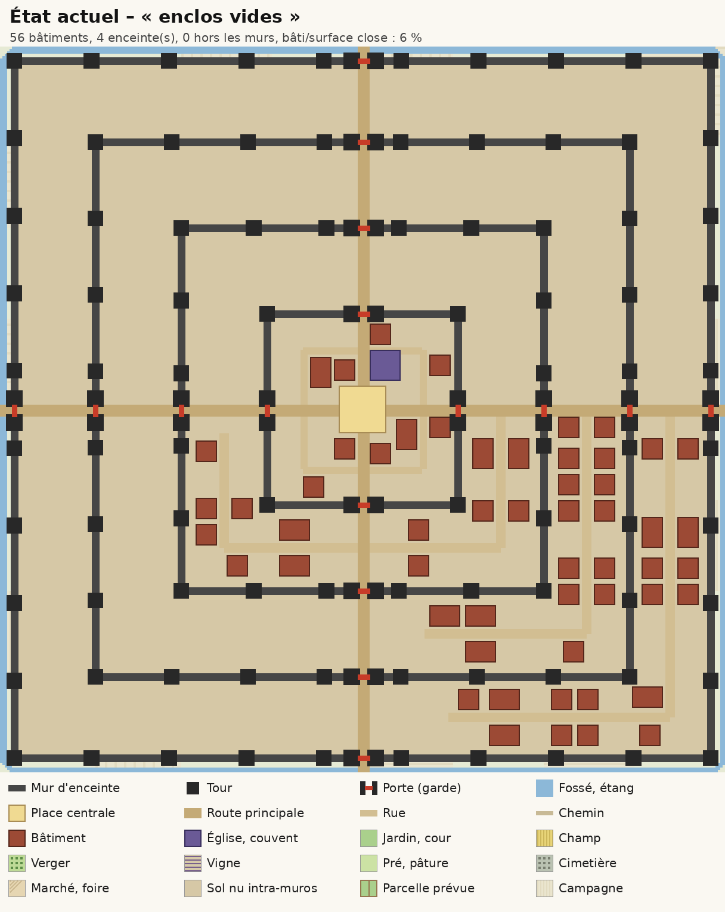
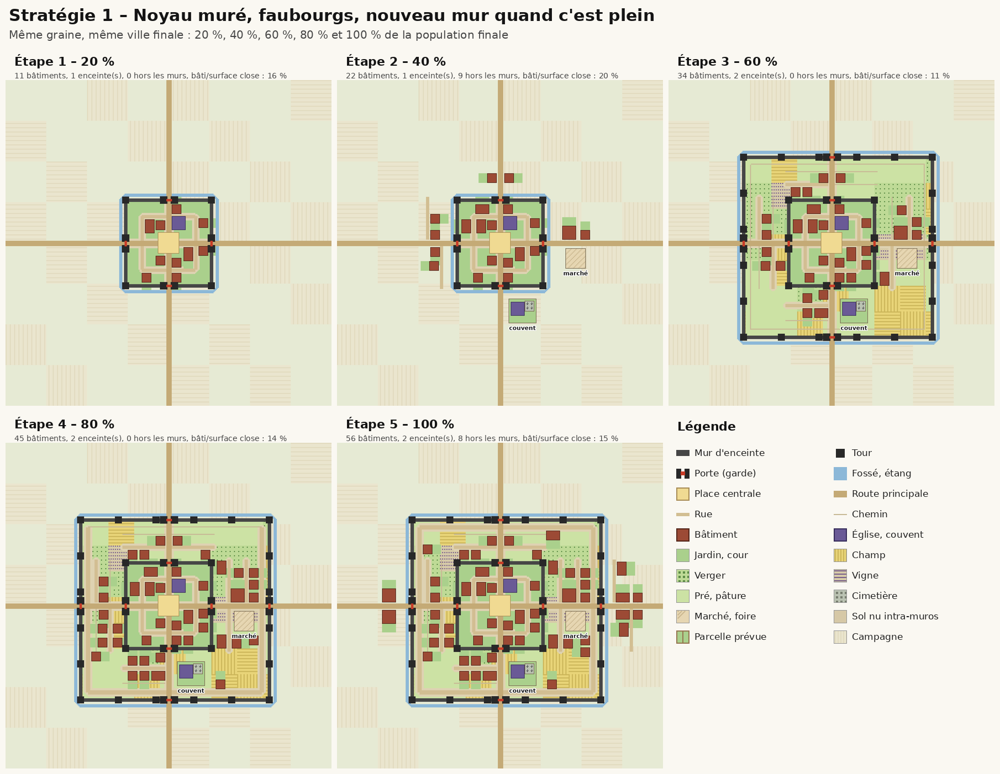
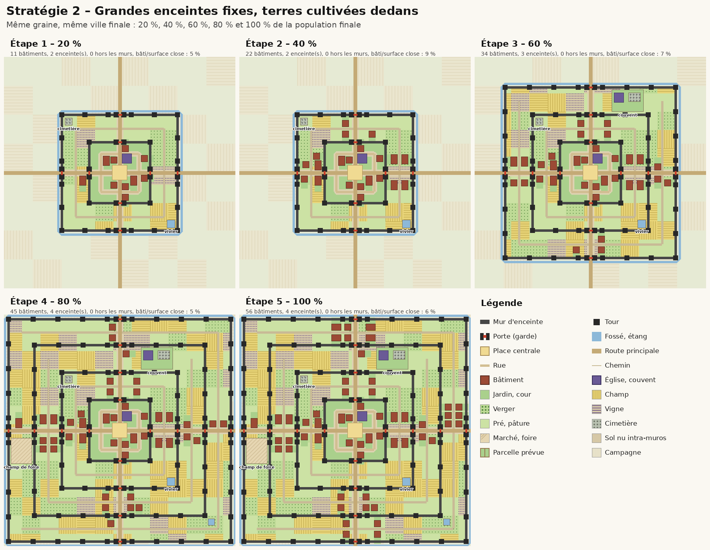
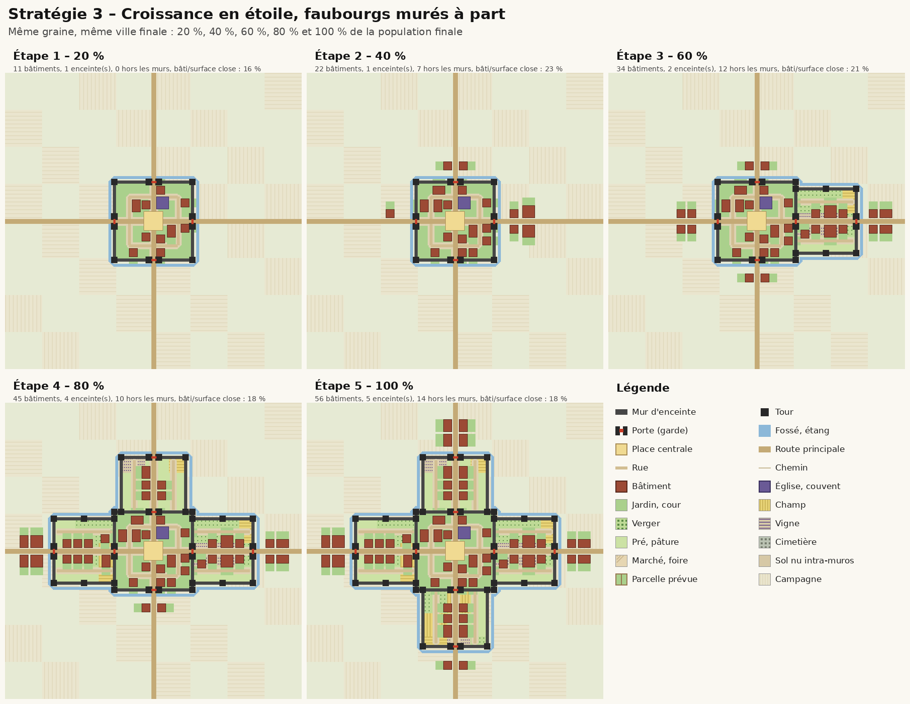
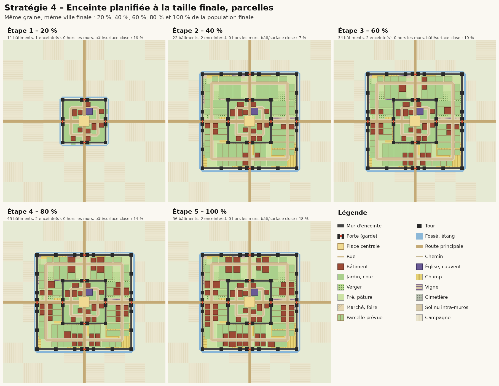
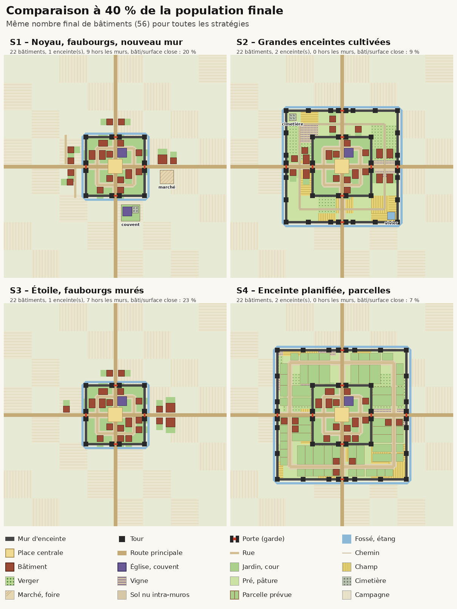
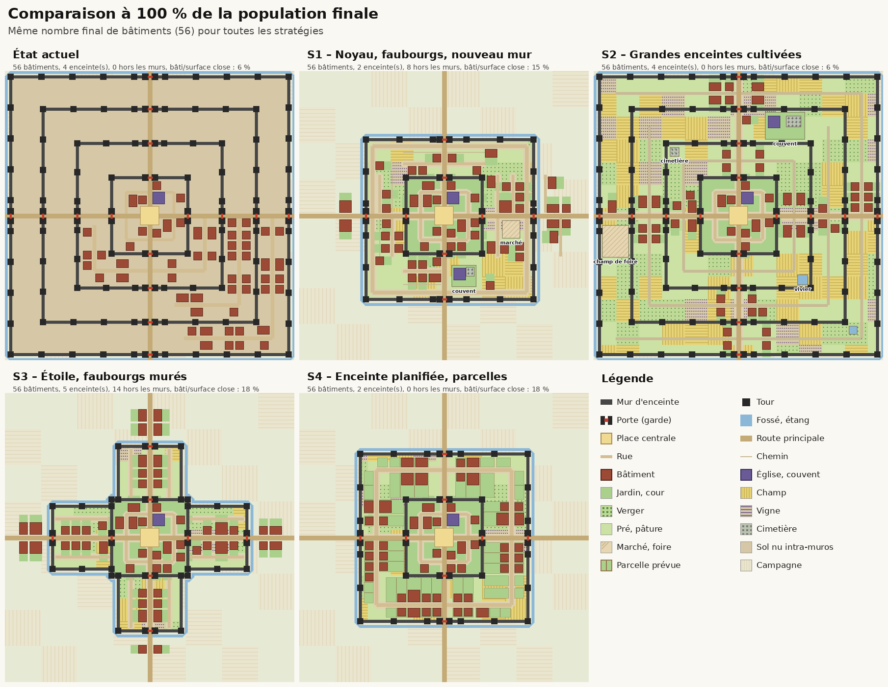

# Exploratory study: fill a walled town and make it grow in stages

Issue: #1186. This study changes no code. The pictures have French labels: see [Labels of the pictures](#labels-of-the-pictures).

## 1. The problem

The generator builds settlements on a square grid, seen from above. Each settlement has a central plaza, streets and
buildings with a rectangular footprint of some fixed sizes (about 9 × 9 cells, sometimes 9 × 13 or 13 × 13). The
smallest settlements have one wall around a compact core. The largest settlements (town, city, capital) also have 1, 2
or 3 more concentric rectangular walls. Each band between two walls has a ring street, with a row of buildings on each
side.

The number of buildings depends on the population. Thus the ring street stops when the settlement has its quota of
buildings. The result: the buildings cover 12 to 19 % of the ground in the small settlements, but only 4 to 8 % in the
outer bands of the large settlements. The player sees "empty enclosures". The population cannot increase much: the
solution must come mostly from the layout, not from more inhabitants.

The picture below shows this state with the script of the study (56 buildings, 4 walls). The measured coverage is 15 %
in the core, then 7 %, 5 % and 4 % in the bands.

All the pictures of the study use the same final town of 56 buildings and the same seed. Thus the strategies stay
comparable. The numbers are orders of magnitude for the pictures, not final settings.

## 2. What the history of real towns shows

### 2.1 The walls were often too large for the town

The large medieval walls were almost never full. A town built a wall for its future growth, to enclose suburbs that
were already there, or for prestige and tolls. Then the growth often stopped.

- **Cologne.** The medieval wall is from 1180 and had 12 large gates [5]. A view of 1572 shows vines and gardens between
  the lines of the fortifications. A survey of the 17th century gives about 30 % of the ground inside the walls for
  them [1]. These gardens and vines stayed mostly with no buildings until the 19th century [2]. The economic decline of
  the town from the 17th century also explains large areas with no buildings [5]. Not verified: the exact area inside
  this wall.
- **Rome.** The Aurelian Wall (271–275) is 19 km long and encloses about 1,400 ha [4]. In the Middle Ages, the
  inhabited town becomes smaller, near the Tiber. The rest, the *disabitato*, becomes countryside inside the walls:
  vines and fields on the slopes and in the valleys, animals that graze among the ruins, and fortified estates of large
  families [3].
- **Florence.** The wall of 1172–1175 encloses about 75 ha. The large communal wall (started in 1282 or 1284, finished
  in 1333) encloses about 430 ha. It encloses growing suburbs and religious centers, and it also gives tolls at the
  gates [6]. After the plague and the fall of the population, a large part of the space inside the walls has crops,
  pasture and gardens [6]. This source is a popular website: a scholarly source must confirm the numbers.
- **Paris.** The wall of Philip II Augustus (1190–1213) encloses 253 ha. It also had the purpose to encourage the use of
  the land with no buildings inside the walls. This land could feed the population during a siege [7].
- **Prague, New Town.** It starts in 1348 on about 250 ha, with a wall of about 3.5 km and four gates. On the east side,
  the wall has a tower about every 100 m [18]. The cattle market (now Charles Square) is about 550 × 150 m [18]. The town first fills
  around its squares and its main streets [1]. Buildings line most of the streets by about 1372, but large areas in the
  north and in the south-east stay empty until the 19th century [18]. The source [18] also gives 7.5 km², and this
  number does not agree with the 250 ha. The study uses 250 ha with caution.
- **Bruges.** Large empty spaces are between the first wall and the second wall [2]. Not verified: the dates of these
  walls.
- **Siena.** The "green valleys" are inside the medieval walls, very near the Piazza del Campo. Generations of peasants
  grew vegetables there, and this kept them out of the built town [16]. The epidemics from 1348 devastate the town [17].
  Not verified: the dates of these crops and their area. The study found no source for them.
- **Ghent.** In about 1300, Ghent has about 50,000 inhabitants. After Paris, it is the largest town of Europe north of
  the Alps [15]. Not verified: the area inside the walls and the part of the land with no buildings. This point stays
  open.

Conclusion for the game: **a wall that is half empty is normal in history**. The "empty" look of the generator does not
come from too few houses. It comes from the absence of all the things that used this ground in reality.

### 2.2 The suburbs in front of the gates

At its origin, a suburb (*faubourg*) is a settlement that grows along a road out of a gate of the town. It often has the
name of this road [8]. The excavations in Coventry show three suburban streets just in front of the gates. Buildings
line the street, with yards behind them. The town wall stands very near one of these streets, probably from the first
half of the 15th century [14]. Some trades, for example the cattle market or the horse market, were preferably outside
the walls. Some gates got a center of trade in front of them [12]. The convents, mostly of the mendicant orders, and the
hospitals were often at the edge of the town, inside or outside the walls [12].

In the early modern period, the fortifications need open ground in front of the ramparts. In Vienna, the glacis is open
ground in front of the walls, for a clear field of fire. The suburbs are between the glacis and an outer wall, the
*Linienwall* [19].

### 2.3 The plot, the garden behind it, and the fill

A burgage plot is a long and narrow strip of land, with a narrow front on the street [9]. The burgher often got a garden
at the back of his plot. A later division of the plots could put buildings on these gardens [1]. When the population
increases, the plots divide into smaller units [9]. Conzen gives the name *burgage cycle* to this sequence: buildings
fill the back of the plots step by step, then a clearance, a period of fallow, and a new cycle [10].

### 2.4 The fringe belts

In urban morphology (the school of Conzen), a *fringe belt* is a zone of plots of different shapes and sizes. It
separates districts of different periods. It usually has large green spaces, buildings of institutions or monuments,
few houses and few streets [10]. In his study of Alnwick, Conzen describes these additions around the old core as a
zone that is quite irregular, wide, and broken in many points [11]. These zones can stay "urban fallow", and they can
fill later [13]. Conzen also uses the term *fixation line*. As far as the study knows, it is a limit (often a wall) that
stops the growth for a long time, and a fringe belt forms around it. The sources that the study read do not give the
exact definition [12]. Thus this point is not verified.

### 2.5 Empty does not mean abandoned

The archaeologists make a difference between the ground that never had buildings, the abandoned plots, and the green
spaces (gardens, fields, vines) [1]. The empty ground at the edge often was a reserve for growth. In Wrocław, plots
behind the first row around the market stay empty until the first half of the 13th century [1]. The open spaces were
"active": food, wealth, community life [2]. The cemeteries had a use for trade, games, meetings and even metal work [2].
In Lier, the future large market square was first waste ground [2]. Traces of ploughing inside the town were also found
in Stralsund (1260s–1270s) [1].

### 2.6 What the procedural generators do

- **Roads that follow a density map.** A classic method makes the roads with a rewriting system (L-system). "Global
  goals" extend it, for example to follow a map of the population density, and "local constraints" control it. Then the
  method divides the blocks into lots and places the buildings [20].
- **Agents that build over time.** Another method uses "developer" agents on a grid. Each type of land use (housing,
  commerce, industry, park) selects sites with a weighted score (distance to the roads, local density, and other
  criteria). Road agents extend the streets into the empty land and connect the networks. The development occurs over
  time, thus the plots have different ages [21].
- **Villages that grow by events.** A third method places seeds of buildings with interest functions (distance to a
  road, to a place of worship, to the water, to a fortification, and a dominant height). It connects each building to
  the network with a path of minimum cost, and it uses the existing roads again. Then it divides the land into plots
  perpendicular to the roads. In this method, the walls are obstacles, and the fortification is a criterion of
  attraction [22].
- **Online medieval town generator (Watabou).** It gives towns with no walls and the outskirts of a town. At the start,
  only the zones near the gates have inhabitants outside the walls [23]. The author also tested a "road-centric"
  method, where the town grows along organic roads, in place of a method with blocks [24].

Key point: the good generators **first decide where the density goes** (center, roads, gates), then fill. They also
**give a function to the ground with no buildings**.

## 3. Visual principles for a town that is partly full

1. **The density follows an order.** First the plaza and the market, then the main streets between the plaza and the
   gates, then the areas near the gates (inside and outside). The secondary streets and the corners between two roads
   come last. An empty corner is normal. An empty main street is not normal.
2. **Continuous fronts, green behind them.** The buildings make almost continuous street fronts. Behind each building,
   a yard or a garden. The garden makes the link between the house and the field.
3. **A gradient, not a sharp limit.** From the center to the wall: houses close together → houses with gardens →
   orchards and vegetable gardens → fields, vines, meadows. The large enclosures (convent, hospital, cemetery, cattle
   market, training ground) go in this edge zone.
4. **All the ground has a use.** Flat bare ground gives the "empty" look. Fields in strips, orchards in dots, vines in
   rows, meadows, ponds or fish ponds, cemeteries, fairgrounds: each area tells why it has no buildings.
5. **The empty streets become tracks.** A street with no houses shows as a narrow dirt track between fields, not as a
   paved street. A wide empty street is the strongest sign of a bad plan.
6. **The suburb is a line along the road.** In front of each gate: a clear space (ditch, glacis), then houses on the
   two sides of the road, some lanes to the side, and one or two large facilities (cattle market, convent, hospital).
   The most important roads have the longest suburbs: this asymmetry makes the town look alive.
7. **A new wall has a reason.** It comes when the suburbs are important, and it encloses them with a margin (as in
   Florence). The old wall stays inside, with no ditch, as a second line or as the limit of the old district.
8. **A coverage target.** Aim for about 15 to 25 % of built ground inside the outer wall, and 20 % or more in the core.
   Below 10 %, the player sees an empty enclosure, also with good decoration.

## 4. Four layout strategies

The pictures show each strategy at 20 %, 40 %, 60 %, 80 % and 100 % of the final population (56 buildings). The stages
are snapshots of one simulation: the final town is the same for all the stages of a strategy.

### Strategy 1 – Walled core, suburbs, new wall when the town is full (idea of the designer)

**Rule.** At the start, one wall around the core. The inside fills until a density threshold (here 19 % of the
enclosed ground) or until it has no more space. Then the buildings go outside, along the main roads near the gates,
then in perpendicular lanes. A cattle market and a convent come in front of the gates. When the number of buildings
outside the walls reaches a threshold (here 10), a new wall encloses the suburbs. Then the new band fills (threshold
15 %), and new suburbs come in front of the new wall. The script keeps the strip of the future wall free from the
start: thus the new wall never cuts a house.

**What the player sees.** 20 %: a compact core. 40 %: the core is full, lines of houses go out of the gates, the market
and the convent are outside. 60 %: the new wall encloses the suburbs, the market and the convent. The rest of the band
has gardens, orchards and fields. 80 %: the band fills near the gates and along the street of the rampart. 100 %: new
suburbs come in front of the gates of the second wall.

**Strengths.** The map shows the history of the town. The density is where the player expects it. The final coverage
is about 15 % of the enclosed ground, and 6 % in the current state. The number of walls follows the real density, not
the rank of the settlement. The suburbs make the gates alive.

**Weaknesses.** The houses outside the walls have no protection, and this must have a meaning in the game. With an
almost fixed population, a capital can end with 2 walls only: the number of walls no longer shows the rank. The
positions of the future walls need a plan in advance (or the generator must accept demolitions). A wall that appears
at once can surprise the player if the growth occurs in front of the player.

**Defense.** The wall protects the core, then the first ring. The suburbs have no wall: they are a natural target for
raids, and they need palisades or patrols. The old wall becomes a second line. Few gates for each wall (4), thus few guard posts.

**Difficulty: medium.** A simple state machine (fill the inside → suburbs → new wall). But the generator must keep the
line of the future walls free, and it must manage the "planned" streets that show only when they have inhabitants.

### Strategy 2 – Large fixed walls, farmland inside

**Rule.** The current walls stay (their number depends on the rank). The buildings go first into the core, then along
the main roads across the bands, from the gates, then near the crossings with the ring. The ring streets become dirt
tracks. The rest of the ground gets a use: fields, orchards, vines, meadows, a convent with its cemetery, a cemetery, a
fish pond, a fairground near a gate. This is the model of Cologne or Florence.

**What the player sees.** The outer walls come early, at their final size. The town makes a cross of houses through an
enclosed countryside. The buildings have the same distribution by band as the current state (10, 13, 16, 17): only the
layout and the decoration change.

**Strengths.** A minimal change of the generator. The rank keeps its identity (number of walls). A solid historical
model. The enclosed ground can hold a system of food or production.

**Weaknesses.** The built coverage stays low (about 6 %). The walls stay visibly too large. If the farm decoration is
too regular, it looks like a filler, and the "empty" look comes back.

**Defense.** Very long walls to guard, many gates (4 for each wall). But the enclosed land feeds the town during a
siege, as in Paris [7].

**Difficulty: low.** It is mostly a layer of land use and a new order of placement.

### Strategy 3 – Star growth, suburbs with their own walls

**Rule.** A wall around the core. The suburbs grow along each road. When a suburb reaches a threshold (here 5 houses),
it gets its own narrow wall, attached to the previous wall, with two lanes parallel to the road. When it grows past its
wall again, a new segment comes. The old end wall stays as an inner wall.

**What the player sees.** A core, then walled arms that extend along the main roads, the most important road first. The
final silhouette is a cross.

**Strengths.** Very compact: 16 to 23 % of built ground at all the stages. No large empty area. A strong and
recognizable silhouette. Each arm is a district with its gate, thus each road has an identity.

**Weaknesses.** Much wall for few houses. The inner corners between two arms stay outside the walls. The shape of the
junctions of the walls is more difficult. Not verified: how frequent this shape is in history. Fortified suburbs
existed, but the study did not confirm a case of a cross shape.

**Defense.** Defense in layers: the gate of the arm, then the gate of the core. But many gates and weak inner corners.

**Difficulty: medium to high.** Walls with three sides, successive extensions, junctions and ditches to manage.

### Strategy 4 – Wall planned at the final size, plots

**Rule.** The generator knows the final population. When the core is full, the generator builds one outer wall. Its size gives a
final town that covers about 18 % of the enclosed ground. At the same time, the generator draws the streets and all the
plots (long and narrow, as burgage plots). The plots first get buildings on their front, near the gates and the main
roads. Later, the back of some plots gets a second building (burgage cycle). A plot with no building shows as a garden
with its limits.

**What the player sees.** A core, then a large wall cut into green plots. The houses appear first near the gates, then
everywhere, then at the back of the plots.

**Strengths.** Deterministic and simple. The empty space reads as a planned development, thus as an intention. Final
coverage of about 18 %. Near to the planned new towns, as the New Town of Prague [18].

**Weaknesses.** Less organic. At the first stages, many empty plots. No suburb, thus less life at the gates.

**Defense.** A compact wall, easy to guard, with 4 gates. The core keeps its wall as an inner keep.

**Difficulty: low to medium.**

### Comparison

At 40 % of the population, the strategies show very different stages: suburbs in front of the gates (S1), a large wall
that is almost farmland (S2), the first arms (S3), empty plots of a planned development (S4).

At 100 %, with the current state for reference:

| Strategy | Walls at the end | Built ground inside the wall | Suburbs | Difficulty |
|---|---|---|---|---|
| Current state | 4 | 6 % | no | – |
| S1 Core, suburbs, new wall | 2 | 15 % | yes | medium |
| S2 Large farmed walls | 4 | 6 % (but the ground has a use) | no | low |
| S3 Star, walled suburbs | core + 4 arms | 18 % | yes, at the end of the arms | medium to high |
| S4 Planned wall, plots | 2 | 18 % | no | low to medium |

The script also writes one picture for each stage, in large format (about 1200 px wide): `s1_etape1.png` to
`s1_etape5.png`, and the same for `s2`, `s3` and `s4`. These pictures are not in the repository. Run the script to get
them (see [The script](#7-the-script)).

## 5. Recommendation

The study proposes to try first **strategy 1, with two elements of the other strategies**:

1. **At once, the land use layer of strategy 2.** It also applies to the current generator: gardens behind the houses,
   fields, orchards, vines, meadows, cemetery, convent, cattle market, and streets with no houses that show as tracks.
   This is the fastest visual gain, and it serves all the other strategies.
2. **Then, the growth of strategy 1**, with the technique of strategy 4. First calculate the final town (positions of
   the walls, planned streets, plots). Then show the stages: show the elements in order. Thus the next wall never cuts a
   house, and the same seed always gives the same town at each stage.
3. **Keep strategy 4 as the fallback solution**, if the houses outside the walls give a problem in the game.

Strategy 3 is interesting for a special settlement (bridge town, stage town on a road), but it costs too much for a
general case.

## 6. Questions for the designer

1. Must the number of walls stay tied to the rank (town, city, capital), or can it follow the real density? If a
   capital has only 2 walls, how does the game show its rank (citadel, palace, monumental gate)?
2. Are houses outside the walls acceptable in the game? Are they targets for raids, and can the player protect them
   (palisade, towers)?
3. Does the population change during a game, with stages that the player sees, or does the generator make the
   settlement only one time at its size?
4. Does the enclosed land (fields, orchards, meadows) have a role in the game (food, resources), or is it decoration?
5. Can the generator add buildings that do not count in the population quota (barns, workshops, stables, convent,
   warehouses)?
6. Which target of built coverage do you want inside the outer wall (for example 15 %, 20 %, 25 %)?
7. Must the walls stay centered rectangles, or can they move off the center, be irregular, and follow the terrain or a
   river?
8. What occurs to the old wall when a new wall comes: does it stay complete, does it become the limit of a district, or
   does a street replace a part of it?
9. How many gates for each wall, and which cost or which number of guards for each gate?
10. Do terrain, water or roads of different importance make the town asymmetric?

## 7. The script

`draw.py` builds the five cases (current state and four strategies) with the same seed and the same final number of
buildings. Then it writes the pictures into `img/` next to the script: the sheets of this folder, and the 20 pictures of
the single stages. It uses numpy, scipy and Pillow. Command: `python3 draw.py`.

Main settings (at the top of the file and in each strategy function): size of the grid (304 cells), final number of
buildings (56), stages (20 to 100 %), density thresholds, suburb thresholds that start a new wall, reserved position of
the future walls of strategy 1, target density of strategy 4.

## 8. Not verified

- The area inside the wall of 1180 of Cologne, and the area inside the wall of the 14th century of Ghent.
- The part of the land with no buildings inside the walls of Ghent.
- The dates and the area of the crops in the "green valleys" of Siena.
- The numbers for Florence come from a popular website [6].
- The exact definition of the "fixation line" of Conzen.
- The area of the New Town of Prague (250 ha or 7.5 km², by the passage of the source [18]).
- How frequent walled suburbs in a cross shape were in history (strategy 3).

## 9. Sources

1. Cembrzyński, P. and Radomski, M., "'Empty' space in Central European medieval towns through an interdisciplinary
   perspective", *Urban History*, vol. 49, no. 1, 2022.
   https://www.cambridge.org/core/journals/urban-history/article/empty-space-in-central-european-medieval-towns-through-an-interdisciplinary-perspective/BFE26C81EB0F5D3BE4E4519F96802C18
2. Jervis, B., Cembrzyński, P., Fleisher, J., Tys, D. and Wynne-Jones, S., "The Archaeology of Emptiness? Understanding
   Open Urban Spaces in the Medieval World", *Journal of Urban Archaeology*, vol. 4, 2021.
   https://eprints.whiterose.ac.uk/179447/1/j.jua.5.126601.pdf
3. Carleton College, "The Disabitato: Farms, Families, and Open Space". https://cgmr.carleton.edu/items/show/468
4. Wikipedia, "Aurelian Walls". https://en.wikipedia.org/wiki/Aurelian_Walls
5. KuLaDig (LVR), page on the fortifications of Cologne. https://www.kuladig.de/Objektansicht/Drucken/O-63687-20130403-2
6. "City Walls of Florence: A System of Defensive Circuits", Ancient History Sites.
   https://www.ancient-history-sites.com/?p=196894
7. Wikipedia, "Wall of Philip II Augustus". https://en.wikipedia.org/wiki/Wall_of_Philip_II_Augustus
8. Wikipedia, "Faubourg". https://en.wikipedia.org/wiki/Faubourg
9. Wikipedia, "Burgage". https://en.wikipedia.org/wiki/Burgage
10. Whitehand, J.W.R., "British urban morphology: the Conzenian tradition", *Urban Morphology*.
    https://journal.urbanform.org/index.php/jum/article/view/3896 (text:
    https://journal.urbanform.org/index.php/jum/article/download/3896/3218/13149)
11. Conzen, M.R.G., *Alnwick, Northumberland: a study in town-plan analysis* (Portuguese translation, PNUM).
    https://pnum.fe.up.pt/en-gb/alnwick.pdf
12. Larkham, P.J., "Space in the traditional city", *Urban Morphology*.
    https://journal.urbanform.org/index.php/jum/article/download/4493/3517/12211
13. University of Central Lancashire, research poster on the fringe belts.
    https://knowledge.lancashire.ac.uk/id/eprint/9473/1/9473_Fringe%20Belts%20MC%206%2013%20ResEventposter%2011%206%2012.pdf
14. Archaeopress, *Coventry's Medieval Suburbs* (presentation of the book).
    https://www.archaeopress.com/Archaeopress/Products/9781784915629
15. Wikipedia, "Ghent". https://en.wikipedia.org/wiki/Ghent
16. FAI, "Le valli verdi della città di Siena – la valle di Follonica".
    https://fondoambiente.it/luoghi/le-valli-verdi-della-citta-di-siena-la-valle-di-follonica
17. Encyclopaedia Britannica, "Siena". https://www.britannica.com/place/Siena-Italy
18. Wikipedia, "New Town, Prague". https://en.wikipedia.org/wiki/New_Town,_Prague
19. Die Welt der Habsburger, "City walls, bastions and glacis – protection or hindrance?".
    https://habsburger.net/en/chapter/city-walls-bastions-and-glacis-protection-or-hindrance
20. Parish, Y. and Müller, P., "Procedural modeling of cities", SIGGRAPH 2001. https://history.siggraph.org/?p=116923
21. Lechner, T. et al., "Procedural Modeling of Urban Land Use", Northwestern University, technical report.
    https://ccl.northwestern.edu/papers/2006/TR-2007-33.pdf
22. Emilien, A., Bernhardt, A., Peytavie, A., Cani, M.-P. and Galin, E., "Procedural Generation of Villages on Arbitrary
    Terrains", *The Visual Computer*, vol. 28, 2012. https://perso.liris.cnrs.fr/egalin/Articles/2012-villages.pdf
23. Watabou, "Medieval fantasy city generator – 0.3.0: Wall-less layouts, city outskirts, smooth roads".
    https://watabou.itch.io/medieval-fantasy-city-generator/devlog/3091/030-wall-less-layouts-city-outskirts-smooth-roads
24. Watabou, "Experimenting" (log of the generator).
    https://watabou.itch.io/medieval-fantasy-city-generator/devlog/31287/experimenting

## Labels of the pictures

The pictures have French labels. This table gives the English word for each label.

| French label | English |
|---|---|
| Légende | Legend |
| Mur d'enceinte | Town wall |
| Tour | Tower |
| Porte (garde) | Gate (guard) |
| Fossé, étang | Ditch, pond |
| Place centrale | Central plaza |
| Route principale | Main road |
| Rue | Street |
| Chemin | Track |
| Bâtiment | Building |
| Église, couvent | Church, convent |
| Jardin, cour | Garden, yard |
| Champ | Field |
| Verger | Orchard |
| Vigne | Vine |
| Pré, pâture | Meadow, pasture |
| Cimetière | Cemetery |
| Marché, foire | Market, fair |
| Sol nu intra-muros | Bare ground inside the walls |
| Parcelle prévue | Planned plot |
| Campagne | Countryside |
| marché | market |
| couvent | convent |
| cimetière | cemetery |
| vivier | fish pond |
| État actuel – « enclos vides » | Current state – "empty enclosures" |
| Stratégie 1 – Noyau muré, faubourgs, nouveau mur quand c'est plein | Strategy 1 – Walled core, suburbs, new wall when the town is full |
| Stratégie 2 – Grandes enceintes fixes, terres cultivées dedans | Strategy 2 – Large fixed walls, farmland inside |
| Stratégie 3 – Croissance en étoile, faubourgs murés à part | Strategy 3 – Star growth, suburbs with their own walls |
| Stratégie 4 – Enceinte planifiée à la taille finale, parcelles | Strategy 4 – Wall planned at the final size, plots |
| S1 – Noyau, faubourgs, nouveau mur | S1 – Core, suburbs, new wall |
| S2 – Grandes enceintes cultivées | S2 – Large farmed walls |
| S3 – Étoile, faubourgs murés | S3 – Star, walled suburbs |
| S4 – Enceinte planifiée, parcelles | S4 – Planned wall, plots |
| Étape N – X % | Stage N – X % |
| Même graine, même ville finale : 20 %, 40 %, 60 %, 80 % et 100 % de la population finale | Same seed, same final town: 20 %, 40 %, 60 %, 80 % and 100 % of the final population |
| Comparaison à X % de la population finale | Comparison at X % of the final population |
| Même nombre final de bâtiments (56) pour toutes les stratégies | Same final number of buildings (56) for all the strategies |
| N bâtiments, N enceinte(s), N hors les murs, bâti/surface close : X % | N buildings, N wall(s), N outside the walls, built area / enclosed area: X % |
